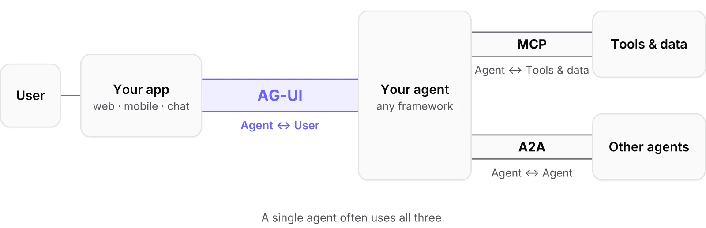

The AG-UI protocol (Agent–User Interaction Protocol) connects an AI agent to the app a person is using through one channel: the app sends a single run input, and the agent answers with an ordered stream of typed events. Everything the user can see of the agent travels in that stream, including text, tool calls, reasoning, shared state and progress. Since version 1.0, each run also reports how it ended, which is what lets a human approval sit between two runs instead of holding a connection open.

Version 1.0 is the first release with a specification behind it. In 0.x the event shapes were defined but much of the behaviour lived in the TypeScript client; 1.0 writes the sequencing, error and compatibility rules down as normative text and generates every SDK's types from one schema. The Python SDK's 1.0.0 package reached PyPI on September 17, 2026, and the framework adapters spent November catching up: the community Kotlin SDK aligned with 1.0 on November 5, and the LangGraph adapter released on November 13 now requires a 1.0 client. InfoWorld published a getting-started guide on November 16.

## AG-UI Protocol Architecture: One Request, One Event Stream {#ag-ui-protocol-architecture}

In the AG-UI protocol, the unit of work is the run: the application sends one `RunAgentInput`, and the agent replies with events bracketed by `RUN_STARTED` and `RUN_FINISHED`. A conversation is a thread of such runs that share a `threadId` and accumulate messages and state. The specification splits the work across four parts:

| Part | Side | What it does |
|---|---|---|
| Application | User-facing | Renders the stream, executes the tool calls it offered, keeps the shared state, decides what needs the user's consent |
| Client (usually an SDK) | Application | Sends the run input and runs every incoming event through one pipeline: compatibility translation, middleware, enforcement, chunk expansion and verification |
| Agent endpoint and framework bridge | Agent | The bridge translates a framework's native events into protocol events; the endpoint speaks a transport binding |
| Middleware | Either | Code installed in the client pipeline that sees each event before enforcement strips anything |

The run input carries `threadId` and `runId`, the conversation `messages`, the application's own `tools`, extra `context` for the model, the last agreed `state`, opaque `forwardedProps` and, when continuing an interrupted run, a `resume` list. The protocol itself carries no framework concepts, which is why one client can face a LangGraph agent today and a Google ADK agent tomorrow. Keeping framework code separate from the runtime that serves it is the same split we covered in [why harnesses now carry production agents](/tutorials/agent-framework-harness-runtime-production/).

Two design principles in the specification explain most of the rules that follow. The only mandatory surface for an agent is the run lifecycle; everything else is a feature it emits when it has something to say. And nothing visible travels out of band, so a recorder holding each run input and the events that answered it can reconstruct what the UI knew at every moment. The specification credits that rule with making the protocol testable, replayable and transport-agnostic.

## AG-UI Events: The Eight Event Families {#ag-ui-events}

AG-UI 1.0 defines 31 event types in eight families, and a client must accept all of them even if it ignores some. Each family follows one of three patterns: lifecycle events open and close something, streaming events go open–content–close, and snapshot–delta events replace a value wholesale or amend it with JSON Patch.

| Family | Events | Pattern | Consumed by |
|---|---|---|---|
| Runs and steps | `RUN_STARTED`, `RUN_FINISHED`, `RUN_ERROR`, `STEP_STARTED`, `STEP_FINISHED` | Lifecycle | The client |
| Text messages | `TEXT_MESSAGE_*` | Streaming | The UI |
| Tool calls | `TOOL_CALL_*` | Streaming | The application |
| Reasoning | `REASONING_*` | Streaming | The UI |
| State | `STATE_SNAPSHOT`, `STATE_DELTA`, `MESSAGES_SNAPSHOT` | Snapshot–delta | The application store |
| Activity | `ACTIVITY_SNAPSHOT`, `ACTIVITY_DELTA` | Snapshot–delta | The UI |
| Subagents | `SUBAGENT_STARTED`, `SUBAGENT_FINISHED`, `SUBAGENT_ERROR` | Lifecycle | The client |
| Passthrough | `RAW`, `CUSTOM` | Standalone | The application, opt-in |

A few ordering rules do most of the work. A stream must begin with `RUN_STARTED` or `RUN_ERROR`, every step opened inside a run must close before the run finishes, and once a run closes the client rejects anything else for it except a new `RUN_STARTED` or a late `RUN_ERROR` reporting a failure that surfaced after success. In the chunked form of text and tool-call streaming, the first chunk must carry the identifiers the opening event would have carried (`messageId`, or `toolCallId` and `toolCallName`), and a later chunk that contradicts them is fatal.

Subagent events are new in 1.0. Delegated work is tagged with `subagentRunId` on the events that can carry it, so a UI can show which worker produced which text or tool call, the kind of attribution a [router-and-worker multi-agent design](/tutorials/deepseek-super-agent-architecture/) needs once its workers' output reaches a user. Activity events, also new, carry structured progress that a UI renders as its own widget rather than as transcript text.

## AG-UI over HTTP and SSE: Request and Response Rules {#ag-ui-http-sse}

AG-UI's default transport is an HTTP POST answered with Server-Sent Events. The client posts the run input as one JSON object with `Accept: text/event-stream`; a run that starts answers `200` with `Content-Type: text/event-stream`, and each SSE `data` field holds exactly one protocol event. A minimal exchange looks like this:

```text
POST /agent HTTP/1.1
Content-Type: application/json
Accept: text/event-stream

{"threadId":"thr-1","runId":"run-1","messages":[…]}

HTTP/1.1 200 OK
Content-Type: text/event-stream

data: {"type":"RUN_STARTED","threadId":"thr-1","runId":"run-1"}

data: {"type":"TEXT_MESSAGE_START","messageId":"msg-1","role":"assistant"}
```

Three rules in this binding catch people who treat it like an ordinary REST call:

- **A 200 is not success.** Input rejected before the run starts (bad JSON, failed validation, refused auth) gets an HTTP error and no stream. A failure after the stream opens arrives in-stream as `RUN_ERROR`, and the client must not infer success from the status code.
- **There is no resumption.** The binding does not use SSE's `Last-Event-ID`. If the connection drops before a terminal event, the run is truncated, and trying again means a new run with a new `runId` carrying whatever the client kept.
- **Framing is pinned.** Producers must use LF line endings, and clients must ignore SSE fields other than `data` and tolerate `: keep-alive` comment lines.

The no-resumption rule moves crash recovery out of the protocol and into whatever hosts the agent. Systems that need runs to survive a restart handle it in the runtime, as [Pi's durable session model](/tutorials/pi-agent-harness-v2-crash-recovery/) does. Version 1.0 also specifies a second binding, HTTP + Protobuf, negotiated by media type on the same POST and sending 4-byte length-prefixed frames generated from the same schema.

## AG-UI Interrupt and Resume for Human Approval {#ag-ui-interrupt-resume}

When an agent needs a person to approve or supply something, AG-UI 1.0 ends the current run and continues in the next one. The run closes with `RUN_FINISHED` whose `outcome` is the interrupt outcome, carrying at least one `Interrupt`. Each interrupt has an `id` unique within the run, an open-ended `reason`, a human-readable `message`, an optional `toolCallId` naming the tool call the approval concerns, and an optional `responseSchema` the app can turn into a form.


*Figure: An approval spans two runs on one thread. Our diagram, based on the AG-UI 1.0 specification; events abbreviated.*

The next run on the same `threadId` carries the answers in its `resume` list, one `ResumeEntry` per interrupt, each naming an `interruptId` and a status of answered or abandoned. The list must cover every interrupt of the run being continued, and leaving one out does not count as abandoning it. Coverage is the client's job: it holds the interrupts the closing event delivered, so it must reject an incomplete list before anything is sent, and the agent does not have to remember the interrupted run at all. An interrupt that expires can no longer be answered, only abandoned, which is how a thread moves past an approval nobody gave in time.

This design keeps no connection open while a person decides, which matters when an approval takes minutes or arrives from another device. It also gives the application a single, explicit place to enforce consent before an agent acts on internal systems, the boundary we looked at in [what changes when agents get internal access](/tutorials/ai-agent-internal-access-security-boundary/).

### Frontend tools vs interrupts

When an agent calls one of the application's own tools, the run ends as a success and the app does the work. The application offers these frontend tools in the run input's `tools`; when the agent calls one, the run finishes with a success outcome that may list the unanswered calls in `pendingToolCallIds`, and the tool's result goes back as a message in the next run's input. The specification separates three endings: success (including a stop on a frontend tool), interrupt (the agent asked for something and names it), and cancelled (the run was told to stop and asks for nothing). A client must not show a cancelled run as successful.

## AG-UI vs MCP and A2A: Which Protocol Connects What {#ag-ui-vs-mcp-a2a}

AG-UI, MCP and A2A cover three different connections, and one agent often uses all three at once. MCP (Model Context Protocol) connects an agent to tools and data, A2A (Agent2Agent) connects an agent to other agents, and AG-UI connects an agent to the user through the application they are using.


*Figure: Where AG-UI sits relative to MCP and A2A. Source: ag-ui-protocol/ag-ui README.*

| | AG-UI | MCP | A2A |
|---|---|---|---|
| Connects | Agent ↔ user-facing app | Agent ↔ tools and context | Agent ↔ other agents |
| Who opens the exchange | The application, with `RunAgentInput` | The agent, as a client of a tool server | One agent, delegating to a remote agent |
| Typical question | What should the person see, and what do they approve? | Which tool or data source does the agent need? | Which other agent should take this subtask? |

The practical split is by who is waiting. If a person is watching the result render, the connection to them is AG-UI; the agent may meanwhile call MCP servers for tools and hand subtasks to other agents over A2A. The AG-UI project also describes handshakes that let an AG-UI client front agents that speak MCP or A2A, so an app built on AG-UI client libraries can reach those agents without a second integration. On the tool side, MCP's own transport is moving toward stateless servers behind gateways, which we covered in [Stateless MCP and the rise of the agent gateway](/tutorials/stateless-mcp-agent-gateway/).

## AG-UI vs A2UI: Transport and Payload {#ag-ui-vs-a2ui}

AG-UI and A2UI work at different layers despite the similar names. A2UI, from Google, is a generative UI specification: the agent describes a surface built from components in a catalog the client trusts, and the client renders it with native widgets in React, Lit, Angular, Flutter, SwiftUI or Jetpack Compose. AG-UI is the runtime connection that carries such payloads, along with everything else, between agent and app.

| | AG-UI | A2UI |
|---|---|---|
| Kind | Agent–user interaction protocol | Generative UI specification |
| Answers | How do the agent and the app talk during a run? | What UI should the app render? |
| Carries | Run lifecycle, text, tool calls, state, reasoning, activity, subagents | Surfaces, components and data-model updates |
| Transport | HTTP + SSE or HTTP + Protobuf | Any: AG-UI, A2A, MCP, SSE, WebSockets or gRPC |

A2UI's documentation says it is transport-agnostic and lists AG-UI as one standard binding. In CopilotKit's runtime, enabling A2UI injects an A2UI generation tool and translates its tool calls and state deltas into AG-UI events for Google ADK, LangGraph and AWS Strands agents. The AG-UI repository also publishes an `@ag-ui/a2ui-middleware` package, which shipped two releases in the week of November 10. AG-UI's docs place OpenAI's Open-JSON-UI and the iframe-based MCP-UI in the same category as A2UI, and AG-UI can carry those or a team's own format as well.

## AG-UI 1.0 Migration: What Changes for Existing Agents {#ag-ui-1-0-migration}

Moving an AG-UI 0.x agent or app to 1.0 is mostly additive, and the wire format is unchanged. The migration guide states compatibility in both directions: a 0.x agent keeps working against a 1.0 TypeScript client, which translates retired shapes at an always-on compatibility boundary and warns on each one, and a 1.0 agent keeps working against a 0.x client, which ignores events and fields it does not know.

What producers have to touch:

- **Declare `protocolVersion` on `RUN_STARTED`.** A 1.0 producer must do this, and no SDK adds it when you build the event yourself. Use the SDK's constant, and do not echo the version from the run input; the declaration states the producer's own version.
- **Replace `THINKING_*` with `REASONING_*`.** The reasoning family adds spans, streamed reasoning messages matched by `messageId`, and `REASONING_ENCRYPTED_VALUE` for provider artefacts the client stores and returns without reading.
- **End runs with an outcome.** `RUN_FINISHED.outcome` is optional and absent means success, so old producers stay conformant, but interrupts and deliberate cancellation now have their own outcomes.
- **Expect stricter clients.** In 1.0, unknown events and fields pass through translation and middleware and are then dropped with a warning, while a malformed value of a known event is fatal. Kotlin's 0.5.0 release notes warn that strict decoding "may reject previously accepted payloads".

The compatibility shims for retired shapes are listed in the repository's `DEPRECATIONS.md`, with provisional expiry twelve months from when each shim was written. Other 1.0 additions are optional: per-provider token usage on `RUN_FINISHED` and `RUN_ERROR`, multimodal content parts on input messages and tool results, and an `AgentCapabilities` declaration now defined once in the schema.

## AG-UI Deployment on AWS AgentCore and Microsoft Agent Framework {#ag-ui-deployment}

Two cloud agent platforms document AG-UI directly. Amazon Bedrock AgentCore Runtime publishes an AG-UI protocol contract: the agent runs as an ARM64 container listening on `0.0.0.0`, port 8080 by default, receives `RunAgentInput` on `POST /invocations`, and streams events over SSE or a WebSocket. AgentCore adds a session header for isolation and passes the payload to the container without validating it, so input checks stay the agent's responsibility.

Microsoft's Agent Framework documentation walks through AG-UI's seven showcase scenarios: agentic chat, backend tool rendering, human in the loop, agentic generative UI, tool-based generative UI, shared state and predictive state updates. Support differs between its C#, Python and Go SDKs, so check the language tab before planning on a scenario.

For a team choosing a starting point, the order of work follows from the specification. Get the run lifecycle and text streaming right first, since that is all a producer must emit. Add shared state with snapshots and JSON Patch deltas once the UI needs to show agent-owned data. Use interrupts for approvals and frontend tools for actions the app should perform itself, and pick a generative UI format such as A2UI only when text and app-defined components stop being enough.

## References {#references}

1. AG-UI. "Specification 1.0": Architecture, Event Streams, HTTP + Server-Sent Events, Interrupts and Resume. Read November 17, 2026. [docs.ag-ui.com/spec/1.0](https://docs.ag-ui.com/spec/1.0/architecture)
2. AG-UI. "Key Changes" (1.0 vs 0.x) and "Migrating to 1.0". [docs.ag-ui.com/spec/1.0/changelog](https://docs.ag-ui.com/spec/1.0/changelog) · [docs.ag-ui.com/migrating-to-1-0](https://docs.ag-ui.com/migrating-to-1-0)
3. AG-UI. "MCP, A2A, and AG-UI" and "Generative UI". [docs.ag-ui.com/agentic-protocols](https://docs.ag-ui.com/agentic-protocols) · [docs.ag-ui.com/concepts/generative-ui-specs](https://docs.ag-ui.com/concepts/generative-ui-specs)
4. A2UI Project. "A2UI documentation" (v1.0, transports and AG-UI binding). [a2ui.org](https://a2ui.org/)
5. Amazon Web Services. "AG-UI protocol contract", Amazon Bedrock AgentCore Developer Guide. [docs.aws.amazon.com](https://docs.aws.amazon.com/bedrock-agentcore/latest/devguide/runtime-agui-protocol-contract.html)
