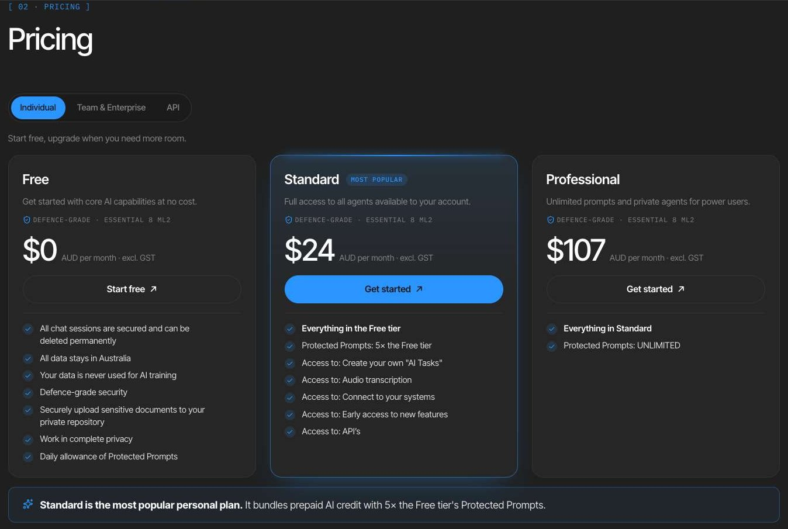
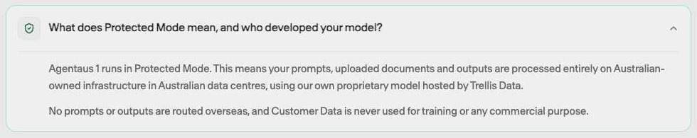

<strong>Agentaus AI is Trellis Data's chat assistant and API, and its main difference from ChatGPT and Claude is where your data goes.</strong> Trellis says prompts, files and outputs are processed on its own cloud in Australian data centres and are never used for training, on every plan including the free one. Its new model, Agentaus 1, is pitched as a 220-billion-parameter Australian model, but Trellis has published no benchmark table and has changed how it describes the model's origin.

Canberra-based Trellis Data announced Agentaus 1 in a release dated November 10, 2026, and founder and CEO Michael Gately posted on November 17 that the model was "open to the world". His post listed three numbers: 220B parameters, 84.4% on MMLU-Pro and a world rank of 43rd. The product around the model is aimed at Australian businesses and government agencies, and the questions buyers ask are practical ones: how its data terms compare with ChatGPT and Claude, what it costs, and how much of the model story can be checked.

## Agentaus AI vs ChatGPT and Claude: data training and retention {#agentaus-ai-vs-chatgpt-and-claude-data-training-and-retention}

Agentaus AI never trains on customer data, and that applies to every plan. Trellis's FAQ says prompts, outputs and files "are never used to train models or for any other purpose", and that the rule sits in the User Agreement, "so there's nothing to opt out of." ChatGPT and Claude draw the line by plan instead, as Switzer's comparison of the three services sets out:

| Service and plan | Used for model training? | Where it is written |
|---|---|---|
| Agentaus, all plans including Free | No; no setting to change | Agentaus FAQ and User Agreement |
| ChatGPT Free, Plus and Pro | May be used unless the user opts out in settings | OpenAI policy, as reported by Switzer |
| ChatGPT Business, Enterprise and API | Not used by default | OpenAI policy, as reported by Switzer |
| Claude Free, Pro and Max | User chooses; if allowed, data is kept for five years instead of 30 days | Anthropic policy, as reported by Switzer |
| Claude for Work, Claude for Government and API | Consumer training terms do not apply | Anthropic policy, as reported by Switzer |

So the gap is widest for individuals and small teams on consumer plans. A company already paying for ChatGPT Enterprise or the Claude API gets a no-training default from both vendors; for that buyer the remaining question is where the data is processed, which the next section covers.

Retention is the other half of the comparison. Agentaus keeps chats and uploads for as long as the subscription runs, with no fixed time limit. Deleting a chat erases it from live systems, and backup copies are removed "as soon as practical". After a subscription ends there is a seven-day reactivation window, then the data is permanently deleted. Gately's launch post put it more simply ("Delete a chat and it's gone for good"); the FAQ is the version to rely on.

## Agentaus Protected Mode: where your data is processed {#agentaus-protected-mode-where-your-data-is-processed}

Protected Mode means requests are handled on Trellis Data's own sovereign cloud, which the FAQ says is "not AWS, Azure, or other public hyperscalers", in Australian data centres that also carry Australian government workloads. Trellis does not name the facility operators, their locations or its sub-processors, citing security. Customers can also install Agentaus on their own systems or run it fully offline on disconnected networks; the Enterprise tier covers on-premises and air-gapped deployment.

The certifications are listed with their limits. Trellis has held ISO/IEC 27001 since 2022. Its Essential Eight Maturity Level 2 rating is a self-assessment against the Australian Signals Directorate's model, with a formal independent assessment "scheduled within 12 months", and deployment on IRAP-assessed infrastructure is available on request. A government buyer that requires an independent Essential Eight assessment today will need to ask for the timeline.

Until this week the product also had a second path. Switzer reported that, as of November 18, every plan included an External Mode that sent prompts to "global engines", with the Standard plan bundling "monthly prepaid credit for Claude & ChatGPT"; Protected Mode was the onshore option. The pricing pages read on November 19 no longer list External Mode or the Claude and ChatGPT credit, although the footnote under the personal plans still says Standard "bundles prepaid AI credit". Anyone who signed up earlier should check which mode their chats ran in, because only Protected Mode carries the stay-in-Australia promise.

## Agentaus AI pricing and API {#agentaus-ai-pricing-and-api}

Agentaus AI pricing starts at A$0 and runs to A$107 a month per person, excluding GST. The personal plans differ mainly in how many Protected Prompts you get:

- **Free (A$0):** a daily allowance of Protected Prompts, document uploads to a private repository, deletable chats.
- **Standard (A$24 a month):** five times the Free allowance, custom "AI Tasks", audio transcription, connections to other systems and API access.
- **Professional (A$107 a month):** unlimited Protected Prompts.

*Agentaus personal plans on November 19, 2026. The footnote still mentions prepaid AI credit, a leftover from the External Mode bundle. Source: Trellis Data.*

Team seats cost A$24 each for two to 19 users and add shared sessions and role-based access. Business seats cost A$107 each for up to 999 users and add single sign-on, audit logs and per-user spend limits. On-premises, cloud-tenant and air-gapped deployments are custom-priced, with a one-year minimum at more than 200 Business seats.

The API is the part developers can try quickly. Trellis's developer docs say it is "compatible with OpenAI's chat completions API": you generate a key in the app, send a POST to `/api/v1/chat/completions`, and the response reports the model as `agentaus`. Tokens cost A$1.70 per million input and A$6.70 per million output. Tool calling currently works from cURL and OpenCode, with Hermes Agent and Pi listed as planned clients. Trellis says Agentaus generates tokens faster than OpenAI and Anthropic, based on their prices as of June 11, 2026, but gives no speed figures, so measure latency on your own prompts before relying on that.

## Agentaus 1 benchmarks: MMLU-Pro and the rank-43 claim {#agentaus-1-benchmarks-mmlu-pro-and-the-rank-43-claim}

Agentaus 1 has three published performance claims, and none comes with a method. Trellis's release says the model "meets leading global benchmarks with a world ranking of 43 for foundational AI models" without naming the ranking; Switzer pointed out the same gap. The 84.4% MMLU-Pro score appears in Gately's launch post, not in a model card or technical report, and Trellis has not published full benchmark results. The 220B parameter count is also unqualified: the release does not say whether the model is dense or a mixture of experts, how many parameters are active per token, or what context length it supports.

That makes Agentaus 1 hard to place against models whose makers publish evaluation tables. MMLU-Pro is a ten-option, graduate-level knowledge test, and 84.4% would put Agentaus 1 level with large open models such as Qwen3-235B-A22B-Thinking-2507, whose model card lists the same figure. A single vendor-reported number without prompts, settings or reasoning mode still cannot be compared directly with leaderboard entries. Other launches show why the details matter: our look at [Qwen4-Max's benchmark chart](/tutorials/qwen4-max-benchmarks/) sets Qwen's own chart beside an independent index score.

On Hacker News, where the launch drew a handful of comments, one reply to the ranking was simply "Ranked 43rd? Yikes." Rank 43 is a modest position for a model marketed as near-frontier, and without knowing the list, it is impossible to say what it is 43rd among.

## Agentaus 1 and DeepSeek: the model origin question {#agentaus-1-and-deepseek-the-model-origin-question}

Whether Agentaus 1 was trained by Trellis or adapted from an open-weight model is still unclear, and Trellis's own wording has moved. According to Switzer, the FAQ as of November 18 said the models in Protected Mode were "customised open-source models hosted by Trellis Data" and that Trellis was "building its own frontier model, with an announcement expected soon." A search-engine snapshot of the FAQ carries the same text. When we read the FAQ on November 19, the answer to "who developed your model?" said something different:

*The FAQ answer as displayed on November 19, 2026, now describing "our own proprietary model". Source: Agentaus FAQ, Trellis Data.*

Both statements can be true at different times: the older answer may have described the models behind Agentaus before Agentaus 1, and a fine-tuned open model can still be proprietary. Trellis has not said which base model, if any, Agentaus 1 starts from.

The question got louder after an X user, Max For AI, posted on November 18 that three runs of the lm.ikale.io fingerprint detector matched Agentaus to `deepseek-v4-flash-0731` at 95% out of 72 reference models, with `deepseek-v4-flash` second. The detector sends prompts asking for long sequences of "random" integers and compares the answers with a library of known models. Its own notice says a result "is a statistical ranking within the reference library. It can be wrong and cannot prove or disprove that any API or model is genuine." The Hacker News commenter who relayed the claim also noted the Qwen model card's identical 84.4% MMLU-Pro figure, then conceded that "on its own, this proves nothing."

The parameter counts do not settle it either. DeepSeek's model card lists DeepSeek-V4-Flash at 284B total parameters with 13B active, against Trellis's 220B for Agentaus 1, and DeepSeek's MIT licence allows commercial fine-tuning. A pruned or distilled derivative could land at a different size, and a different model could share a fingerprint. Weight-level analysis, like the [forensics on DeepSeek-V4's training hardware](/tutorials/deepseek-nvidia-blackwell-training/), needs access to the weights, which Trellis has not released. For more on the DeepSeek models in question, see our [DeepSeek topic page](/topics/deepseek/).

For buyers, the base model is a disclosure question. The Australian Government is seeking to introduce mandatory AI safety and security protections, and Gately told Technology Decisions that Agentaus 1 "and all of our products already meet these standards." Agencies assessing the model will want its provenance in writing.

## Sovereign AI models: what Agentaus covers {#sovereign-ai-models-what-agentaus-covers}

Sovereign AI models are usually sold on three separate promises: data stays in the country, the provider answers to local law, and the model itself is built locally. Agentaus documents the first two in detail, with Australian data centres, Trellis's own infrastructure, an Australian data processing agreement aligned with the Australian Privacy Principles, and offline deployment for classified networks. The third promise, a locally trained foundation model, is the one that Trellis's FAQ described differently a week apart and that outside observers are questioning.

Many organisations get the first two without the third by running an open-weight model on infrastructure they control. Revolut, for example, put [2,000 engineers on a self-hosted GLM model](/tutorials/glm-for-coding/) rather than sending code to an outside API. Agentaus packages that kind of setup as a managed service with Australian hosting, document search across Word, PDF and connected systems, and MCP connectors. Its customers include other model builders: Trellis says Agentaus powers Dukes, a model from Indigenous ICT provider Gulanga Group that is being integrated with Workato.

## Agentaus AI review checklist for buyers {#agentaus-ai-review-checklist-for-buyers}

An Agentaus AI review for a business comes down to whether the data terms meet your requirements and whether you can get the model details you need. Ask Trellis for these in writing:

1. **Model provenance.** Which base model Agentaus 1 was built from, if any, what was changed, and under which licence.
2. **Benchmarks.** The ranking behind "43rd", and full results with prompts and settings, including how the 84.4% MMLU-Pro score was produced.
3. **Data flow.** Confirmation that your account runs only in Protected Mode, and how web searches are sent out, since the FAQ says Agentaus can search the internet.
4. **Assurance.** The date of the independent Essential Eight assessment, and IRAP details if you need them.
5. **Retention.** How long backups persist after deletion, given the FAQ's "as soon as practical".

If you already use several providers, a [model gateway](/tutorials/model-gateway-enterprise-ai-control-plane/) can route sensitive work to Agentaus's OpenAI-compatible endpoint and other tasks elsewhere, with one set of logs and policies. The free tier is enough to test answer quality and latency on your own documents before paying for seats.

## References {#references}

1. Trellis Data, ["Trellis Data joins global AI ranks with launch of near-frontier sovereign AI model – Agentaus 1"](https://trellisdata.com/newsroom/trellis-data-launches-agentaus-1), November 10, 2026.
2. Trellis Data, [Agentaus FAQ](https://agentaus.com.au/eng/docs/faq), [pricing](https://agentaus.com.au/eng/docs/pricing) and [developer getting-started guide](https://agentaus.com.au/eng/docs/developers/getting-started), accessed November 19, 2026.
3. Luke Hopewell, ["Australia now has its own AI model: how Agentaus compares with ChatGPT and Claude"](https://switzer.com.au/australia-now-has-its-own-ai-model-how-agentaus-compares-with-chatgpt-and-claude/), Switzer, November 19, 2026.
4. Michael Gately, [Agentaus 1 launch post](https://x.com/mgately_au/status/2122780345947017287), X, November 17, 2026; and the [Hacker News discussion](https://news.ycombinator.com/item?id=50542843), November 18, 2026.
5. DeepSeek, [DeepSeek-V4-Flash model card](https://huggingface.co/deepseek-ai/DeepSeek-V4-Flash), Hugging Face; and Ikaleio, [Fingerpoint Detector](https://lm.ikale.io/), accessed November 19, 2026.
