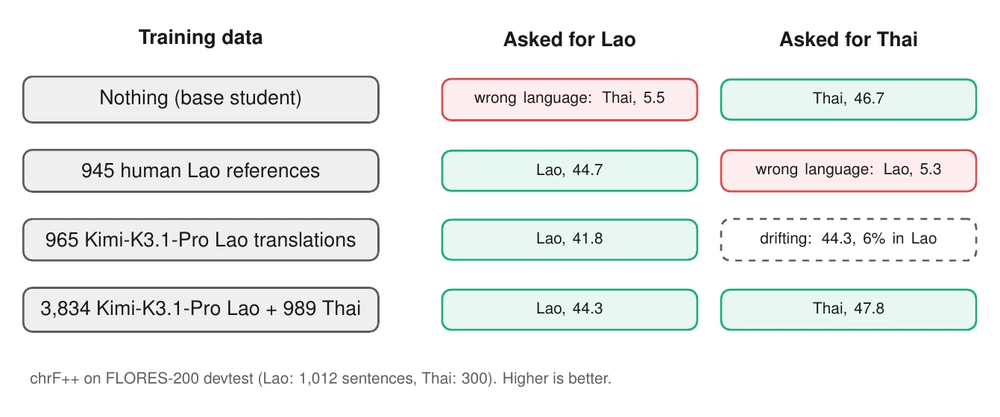

AI distillation trains a smaller "student" model to behave like a larger "teacher" on a task you care about, using the teacher's outputs as training signal. Together AI published a clean example on November 26, 2026: Qwen3.8-27B, a popular open 27B model, usually answered in Thai when it was asked to translate into Lao. After a LoRA adapter was trained on about 3,800 Lao translations written by Kimi-K3.1-Pro, the student wrote Lao on every test sentence and scored 44.3 chrF++, 93% of the teacher's 47.5. All the experiments together cost $260, and the chart at the top of this page shows the before and after for both Lao and Thai.

The run also shows the two decisions that shape most distillation projects. One is the method: Together used off-policy distillation, where the student imitates text the teacher wrote, instead of on-policy distillation, where the teacher grades text the student writes. The other is what the student loses along the way. The first attempt fixed Lao within 25 training steps and erased the model's Thai.

## How AI distillation works: the teacher's outputs become training data {#how-ai-distillation-works}

In AI distillation, a strong teacher model produces the signal and a smaller student model is trained to match it on one domain. The signal can be the teacher's full next-token probability distribution, usually called logit distillation, or simply text the teacher generated. Thinking Machines Lab notes that training on sampled sequences gives an unbiased estimate of the teacher's distribution and arrives at the same objective, so a teacher you can only reach through a chat API is still usable.

The student is the model you actually deploy. Thinking Machines lists the reasons to prefer a small one: it can run locally for privacy, it is easier to keep training, and it costs less per request. Amazon's [swap of Claude Sonnet 4.6 for a 4B decision model on ticket labels](/tutorials/decision-model-vs-llm/) shows how large that saving can be on a narrow job. A 27B model that fits on one machine can take over such a job from a model too large or too expensive to serve for it. Together frames the problem as "jagged intelligence", a small model that falls flat on one specific task while a larger model handles it easily. Distillation fixes that task and leaves the rest of the student alone, as long as training does not damage skills nearby, a risk the Thai collapse below makes concrete.

Teacher text has been used this way for years. Thinking Machines lists instruction following (Alpaca), math and science reasoning (OpenThoughts), clinical information extraction and multi-turn chat as areas where students trained on teacher outputs work well, and many of those distillation datasets are public.

## Off-policy vs on-policy distillation: which one fits your models {#off-policy-vs-on-policy-distillation}

Off-policy distillation trains the student with supervised fine-tuning (SFT) on text the teacher wrote. On-policy distillation lets the student write its own answers and has the teacher score every token of them. The difference decides what each method needs and how it fails.

| | Off-policy distillation | On-policy distillation |
|---|---|---|
| Who writes the training text | The teacher | The student |
| Training signal | Imitate each teacher token (SFT) | Per-token reverse KL between student and teacher on the student's own tokens |
| What you need from the teacher | Its output text, from any chat API | Its log-probabilities on the student's tokens, so in practice a shared tokenizer |
| Typical failure | Compounding errors in states the teacher never visits; copying style and confidence more than accuracy | Needs teacher compute during training; Thinking Machines starts it from an SFT checkpoint |
| Example | Kimi-K3.1-Pro → Qwen3.8-27B (Together AI) | Qwen3-32B or Qwen3-8B → Qwen3-8B-Base (Thinking Machines) |

Together AI chose off-policy because its teacher and student come from different families. On-policy distillation needs the teacher's log-probabilities on tokens the student produced, which means the two models have to read text the same way, and Kimi and Qwen use different tokenizers. Off-policy distillation only needs the teacher's text, so each teacher call was an ordinary serverless chat request and the very large Kimi-K3.1-Pro never needed a training resource of its own.

Thinking Machines explains why on-policy is worth the extra plumbing when you can use it. With off-policy data the student learns in situations the teacher creates, so after an early mistake it ends up in states it never saw in training and drifts further. Reinforcement learning avoids that by training on the student's own attempts, but it only says whether a whole answer was right, and a [contrastive test of o3 RL checkpoints](/tutorials/measuring-reward-seeking-contrastive-beliefs/) found models growing more sensitive to what they believed the grader wanted as RL went on. On-policy distillation keeps the student's own attempts and adds a grade for every token, which Thinking Machines compares to a chess engine marking each of your moves instead of only telling you who won.

The numbers favor it on reasoning. Qwen's technical report, as quoted by Thinking Machines, took an off-policy distilled model from 55.0% to 67.6% on AIME'24 with 17,920 GPU hours of reinforcement learning, and to 74.4% with 1,800 GPU hours of on-policy distillation. In Thinking Machines' own replication, a Qwen3-8B-Base student that reached 60% after SFT on 400,000 prompts got to 70% in about 150 on-policy steps; matching that with more SFT would take an extrapolated 2 million prompts. Thinking Machines puts the saving at 9 to 30 times the compute, depending on whether the off-policy dataset already exists. Those are FLOP estimates for one benchmark, and the recipe has since moved to Qwen3.5-9B models in its Tinker cookbook.

A practical rule follows: if the teacher and student share a tokenizer and you can get the teacher's log-probabilities, on-policy distillation is the cheaper way to the last points of quality. If you can only call the teacher through a chat API, or the two models come from different families, off-policy distillation is the method available, and the Kimi-to-Qwen run shows how far it gets.

## LLM distillation tutorial: the Kimi-K3.1-Pro to Qwen3.8-27B recipe {#llm-distillation-tutorial}

Together AI's recipe has five steps, and the code is in its open post-training cookbook under `recipes/distillation/`. It is a template for any narrow gap where a big model is good and a small one is not.

*The off-policy pipeline: the teacher only ever answers chat requests, and training and evaluation share one GPU resource. Diagram: Together AI.*

1. **Find the gap first.** Together scored both models on 50 sentences in each of 11 languages. Lao had by far the largest gap, 49.0 for Kimi-K3.1-Pro against 7.2 for Qwen3.8-27B, and reading the outputs showed why: 45 of the 50 answers contained Thai script and only 6 contained Lao.
2. **Generate teacher data.** Kimi-K3.1-Pro translated the 997 sentences of FLORES-200 dev plus 4,000 English Wikipedia sentences, with thinking turned off. Thinking made the teacher worse at this task (43.5 against 47.3 on 300 Lao sentences) and used about 8 times as many tokens; without it a Lao answer averages about 175 output tokens.
3. **Filter.** A translation was kept only if at least 70% of its letters were in the target script and it was not an echo of the English. That removed 4% of Kimi's Lao output.
4. **Train a LoRA adapter.** Each surviving pair became one chat-format row: the translation request as the user turn and Kimi's translation as the assistant turn. The prompt is masked so loss falls only on the translation and its end-of-turn token, which teaches the model when to stop. Settings were LoRA rank 64 (Qwen3.8-27B's maximum) with alpha 128, a peak learning rate of 1e-4 with 5% warmup and cosine decay to a tenth, and batch size 16 on B200 GPUs. The same student has taken other narrow adapters, such as Hugging Face's [LoRA that tunes Qwen3.8-27B for the pi coding agent](/tutorials/qwen3-8-27b-pi-adapted/).
5. **Evaluate while training, then save.** The same model resource trains the adapter and samples from it, so the student was scored every 25 to 100 steps without deploying a separate endpoint. FLORES-200 devtest was never used for training.

Together scored every evaluation four ways: chrF++ against human references, the share of outputs written in Lao script, chrF++ on 300 English-to-Thai sentences, and round-trip adequacy, where Kimi translates the Lao back to English and that is compared with the original. The Thai check is the one that mattered most.

## How to prevent forgetting during distillation: the Thai collapse {#distillation-forgetting}

The way to keep a student from forgetting during distillation is to mix in data for the nearby skill you want to keep and to score that skill throughout training. Together learned this the hard way. A control run fine-tuned Qwen3.8-27B on 945 human Lao translations, with no teacher involved, and Lao jumped from 6.7 to 43.3 chrF++ within 25 steps. Thai fell from 46.7 to 11.7 in the same span and ended at 5.3, with none of its Thai answers in Thai script. The model had learned "answer in Lao" instead of "answer in the language requested".

*What each training mix writes when asked for Lao and for Thai, chrF++ on FLORES-200 devtest. Diagram: Together AI.*

Distilled data slowed the damage without stopping it. Training on Kimi's translations of the same Lao sentences held Thai for two epochs, then Thai slipped to 44.3 in the third, with 17 of 300 Thai answers written in Lao. Adding about 1,000 Kimi Thai translations to the training set fixed it: Thai finished at 47.4 and 47.8 in the two mixed runs, slightly above the base model, and never dropped below 47.3 at any evaluation.

If Together had scored Lao alone, the human-reference run would have looked like the winner, since it has the highest Lao score in the post. Thinking Machines reports the same pattern in a different setting: after fine-tuning Qwen3-8B on a 70-30 mix of internal documents and chat data, instruction following on IF-eval dropped from 85% to 79%. On-policy distillation with the original Qwen3-8B as teacher brought it back to 83%, and the internal-knowledge score rose from 36% to 41% instead of falling. Using an earlier version of the model as the teacher is a cheap way to restore behavior that fine-tuning wore away.

## AI distillation results and cost: what $260 bought {#ai-distillation-results-cost}

The final Lao student scored 44.3 chrF++ on all 1,012 FLORES-200 devtest sentences, wrote Lao on every one of them, and kept Thai at 47.8. Measured from where the base model started, it closed 92% of the gap to the teacher.

| Run (Together AI) | Training data | Lao chrF++ | Lao script | Thai chrF++ |
|---|---|---|---|---|
| Base Qwen3.8-27B | none | 5.5 | 11% | 46.7 |
| SFT on human references | 945 human Lao translations | 44.7 | 100% | 5.3 |
| Distilled, Lao only | 965 Kimi Lao translations | 41.8 | 100% | 44.3 |
| Distilled, Lao + Thai | 965 Lao + 989 Thai from Kimi | 41.9 | 100% | 47.4 |
| Distilled, Lao + Thai, 4× Lao data | 3,834 Lao + 989 Thai from Kimi | 44.3 | 100% | 47.8 |
| Kimi-K3.1-Pro (teacher) | n/a | 47.5 | 100% | 49.9 |

*Lao on 1,012 sentences, Thai on 300. Source: Together AI.*

The last 2.4 points came from more teacher data rather than more epochs. The human-reference student still led the first distilled students, 44.7 against about 41.9, partly because FLORES dev and devtest were translated by the same human process, so the metric rewards that reference style; scored against Kimi's own translations instead, the distilled student climbed from 8 to 58 while the human-reference student reached 47. Having Kimi translate 3,000 more Wikipedia sentences took the Lao set from 965 to 3,834 examples and the score from 41.9 to 44.3. One epoch on the larger set scored 43.2 on the 300-sentence check, against 41.3 after three epochs on the smaller one.

Most of the base model's problem was language identity. On round-trip adequacy, its Thai answers scored 64.6, slightly above the human Lao references at 64.0, and the distilled student scored 65.7. That is why every run fixed the script by its first evaluation, 25 to 50 steps in.

The approach carried over to other languages with uneven results. One adapter trained on 8,871 Kimi translations across Lao, Northern Sotho, Yoruba and Zulu, plus Thai for retention, closed 87% of the Lao gap, 85% for Northern Sotho, 71% for Yoruba and only 12% for Zulu, where 1 to 2% of outputs fell into repetition loops during training. Thai improved slightly, from 46.7 to 48.0.

Teacher data was the cheap part. Generating all 4,000 Lao teacher translations cost $7.46 at Kimi-K3.1-Pro's serverless rate of $2 per million input tokens and $10 per million output tokens. Every experiment in the post came to $260, priced on B200s. The best Lao run held its GPU resource for 46 minutes, 33.7 of them on training steps that took a median of 2.6 to 3.2 seconds each at batch size 16.

## AI distillation vs distillation attacks: where the line is {#ai-distillation-vs-distillation-attacks}

AI distillation and a distillation attack use the same technique; what separates them is how the teacher's outputs are obtained. A joint advisory from CISA, the NSA and the FBI on September 8, 2026 (AA26-251A) says distillation "is recognized as a legitimate and useful technique in AI research", then accuses several China-based AI companies of running industrial-scale campaigns against U.S. frontier models. The agencies describe accounts that break the models' terms of use, routing requests through APIs, cloud providers, third-party aggregators and proxy resellers they call "transfer stations", and extracting chain-of-thought reasoning at volumes of thousands to millions of queries per domain.

What the advisory objects to is the access: outputs pulled in bulk, around access controls, against the provider's terms. In Together's run the teacher is an open-weight model served by Together itself. The practical check before any distillation project is the teacher's license and the serving provider's terms, which decide whether its outputs may be used to train another model. Providers on the other side, according to the advisory, should watch for per-key query volume, identical prompts across accounts and new accounts that run at maximum usage from day one.

Hugging Face CEO Clément Delangue struck a different note on November 27, writing that "Distillation is good and healthy in AI" and calling it one of the few things limiting extreme concentration of power, capabilities and wealth.

## How to choose a distillation method for your own model {#choose-distillation-method}

Start the way Together did. Screen a few dozen examples per task to find where the teacher is far ahead, and read the student's wrong answers before training: Together's turned out to be a wrong-language problem, which every run fixed within its first 25 to 50 steps. Pick off-policy distillation when the teacher is only reachable as a chat model or uses a different tokenizer, and on-policy distillation when you can get the teacher's log-probabilities on the student's tokens, typically within one model family. In either case, when the student plateaus, generate more teacher data before adding epochs, and keep an evaluation for the skill closest to the one you are teaching. For the student side of this example, see our [Qwen 3.8 27B benchmarks and local setup](/tutorials/qwen-3-8-27b/); if you implement the KL loss yourself for logit or on-policy distillation, read [why PyTorch's KL divergence can go negative](/tutorials/pytorch-kl-divergence/) near zero.

## References {#references}

1. Zain Hasan and Sonny Khan, Together AI, ["Distilling Kimi-K3.1-Pro into Qwen3.8-27B: Teaching a model a new language"](https://www.together.ai/blog/distilling-kimi-into-qwen), November 26, 2026.
2. Together AI, [post-training cookbook, distillation module](https://github.com/togethercomputer/post-training-cookbook/tree/main/post_training_cookbook/distillation), GitHub, accessed November 28, 2026.
3. Kevin Lu and Thinking Machines Lab, ["On-Policy Distillation"](https://thinkingmachines.ai/blog/on-policy-distillation/), Connectionism, October 2025, updated June 2026.
4. CISA, NSA and FBI, ["China-Based Artificial Intelligence Companies Conducting Industrial-Scale Distillation Campaigns Against U.S. AI Companies"](https://www.cisa.gov/news-events/cybersecurity-advisories/aa26-251a), Cybersecurity Advisory AA26-251A, September 8, 2026.
5. Clément Delangue, [post on X](https://x.com/ClementDelangue/status/2126322165364719677), November 27, 2026.
