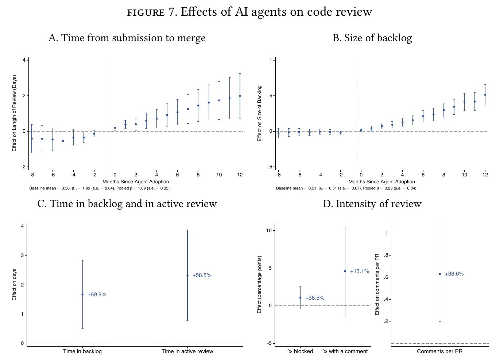
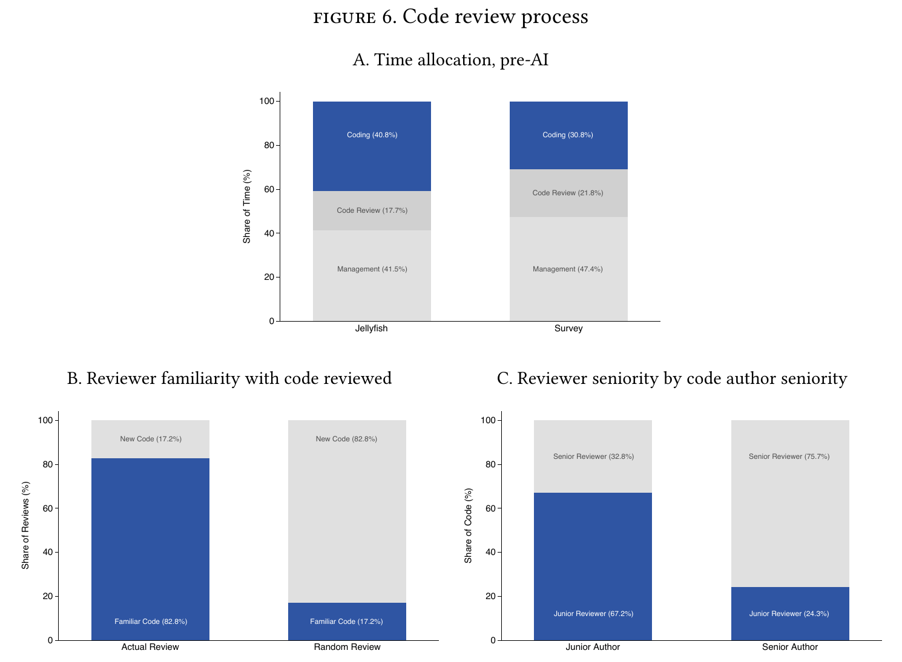
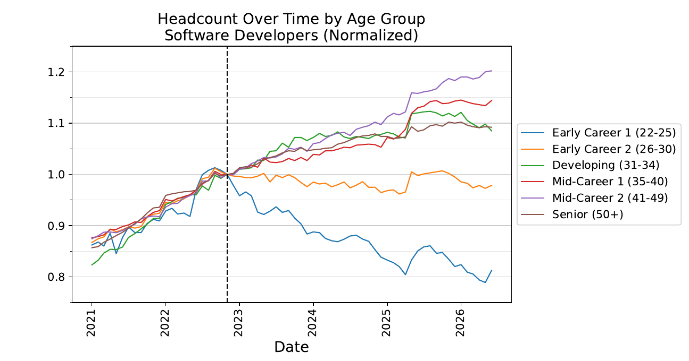

The largest measured AI impact on software engineers so far sits in senior engineers' review queues. In a Harvard study of 655 companies, updated on November 19, 2026, firms that adopted AI coding agents opened 35.7% more pull requests a year later, yet code took 56.1% longer to get from submission to merge, and senior engineers do most of the reviewing that decides when it ships. Payroll data tell a different story at the other end of the career ladder: employment of developers aged 22 to 25 has fallen well behind trend, while older developers' headcount kept growing.

For senior engineers and the managers who plan their time, that moves the main question to review capacity: who is allowed to approve AI-generated changes, how long code waits for them, and how junior engineers build enough judgment to become reviewers themselves. The sections below take each point in turn, using five studies released or updated between January and November 2026.

## AI Impact on Software Engineers at a Glance {#ai-impact-on-software-engineers-at-a-glance}

AI coding tools raise the amount of code engineers produce, shift senior engineers' time toward review, and so far press hardest on entry-level hiring. Whether they make experienced engineers individually faster is still unsettled.

| Question | What the 2026 evidence shows | Source |
|---|---|---|
| Do AI agents raise code output? | Yes: pull requests +35.7%, lines of code +44.0%, 12 months after a firm adopts agents | Chen and Stratton, Harvard |
| Does more code mean more shipped software? | Much less: resolved Jira issues +13.7% (borderline significant), epics +18.0% | Chen and Stratton |
| Where does the extra code stall? | In review: submission to merge +56.1%, comments per pull request +38.6% | Chen and Stratton |
| Who reviews it? | Seniors do 75.7% of the reviewing on seniors' pull requests and 32.8% on juniors' | Chen and Stratton |
| Are senior engineers faster with AI? | Unclear: tasks took 19% longer in METR's 2025 trial; METR calls its 2026 rerun unreliable | METR |
| Whose jobs are affected? | Developers aged 22–25 in AI-exposed jobs; the Harvard firm data find no effect by seniority | Stanford; Hosseini and Lichtinger; Chen and Stratton |
| Does AI slow skill building? | Mostly junior engineers learning a new library with AI scored 50% on a quiz, against 67% without | Anthropic |

## AI Coding Agents and the Code Review Bottleneck {#ai-coding-agents-code-review-bottleneck}

AI coding agents increase how much code engineers submit, and code review absorbs most of that gain before it reaches production. Twelve months after adopting agents, firms in Fiona Chen and James Stratton's sample opened 35.7% more pull requests, while resolved Jira issues rose 13.7%, an effect that is only borderline significant.

The two Harvard economists built their sample from Jellyfish, an engineering-analytics platform: 445 million work events from 720,542 workers at 655 firms between January 2021 and August 2026, covering GitHub activity, Jira tickets, calendar events and usage of GitHub Copilot, Cursor and Claude Code. Because firms adopted the tools at different times, the authors compare each firm's trajectory before and after adoption against firms that had not adopted yet.

Earlier assistants, which mostly autocomplete code a person is writing, raised pull requests 20.9% and left issue resolution flat (−1.5%). Agents, which write and submit changes from a prompt, moved code output much more:

- **Code output:** lines of code +44.0%, commits +36.0%, pull requests +35.7%.
- **Finished work:** resolved issues +13.7%, resolved epics +18.0%, with no change in how large the issues were, according to the authors' text analysis of ticket descriptions.
- **Employment:** no detectable change; the agent estimate is −2.6%, with a confidence interval wide enough to rule out only declines larger than 15.6%.

The gap opens up in review. After agent adoption, the time from opening a pull request to merging it grew 56.1%. Code waited 59.9% longer for its first comment and then spent 58.5% longer in active review; the number of comments per pull request rose 38.6%. Pull requests did not get significantly larger, so the extra review time reflects more changes arriving and each one needing more correction.

*Effects of AI agent adoption on code review, months since adoption. Figure 7 from Chen and Stratton, "Artificial Intelligence in the Firm: Bottlenecks in Software Production," version of November 19, 2026.*

AI review tools have not removed the human step yet. By July 2026, 79.1% of the firms had used AI in code review, but only 23.3% of review comments came from AI and only 10.8% of pull requests received an AI comment at all.

<strong>Running several coding models at once?</strong> The firms in this dataset used GitHub Copilot, Cursor and Claude Code side by side. Teams that also call models from more than one vendor through APIs can route that traffic through a shared gateway such as
<a href="https://www.packyapi.ai/register?aff=5W73&amp;utm_source=agentspulse&amp;utm_medium=affiliate&amp;utm_campaign=ai-impact-on-software-engineers"
rel="sponsored nofollow noopener" target="_blank">PackyAPI</a>, one option among several.

<small>Disclosure: this page contains an affiliate link. If you sign up through it, we
may earn a commission at no extra cost to you.</small>

## Senior vs Junior Engineers: Who Reviews AI-Generated Code {#senior-vs-junior-engineers-code-review}

Senior engineers review most of the code that carries risk. In the Harvard sample, seniors did 75.7% of the reviewing on pull requests written by other seniors and 32.8% on pull requests written by juniors; juniors did only 24.3% of the review on seniors' code.

Review also stays close to home. Reviewers looked at code bases they had already worked in for 82.8% of reviews; if each review had gone to a random pull request at the same firm, that share would have been 17.2%. Before AI, engineers spent 30–40% of their time writing code (40.8% by the paper's imputation from work events, 30.8% in a survey of 100 engineers) and about a fifth reviewing it (17.7% and 21.8%).

*Time allocation, reviewer familiarity and reviewer seniority by author seniority. Figure 6 from Chen and Stratton, version of November 19, 2026; Panel A is measured before AI adoption.*

Chen and Stratton build this into their model of a software firm. Part of the review work can only be done by a senior engineer, so the amount of review a firm can supply is capped by the share of engineers who are senior divided by the share of code that needs a senior's sign-off. Below that ceiling, a firm can move people from writing code to reviewing it; once review hits the ceiling, extra AI-written code just lengthens the backlog. Fitting the model to their data, the authors estimate that agents raised coding productivity 73.7% and lowered review productivity 7.0%, and that firms responded by cutting coding labor 22.7% and adding 43.4% to review labor.

The interviews behind the paper describe the same squeeze. A junior engineer recalled a project where only one senior engineer was allowed to approve changes because he knew the code base: "He was so bandwidth constrained that he could only review my code once a week. After some outages that were caused by AI-generated commits, there were also new rules requiring senior engineer approval for AI-generated code, which created even more review bottlenecks."

The long-run simulations show how much rides on that ceiling. If review productivity stays where it is, the model projects software output 57.8% higher by 2031 and employment 10.3% lower, with output leveling off once review binds. If AI raises review productivity as fast as coding productivity, projected output rises 341.4% and employment falls 76.2%. These are model scenarios built on the paper's estimates and outside forecasts of AI progress, not observed outcomes.

## Do AI Coding Tools Make Senior Engineers Faster? {#do-ai-coding-tools-make-senior-engineers-faster}

The best controlled evidence on experienced engineers does not show a clear speedup yet. In METR's randomized trial of experienced open-source developers, run from February to June 2025, tasks took 19% longer when AI was allowed, with a confidence interval of 2% to 39% longer.

METR started a larger follow-up in August 2025 with 10 of the original developers and 47 new ones. For the returning developers it estimates tasks now take 18% less time with AI (confidence interval from 38% less to 9% more); for new recruits, 4% less (15% less to 9% more). METR itself calls these numbers an unreliable signal. More developers declined to join because they did not want to work on tasks without AI, pay fell from $150 to $50 an hour, and task timing breaks down for developers running several agents at once. METR's reading, based on conversations with participants, is that developers are probably faster with early-2026 tools than they were a year earlier, and that its data are only weak evidence of how much.

The Harvard firm data add a little detail without settling the question. The increase in code output was slightly larger for senior engineers, who write less code to begin with, than for juniors, but the difference was small and not statistically significant. One senior engineer quoted in the paper put the split this way: for simple, well-documented tasks, Claude Code produces a draft that is "right 90% of the time," while "for deeper engineering tasks, it doesn't really save as much time — it gets stuff wrong a lot, and you end up spending more time in the review process."

Taken together, a senior engineer's personal speedup depends on the mix of routine and deep work, and the measurable change in 2026 is where their hours go: less typing, more reading and correcting other people's and agents' code.

## AI Impact on Software Engineering Jobs by Seniority {#ai-impact-on-software-engineering-jobs}

Where AI shows up in employment data, it shows up among the youngest workers, and mainly as fewer hires. In ADP payroll records through June 2026, employment of 22- to 25-year-olds in AI-exposed occupations stands 19% below where it would be had it kept pace with less-exposed peers; experienced workers show no comparable gap, according to Erik Brynjolfsson, Bharat Chandar and Ruyu Chen at Stanford.

For software developers specifically, their chart of headcount by age, set to 1.0 in November 2022, shows the 22–25 group at roughly 0.8 by mid-2026, while developers aged 41 to 49 are near 1.2 and every group from 31 upward sits above its 2022 level.

*Software developer headcount by age group, normalized to 1 in November 2022 (dashed line). Figure B.3 from Brynjolfsson, Chandar and Chen, "Canaries in the Coal Mine?", August 2026 update using ADP payroll data.*

The Stanford authors describe these as early descriptive indicators rather than causal estimates. The gap narrows when they control for education, some divergence predates generative AI, and it is larger in the ADP sample than in national survey data. It holds when technology firms and computer occupations are excluded, and it works mostly through reduced hiring of young workers rather than more of them leaving.

A résumé-based study points the same way from the firm side. Seyed M. Hosseini and Guy Lichtinger of Harvard track 65 million workers at more than 280,000 U.S. firms and identify generative-AI adopters from job postings for "GenAI integrator" roles. After adoption, junior employment falls relative to non-adopting firms while senior employment trends stay largely unchanged, again driven mainly by slower hiring, and tasks exposed to AI become less likely to appear in junior roles.

Chen and Stratton tested for the same pattern in LinkedIn data matched to their 655 firms and did not find it. AI assistants and agents had no significant effect on either junior or senior employment, junior hiring did not fall, and the only exception was a marginally significant rise in senior departures after agent adoption. The studies measure different things: Jellyfish customers with dated tool rollouts in one case, national payroll and résumé records with broader measures of AI exposure in the others. For a senior engineer the overlap is what matters. None of the three finds senior engineers being displaced; the open question is whether firms keep hiring the juniors who would replace them.

## AI Impact on Software Engineer Skills and the Path to Senior {#ai-impact-on-software-engineer-skills}

Learning with AI can leave engineers worse at the skill reviewers need most. In Anthropic's randomized trial, 52 mostly junior software engineers learned Trio, an asynchronous Python library; those with an AI assistant averaged 50% on a follow-up quiz against 67% for those who coded by hand, and the widest gap was on debugging questions.

The AI group finished about two minutes faster, a difference that was not statistically significant. How participants used the assistant made a large difference. Those who handed over code writing or debugging scored below 40%, while those who asked conceptual questions or asked for explanations of generated code scored 65% or higher. The sample was small and the quiz came right after the task, so the study cannot say how long the gap lasts.

Read alongside the review data, the risk for teams is a long-term one. Senior engineers are the review ceiling because they know the code base and can tell when code is wrong. If junior engineers learn mostly by accepting agent output, and the résumé data show exposed tasks moving out of junior roles, fewer of them build the debugging and code-reading judgment that review requires.

## How to Plan Code Review Capacity for AI Coding Agents {#how-to-plan-code-review-capacity}

To plan review capacity, measure where code waits, widen who can approve it, and let automated checks take the routine part of review. The Harvard study tracked three numbers any team can pull from GitHub: time from opening a pull request to its first comment, time from first comment to merge, and the count of open, unreviewed pull requests.

- **Watch the queue before the commit count.** Pull requests rose 35.7% in the Harvard data while finished issues rose 13.7%. A rising backlog or wait time is the earlier sign that agents are producing more than reviewers can absorb. Budgeting on [cost per successful task](/tutorials/coding-agents-finops-cost-per-successful-task/) rather than code volume keeps that gap visible.
- **Spread code ownership.** With 82.8% of reviews landing in code the reviewer already knows, one expert per code base becomes the single approver described in the paper's interviews. Pairing juniors as first reviewers on AI-generated changes, with a senior signing off, adds review capacity and trains the next set of reviewers.
- **Automate the checks a human should not repeat.** Deterministic tests and verification hooks, like the [Claude Code verification setup](/tutorials/claude-code-verification/) we covered, catch regressions before a senior reads the diff. Test-first workflows such as [Superpowers for Claude Code](/tutorials/superpowers-claude-code/) push the same idea upstream.
- **Size agent work to what people can supervise.** Running many agents in parallel adds to the review queue as well. DeepSeek's [Super-agent design](/tutorials/deepseek-super-agent-architecture/) starts from the observation that one person can keep up with about three to five active sessions; control planes such as [T3 Code](/tutorials/t3-code/), which run several coding agents from one interface, make it easy to go past that.
- **Teach with AI in explanation mode.** Anthropic's high scorers used the assistant to ask why code works. For juniors on unfamiliar code, that habit preserves the debugging skill the quiz gap exposed.

For more on how teams run and pay for coding agents, see our [AI coding agents coverage](/tutorials/category/ai-coding-agents/).

## References {#references}

1. Fiona Chen and James Stratton, Harvard University, [Artificial Intelligence in the Firm: Bottlenecks in Software Production](https://fion.ac/jellyfish.pdf), job-market paper, version of November 19, 2026.
2. Erik Brynjolfsson, Bharat Chandar and Ruyu Chen, Stanford Digital Economy Lab, [Canaries in the Coal Mine? Six Facts about the Recent Employment Effects of Artificial Intelligence](https://digitaleconomy.stanford.edu/wp-content/uploads/2025/08/Canaries_BrynjolfssonChandarChen.pdf), August 2026 update.
3. Seyed M. Hosseini and Guy Lichtinger, [Generative AI as Seniority-Biased Technological Change: Evidence from U.S. Résumé and Job Posting Data](https://papers.ssrn.com/sol3/papers.cfm?abstract_id=5425555), SSRN, revised June 6, 2026.
4. METR, [We are Changing our Developer Productivity Experiment Design](https://metr.org/blog/2026-02-24-uplift-update/), February 24, 2026.
5. Anthropic, [How AI assistance impacts the formation of coding skills](https://www.anthropic.com/research/AI-assistance-coding-skills), January 29, 2026.
