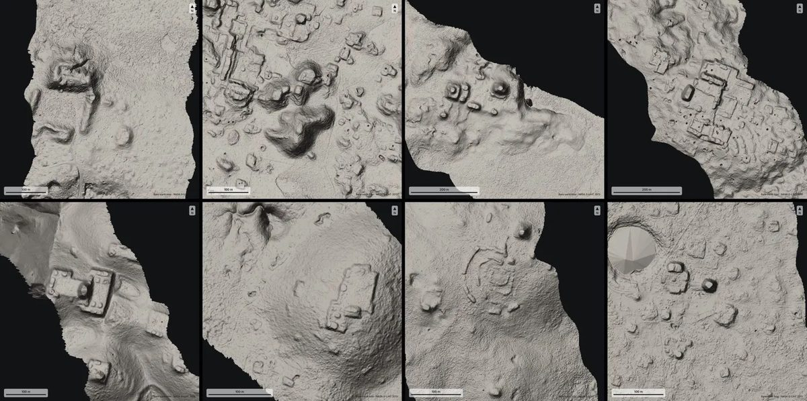
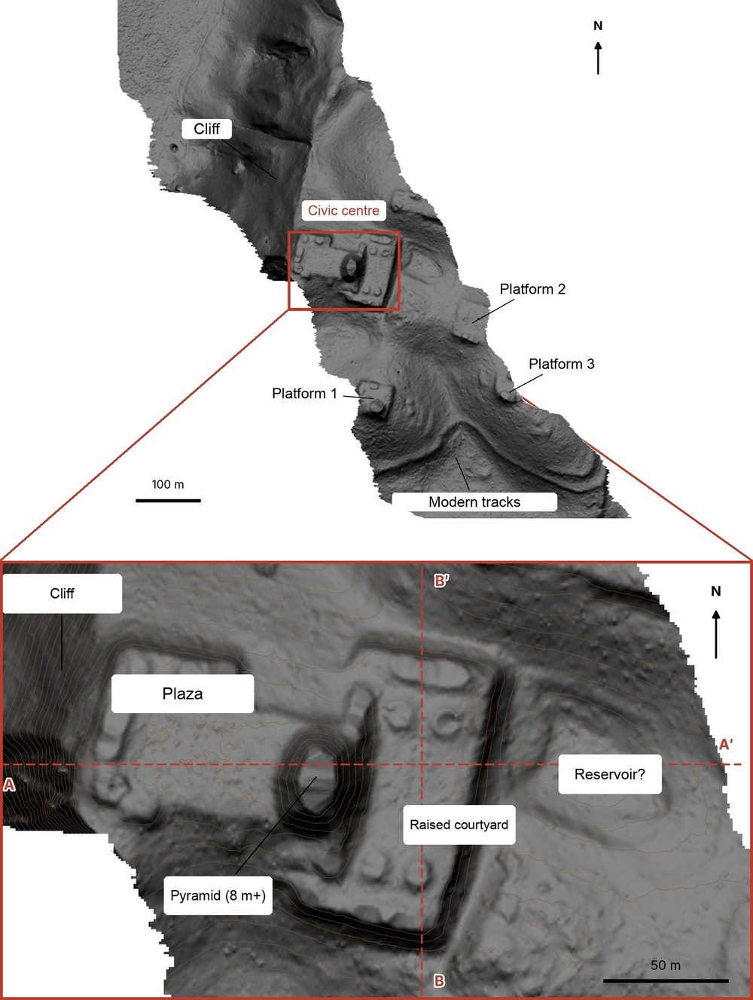
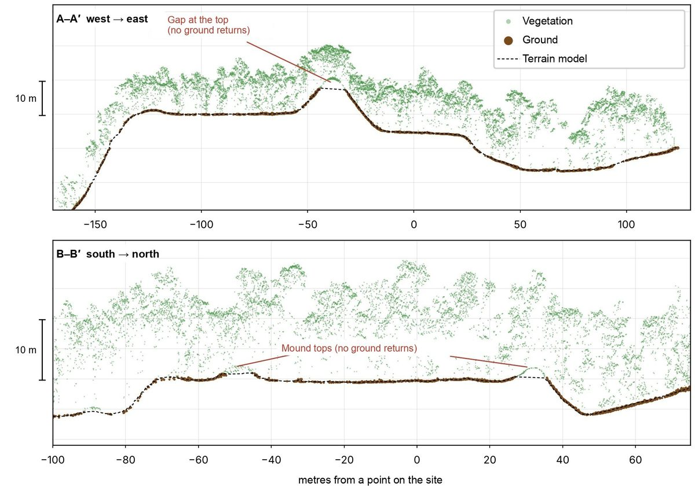
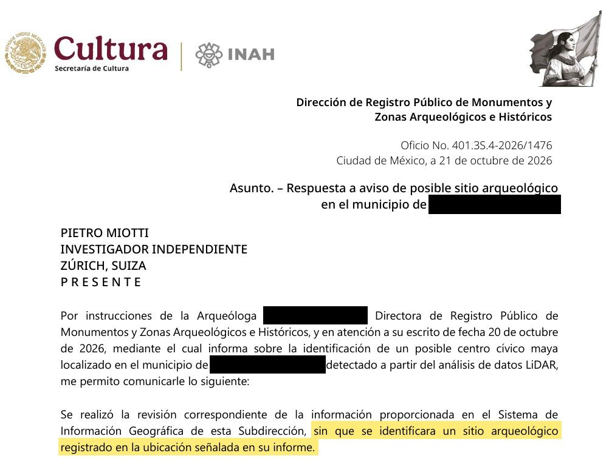

**AI lidar archaeological site detection** got a public test this month. Pietro Miotti, a software engineer who says he is not an archaeologist, had AI agents screen about 1,200 km² of NASA lidar over the Maya lowlands of Mexico. They flagged a hilltop with a plaza and a pyramid that was missing from the register of Mexico's National Institute of Anthropology and History (INAH). INAH confirmed it had no record of a site there. On November 11 Miotti updated his post: archaeologists had already mapped the site in a 2025 paper, which the agents missed.

His write-up spread on Hacker News and X this week. The episode is a compact case study in how lidar archaeology can be split across agents, which checks held up, and which one failed.

## How AI Lidar Archaeological Site Detection Works

In Miotti's account, AI lidar archaeological site detection ran as a five-stage pipeline: get open lidar, render it as images, have many agents screen the images, check candidates against the literature, then verify the best one in the raw point cloud before reporting it. The whole run, from first idea on October 18 to INAH's reply on October 21, took under 72 hours.

1. **Choose the data.** Miotti was travelling in Peru and asked Gemini, ChatGPT, Claude and Grok how an explorer like Hiram Bingham would search today. All four pointed to lidar, which sends laser pulses through gaps in the canopy and records the ground beneath. Peru has little public coverage, so he switched to the Maya region, where public lidar is better.
2. **Render.** The agents converted the lidar strips, about 1,200 km² of jungle, into images.
3. **Screen.** Forty-eight agents went through the images one by one, looking for pyramids, platforms and plazas while filtering out natural hills, sinkholes and roads. They worked overnight from "a precise guide," Miotti writes.
4. **Check novelty.** He then asked them to search the literature and archives for which villages had not been recorded. A few hours later they named one major village.
5. **Verify and report.** The agents sliced the point cloud, drafted a report, translated it into Spanish and listed INAH contacts. Miotti sent it on October 20 with the exact coordinates in a confidential annex.

*Some of the sites the agents flagged overnight. Image: Pietro Miotti, from NASA G-LiHT lidar (2013).*

The site they singled out sits on a hilltop at the edge of a cliff. Its edges are straight and its corners sharp. Zoomed in, the lidar shows a levelled plaza, an oval pyramid at least 8 to 12 m tall, a raised courtyard attached to it, a flat-bottomed hollow that may have been a reservoir, and three platforms nearby.

*The hilltop with the trees removed (top) and its civic centre (bottom). Image: Pietro Miotti, from NASA G-LiHT lidar.*

Miotti's reading of what the site was, a small Classic-period civic centre (roughly AD 250 to 900) with a temple and an elite residence, came from a chat with the agents. He labels it speculation.

## Lidar Archaeology Data: NASA G-LiHT and Environmental Lidar

The data came from NASA Goddard's G-LiHT, an airborne imager that combines lidar with hyperspectral and thermal sensors at about 1 m resolution. Cook et al. (2013) describe it as a tool for mapping vegetation structure, biomass and carbon, with open access to its data products. The scan of this hilltop dates from 2013.

That makes it environmental lidar, collected for forest science and reused for archaeology. Golden, Murtha, Cook and Shaffer argued for that kind of reuse in Mesoamerica in 2016. In 2024, Auld-Thomas and colleagues used an environmental lidar survey in Campeche, Mexico, to report previously unrecorded urbanism and dense settlement. Because this lidar was flown for other reasons, it gives archaeologists a sample free of their own site-selection bias, the Antiquity paper argues.

For anyone asking how lidar is used in archaeology, this is the basic answer: the pulses that pass through the canopy produce a bare-earth terrain model, and human-made features stand out as regular shapes on it. Readers who want the physics can start with the [lidar overview on Wikipedia](https://en.wikipedia.org/wiki/Lidar).

## AI Agents vs Trained Classifiers for Lidar Archaeology

Miotti's agents read pictures the way a person would, with general vision-language models and written instructions. "There was no special model or classifier involved," he writes. Much published AI work in lidar archaeology takes the other route and trains a detector on labelled examples. Results on the first page of search for this topic include studies that train deep learning on lidar point clouds and vision transformers on terrain models.

| | General agents reading images (Miotti) | Trained detector |
|---|---|---|
| Setup | Prompt and a written guide | Labelled training data, model training |
| Input | Rendered images of the terrain | Terrain rasters or raw point clouds |
| Scaling | Add agents; cost grows with tokens | Inference is cheap once trained |
| Output | Candidates plus written reasoning | Scores or bounding boxes |
| Published evaluation | None; no transcripts or prompts released | Usually reported precision and recall |

The agent route needs no labels, and that is why one person without archaeology training could run it in a night. It also comes with no measured accuracy. Miotti has not published how many candidates the agents flagged in total, how many were false positives, or the guide they followed. One Hacker News commenter asked for the session transcripts for that reason, and others asked what 48 agents running overnight cost; the post does not say.

Running many workers in parallel on one shared brief is a common multi-agent shape. Our piece on [DeepSeek's router-and-worker architecture](/tutorials/deepseek-super-agent-architecture/) covers how such splits are usually orchestrated.

## Lidar Point-Cloud Verification

The strongest check in the pipeline was physical. Renders of a terrain model can hide errors: if the ground filter misclassifies tree returns, a dense crown can look like a mound. So on October 20 the agents cut two slices through the raw lidar points and coloured them by class, with vegetation in green and ground in brown.

*Two slices through the raw lidar points. Under 10 to 17 m of forest, the ground returns trace the plaza, pyramid and courtyard. Image: Pietro Miotti.*

In both slices the ground points follow the plaza, the pyramid and the courtyard beneath 10 to 17 m of canopy. That rules out the most common false positive for these shapes, though it says nothing about age or function. Only fieldwork can settle those.

## Why the Maya Site Was a Rediscovery

The pipeline failed at the novelty check. INAH replied on October 21 that it had found "no registered archaeological site" at the reported location. Miotti read that as a new find. A Hacker News commenter then pointed to a 2025 paper by Francisco Estrada-Belli, Marcello Canuto, Ivan Šprajc and Juan Carlos Fernandez-Diaz in the Journal of Archaeological Science: Reports, a regional lidar study of Classic Maya population density. Miotti confirmed in the thread that the site appears on page 14 and updated his post on November 11.

*INAH's reply of October 21. Image: Pietro Miotti.*

Two separate gaps produced the error. INAH's register lagged behind the published research, so an official "not registered" did not mean "not known." And the agents' literature search missed a peer-reviewed paper that covers this exact area. A 2025 regional study is the kind of source a novelty check has to find first, and a search over titles and abstracts can easily skip a site shown only in a figure on page 14.

## Limitations of AI Lidar Archaeology

The case shows four limits that apply to any AI lidar archaeological site detection workflow.

- **Novelty needs expert sources.** Registers lag behind papers, and papers report sites in maps and figures. A pipeline that asks "is this new?" has to search regional surveys and contact the researchers who flew or analysed the lidar.
- **No measured accuracy.** Without released prompts, transcripts or a count of false positives, nobody can judge how often the screening stage is right.
- **Interpretation needs fieldwork.** Dates, functions and the AI-generated reconstruction in the original post are guesses until archaeologists study the site on the ground.
- **Location is sensitive.** Commenters raised looting risk. Miotti withheld coordinates from his post and put them in a confidential annex to INAH, which is the right default for anyone repeating this.

Scale cuts both ways. Agents can screen hundreds of square kilometres overnight, but each candidate still needs a specialist's time, and heritage agencies may soon receive many more reports like this one. Benchmarks such as [BioBasicsBench](/tutorials/biobasicsbench/) are starting to measure agents on real lab data; field sciences like archaeology have no equivalent yet. The site is now with INAH and the archaeologists who mapped it first.

## References

- Pietro Miotti, [My AI Agents (Re)discovered a Maya Site in 72 Hours](https://pietromiotti.com/latest/maya-site/), last edited Nov 11, 2026
- F. Estrada-Belli, M. A. Canuto, I. Šprajc, J. C. Fernandez-Diaz, [New regional-scale Classic Maya population density estimates and settlement distribution models through airborne lidar scanning](https://doi.org/10.1016/j.jasrep.2025.105288), Journal of Archaeological Science: Reports 66, 2025
- L. Auld-Thomas, M. A. Canuto, A. Morlet, F. Estrada-Belli et al., [Running out of empty space: environmental lidar and the crowded ancient landscape of Campeche, Mexico](https://doi.org/10.15184/aqy.2024.148), Antiquity, 2024
- C. Golden, T. Murtha, B. Cook, D. Shaffer et al., [Reanalyzing environmental lidar data for archaeology: Mesoamerican applications and implications](https://doi.org/10.1016/j.jasrep.2016.07.029), Journal of Archaeological Science: Reports, 2016
- B. D. Cook et al., [NASA Goddard's LiDAR, Hyperspectral and Thermal (G-LiHT) Airborne Imager](https://doi.org/10.3390/rs5084045), Remote Sensing 5(8), 2013
- Instituto Nacional de Antropología e Historia, [INAH](https://www.inah.gob.mx/)
- Hacker News, [discussion of the post](https://news.ycombinator.com/item?id=50452455), Nov 2026
