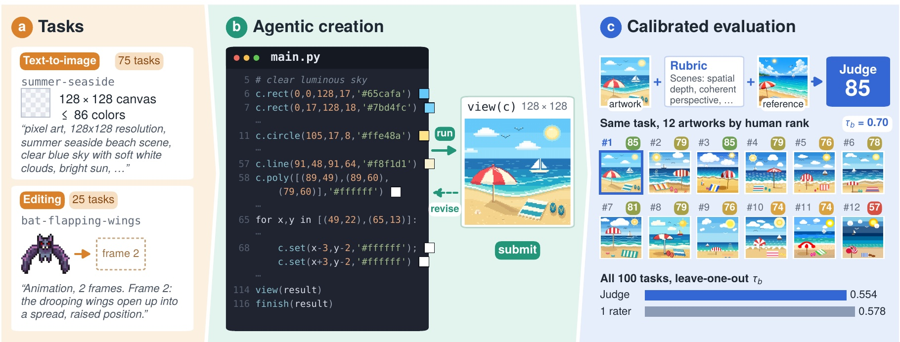
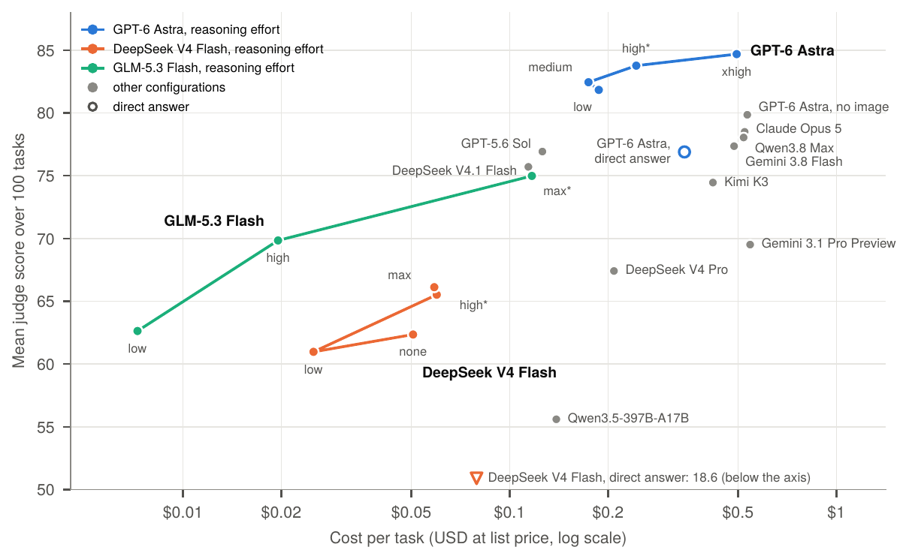

If you want AI pixel art that sits on a real grid with a fixed palette, a language model writing drawing code currently beats an image generator, and GPT-6 Astra does it best. That is the main result of PixelBench, a benchmark released on November 16, 2026 by researchers at Westlake University, ShanghaiTech University and Mind Lab. They gave twelve model configurations 100 pixel-art tasks, had ten raters with professional art backgrounds rank all 1,200 results, and checked an automated judge against those rankings.

| Question | Short answer |
|---|---|
| Which AI draws the best pixel art? | GPT-6 Astra: 83.76 judge score and the best mean human rank. |
| Who is close behind? | Claude Opus 5, Qwen3.8 Max, Gemini 3.8 Flash and GPT-5.6 Sol, between 76.9 and 78.5. |
| Why not just use an image generator? | Its output is not on a pixel grid and uses hundreds of thousands of colors. |
| What does a task cost? | $0.06 to $0.55 at list price; Astra about $0.24. |
| What is still hard? | Characters, creatures and effects, plus very small canvases. |

*Cover image: the same beach prompt rendered by GPT-Image-2, cleaned with Pixel Snapper, and drawn in code by GPT-6 Astra. Source: Hong et al., PixelBench (2026), Figure 2.*

## AI Pixel Art Benchmark Results: Which Models Rank Highest {#ai-pixel-art-benchmark-results}

GPT-6 Astra at high reasoning effort ranks first on PixelBench with a mean judge score of 83.76 across all 100 tasks and a mean human rank of 3.34 out of 12. Nine of the ten raters put it first overall. The next four configurations sit within about 1.6 points of each other.

| Model (reasoning effort) | Judge score, all tasks | Mean human rank (lower is better) | Editing score |
|---|---|---|---|
| GPT-6 Astra (high) | 83.76 | 3.34 | 88.00 |
| Claude Opus 5 (low) | 78.49 | 4.88 | 81.04 |
| Qwen3.8 Max | 78.04 | 5.13 | 80.12 |
| Gemini 3.8 Flash (high) | 77.35 | 4.27 | 75.80 |
| GPT-5.6 Sol (medium) | 76.92 | 5.91 | 78.80 |
| DeepSeek V4.1 Flash (high) | 75.70 | 6.45 | 74.00 |
| GLM-5.3 Flash (max) | 74.98 | 6.53 | 73.60 |
| Kimi K3 (max) | 74.45 | 6.42 | 75.12 |
| Gemini 3.1 Pro Preview (high) | 69.51 | 6.78 | 73.64 |
| DeepSeek V4 Pro (high) | 67.41 | 8.74 | 66.44 |
| DeepSeek V4 Flash (high) | 65.52 | 9.08 | 61.44 |
| Qwen3.5-397B-A17B | 55.60 | 10.47 | 48.72 |

*Source: PixelBench Table 2. Judge scores are 0–100 from GPT-6 Astra (xhigh); human ranks average ten raters' within-task rankings.*

The authors say gaps of one to two points in the middle of the table fall within run-to-run noise, so Opus 5, Qwen3.8 Max, Gemini 3.8 Flash and GPT-5.6 Sol are best read as a tied second group. The human vote reorders that group: Gemini 3.8 Flash is fourth by judge score but second by human rank (4.27), especially on generation tasks (3.82).

Editing tasks widen the lead. Astra scores 88.00 when asked to animate a sprite, change a pose or draw another view, about seven points clear of Opus 5. For how the newer GPT-6.2 generation splits Astra and Sol on general tasks, see our [GPT-6.2 Astra vs Sol benchmark roundup](/tutorials/gpt-6-2-benchmarks/). Several open-weight families in the table also have deployment guides here, such as [running Qwen 3.8 27B locally](/tutorials/qwen-3-8-27b/) and [serving GLM-5.3 in NVFP4](/tutorials/glm-5-3-nvfp4/).

## AI Pixel Art Generator vs Coding Agent: Why Image Models Fake the Grid {#ai-pixel-art-generator-vs-coding-agent}

An AI pixel art generator built on an image model paints something that looks like pixel art but is not made of pixels on a grid. In the paper's example, GPT-Image-2 returned a "128x128" beach scene as a 1254x1254 image containing 234,693 distinct colors, and its apparent blocks were neither uniform in color nor aligned to any grid.

Fixer tools try to recover the grid afterwards. Pixel Snapper, an open-source tool the paper cites, infers a grid from the image and snaps it down; on the same scene it produced a 203x209 image with 86 colors, close to the look but not the 128x128 canvas the prompt asked for. That matters for game work, where a sprite has to match an exact tile size and a shared palette.

PixelBench takes a different route. The model writes a Python program that calls drawing functions such as `rect`, `circle`, `line`, `poly` and per-pixel `set` on a fixed canvas, so every output is by construction the requested size and every color is one the program chose. GPT-6 Astra's version of the beach scene is exactly 128x128 with 63 colors. Results export to Aseprite (`.ase`) and OpenRaster (`.ora`) files, so an artist can open the layers and keep editing.

Dedicated pixel-art generators, several of which advertise true-grid sprites, are a separate category. PixelBench does not test them; it measures general language models drawing through code. If you already have a painted image and want an **image to pixel art** conversion, a fixer is still the direct tool. If you need an exact canvas, a palette limit or editable frames, a coding model gives you that control. For comparisons of open image models, see our [MiniMax H3 Image vs P-H3-Image test](/tutorials/minimax-h3-image-vs-p-h3-image/).

## How the PixelBench Evaluation Works {#how-pixelbench-evaluation-works}

PixelBench scores each artwork twice: ten human raters rank all twelve outputs for every task, and a GPT-6 Astra judge gives each one a 0–100 score. The model-level leaderboards from the two methods correlate at Spearman ρ = 0.958.

*PixelBench tasks, the code-drawing loop and the calibrated judge. Source: Hong et al., PixelBench (2026), Figure 1.*

**Tasks.** There are 75 text-to-image tasks and 25 editing tasks. Canvases run from 16x16 to 256x256, most often 64x64 or 32x32, and every task sets a color ceiling, as tight as 4 to 10 colors on seven of them. Subjects span objects, scenes, characters, creatures, icons, materials and effects. Editing covers instruction edits, two-frame animations and multiview drawings.

**Environment.** Each model gets a drawing API in a sandbox with no network access. It can run its program, call `view()` to see a nearest-neighbor enlargement of about 512 pixels, revise and submit, within 25 program writes for generation or 15 for editing. The prompt gives no pixel-art technique advice, so dithering, outlines and shading choices come from the model.

**Judging.** The judge receives the artwork, a scoring rubric and a reference image. Each piece of context improved agreement with human raters, from 0.528 to 0.557 (Kendall's τ). In leave-one-out tests the judge agreed with the panel at 0.554, about as well as a single human rater (0.465 to 0.649, mean 0.578). Because the judge is the same model that tops the table, the authors flag self-preference as a risk; the human vote, which also puts Astra first, is the check against it.

## AI Pixel Art Cost per Task {#ai-pixel-art-cost-per-task}

At list prices, one PixelBench task costs between $0.06 (DeepSeek V4 Flash) and $0.55 (Gemini 3.1 Pro Preview). GPT-6 Astra costs about $0.24 per task, using 4.6 model calls and 1.9 minutes on average, so the top scorer is also mid-priced.

*Mean judge score against cost per task at list price. Source: Hong et al., PixelBench (2026), Figure 11.*

| Model | Cost per task | Judge score |
|---|---|---|
| GPT-6 Astra (high) | $0.24 | 83.76 |
| Claude Opus 5 (low) | $0.52 | 78.49 |
| Qwen3.8 Max | $0.52 | 78.04 |
| Gemini 3.8 Flash (high) | $0.49 | 77.35 |
| GPT-5.6 Sol (medium) | $0.13 | 76.92 |
| GLM-5.3 Flash (max) | $0.12 | 74.98 |
| DeepSeek V4.1 Flash (high) | $0.11 | 75.70 |
| Kimi K3 (max) | $0.42 | 74.45 |

*Source: PixelBench Table 11 and Table 2.*

Reasoning effort buys less than it costs at the top. Astra scores 81.8 at low effort, 82.4 at medium, 83.8 at high and 84.7 at xhigh, where the last 0.9 points roughly double the cost. For budget runs, GPT-5.6 Sol, DeepSeek V4.1 Flash and GLM-5.3 Flash land around 75 to 77 points for 11 to 13 cents, though GLM-5.3 Flash at max effort averages 31.1 minutes per task. The same trade-off shows up in coding work, which we covered in [pricing agents by cost per successful task](/tutorials/coding-agents-finops-cost-per-successful-task/).

## Where AI Pixel Art Still Fails {#where-ai-pixel-art-fails}

AI pixel art is weakest on living subjects and effects. Characters, creatures and effects average 67 to 69 points across configurations, against 78 to 79 for objects and icons. On the tiniest canvases, 16x16 or smaller, no model dominates: the human first place is split across seven configurations.

The lower-ranked models do not lose because their code breaks. The four configurations raters ranked lowest had 5.4% of program runs fail, against 4.9% for the top four, and submitted 399 of 400 artworks. They lose on drawing. On generation tasks, rectangles, circles and ellipses make up 48% of their drawn pixels against 30% for the top group, and 22% of their pixels sit in flat single-color areas against 12%. Within a task, more flat area tracks a worse human rank (ρ = −0.49). In a review of 16 random tasks, the weaker artwork most often had a misbuilt or unreadable main shape (10 cases) or flat unshaded fills (6).

Revision count does not explain quality either. Astra and GPT-5.6 Sol usually write their program about twice and get the composition in one pass, while Qwen3.8 Max, GLM-5.3 Flash and Gemini 3.8 Flash write 11 to 13 times and DeepSeek V4.1 Flash 15. Astra's programs have a median of 75 lines; Gemini 3.8 Flash's run to 442.

The benchmark has its own limits. It uses one drawing environment and a deliberately minimal prompt, and the authors did not vary the tools, the write budget or what the model is told about pixel art. Scores therefore compare models under one protocol and do not show how far better prompting or references could push a weaker model. As of v1 the paper promises to release the tasks, artworks, human rankings, judge protocol and environment but does not yet link a repository.

## How to Get Better AI Pixel Art From a Language Model {#how-to-get-better-ai-pixel-art}

To get better AI pixel art from a general model, let it draw in code on a fixed canvas and let it look at what it drew. Both parts of that loop show up in PixelBench's ablations.

- **Keep the agent loop.** Asked to answer in one shot without the run-and-revise loop, Astra drops from 83.8 to 76.9, and DeepSeek V4 Flash collapses from 65.5 to 18.6. On canvases above 64 pixels, one-shot Astra scores 69.1 against 83.1 with the loop, while at 32x32 or smaller the two are nearly equal (80.8 vs 81.4).
- **Give it eyes.** Removing image observation cuts Astra's editing score from 88.0 to 77.8 and its generation score from 82.3 to 80.5.
- **Push past basic shapes.** Flat fills and stacked rectangles are what separate weak results, while dithering, outlines and symmetry appear equally often in strong and weak work. PixelBench did not test prompt advice, but asking for shading and hand-placed pixels on the main shape targets the measured gap. Only 17% of programs in the benchmark used the `path` primitive, and on canvases of 16x16 or smaller almost half of all artworks were written as per-pixel strings.
- **Spend effort where it pays.** Medium or high reasoning effort captures most of Astra's quality; xhigh adds 0.9 points for about twice the cost.

The loop around the model moves scores almost as much as the model itself; for a wider look at how harness design changes results, see [HarnessDev's agent harness benchmark](/tutorials/harnessdev-agent-harness-benchmark/). If you already work with an image model's output, a grid fixer such as Pixel Snapper will clean it up, but for exact sizes, palettes and editable Aseprite layers, a coding model with a view-and-revise loop is the stronger route today.

## References {#references}

1. Mutian Hong, Jianxuan Yao, Mingkun Yue, Changkai Li, Hower Yang, Haibin Ling. "[PixelBench: Evaluating Language Models for Pixel-Art Creation](https://arxiv.org/abs/2611.20628)." arXiv 2611.20628v1, November 16, 2026.
2. PixelBench full text, [HTML version on arXiv](https://arxiv.org/html/2611.20628v1), Tables 2, 3, 10 and 11; Appendix L.
