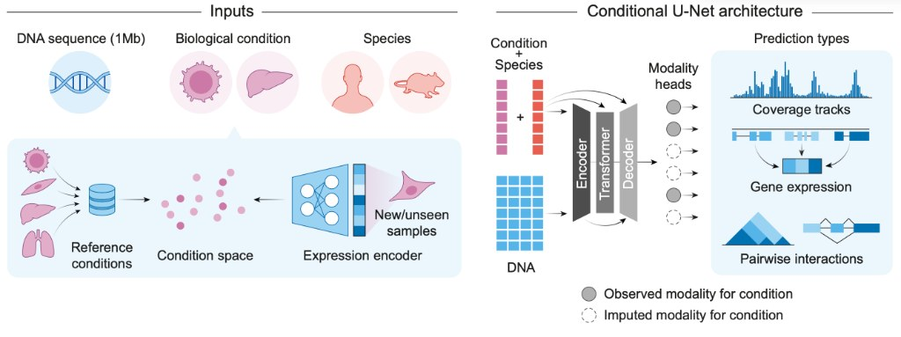
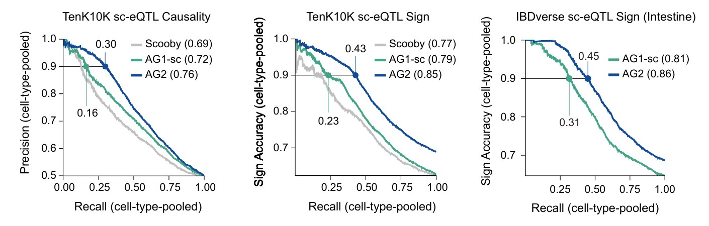
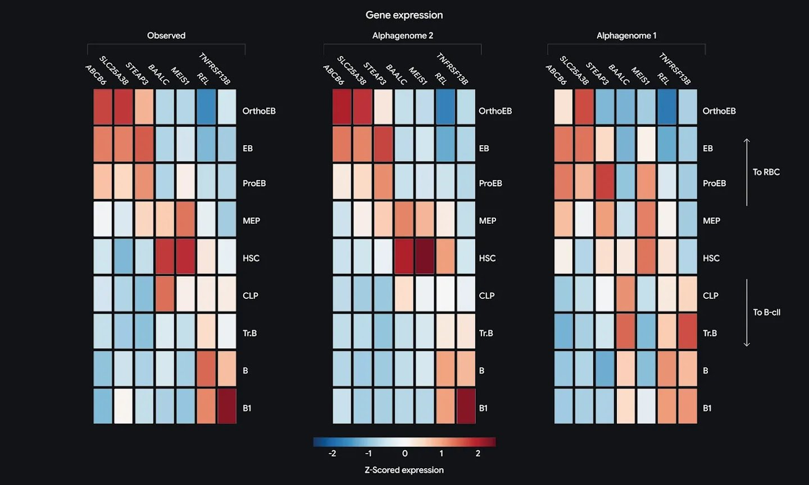

AlphaGenome 2 is Google DeepMind's second DNA sequence model, announced on November 11, 2026. It takes a 1 Mb DNA sequence and one biological condition, a tissue, a cell type or a cell state, and predicts how that sequence and its variants change gene expression, chromatin accessibility, splicing and DNA methylation in that condition. AlphaGenome 1 predicted a fixed set of bulk tissue and cell-line tracks all at once.

DeepMind says the redesign roughly doubles how many causal variants it recovers in single-cell data. This guide covers what changed between the two models, what the reported benchmarks show, and what you need to change in code to score a variant with AlphaGenome 2.

## AlphaGenome 2 vs AlphaGenome 1: Conditional Model Instead of Fixed Tracks {#alphagenome-2-vs-alphagenome-1}

AlphaGenome 1 read a million-letter sequence and produced predictions for thousands of experiments in parallel. DeepMind's post says this spread the model's capacity thin and made subtle differences between related cell types hard to capture.

AlphaGenome 2 predicts for one condition at a time and feeds that condition into every stage of the network. The condition is either a reference entry from a fixed catalog, written as an ontology CURIE such as `UBERON:0000178_CL:0001054` for CD14-positive monocytes in blood, or an embedding computed from your own single-cell RNA-seq counts.



*AlphaGenome 2 architecture: sequence plus one condition in, condition-specific tracks out. Image: AlphaGenome documentation, Google LLC.*

The training data shifted from bulk to single-cell. AlphaGenome 1 used bulk assays only. The AlphaGenome 2 paper adds 3977 single-cell RNA-seq and ATAC-seq pseudobulk tracks from 36 human and mouse studies and CpG methylation for 185 human reference conditions, then post-trains on single cells sampled from 107 million human scRNA-seq profiles.

| | AlphaGenome 1 | AlphaGenome 2 |
|---|---|---|
| Input | 1 Mb DNA sequence | 1 Mb DNA sequence plus one condition |
| Training data | Bulk tissues and cell lines | Bulk plus single-cell atlases, 107 million profiles |
| Output per call | All tissues and cell types | One condition, every channel, each track tagged observed or imputed |
| New outputs | — | Single-cell expression, single-cell ATAC, DNA methylation, cell embeddings |
| Removed outputs | — | PRO-cap |
| Variant scores | `raw_score` and `quantile_score` | `raw_score` only |
| Unseen cell types | Fine-tuning needed | Condition on up to 256 cells, no fine-tuning |

Because the model separates the cell state from the outputs, it can also impute data that was never measured for a condition. Every AlphaGenome 2 track carries an `imputation_mode` label: `observed`, `imputed_supported` or `imputed_exploratory`. Check that label before treating a track as a measured readout.

## AlphaGenome 2 Benchmarks: Variant Effect Prediction Results {#variant-effect-prediction-benchmarks}

All numbers in this section come from DeepMind's AlphaGenome 2 paper. No outside group has published a reproduction yet.

The headline result is on TenK10K, a single-cell eQTL study of 28 primary immune cell types. At 90% precision, AlphaGenome 2 recovered 30% of fine-mapped causal variants, compared with 16% for AlphaGenome 1 fine-tuned on single-cell data (AG1-sc). For predicting whether a variant raises or lowers expression, recall at 90% accuracy rose from 23% to 43%.



*Single-cell eQTL benchmarks; dots mark recall at 90% precision or sign accuracy. Image: Gayoso et al., AlphaGenome 2 paper, Fig. 2e, Google DeepMind.*

| Benchmark (DeepMind-reported) | AlphaGenome 2 | AlphaGenome 1 | Other baseline |
|---|---|---|---|
| TenK10K sc-eQTL causality, AUPRC | 0.76 | 0.72 (AG1-sc) | 0.69 (Scooby) |
| TenK10K sc-eQTL sign, AUC | 0.85 | 0.79 (AG1-sc) | 0.77 (Scooby) |
| IBDverse intestinal sc-eQTL sign, AUC | 0.86 | 0.81 (AG1-sc) | — |
| GTEx bulk eQTL causality, AUPRC | 0.74 | 0.72 | 0.69 (Borzoi) |
| GTEx bulk eQTL sign, AUC | 0.85 | 0.83 | 0.77 (Borzoi) |
| Enhancer–gene linking, AUPRC | 0.78 | 0.73 | 0.61 (Borzoi ensemble), 0.57 (ENCODE-rE2G) |
| Enhancer–gene linking at 100 to 2500 kb, AUPRC | 0.62 | 0.48 | 0.37 (ENCODE-rE2G), 0.28 (Borzoi) |

Two patterns stand out. The gains are largest in the high-precision range, which is where variant prioritisation happens. And the gap over AlphaGenome 1 is much smaller on bulk GTEx tissues than on single-cell data, where AlphaGenome 1 was weakest. The bulk eQTL causality AUPRC moves only from 0.72 to 0.74.

Expression prediction improved as well. Across GTEx tissues, the median per-tissue Pearson correlation rose from 0.61 to 0.71. Within tissues, AlphaGenome 2 explained a median of 34% of cell-type-specific expression variance, against 23% for AG1-sc.



*Observed expression during blood cell maturation (left) against AlphaGenome 2 (middle) and AlphaGenome 1 fine-tuned on single-cell data (right). Image: Google DeepMind.*

The paper's discussion names the gaps. Recall of variant effects across individuals is still limited. Distal and post-transcriptional effects are underestimated. Stimulated cell states are underrepresented in the training data, so predictions for activated or diseased cells rest on thinner evidence.

## AlphaGenome 2 Expression Conditioning: Predicting Unseen Cell States {#expression-conditioning}

Expression conditioning is the feature AlphaGenome 1 had no equivalent for. You pass a small scRNA-seq count matrix, the model's cell encoder compresses it into a cell-state embedding, and predictions are made for that state without retraining.

The documentation sets the input rules:

- raw integer UMI counts in `adata.X`, since normalised or log values are truncated to integers;
- Ensembl gene IDs (`ENSG…`) as `adata.var_names`;
- up to 256 cells per call (`dna_client.MAX_CONDITIONING_CELLS`), with at least 16 cells recommended to average out sampling noise.

DeepMind's examples show what this is for. Given single-cell data from a COVID-19 mRNA vaccine study that the model had not seen, AlphaGenome 2 separated vaccine-activated T cells from resting ones. It also showed that a variant linked to severe COVID-19 disrupts gene activity more strongly in the activated state. In a second case, it reproduced a published finding that a distant regulatory variant drives inflammatory bowel disease by overactivating ETS2 in gut macrophages.

## How to Score a Variant with the AlphaGenome 2 API: Colab Walkthrough {#score-variant-alphagenome-2}

The `alphagenome` package is a thin client for the hosted models, so you need a free API key and no GPU. It installs with `pip install alphagenome` on Linux, macOS or Windows. The official v2 Colab scores `chr2:219243701:C>T`, near the gene GLB1L, in CD14-positive monocytes:

```python
from alphagenome.data import genome
from alphagenome.models.v2 import dna_client, variant_scorers

dna_model = dna_client.create(API_KEY)

condition = 'UBERON:0000178_CL:0001054'  # CD14-positive monocytes in blood
variant = genome.Variant(
    chromosome='chr2', position=219243701,
    reference_bases='C', alternate_bases='T',
)
interval = variant.reference_interval.resize(dna_client.SEQUENCE_LENGTH_1MB)

sc_gex = variant_scorers.RECOMMENDED_VARIANT_SCORERS['SC_GENE_EXPRESSION']
dnase = variant_scorers.CenterMaskScorer(
    requested_output=dna_client.OutputType.DNASE,
    width=501,
    aggregation_type=variant_scorers.AggregationType.DIFF_MEAN,
)

scores = dna_model.score_variant(
    interval=interval, variant=variant,
    variant_scorers=[sc_gex, dnase], condition=condition,
)
tidy = variant_scorers.tidy_scores(scores, match_gene_strand=True,
                                   filter_protein_coding=True)
```

`score_variant` predicts the reference and alternate sequences and returns one AnnData object per scorer. In the Colab, the single-cell expression result covers 73 genes across 7 tracks. `tidy_scores` flattens the results into one row per variant, gene, scorer and track. If you omit `variant_scorers`, the recommended scorers for the organism and condition are used.

To score in your own cells, replace `condition=` with `cell_conditioning=` (the AnnData of counts) plus a `cell_condition_name=` label. The docs then recommend the `SC_GENE_EXPRESSION_DENOISED` scorer. The single-cell Colab conditions on 128 CD14+ monocytes from a published CELLxGENE dataset.

## AlphaGenome 1 to 2 Migration: API Changes and When to Keep AG1 {#alphagenome-1-to-2-migration}

Both models ship in the same package, so existing AlphaGenome 1 code keeps working:

```python
from alphagenome.models.v2 import dna_client                  # AlphaGenome 2
from alphagenome.models.v1 import dna_client as dna_client_v1  # AlphaGenome 1
```

When you port code, the main changes are:

- **Condition is required.** Every `predict_*` and `score_*` call takes exactly one `condition=` or `cell_conditioning=`. To compare tissues, loop over conditions, or pass one per item with `conditions=` in batch methods.
- **Metadata moved.** Use `dna_model.supported_conditions()` to list conditions and `dna_model.observed_metadata()` to see which tracks were actually measured.
- **Scores are raw only.** AlphaGenome 1's `quantile_score` ranked each raw score against about 300,000 common variants. AlphaGenome 2 has no equivalent, so thresholds tuned on AlphaGenome 1 quantiles do not transfer.
- **Some outputs changed.** `SPLICE_SITES` is now condition-specific, `CONTACT_MAPS` values are not comparable to AlphaGenome 1, and `PROCAP` is gone, with `CAGE` as the documented substitute.

Keep AlphaGenome 1 when you need to reproduce the AlphaGenome 1 paper, score a variant across all tissues and cell types in one call without choosing a condition, or predict PRO-cap tracks. The AlphaGenome Atlas of precomputed scores for all 9 billion possible single-letter changes comes from AlphaGenome 1. For AlphaGenome 2, DeepMind has released precomputed enhancer–gene links and scores for 7 million common variants.

## AlphaGenome 2 Access and Terms of Use {#alphagenome-2-access}

AlphaGenome 2 is available now through the AlphaGenome API for non-commercial research. Under the AlphaGenome Terms of Service, API outputs and Atlas scores must not be used for clinical decisions or to train machine learning models. Commercial research access is in private preview through Model Garden on Google Cloud. DeepMind also says AlphaGenome 2 Skills are coming to Google Antigravity, its agent development platform.

## AlphaGenome 2 FAQ {#alphagenome-2-faq}

### Is AlphaGenome 2 better than AlphaGenome 1?

On DeepMind's own benchmarks, yes for cell-type-specific work. On TenK10K single-cell eQTLs it reports causal-variant recall at 90% precision of 30% versus 16% for AlphaGenome 1 fine-tuned on single-cell data. These results have not been independently reproduced, and AlphaGenome 1 is still the only option for scoring all tissues in one call or predicting PRO-cap.

### Do I need a GPU to run AlphaGenome 2?

No. The `alphagenome` Python package is a client for DeepMind's hosted models. It runs on Linux, macOS and Windows and needs a free API key, not a local GPU.

### Can I use AlphaGenome 2 commercially or clinically?

Direct API outputs are for non-commercial research only and must not be used for clinical decisions or to train machine learning models. Commercial research access is in private preview through Google Cloud Model Garden.

## References {#references}

- Google DeepMind, [AlphaGenome 2: Deciphering how cells read DNA to better understand disease](https://deepmind.google/blog/alphagenome-2-deciphering-how-cells-read-dna-to-better-understand-disease/), Nov 11, 2026
- A. Gayoso, A. Mottram, A. Karollus, G. Novati et al., [AlphaGenome 2 predicts regulatory activity and variant effects across cell states](https://storage.googleapis.com/deepmind-media/DeepMind.com/Blog/alphagenome-2-deciphering-how-cells-read-dna-to-better-understand-disease/alphagenome-2.pdf), Google DeepMind, 2026
- AlphaGenome documentation, [Migrating from AlphaGenome 1](https://www.alphagenomedocs.com/user_guides/ag1_vs_ag2.html)
- AlphaGenome documentation, [Scoring a variant (v2 Colab)](https://www.alphagenomedocs.com/colabs/v2/score_variant.html)
- AlphaGenome documentation, [Conditioning on your own single-cell data](https://www.alphagenomedocs.com/colabs/v2/conditioning_on_single_cell_data.html)
- AlphaGenome documentation, [Installation](https://www.alphagenomedocs.com/installation.html) and [FAQs](https://www.alphagenomedocs.com/faqs.html)
- [google-deepmind/alphagenome](https://github.com/google-deepmind/alphagenome) on GitHub
