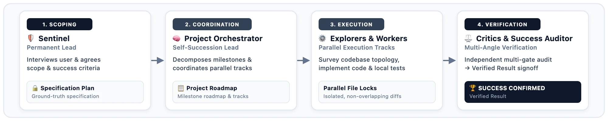
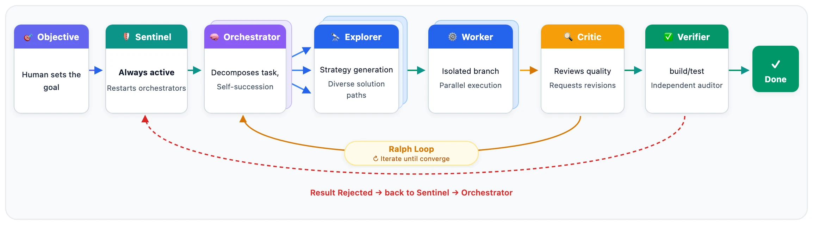
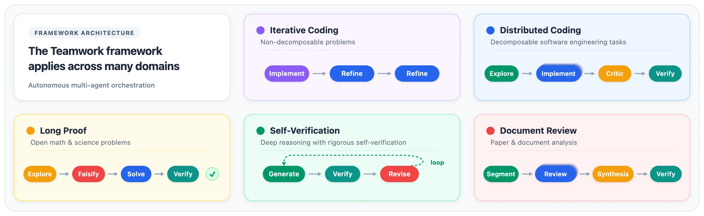

On November 13, Google Research said outside developers can now run Gemini 4 models with Antigravity Teamwork, the `/teamwork` agent-team mode Google has used for Lean-verified proofs and for rewriting a microkernel into about 800,000 lines of safe Rust. The post, by Google Fellow Vahab Mirrokni, lists results in math, chemistry and systems engineering. It says little about how to use the command or how it differs from Antigravity's other multi-agent commands, `/boost` and `/swarm`.

Readers noticed. On Hacker News, one reply asked "When to use teamwork vs boost vs swarm?" and another said "This doesn't tell me how to use it." Google's Antigravity documentation answers both, spread across three pages. This guide puts them in one place: how Teamwork splits and checks the work, how it compares with Boost and Swarm, how to start a run and write its brief, and what it costs.

## Antigravity Teamwork vs Boost vs Swarm: Which Command to Use {#antigravity-teamwork-vs-boost-vs-swarm}

Use `/teamwork` when a project runs for hours or days and needs milestones, `/boost` when one problem is hard but small, and `/swarm` when the work is broad and splits cleanly into independent pieces. Background subagents cover the smallest case: a side task such as a test run or a browser check. All four sit in the same comparison table in Antigravity's docs:

| | Subagents | `/boost` | `/swarm` | `/teamwork` |
|---|---|---|---|---|
| Best for | A focused side task: codebase research, a browser check, a test run | Hard bugs, race conditions, algorithms, tricky refactors | Broad tasks that split across independent files, packages or questions | Multi-milestone projects, repository-scale migrations, simulations, deep research |
| How agents coordinate | Each subagent reports back to the agent that started it | An orchestrator runs rounds where workers implement, challenge, fix and re-verify | A coordinator assigns named workers and a verifier who talk on one shared board | A Sentinel and a Project Orchestrator run specialized roles through a milestone plan with review gates |
| How it starts | Automatic delegation or an `@subagent` mention | `/boost <task>`, immediately | `/swarm <task>`, immediately | `/teamwork <goal>`, then a scoping interview |
| Workspace | Current workspace, or an isolated copy on request | Current workspace, isolated subagent contexts | Current workspace, or per-worker copies for overlapping edits | Dedicated `~/teamwork_projects/{PROJECT_NAME}` directory with exclusive file ownership |
| Verification | Parent agent checks the reply | Improvement workers try to break earlier attempts and rerun tests; the orchestrator spot-checks | A dedicated `@verifier` reviews diffs and runs tests | Critic, Challenger, Auditor and Success Auditor gates on every milestone |
| Typical horizon | Seconds to minutes | Seconds to hours | Minutes to hours | Hours to days |
| Plans | All plans | Paid plans | Google AI Pro and Ultra (preview) | Paid plans |

*Source: Google Antigravity docs, "When to use /teamwork" comparison table, retrieved November 14, 2026.*

The split between Boost and Teamwork comes from Google's own trajectory data. According to the Google Research post, a long Teamwork campaign that analyzed past runs found that tightly coupled code is handled better by sequential implementation and revision than by splitting it across parallel workers. Google packaged that sequential loop as `/boost`. So when the change touches code that all depends on itself, such as a locking bug, a hot loop or one module's internals, fanning it out to a team works against you.

Swarm and Teamwork both run parallel workers, and the difference is structure. A swarm turns your current conversation into a coordinator, adds workers named for their slice (`@parser`, `@api-tests`, `@docs`) and usually one `@verifier` for every two to four workers. Everyone posts to one board you can watch and steer, and idle members sleep without spending tokens. Teamwork interviews you first, writes a plan with milestones, moves the work into its own directory and will not close a milestone until independent reviewers pass it. Pick Swarm when you want to stay in the loop and the pieces don't collide; pick Teamwork when you want to hand off a spec and come back later.

### Antigravity Teamwork vs Boost for Coding Tasks

For day-to-day coding, Boost is the default choice. It needs no setup: an orchestrator routes the task to an implementation pipeline (DeepCoder) or a root-cause pipeline (DeepInvestigator), a first worker attempts it and runs the tests, and follow-up workers reread your requirements, try to break that attempt and fix what they find. The orchestrator then checks the result against each requirement and starts another round if anything fails. Teamwork earns its overhead only when the job has several milestones, for example "migrate this service, keep every test green, and match the old benchmark numbers."

## How Antigravity Teamwork Works: Roles and Verification Gates {#how-antigravity-teamwork-works}

Antigravity Teamwork splits a run into coordinators who delegate rather than code, workers who build, and reviewers who judge that work from a clean context. The docs group the roles into three tiers:

- **Sentinel** takes over once you approve the prompt. It records the request, routes work, posts progress updates and, at the end, spawns the Success Auditor.
- **Project Orchestrator** breaks the brief into milestones, runs parallel tracks and delegates every unit of work. Between milestones it hands off to a fresh successor of itself.
- **Explorers** are read-only. They trace call chains and evaluate candidate approaches without touching source files.
- **Workers** have terminal and file tools and build in non-overlapping tracks. The orchestrator assigns each file to one worker, so two workers never edit the same file.
- **Critic** reviews the code for correctness, robustness, interface conformance and style. **Challenger** writes adversarial tests, edge cases and worst-case inputs. **Auditor** checks test evidence against real command output, so a mocked or skipped test does not count as a pass.
- **Success Auditor** runs a final end-to-end check before Sentinel shows you the result.



*Teamwork's four stages, from scoping to verified sign-off. Source: Google Antigravity docs, "Teamwork agent teams (/teamwork)".*

The design targets two failure modes Google names in its research post. The first is that a single model attempt is unreliable, so Teamwork runs several candidates in parallel and pairs them with falsifiers: the Lean 4 proof checker, an unmodified test suite, a simulator or hardware counters. The second is context decay over multi-day work. Teamwork gives each agent only the files and tools for its step, replaces coordinators with fresh successors, and has critics and auditors judge results without seeing the producer's reasoning. The Antigravity team's August post describes the problem these roles guard against: loosely organized agents "agreeing with other agents' early mistakes and building confidently on flawed ideas."



*The default distributed coding path. Critic feedback loops back to the Orchestrator until the work converges; a result the Verifier rejects goes back to Sentinel. Source: Antigravity blog, "Teamwork: when AI becomes a research partner" (August 27, 2026).*

All coordination runs through files in the project directory: a request artifact with your goals and acceptance criteria, a project plan with the milestone roadmap, and a progress artifact with live status. Each subagent writes notes and helper scripts to its own scratch directory. You can follow the tracks in the app's subagent panel or the CLI status bar. Patterns are specifications rather than code, so the framework decides at run time how many agents to spawn and can change the team mid-run.

This is the same router-and-worker idea behind [DeepSeek's Super-agent design](/tutorials/deepseek-super-agent-architecture/), with heavier review between steps. The handoff to fresh coordinators is also one answer to the state problems covered in our [review of stateful long-horizon agent research](/tutorials/stateful-long-horizon-agents-review/).

## Antigravity Teamwork Execution Paths and Prompt Signals {#antigravity-teamwork-execution-paths}

Antigravity Teamwork picks one of five execution paths from the wording of your prompt, so a few phrases change the team you get. Gemini reads the request and selects the pattern; the docs list the signals:

| Execution path | Best for | How to trigger it |
|---|---|---|
| General (distributed coding) | Multi-file engineering, large refactors, system simulation, research | Default |
| Iterative coding | One self-contained change: a bug fix, a small feature, a contained refactor. Cannot decompose the task | Say "keep it small" or "keep it focused" |
| Document review | Multi-angle critique of papers, RFCs and design docs | Ask to "review this paper" or "critique this design doc" |
| Math / proof | Problem solving, formal bounds, theorem proving | Ask to "prove theorem X" or "verify mathematical bounds" |
| Math / proof (large team) | Tournament-style search on hard conjectures | Say "Use a very large team of agents" |

*Source: Google Antigravity docs, "Execution paths", retrieved November 14, 2026.*



*The pattern set as of August 2026; the current docs fold self-verification into the math path and add a large-team option. Source: Antigravity blog, "Teamwork: when AI becomes a research partner".*

The iterative coding path overlaps with `/boost`; Google describes Boost as that pattern packaged as a standalone command. If you already know the change is small, calling `/boost` directly skips the scoping interview. The document review path is the same pattern Google offers as Deep Review, which the authors of 578 STOC 2027 submissions used for feedback on their drafts.

## How to Start Antigravity Teamwork in the App or CLI {#how-to-start-antigravity-teamwork}

To start Antigravity Teamwork, open a new conversation in the Antigravity app or CLI on a paid plan and type `/teamwork` followed by your goal. The docs give this example:

```text
/teamwork Migrate our REST API service from Express to Fastify, including full test coverage, TypeScript typing, and benchmark validation.
```

The run then has two phases. In the first, the main Antigravity agent interviews you and drafts a prompt artifact. In the second, after you approve that artifact with one confirmation, Sentinel hands the project to the Project Orchestrator and the team works through its milestones without further prompts. The August preview used the command `/teamwork-preview`; the current docs call it `/teamwork` on both the app and the CLI.

### Writing the Antigravity Teamwork Scoping Brief

The interview follows one rule from the docs: specify what, not how. It covers five items, and each one decides how much the later gates can catch:

1. **Scope and purpose.** What you want built and whether it is a demo, production code, an evaluation or an exploration.
2. **Requirements.** Only the ones you care about. Each becomes something the Auditor checks.
3. **Independent verification.** An objective check per requirement: a test suite, a reference benchmark or metric script, or an independent agent judging against an explicit rubric.
4. **Acceptance criteria.** Testable conditions for calling the project done.
5. **Working directory.** Defaults to `~/teamwork_projects/{PROJECT_NAME}`, which keeps your main repository untouched.

Item 3 matters most. The results Google reports all lean on a checker the agents cannot argue with, and the Auditor can only compare evidence against something concrete. "Fast" gives the team nothing to verify; "p95 latency under the current Express numbers on our existing load test" does.

### Choosing an Antigravity Teamwork Integrity Mode

During the interview, the agent asks which shortcuts are off-limits and maps your answers to one of three integrity modes, recorded in the prompt artifact:

| Mode | Use it for | What the Auditor enforces |
|---|---|---|
| development (default) | Rapid iteration | Flags only fabricated outputs and facade implementations; libraries, code reuse and frameworks are allowed |
| demo | A reproducible presentation | Also bans copying core logic from open source, handing core work to external tools, and reading test source to reverse-engineer expected behavior |
| benchmark | A thorough evaluation | A fully independent, from-scratch implementation using only the language's standard library |

*Source: Google Antigravity docs, "Integrity modes".*

For ordinary product work, development mode is the right setting. Benchmark mode exists for measuring what the agents can do on their own, and it rules out the libraries most production code depends on.

## Antigravity Teamwork Examples: Rust Rewrites, TPU Kernels and Proofs {#antigravity-teamwork-examples}

Google's examples of Antigravity Teamwork share one trait: each had a fixed, external way to tell right from wrong. All figures below are Google's own and come from its November 13 research post unless noted.

| Project | Objective check | Reported result |
|---|---|---|
| Zircon microkernel, C++ to Rust | Original, unmodified kernel unit tests; booting on arm64 | Starting from an earlier 25% port, a two-week campaign on Gemini 4 Argon rewrote the rest: about 800,000 lines of safe Rust that pass all kernel unit tests |
| libgav1 AV1 decoder, C++ to Rust | Bit-exact output on a conformance suite; profiling on sample clips | About 170,000 lines of Rust, 100% bit-exact; first about 4x slower, then 20–30% faster than the C++ and hand-tuned assembly once given profiling tools |
| JAX and Pallas TPU kernels (DuoDiscover pattern) | 23-second proxy evaluators validated against 7–32 minute hardware runs | 4.09x geometric-mean speedup on 17 JAXBench kernels; 2.99x on 7 vLLM TPU inference kernels |
| NMR molecule structure | Physics-informed spectral simulator | 30 agents: 95% top-1 exact match, 100% top-3, nearly double a single agent |
| Causal inference benchmark | Five human acceptance criteria; reviewer and auditor agents | 29 agents over 11.5 hours turned 13 public tables into 50 tasks |
| Courtade–Kumar conjecture | Lean 4 proof checker | Proof formalized in about 50 million lines of Lean, with researchers from CUHK, USC and CMU |

The libgav1 row shows what a fixed checker buys. The first Rust port matched the decoder's output and ran about four times slower. Google then gave the team profiling tools and a mandate to maximize speed on sample clips, and the finished port, still bit-exact, came out 20–30% faster than the C++ on both x86_64 and ARM. The Zircon rewrite relied on a rule against a common migration failure, agents that "stub out dependencies or alter tests to make a broken port pass." Its rewrite pattern schedules each module only after its dependencies compile and links every leaf module against the original test suite.

Two caveats apply. Google calls that rewrite pattern "soon to be available" in Antigravity and says its formal proof pattern will come in later updates, so the public command does not yet include every workflow behind these results. And most of the math results were produced with human researchers, who framed the problems and, by Google's account, verified, simplified and edited the proofs for publication. For a closer look at what an AI-produced proof does and does not establish, see our analysis of [DeepMind's Signal protocol proof](/tutorials/signal-messaging-protocol/).

## Antigravity Teamwork Cost, Quota and Review Overhead {#antigravity-teamwork-cost-and-quota}

Antigravity Teamwork's main cost is time and quota: the docs put a typical run at hours to days, and every Critic, Challenger and Auditor pass is another agent spending tokens. Google does not publish a per-run quota figure for `/teamwork`. For `/swarm`, the docs warn that "every worker is its own agent, so a swarm uses quota much faster than a single conversation," and a Teamwork run, with more roles and a longer horizon, adds up the same way.

Early users hit this limit. In June, while the command was still `/teamwork-preview`, a developer on Google's AI developer forum reported that a run stopped partway through with an "individual quota reached" error and a prompt to enable overages, with no estimate beforehand and no clean pause, which left the code half-changed. Another preview user complained that dozens of Markdown files landed in the agent's working directory. The current docs address the second problem with the dedicated project directory and per-agent scratch folders; they say nothing about pausing a Teamwork run when quota runs out. Swarm members, by contrast, pause on a quota error and wait instead of retrying.

The process overhead draws complaints too. On Hacker News, one user who had inspected a run described "an overwhelming amount of ceremony: BRIEF.md, specialized roles, multiple rounds of checking," and asked whether all of it was necessary. It pays off when a milestone can fail in ways a single agent would miss, which is why Google's examples all come with test suites, proof checkers or hardware timers. Without such a check, the review rounds mostly cost time.

A few habits keep the bill predictable:

- **Start with `/boost` for anything that fits in one sitting.** Escalate to `/teamwork` only when the work needs milestones.
- **Give every requirement a check before you approve the prompt artifact.** The Auditor can only enforce what the brief defines.
- **Keep the default development mode** unless you are measuring what the agents can build from scratch.
- **Watch the progress artifact and the subagent panel** during the first hours, when a bad plan is cheapest to stop.

If you are tracking spend across agent tools, measure cost per finished milestone rather than per run, the same approach we describe for [coding agents and cost per successful task](/tutorials/coding-agents-finops-cost-per-successful-task/). The model behind the team matters as well; our [Gemini 4 Hydrogen benchmarks](/tutorials/gemini-4-hydrogen-benchmarks/) cover the Carbon-coordinator, Hydrogen-worker setup Google offers in Antigravity, with cost and time per task at each thinking level. How much the harness itself moves results is the subject of the [HarnessDev agent harness benchmark](/tutorials/harnessdev-agent-harness-benchmark/) and our piece on why [harnesses are separating from agent frameworks](/tutorials/agent-framework-harness-runtime-production/).

## References {#references}

1. Google Antigravity Docs, "Teamwork agent teams (/teamwork)," retrieved November 14, 2026. <https://antigravity.google/docs/teamwork>
2. Google Antigravity Docs, "Boost deep reasoning (/boost)" and "Swarm (/swarm)," retrieved November 14, 2026. <https://antigravity.google/docs/boost>, <https://antigravity.google/docs/swarm>
3. Vahab Mirrokni, Google Research, "Advancing science & engineering with Antigravity's /teamwork," November 13, 2026. <https://research.google/blog/advancing-science-engineering-with-antigravitys-teamwork-feature/>
4. The Antigravity Team, "Teamwork: when AI becomes a research partner," Google Antigravity Blog, August 27, 2026. <https://antigravity.google/blog/teamwork-when-ai-becomes-a-research-partner>
5. Hacker News discussion, "Advancing science and engineering with Antigravity's /teamwork," November 14, 2026. <https://news.ycombinator.com/item?id=50496811>
