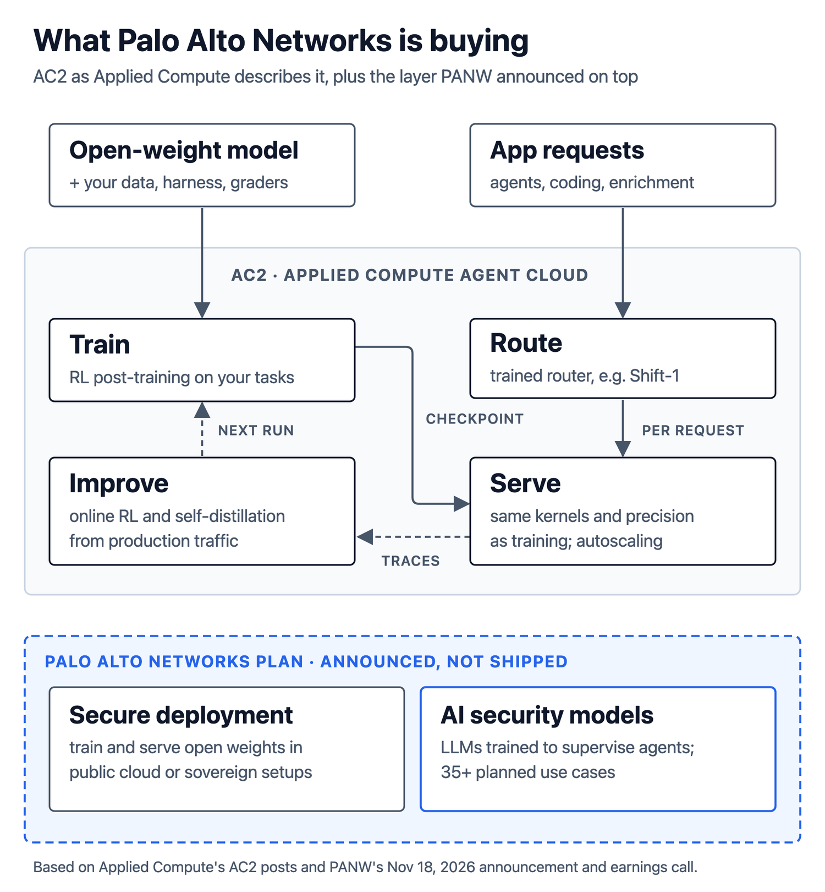
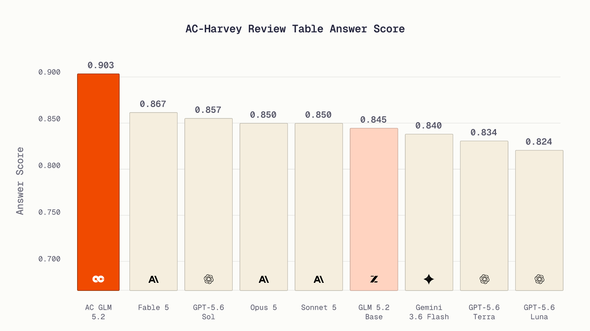
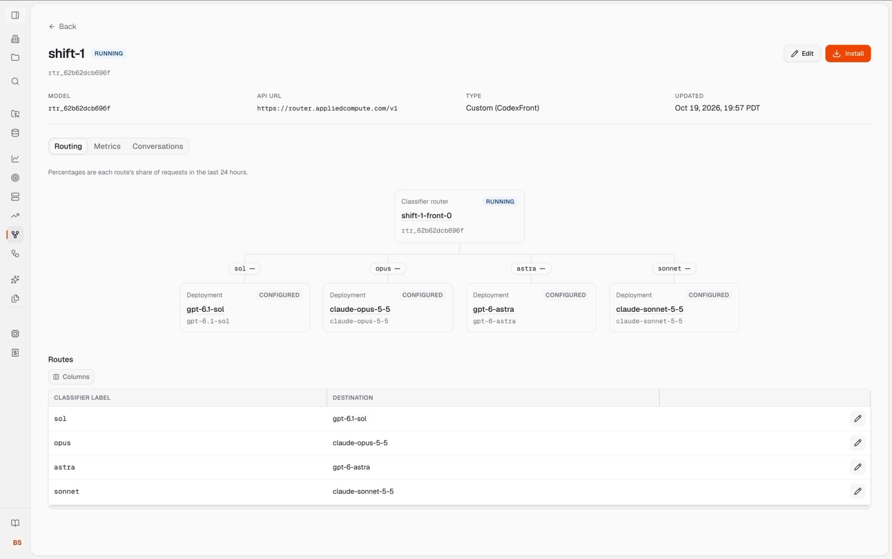

The Applied Compute acquisition puts a post-training and inference platform for open-weight models inside a cybersecurity company. Palo Alto Networks announced on November 18, 2026 that it will buy [Applied Compute](https://appliedcompute.com) in an all-stock deal valued at $4.5 billion, and its pitch is specific: enterprises will run a mix of open and closed models, nobody large is delivering the open ones securely, and Palo Alto intends to. What it gets is AC2, a stack that trains models on a company's own tasks, serves them, learns from their production traffic and routes requests between them, plus the research team that built it.

That team matters as much as the product. Chairman and CEO Nikesh Arora told investors that static security rules cannot keep up with AI agents, so Palo Alto needs its own LLMs trained to supervise them. Applied Compute is how it plans to build those models.

## Applied Compute Acquisition Terms: Price, Timing and Who Joins {#applied-compute-acquisition-terms}

Palo Alto Networks signed a definitive agreement to acquire Applied Compute for stock valued at $4.5 billion, subject to adjustments and regulatory clearance. The company expects the deal to close in its fiscal third quarter of 2027. After closing, Applied Compute co-founder and CEO Yash Patil becomes Palo Alto's Co-Chief AI Officer, and the research team joins the company.

| Item | Detail |
|---|---|
| Buyer | Palo Alto Networks (NASDAQ: PANW) |
| Price | $4.5 billion, all stock, subject to adjustments |
| Expected close | Palo Alto's fiscal Q3 2027, pending regulatory clearance |
| Leadership | Yash Patil becomes Co-Chief AI Officer |
| Existing customers | Applied Compute keeps serving AI-native companies and enterprises |
| Size of deal | Palo Alto's second largest, after the $25 billion CyberArk purchase in February 2026, per ISMG |

The price came 16 days after a funding round. On November 2, Applied Compute said it had reached $100 million in annualized revenue run rate less than 18 months after founding, and raised $350 million at a $3.25 billion valuation in a round led by Elad Gil, with NVIDIA, Kleiner Perkins, Lux Capital, Blackstone, Shopify Ventures and HubSpot Ventures among the participants. Palo Alto's offer is about 1.4 times that valuation. SiliconANGLE puts Applied Compute's total funding above $500 million.

Applied Compute was founded in 2025 by three former OpenAI researchers, Yash Patil, Rhythm Garg and Linden Li. ISMG reports about 50 employees. Its customer list includes Microsoft, Shopify, Mercor, Harvey, DoorDash, Cognition, Clay and Decagon, and a week before the deal it bought Delegate, a startup founded by two people who built Scale AI's enterprise business, to bring that enterprise deployment experience in-house.

Palo Alto announced the deal alongside fiscal first-quarter results: revenue of $3.44 billion, up 39% year over year, and next-generation security ARR of $9.73 billion, up 66%.

## Applied Compute AC2 Architecture: Train, Serve, Improve and Route {#applied-compute-ac2-architecture}

AC2, the Applied Compute Agent Cloud, is one platform for the full life of a custom model: post-train an open-weight model on a company's own tasks, deploy it, collect what happens in production and feed that into the next training run. A trained router sits in front and decides which model handles each request. Applied Compute launched AC2 in August 2026 and calls the approach a "model factory".

*The AC2 loop and the layer Palo Alto Networks plans to add. Based on Applied Compute's AC2 posts and Palo Alto's November 18 announcement; the Palo Alto layer is announced, not shipped.*

**Train.** Customers bring their own harness and graders, and AC2 runs reinforcement learning on tool-using, long-horizon agents across text, images, code and structured data. Researchers inspect individual rollouts in the console, and an internal agent called Ari monitors runs and reads rollouts to find failure modes. Teams can start from any of the latest open models and swap to a stronger base when one ships without rebuilding the pipeline.

**Serve.** Production endpoints use the same sampling configuration, numerical precision and kernels as training, so a checkpoint behaves in production the way it did in evaluation; Applied Compute calls this zero train-to-deployment mismatch. A finished checkpoint deploys behind the same endpoint in minutes, with autoscaling, speculative decoding and a stated 99.9% uptime. Applied Compute says its inference service handles more than 1 trillion tokens a day.

**Improve.** Production traces become training data. AC2 can attach a live endpoint to a training runtime and update the model with online RL and on-policy self-distillation as user feedback arrives, with A/B tests on release candidates before rollout.

**Route.** AC2 Routers train small decision models that pick a model per request. Shift-1, a 4-billion-parameter router Applied Compute released in October, routes coding traffic between closed models and could equally route between post-trained open models such as Kimi or Nemotron.

<strong>Testing the mixed-model idea before buying a platform.</strong> AC2 is built on the bet that one application will call several models, open and closed, and pick one per request. Before training or routing anything, a smaller team can check whether that mix helps on its own prompts by sending the same requests to several hosted models through a shared gateway such as
<a href="https://www.packyapi.ai/register?aff=5W73&amp;utm_source=agentspulse&amp;utm_medium=affiliate&amp;utm_campaign=applied-compute-acquisition"
rel="sponsored nofollow noopener" target="_blank">PackyAPI</a>. A hosted gateway sits outside your perimeter, so it does not offer the in-VPC controls described next.

The parts that a security buyer cares about sit underneath: serverless or in-VPC deployment so data stays inside the customer's perimeter, role-based access control, audit logs on every dispatch, SOC 2 and ISO 42001 certification, and customer ownership of the weights. Since July, customers have run more than 1,700 training runs on AC2, and 40% of customers use it for both training and inference.

## Applied Compute Customer Results: Harvey, Clay and Shift-1 {#applied-compute-customer-results}

Applied Compute's public case studies each show one layer of the stack cutting cost or raising quality on a single high-volume workload. All of the numbers below come from Applied Compute and the customers involved; none has been independently replicated.

**Harvey, training.** For Harvey's Review Table, where a lawyer can upload up to 10,000 files and every cell of the resulting grid is a separate model call, Applied Compute post-trained GLM 5.2 on a synthetic dataset built from open-source legal documents. Harvey's customer data was not used. The reward gated schema and correctness together and scored citations separately, with a recall-times-precision term to stop the model from citing everything.

*Review Table answer score, combining answer correctness and citation quality, at minimal reasoning effort. Image by Applied Compute and Harvey, June 2026; the comparison models were current at the time.*

The tuned model scored 0.903 against 0.845 for the GLM 5.2 base it started from and 0.867 for the best closed model tested. In its November fundraise post, Applied Compute says the model runs at less than half the inference cost of the frontier alternative.

**Clay, routing.** Clay's research agent, Claygent, has processed more than 5 billion queries, from yes-or-no company classifications to multi-step research. Applied Compute post-trained Qwen 3.6 35B A3B with GRPO to predict each candidate model's quality on a query, then picks the model with the best quality-minus-cost score, with a floor so no query class gets worse to pay for savings elsewhere. Clay reports inference costs down by up to 47% with minimal impact on answer quality.

**Shift-1, routing for coding agents.** Shift-1 chooses a model for every request inside a session, rather than once per task, and accounts for the cost of breaking the prompt cache when it switches. On thousands of turns of Applied Compute's own coding work, it cut Codex spend by 55% compared with using GPT-6-Astra alone, by routing between Astra and GPT-6.1-Sol, and Claude Code spend by 24% compared with Opus 5.5. Quality was judged by a calibrated LLM judge on that internal traffic. NVIDIA collaborated on the work through its NeMo Switchyard project. For how Astra and Sol compare on public benchmarks, see our [GPT-6.2 Astra vs Sol breakdown](/tutorials/gpt-6-2-benchmarks/); the routing logic is the same cost-per-successful-task tradeoff covered in [coding agent FinOps](/tutorials/coding-agents-finops-cost-per-successful-task/).

*Shift-1 in the AC2 Routers console, routing between OpenAI and Anthropic deployments. Image by Applied Compute.*

## Why Palo Alto Networks Wants Applied Compute: LLMs That Supervise AI {#why-palo-alto-networks-wants-applied-compute}

Palo Alto Networks wants Applied Compute for two jobs: selling secure training and serving of open-weight models to enterprises, and building its own security models that can watch over AI agents. The second reason came up most on the earnings call.

Arora told investors, as reported by ISMG, that Palo Alto first focused on controls against threats like prompt injection, then concluded that predefined policies cannot keep up with agents. "Deterministic controls cannot anticipate every scenario that an agent is going to conduct, or every deception that it's going to try and do," he said. "We actually would have to have an LLM trained to interpret, understand, and stop AI from misbehaving." He added that supervising an AI application well requires visibility into how it was trained, which a training platform provides.

The press release says the Applied Compute team will train Palo Alto's "proprietary large and small AI models" across its products. According to ISMG, Palo Alto evaluated nine providers before choosing Applied Compute and plans to apply its capabilities to more than 35 use cases aimed at AI-enabled threats. Arora also said Palo Alto had been a prospective Applied Compute customer and that its Unit 42 Frontier AI Assessment checked the startup's security foundations.

The commercial case rests on open-weight adoption. Arora said open-weight models grew from under 5% of token traffic to more than 60% over the past year; ISMG's report gives no source or method for that figure. Palo Alto expects Applied Compute to add more than $1 billion in next-generation security ARR by 2029, and Arora suggested AI security could eventually take 2% to 5% of what enterprises spend on tokens. Those are forecasts from the buyer.

This puts training and supervision in the same vendor. Our earlier look at [AI agents with internal access](/tutorials/ai-agent-internal-access-security-boundary/) describes the problem Palo Alto says it is solving: once an agent can act inside a company, its permissions and actions become the boundary to defend.

## Open-Weight Model Security: Applied Compute's Deployment Rules {#open-weight-model-security}

Applied Compute published its framework for deploying open-weight models safely in September, and it reads like the product brief Palo Alto is buying. The company says it has taken open-weight deployments across more than 20 enterprise applications and five model families into production, and it sorts the risks into two groups: where the model runs and who can see its data, and how the model behaves once it can act.

For the first group, open weights have an advantage. A company can run the model in its own VPC or through an approved U.S. cloud with no connection back to the model's developer, so prompts, outputs and traces stay private. Applied Compute deploys all models on Western-domiciled infrastructure.

The second group covers the agent risks it sees most often:

- **Exfiltration:** an agent with both sensitive data and network access has a path to leak it.
- **Excess privilege:** the damage from an error depends on what the agent is allowed to modify, delete, send or pay.
- **Plausible errors:** wrong analysis or code that looks right and propagates before anyone checks.
- **Injected instructions:** prompt injection through documents, tools, websites or other agents.
- **Opaque traces:** long chains of tool calls that are hard to reconstruct.

On the specific worry about Chinese-origin weights, Applied Compute says it has never observed a backdoor across dozens of critical applications, but that the research literature shows backdoors are feasible and can survive further training. It cites a study where backdoored models produced vulnerable code at up to five times the normal rate when triggered, CrowdStrike's finding that DeepSeek-R1's vulnerable-code rate rose from 19% to 27.2% under certain political context, and a Cognition study that found no clear effect. Our [LLM backdoor detection](/tutorials/llm-backdoor-detection/) piece walks through what a poisoned open-weight model looks like in practice.

Because evaluations cannot find a backdoor tied to an unknown trigger phrase, Applied Compute leans on hard limits:

1. Define what files, records and systems the agent can change, keep backups out of its reach, and require approval for irreversible actions.
2. Specify which domains it can reach and what it can upload or download; disable connectivity it does not need.
3. Run the agent with the invoking user's permissions, narrowed to the task, and never let added tools or sub-agents grant more.
4. Log inputs, tool calls, state changes and outputs where the agent cannot edit or delete them.
5. Evaluate on sandboxed copies of production data with the real tools and permissions, without obvious test cues, and use monitoring agents to flag unexpected actions in traces.

Those five rules map onto things Palo Alto already sells, such as identity, network policy and audit, which is the practical overlap between the two companies. Routing and policy also tend to converge in one layer, as covered in [the model gateway as enterprise AI control plane](/tutorials/model-gateway-enterprise-ai-control-plane/).

## Applied Compute Acquisition Criticism: Price, Model Supply and Focus {#applied-compute-acquisition-criticism}

The main objections on Hacker News were about price and dependence on other labs' models. The top comment called it "$4.5B to serve fine-tuned open-weight Chinese models" from a company under two years old with fewer than 100 employees. The same commenter asked what happens if Chinese labs slow their open-weight releases, since much enterprise fine-tuning builds on them; others replied that U.S. open-weight providers such as NVIDIA exist and that released weights keep working. Another commenter read the deal as Palo Alto moving into cloud and enterprise infrastructure rather than staying a pure security company.

The case studies speak to part of that. Applied Compute's tuned models start from GLM, Qwen and other open bases, and AC2 is designed to swap bases as better ones appear, so it depends on a supply of strong open weights from somewhere rather than on one lab. Its homepage router demo already lists NVIDIA's Nemotron alongside GLM and GPT-6-Astra.

Several things are still unknown as of November 19:

- How AC2 will be packaged with Palo Alto products such as Prisma AI and Cortex, and on what timeline.
- Whether security vendors among Applied Compute's customers, such as Semgrep, keep training on a platform now owned by Palo Alto.
- What the 35 planned security use cases are.
- How the security models will be evaluated, and whether any results will be published.

## Applied Compute Customers After the Acquisition: What Changes {#applied-compute-customers-after-acquisition}

For current Applied Compute customers, nothing changes until the deal closes, which Palo Alto expects in its fiscal third quarter of 2027. The press release says Applied Compute will keep serving AI-native companies, digital natives and large enterprises, and Patil wrote that customers "will still own and control their models".

For teams weighing open-weight models against closed APIs, the deal is a signal that a large security vendor expects private, fine-tuned models to be a normal enterprise purchase, with security sold alongside them. The practical work does not depend on the acquisition: pick a base you can host, such as [Qwen 3.8 27B](/tutorials/qwen-3-8-27b/) or [GLM-5.3 on your own hardware](/tutorials/glm-5-3-nvfp4/), train against graders that reflect your real tasks, and apply the permission, network and logging limits above before an agent touches production data.

## References {#references}

1. Palo Alto Networks, [Palo Alto Networks to Acquire Applied Compute, Bringing Secure Open-Weight AI to the Enterprise](https://www.prnewswire.com/news-releases/palo-alto-networks-to-acquire-applied-compute-bringing-secure-open-weight-ai-to-the-enterprise-302944421.html), press release, November 18, 2026.
2. Applied Compute, [Applied Compute hits $100M run rate and raises $350M](https://appliedcompute.com/company/100m-run-rate-fundraise), November 2, 2026, and [Introducing AC2](https://appliedcompute.com/platform/introducing-ac2), August 25, 2026.
3. Applied Compute, [Securely Deploying Open-Weight Models](https://appliedcompute.com/company/securely-deploying-open-weight-models), September 24, 2026.
4. Applied Compute and Harvey, [Training Frontier Review Table Agents with Harvey](https://appliedcompute.com/case-studies/harvey-review-table), June 22, 2026; Applied Compute, [Shift-1](https://appliedcompute.com/platform/shift-1), October 21, 2026; [Claygent model router case study](https://appliedcompute.com/case-studies/clay).
5. Michael Novinson, ISMG, [Palo Alto's $4.5B Applied Compute Purchase Targets AI Risks](https://www.bankinfosecurity.com/palo-altos-45b-applied-compute-purchase-targets-ai-risks-a-33443), November 18, 2026.
