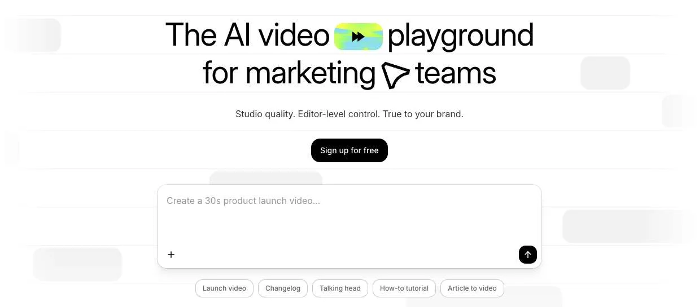
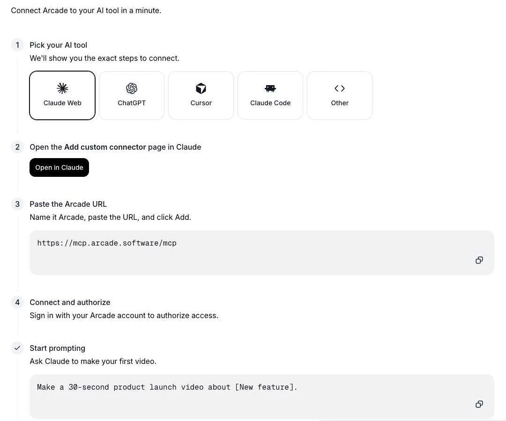
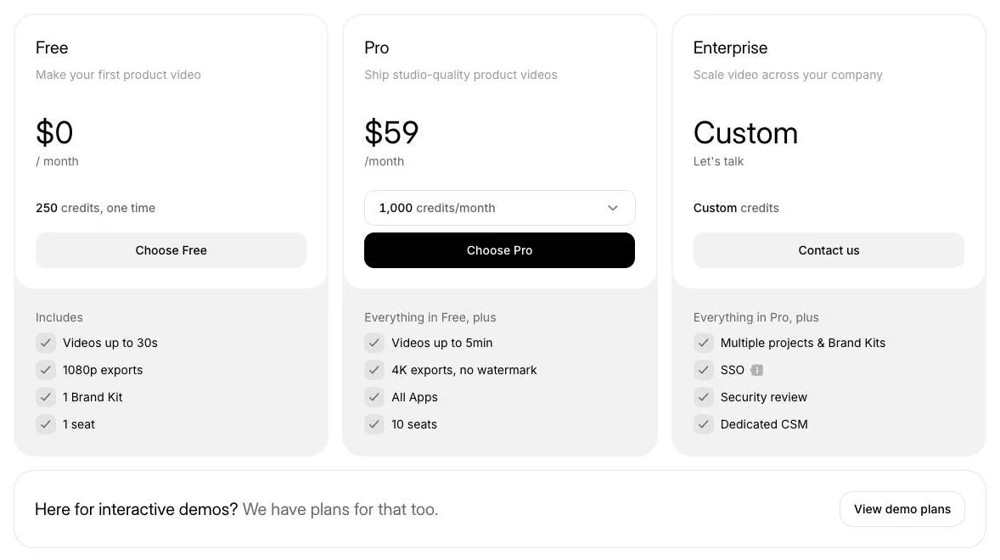
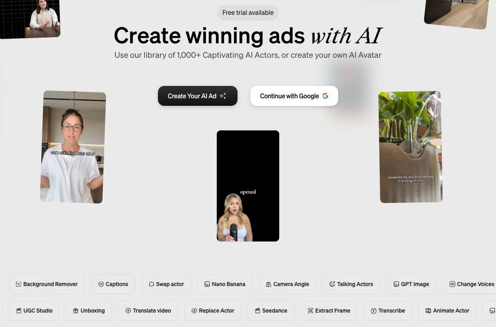

Arcade, the company best known for clickable interactive product demos, released Arcade 3.0 on November 18, 2026 and rebuilt its Arcade AI video generator around a chat. You type one line, answer two questions, and Arcade assembles a launch video with voiceover, captions and music, using your actual product screens and brand kit. This guide covers the three ways to start a video, what each one costs in credits, and how Arcade differs from Arcads, the AI-actor ad tool that sits next to it in search results.

## Arcade 3.0 Release: What the Launch Added {#arcade-3-0-release}

Arcade 3.0 turns a single prompt into a finished, branded product video and lets you change any one scene afterward without regenerating the rest. Caroline Clark, Arcade's co-founder and CEO, announced it as "the AI video playground for marketing teams": "Type one line, answer two questions, and Arcade does the rest. Voice, captions, and music included."

*The Arcade composer with its five starting formats. Screenshot of arcade.software, November 20, 2026.*

Two things separate it from a general text-to-video model. Arcade "runs its own harness on top of the best models," in Clark's words, and the models it exposes are Anthropic's: the composer offers Light (Claude Haiku 5.5), Medium (Claude Sonnet 5.5) and High (Claude Opus 5.5). The second is the source material. A video is built from your brand kit (colors, fonts, logos and the tone of voice for the script) and from whatever you attach, so the screens in the video are your product rather than generated look-alikes. Arcade's homepage describes the output as editable motion design that uses generative AI "where it adds value"; AI-generated footage is an optional add-on, and stock clips are free.

The release builds on features Arcade shipped two weeks earlier. The [November 4 changelog](https://www.arcade.software/changelog) added the MCP connector, 60 native voices in 15 more languages, and one-click variations that rebuild a finished video in another aspect ratio, language or opening hook while keeping the original.

## How to Make a Launch Video with the Arcade AI Video Generator {#how-to-make-a-launch-video-with-arcade}

To make a launch video in Arcade, describe it in the composer, pick a brand kit, model, length and aspect ratio, attach your product material, then answer the agent's planning questions. Arcade's knowledge base says the first draft usually arrives in under a minute. You can start from the web app, a screen recording, or another AI assistant.

### Start from one line in the composer

The AI Video home screen opens straight onto a prompt box ("What are we building today?"). Before you send the prompt, set:

| Setting | Options in the composer |
|---|---|
| Brand kit | Colors, fonts, logos and voice applied from the start |
| Quality tier | Light (Claude Haiku 5.5), Medium (Claude Sonnet 5.5), High (Claude Opus 5.5) |
| Length | 15 s, 30 s, 1 min, 2 min or 3 min, or custom up to 5 min on Pro and 10 min on Enterprise |
| Aspect ratio | 16:9, 1:1 or 9:16 |
| Attachments | Existing Arcade demos, URLs including YouTube links, images, PDFs, Office files, text or code files, MP4/MOV/WebM video, and connected apps such as Figma, Google Drive, GitHub, Granola and Atlassian |

Arcade's docs say the more context you attach, the closer the first draft lands: a prompt plus a demo, a screenshot or a release doc beats a bare sentence. You can also attach an earlier video as a template, which copies its scene structure and pacing, or as a reference, which borrows only the look and transitions.

After you send it, the agent asks its planning questions and sometimes offers a few visual concepts to choose from. The draft then appears as a player plus a timeline of scenes. Arcade also lists anything worth checking before you publish, for example source images that may carry licensing restrictions or audio levels it has not verified.

### Turn a screen recording into a launch video

The Arcade Chrome extension records your screen and camera along with the product's context, and Arcade turns the capture into a video with automatic zooms and cursor movements that follow the story. Since the November 4 update you can also ask the AI to change those zooms and cursor paths after recording. The extension's Chrome Web Store listing names launch videos, feature walkthroughs and tutorials as the intended results, so this is the route to take when a feature is built but has no marketing footage yet.

### Make Arcade videos from Claude, ChatGPT or Cursor with Arcade MCP

Arcade MCP lets you request and edit videos from inside another AI assistant. Add `https://mcp.arcade.software/mcp` as a custom connector, sign in with your Arcade account to authorize it, and prompt as you would in Arcade, for example "Make a 30-second product launch video about [New feature]." Arcade's setup page has steps for Claude on the web, ChatGPT, Cursor and Claude Code, and the changelog adds Gemini. Credit use and your remaining balance show up in the chat. Every request the assistant sends draws on the workspace's shared credit balance, so treat it like any MCP tool that writes to another system; our [audit of the Payload MCP plugin](/tutorials/payload-mcp-plugin-document-locks/) shows how a connector's write path can skip safeguards the regular app enforces.

*Connecting Arcade MCP to Claude. Screenshot of arcade.software/agents, November 20, 2026.*

The connector is most useful when the facts for a video live in other tools your assistant can already read. Arcade's own examples include pulling completed Linear tickets from a sprint and asking for a release video per feature, or asking for five cuts of one launch video for LinkedIn, a paid ad, a sales follow-up, a website hero and an email. If you are comparing this with agent-driven editing of footage you already shot, our [hands-on test of Claude Code video editing with ffmpeg-skill](/tutorials/claude-code-video-editing/) covers the local route, and [our look at stateless MCP and agent gateways](/tutorials/stateless-mcp-agent-gateway/) explains how remote connectors like this one are authorized and routed.

### Edit one scene without regenerating the video

Each draft is a sequence of scenes, and you can change one by asking in the chat or by editing the timeline and Design panel yourself. Manual edits are free. Regenerating a voiceover, fitting music to a new cut, captions and voice suggestions are free even when you ask the agent for them. Other AI edits use credits, which is where most of the cost difference between careful and careless use comes from.

## Arcade AI Video Generator Pricing and Credits per Video {#arcade-ai-video-generator-pricing}

The Arcade AI video generator has a free plan with 250 one-time credits and a Pro plan at $59 a month, or $49 a month billed annually, with 1,000 credits a month. On the default High model, Arcade lists about 90 credits for a 30-second video and about 150 for a 1-minute one.

*Arcade's AI video plans with monthly billing selected. Screenshot of arcade.software/pricing, November 20, 2026. The yearly toggle shows Pro at $49 a month.*

| Plan | Price | Credits | Video length | Export and seats |
|---|---|---|---|---|
| Free | $0 | 250, one time | Up to 30 s | 1080p, 1 brand kit, 1 seat |
| Pro | $59/month, or $49/month billed annually | 1,000 per month | Up to 5 min | 4K without watermark, all apps, 10 seats |
| Enterprise | Custom | Custom | Up to 10 min | Multiple brand kits, SSO, security review |

Credits pay for the AI's work: planning with you, generating, and edits you ask it to make. Arcade publishes typical amounts for the High model and calls them "typical amounts, not fixed prices":

| Request on High (Claude Opus 5.5) | Typical credits |
|---|---|
| Planning step with question and answer | Under 10 |
| Planning step with visual concepts | About 25 |
| Generate a 30-second video | About 90 |
| Generate a 1-minute video | About 150 |
| Generate a 90-second to 2-minute video | About 200 |
| AI edit within 5 minutes of your last request | About 20 |
| AI edit more than 5 minutes after your last request | About 50 |
| AI-generated clip, Standard / Premium (Pro and Enterprise) | About 1 / 3 per second |
| Stock clips, manual edits, music, voiceover, export | 0 |

Medium uses about three quarters of High's credits for the same request, and Light about a quarter. Applying those typical amounts:

- **Free plan:** a 30-second draft with one planning step is about 100 credits on High, so 250 credits cover roughly two drafts and a couple of quick AI edits.
- **Pro on High:** a 1-minute video with one planning step and three quick AI edits is about 220 credits, or about four such videos a month.
- **Pro on Light:** the same video is about 55 credits, so 1,000 credits stretch to about 18.

The 5-minute rule on edits matters in practice. Batching your change requests while the session is warm costs about 20 credits each; coming back later to ask for one more tweak costs about 50. Changes you make on the timeline yourself cost nothing.

## Arcade vs Arcads: Product Videos or AI Actor Ads {#arcade-vs-arcads}

Arcade and Arcads are different companies that make different videos. Arcade (arcade.software) builds videos of your own software from screen captures, demos and a brand kit. Arcads (arcads.ai) makes UGC-style video ads in which AI actors read your script. Search for "arcade ai video generator" and both appear on the first page; Google's own AI summary splits its answer between them and asks which one you meant.

*Arcads positions itself around AI actors for ads. Screenshot of arcads.ai, November 20, 2026.*

| | Arcade | Arcads |
|---|---|---|
| Built for | Marketing teams showing a software product | Performance marketers, D2C brands and agencies running video ads |
| What appears on screen | Your product's real screens, brand colors and fonts, motion graphics | AI actors and avatars presenting a product, from a library of 1,000+ |
| Typical outputs | Launch videos, changelogs, how-to tutorials, article-to-video, talking-head clips | UGC-style ads, unboxing and product showcase clips |
| Inputs | Prompt, Chrome-extension recordings, Arcade demos, files, connected apps, MCP | Script, actor choice, ad presets, product visuals |
| Models | Claude Haiku, Sonnet and Opus 5.5 for the agent; optional AI clips | A menu of generators including Seedance, Kling, Nano Banana and GPT Image |
| Public pricing | Yes, credit-based plans | No pricing page; arcads.ai/pricing returned 404 on November 20, 2026 |

Pick Arcade when the viewer needs to see the product itself, for example a feature launch for existing users or a walkthrough for sales follow-ups. Pick Arcads when the ad needs a person talking to camera and you plan to test many hooks and actors.

Two other companies share the name. arcade.dev sells an actions runtime that lets AI agents call business systems under delegated authorization, and arcade.ai is a platform for designing physical products with AI. Neither makes marketing video.

## Arcade 3.0 vs Claude Opus 5.5 and Gemini Argon: the 2x Blind Test {#arcade-3-0-blind-test}

Arcade says that "in a blind test, B2B marketers chose Arcade's video 2x as often as videos from Claude Opus 5.5 and Gemini Argon." That is the company's own result, and the launch post and video give no sample size, prompts, rating method or description of how the general-purpose models were asked to produce video.

Read it as a claim about taste, which is the launch's own framing. Opus 5.5 is also the default model inside Arcade, so the comparison mainly tests what Arcade's harness, brand kit and product context add on top of the same kind of model. For how Opus 5.5 compares with Anthropic's newer top model, see our [Claude Fable 5.2 pricing and benchmarks review](/tutorials/claude-fable-5-2/); Google opened Gemini 4 Argon to everyone in October, and our [Gemini 4 Carbon release-date guide](/tutorials/gemini-4-carbon-release-date/) shows where it sits in the Gemini 4 lineup. We found no independent comparison of Arcade 3.0 with other video tools in the two days after launch.

## Arcade AI Video Generator Limits to Check Before You Pay {#arcade-ai-video-generator-limits}

Most of the Arcade AI video generator's limits concern credits and billing. From the pricing page and knowledge base:

- **Model choice is fixed per video.** You pick Light, Medium or High before generating and cannot switch once generation has started.
- **Monthly credits expire.** On monthly billing the balance resets on each billing date. Annual plans receive a twelfth of the yearly allowance each month and carry unused credits to the end of the term. The free plan's 250 credits never refresh.
- **No top-ups.** Arcade does not sell one-off credit packs. When you run out, generation stops until the next billing date or an upgrade, although you can still edit by hand, publish and export.
- **AI footage is Pro-only and extra.** Generated clips are charged per second on top of the request that adds them; stock footage stays free.
- **Demos and videos are billed separately.** An interactive-demo subscription does not include AI video credits, and the reverse is also true.
- **Existing customers change on December 16.** Paid plans that started before November 18, 2026 keep their old credit prices until December 16, 2026, then move to the new credit table at the same plan price and allowance.

Failed requests are not charged, and a request you stop is charged only for the work already done.

## Arcade AI Video Generator FAQ {#arcade-ai-video-generator-faq}

### Is the Arcade AI video generator free?

Yes, within limits. The free plan gives 250 one-time credits, videos up to 30 seconds, 1080p exports, one brand kit and one seat. At Arcade's typical rates that is about two 30-second drafts on the High model with a few AI edits, and the credits do not refresh.

### How much does Arcade AI cost?

Pro costs $59 a month, or $49 a month billed annually, for 1,000 credits a month, videos up to 5 minutes, 4K exports without a watermark and up to 10 seats. Enterprise is custom-priced, and interactive demos have their own plans.

## References {#references}

1. Caroline Clark (Arcade), [Arcade 3.0 launch post](https://x.com/carolinedclark/status/2123099914200862828), X, November 18, 2026; launch video [Introducing Arcade 3.0](https://www.youtube.com/watch?v=x4MJrXz1eEo), YouTube.
2. Arcade, [AI Video reference](https://docs.arcade.software/kb/ai-video/ai-video), Arcade Knowledge Base, accessed November 20, 2026.
3. Arcade, [AI video pricing and credits FAQ](https://www.arcade.software/pricing), accessed November 20, 2026.
4. Arcade, [Arcade for agents: MCP setup](https://www.arcade.software/agents) and [changelog, November 4, 2026](https://www.arcade.software/changelog).
5. Arcads, [Create winning ads with AI](https://www.arcads.ai/), accessed November 20, 2026.
