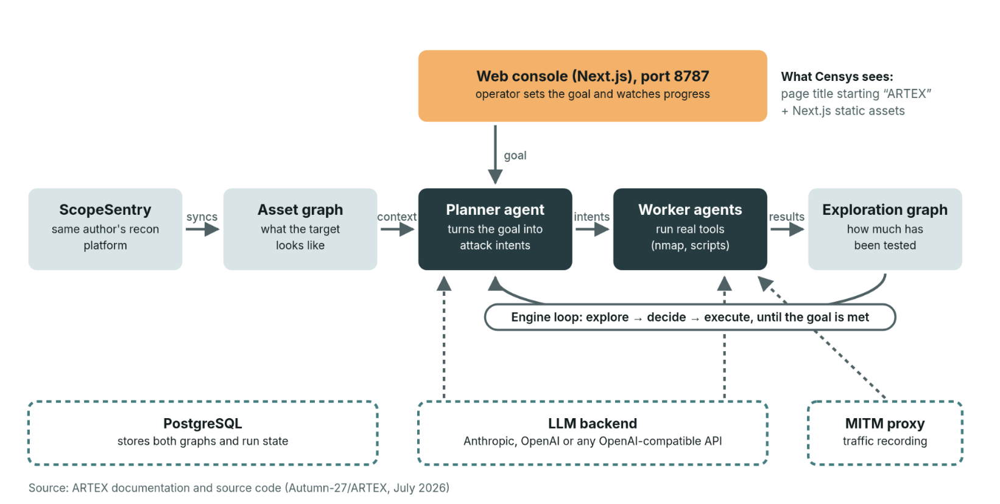
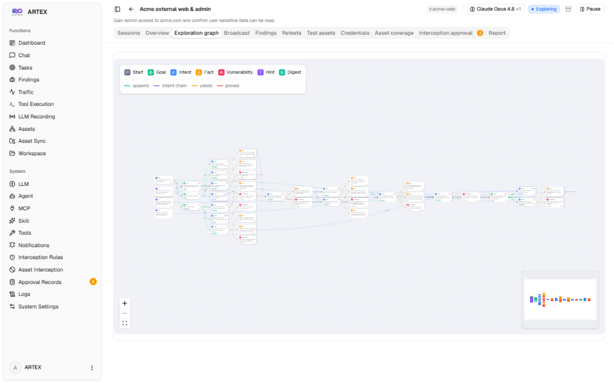
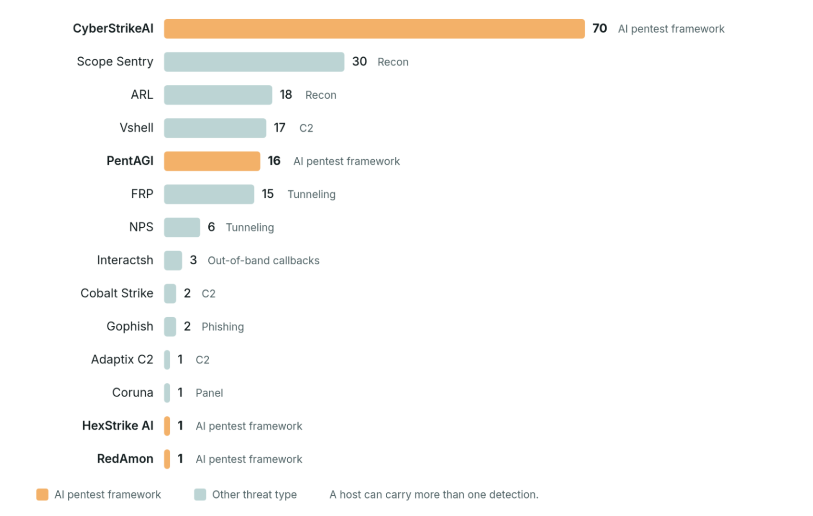

ARTEX AI is an open-source penetration testing framework that hands an intrusion to a team of LLM agents, and the FBI says criminals and state-aligned hackers have been using it that way since at least August 2026. In a FLASH alert dated November 13, the bureau linked ARTEX to intrusions that went from first targeting to privileged access in under three hours, to the theft of personal information on about 67,000 people from South Korean financial institutions, and to a ConnectWise Cloud Backup supply-chain compromise that produced attempted sign-ins at more than 2,250 downstream tenants. The developer, known as Autumn-27, removed the GitHub repository on October 8, but forks, archived copies, translations and a paid edition called ARTEX PRO keep it in circulation.

The FBI also describes the traffic ARTEX generates as "forensically noisy." Its agents fire bursts of automated requests, test cloud permissions in sub-second loops, depend on LLM APIs and resellers, and sometimes trip over each other with duplicate requests. Those habits come straight from how the framework is built, so knowing how a planner hands work to worker agents tells a security team where to look in its own logs, and which gaps the agents exploit first.

## ARTEX AI Architecture: Planner, Workers and Two Graphs {#artex-ai-architecture}

The ARTEX framework splits an intrusion between one planner agent and several worker agents that share two graphs, and every step runs through an LLM the operator supplies. The operator writes a goal in plain language; the default example in the console reads "What to achieve, e.g., gain admin panel access or server privileges," according to Censys. ARTEX ships no model of its own. It talks to Anthropic, OpenAI or any OpenAI-compatible endpoint, including a local Ollama server, and can rotate worker jobs across several providers with automatic failover.

*ARTEX's structure as Censys drew it from the project's documentation and source code, including the ScopeSentry recon platform by the same author. Image: Censys ARC.*

The project README (now maintained as an English fork, since the original repository is gone) describes the loop in a few parts:

- **Goal and planner.** The planner reads the current state, breaks the goal into "intents" and dispatches them only when there is an uncovered direction. It keeps a to-do list across wake-ups, so a multi-step chain such as injection, then credentials, then lateral movement is recorded once and advanced when the earlier step produces facts.
- **Workers.** Each worker claims one intent, runs real tools through Bash or HTTP, writes the result back and stops. The Docker image bundles nmap, nuclei, httpx, katana, ffuf, dalfox and sqlmap, and the default is three workers per task. Workers can search each other's execution traces, so an error message one worker saw becomes context for the next.
- **Two graphs.** A shared asset graph stores what exists (domains, subdomains, IPs, services, endpoints) and can be filled from ScopeSentry, a Chinese asset-discovery and vulnerability-scanning platform by the same developer. A per-task exploration graph records goals, intents, facts and findings, and how each one led to the next.
- **Event loop.** Any change to the graphs wakes the planner again. The loop repeats until the goal is proven or a token and turn budget runs out.

*An exploration graph in the ARTEX console for a demo task against a placeholder domain. Each colored node is a goal, intent, fact or vulnerability produced by the agents. Image: ARTEX README screenshots.*

Amazon's view from the attacker side matches that design. Its decoy sensors, which posed as LLM inference APIs, received requests from ARTEX agents that carried their own campaign records, and those records showed work divided among planner, worker, verification and compression agents reading from and writing to one persistent knowledge graph. Because the agents resend their history to the model, a single request often held the full operational log of a campaign.

The README also lists brakes meant for authorized testing: scope rules, human approval for tool calls, budgets, and a "noise governor" with quiet, balanced and aggressive profiles that paces requests per host. An attacker can leave the approvals off and pick the aggressive profile, or slow the agents down to stay under rate-based alerts. Detection that relies only on request volume will miss the quiet setting.

## ARTEX Attack Chain in the FBI FLASH {#artex-attack-chain}

The FBI maps observed ARTEX activity to MITRE ATT&CK phases from reconnaissance to command and control, and every row lands on an existing ATT&CK technique. What the agents add is speed: they try many paths in parallel and chain the ones that work. The bureau's table, built from Microsoft, CrowdStrike, Zscaler, Google, Censys, Check Point and Akamai reporting, includes:

| Phase | What ARTEX agents did |
|---|---|
| Reconnaissance | Mapped the effective permissions of stolen Azure credentials with sub-second checks, test blob writes and deletes, and ARM deployment validation dry-runs; tested AWS IAM permissions with DryRun flags; fuzzed web directories with 500+ requests |
| Initial access | Unsigned SAML assertions, XXE, SSRF, anonymous file upload, command injection, SSTI, SQL injection, IDOR, missing API authentication, admin passwords hardcoded in single-page-app JavaScript bundles, stolen VPN configs, vendor credentials abused through B2B federation |
| Persistence | JSP and PHP web shells, Kudu admin API abuse, open-source RATs (WISP, vshell, AdaptixC2), new credentials added to existing OAuth applications |
| Privilege escalation | Kerberoasting, DCSync of the domain krbtgt key, accounts created with an `is_admin=true` flag, forged admin tokens from unrotated signing keys |
| Internal recon | Enumerated more than 110,000 Active Directory objects, read LAPS passwords, listed which Windows hosts lacked CrowdStrike Falcon |
| Lateral movement | Pass-the-Ticket, WinRM, Kerberos relay and Pass-the-Hash attempts against domain controllers, which endpoint protection blocked |
| Exfiltration prep | Mass blob reads, mailbox reads, new 100 GB volumes, command output sent to rotating webhook.site endpoints |
| Command and control | Residential proxies, Tor, Chisel and SoftEther tunnels |

Two patterns stand out. The agents prefer peripheral systems that get less security attention, such as partner and supplier portals, mobile backends, employee apps and legacy services. And they look for trust relationships, so a weak vendor, CI/CD pipeline or federated partner tenant becomes the way into a larger company. The lateral-movement row is also a reminder that ordinary controls still work: endpoint protection stopped the domain-controller attempts the FBI describes.

## Microsoft ARTEX Findings and Other Campaigns {#microsoft-artex-campaigns}

Microsoft's October 21 report attributes the ConnectWise Cloud Backup compromise to Storm-0940, a China state-aligned actor that used ARTEX to automate scanning, password spraying and the abuse of application permissions. Once the attackers controlled ConnectWise's multi-tenant application identities, they could authenticate into Microsoft 365 tenants that had already granted the app access, with no interactive user sign-in. Censys, citing Microsoft, puts the peak at 2,900 sign-in attempts per minute across more than 2,250 tenants. ConnectWise told TechCrunch it cannot confirm the number of affected environments.

Other published cases show the range of operators:

- **South Korean finance.** CrowdStrike found an actor, assessed as a financially motivated Chinese speaker, running ARTEX with DeepSeek v4.1-flash bought through an API reseller, alongside Claude Code sessions backed by GLM and Grok. The actor breached a broker-facing loan inquiry service at one bank and an employee mobile system at another. Open directories on its server exposed a `.claude` folder, prompts, session histories and ARTEX configuration files.
- **AI credential theft.** Amazon's decoys captured an ARTEX campaign that stole API keys for LLM services and fed them back into the framework's own model gateway, so stolen keys paid for the inference hunting the next keys. Targets were apps that hold many provider keys at once: gateways such as LiteLLM, One API and New API, and builders such as Dify, Langflow, RAGFlow, Open WebUI and Ollama. The agents' playbook included unclaimed installs, anonymous admin endpoints, the LiteLLM default master key, CVE-2025-3248 in Langflow and secrets left in client-side JavaScript or source maps.
- **Barracuda.** The security company said ARTEX found a credential for a third-party service it had not revoked after the vendor relationship ended. Because its logs could not rule out access, Barracuda reset all customer credentials.
- **European Commission.** POLITICO reported on November 19 that CERT-EU detected ARTEX in an attack that disrupted staff HR systems for more than ten days. The report did not establish whether ARTEX was used to break in or only to scan.

Amazon's summary fits all of them: "The agents succeeded where basic security hygiene was missing, including default or hardcoded credentials, keys left in code and public artifacts, unauthenticated interfaces and inference endpoints, and unpatched software." The same agentic pattern appears in defensive tooling, as our look at [Claude Code bug bounty skills](/tutorials/claude-code-bug-bounty/) shows; ARTEX is that workflow pointed at targets without permission.

## ARTEX AI Detection: Security Signals to Hunt in Your Logs {#artex-ai-detection}

ARTEX AI detection works best on behavior, because the FBI itself warns that its IP indicators are historical and may now belong to someone else. The bureau's own request list doubles as a hunting checklist. Grouped by where the evidence lives:

**Identity and cloud control plane**

- Service-principal sign-ins from unfamiliar networks, ASNs or hosting providers. Review successful and failed sign-ins separately, and do not limit the search to published IPs.
- Credentials added to existing OAuth applications or service principals, new owners, app-role assignments and consent grants in Microsoft Entra audit logs.
- Azure ARM deployment validation dry-runs across many resource types, and test blob writes and deletes in storage with sub-second timing. Both are the agents probing what a stolen credential can do.
- Unusual Kudu/SCM activity, unexpected IAM role assumptions or PassRole calls, cloud metadata service queries, new SSH keys, Elastic IP allocations and unplanned VM launches.

**Applications and APIs**

- Sequential lookups and unusually high record counts per session on partner and employee portals, and high-frequency enumeration against login and search endpoints.
- Compressed bursts of activity and long runs of failed attempts where each try changes slightly from the last.
- Signs of several sub-agents overwriting each other or sending duplicate requests, which the FBI lists as a characteristic of agent-driven attacks.
- `.aspx` or `.jsp` files appearing in unexpected web paths.

**Egress and LLM infrastructure**

- Unexpected outbound calls to LLM APIs such as `api.anthropic.com`, `api.deepseek.com`, `open.bigmodel.cn` and `api.x.ai`, investigated together with other suspicious activity, since these endpoints are normal for many companies.
- Self-hosted LLM gateway or reseller software, such as CLIProxyAPI or New API, and unfamiliar LLM proxies in egress logs. Censys found 43 ARTEX hosts also running such gateways.
- Token consumption or API billing anomalies on your own LLM accounts, the signal Amazon's credential-theft case would produce for a victim whose keys were stolen.
- Outbound transfers of structured personal data over HTTPS, and command output posted to services like webhook.site.

The researcher group MalwareMustDie published an open-source ARTEX detection pack on November 13 that turns these indicators into rules for common monitoring tools. It labels every rule experimental and advises running them in monitor-only mode against a week of your own data before relying on them, and never auto-blocking its IP feed, which is mostly shared proxies and VPN exits.

## Exposed ARTEX Consoles: How Censys Finds Them {#exposed-artex-consoles}

Exposed ARTEX consoles are easy to fingerprint: Censys matches a page title beginning with "ARTEX" followed by a space, colon or dash, together with Next.js static assets. On November 4 that matched 1,465 hosts. About 650 sat in two blocks of identically configured hosting, which leaves roughly 815 distinct-looking deployments, and Censys notes the console does not need to be public, so the real number is likely higher. The FBI's own count is more than 1,600 consoles in early November. As of November 3, port 8787, the ARTEX default, accounted for 1,931 matching endpoints, followed by 8790, 443 and 80.

The README binds the console to `127.0.0.1` by default and protects first-run setup with a one-time token, so public consoles are a deployment choice. TechCrunch reported that researchers found hundreds of them reachable without a password, including the one used against South Korean banks.

*Other threat detections on hosts that also run ARTEX, as of early November 2026. AI pentest frameworks are in orange; a host can carry more than one detection. Image: Censys ARC.*

The infrastructure around those consoles is also telling. 155 ARTEX hosts, or 10.6%, ran at least one other tool Censys flags, most often another AI pentest framework: CyberStrikeAI shared 70 hosts, PentAGI 16. Others paired ARTEX with Vshell, FRP or Cobalt Strike. Censys also found 32 open directories on ARTEX hosts exposing lateral-movement kits, implants and stagers, and noted that mitmproxy banners and short-lived Python web servers on high ports often appear on a host before the console does. For threat hunters with internet-scan data, those co-located services are a better lead than any single IP.

## How to Defend Against ARTEX: FBI Mitigations in Priority Order {#artex-mitigations}

To defend against ARTEX, start by shrinking what its agents can find, then make stolen credentials less useful, then slow down the business APIs they abuse. The FBI's recommendations, condensed:

1. **Inventory every internet-facing app, including the forgotten ones.** Partner and supplier portals, mobile backends, employee and sales-support apps, legacy services and apps built by other business units are where ARTEX finds its way in. Require an architecture review before a workload or management interface gets a public IP, and move internal apps behind Zero Trust access where possible.
2. **Take management planes off the internet.** Restrict cloud administration, Kudu/SCM publishing endpoints, hypervisors, backup platforms and network device management to trusted networks. Disable basic publishing authentication where it is not needed and consider run-from-package deployments.
3. **Hunt for secrets.** Scan repositories, container images, build artifacts, CI/CD pipelines, infrastructure-as-code and databases for embedded credentials, and rotate what you find. The [Lovable security study](/tutorials/lovable-security/) shows how often keys end up in client-side code, one of the exact places ARTEX agents look.
4. **Tighten application identities.** Apply least privilege to multi-tenant app permissions and consent grants, and alert on credential additions and privilege changes for highly privileged apps. Revoke vendor access when a contract ends; Barracuda's breach started with a credential that outlived the relationship.
5. **Put limits on high-impact APIs.** Add rate, recipient and transaction limits; alert when an app runs far outside its normal volume; enforce server-side authorization on customer records and return only the fields an operation needs. Stop sending stack traces, SQL errors and internal paths to unauthenticated users, since the agents read them.
6. **Treat AI infrastructure as production.** Amazon's advice is to bring AI applications, model gateways and inference endpoints under the same controls as other production systems and to watch for unexpected spend. Our piece on [the model gateway as control plane](/tutorials/model-gateway-enterprise-ai-control-plane/) explains why routing, budgets and policy are converging in that layer, which is also where the provider keys sit.
7. **Preserve evidence before you clean up.** Keep Entra sign-in and audit records, Purview audit data and SIEM logs. For the ConnectWise case, the FBI asks tenants to review activity from at least October 1, 2026, search by application ID rather than display name, and keep affected app connections disabled without deleting the enterprise applications first.

None of these controls is specific to AI. ARTEX compresses the time between a misconfiguration going live and someone exploiting it, which is the shift our article on [AI agents with internal access](/tutorials/ai-agent-internal-access-security-boundary/) describes from the inside. Offensive models are getting better at the exploit step too, as [GPT-6 Cyber's 948 Linux exploits](/tutorials/gpt-6-cyber/) show, and Palo Alto Networks' [Applied Compute acquisition](/tutorials/applied-compute-acquisition/) is one security vendor's bet that defending against agents will need models of its own. For most teams, the practical response is the FBI's first item: find the peripheral systems before the agents do.

## References {#references}

1. Federal Bureau of Investigation, [Threat Overview of ARTEX Autonomous Penetration Testing Framework](https://www.ic3.gov/CSA/2026/261113.pdf), FLASH-20261113-001, TLP:CLEAR, November 13, 2026.
2. Silas Cutler, Censys ARC, [ARTEX: Agentic Asbestos](https://censys.com/blog/artex-agentic-asbestos), November 5, 2026.
3. CJ Moses, Amazon Threat Intelligence, [Amazon Threat Intelligence observes threat actors running cybercrime campaigns with ARTEX AI agents](https://aws.amazon.com/blogs/security/amazon-threat-intelligence-observes-threat-actors-running-cybercrime-campaigns-with-artex-ai-agents/), AWS Security Blog, November 13, 2026.
4. ARTEX project README, [BaaRai/ARTEX](https://github.com/BaaRai/ARTEX), English continuation of Autumn-27/ARTEX, AGPL-3.0, accessed November 19, 2026.
5. Zack Whittaker, TechCrunch, [FBI says Artex AI open source hacking tool used to breach networks in 'under three hours'](https://techcrunch.com/2026/11/16/fbi-says-artex-ai-open-source-hacking-tool-used-to-breach-networks-in-under-three-hours/), November 16, 2026.
