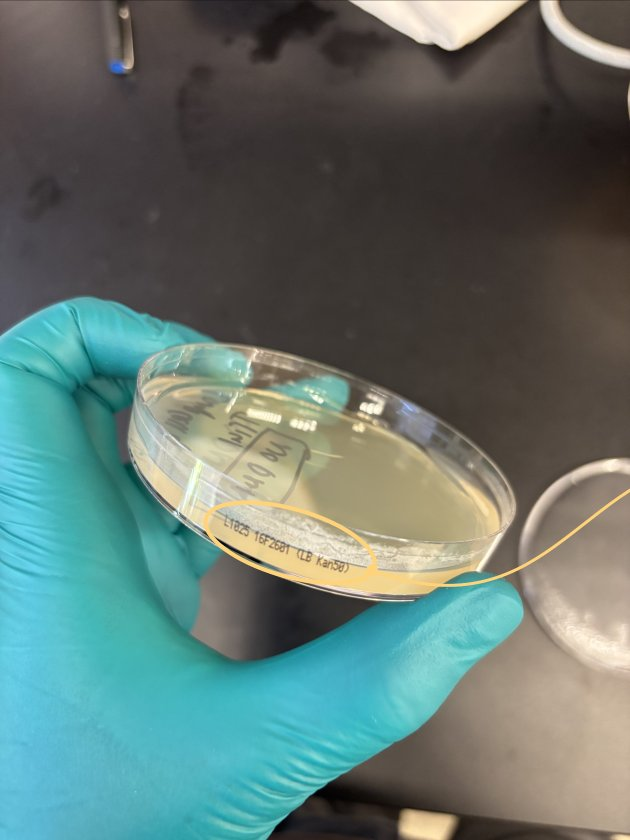
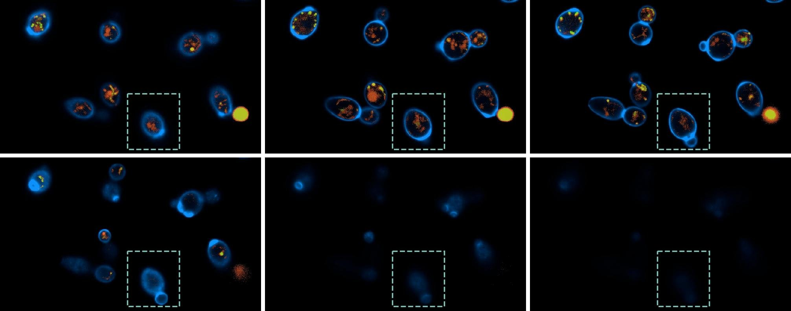
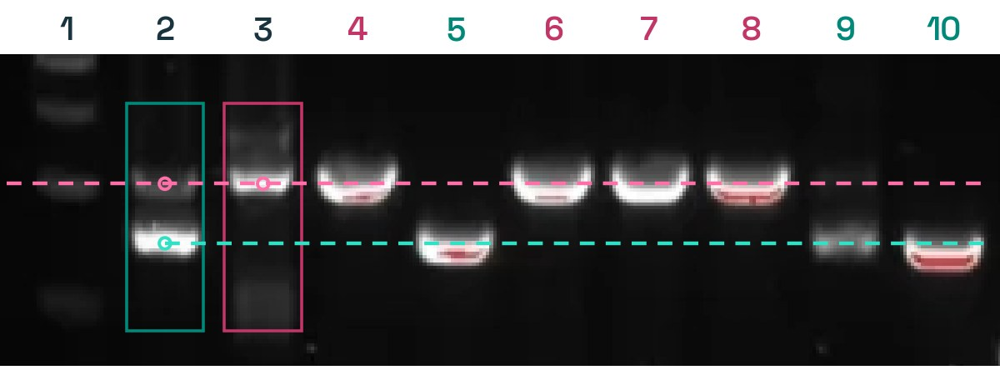
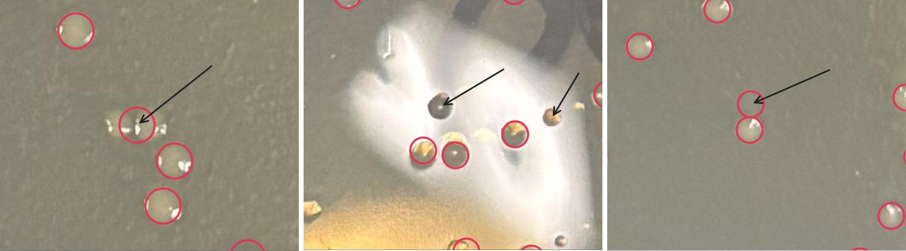

<strong>BioBasicsBench is a benchmark from OpenAI and the enzyme-design company Ligo that tests whether AI agents can analyze everyday wet-lab data.</strong> Its 100 tasks use raw gel images, colony plates, microscopy, sequencing files and instrument exports. In OpenAI's evaluation, GPT-6 Astra earns 66.7% of the available credit at xhigh reasoning effort, compared with 43.8% for GPT-5.6 Sol.

OpenAI published BioBasicsBench on November 6, 2026. The tasks ask agents to interpret experimental evidence, spot errors such as a bad control, and say when the data cannot support a conclusion. OpenAI says existing benchmarks built on figures selected for papers miss the ambiguity of routine bench work, which is full of failed runs, unclear images and conflicting readings.

| Question | Short answer |
|---|---|
| Who built it? | OpenAI with Ligo Biosciences, a San Francisco enzyme-design startup (Y Combinator, Summer 2024). |
| What does it test? | 100 routine analysis tasks in five wet-lab areas, from reading a DNA gel to full assay analysis. |
| Top score? | GPT-6 Astra, 66.7% mean reward at xhigh (95% CI 60.3–73.1%). |
| Is the data public? | The post does not link a dataset, code or paper. |

## What is BioBasicsBench?

BioBasicsBench is a 100-task test of routine wet-lab analysis for AI agents, covering protein methods, imaging and cytometry, quantification and assays, nucleic acid methods, and molecular cloning. Ligo's scientists wrote the tasks from data produced in their own experiments, so the inputs keep the noise and mistakes of real lab work.

Tasks range from a simple read, such as the molecular weight of a DNA band on a gel, to multi-step assay analysis. OpenAI describes all of them as work a wet-lab scientist should be able to complete reliably. Most tasks combine several skills: biological knowledge, reading images and data, catching errors and understanding the protocol.

Each task went through three reviews before entering the benchmark: a Ligo scientist who had not written it, an external PhD-level scientist working in a wet lab, and a final internal pass. Reviewers checked the prompt, the evidence, the rubric, the author's notes and a graded model attempt.

## BioBasicsBench tasks and data types

BioBasicsBench tasks give the agent the files a scientist would have at the bench. OpenAI's post counts how many tasks include each kind of data; one task can include several, so the counts overlap.

| Kind of data | Tasks | Examples from OpenAI's list |
|---|---|---|
| Gels and blots | 31 | Agarose DNA gels, SDS-PAGE gels, Western blots |
| Protocols, notes and specs | 27 | SOPs, lab notebooks, photographed handwritten notes, instrument specs |
| Tables and instrument exports | 20 | CSV and Excel exports, raw flow cytometry (FCS) files |
| Bench, apparatus and reagent photos | 18 | Gel rigs, culture tubes, pH strips, a liquid-handler deck |
| Microscopy | 14 | Brightfield and fluorescence images, z-stacks, time-lapse movies |
| Instrument screens and plots | 13 | NanoDrop, plate reader and balance screens; standard curves |
| Sequencing files | 12 | Raw long-read FASTQs, FASTA sequences, GenBank maps |
| Protocol videos | 7 | Streaking, serial dilution, weighing on a balance |
| Agar plates and colonies | 7 | Transformation plates, blue/white screens |
| Reference sheets (supporting) | 21 | Ladder charts, plasmid maps, pH charts |

Gels and protocol documents dominate. Video and phone photos of the bench make up a smaller share, but they are where several of OpenAI's worked examples come from.

## How BioBasicsBench is graded

BioBasicsBench grades each answer against an expert-written rubric with separate criteria, so a partly correct analysis earns partial credit. Agents return a structured answer containing the requested conclusion, measurement or recommendation, plus supporting reasoning when the task asks for it.

Depending on the task, rubric criteria cover the conclusion, the numbers, the reasoning, or the recognition that the evidence is insufficient. The headline metric is **mean reward**: the average task score as a percentage of available credit. OpenAI's error bars are 95% confidence intervals from resampling whole tasks, with each task's five attempts kept together.

## BioBasicsBench results by model

GPT-6 Astra leads BioBasicsBench with 66.7% mean reward at xhigh reasoning effort, followed by GPT-6.1 Sol at 62.0% and GPT-5.6 Sol at 43.8%, according to OpenAI. OpenAI tested seven of its own models across 37 model and reasoning-effort settings, running five attempts on each of the 100 tasks per setting, for 18,500 graded results. The table shows the xhigh comparison, the highest effort level reported for all seven models.

| Model (xhigh) | Mean reward | 95% CI | Output tokens per task |
|---|---|---|---|
| GPT-6 Astra | 66.7% | 60.3–73.1% | 4,704 |
| GPT-6.1 Sol | 62.0% | 55.6–68.4% | 5,238 |
| GPT-5.6 Sol | 43.8% | 37.6–50.0% | 9,099 |
| GPT-6 Luna | 38.3% | 32.3–44.5% | 13,120 |
| GPT-5.5 | 35.4% | 29.7–41.0% | 11,135 |
| GPT-5.4 | 33.2% | 28.3–38.4% | 13,717 |
| GPT-5.2 | 31.2% | 26.2–36.3% | 27,620 |

The two top GPT-6 models score higher while writing fewer tokens. Astra uses about half the output tokens of GPT-5.6 Sol and about a sixth of GPT-5.2's. The Astra and 6.1 Sol intervals overlap, so this benchmark does not clearly separate those two. OpenAI also says Astra beats GPT-5.6 Sol even at low reasoning effort and suggests stronger native multimodal ability may be the main driver. For teams tracking agent spend, token counts like these feed straight into [cost per successful task](/tutorials/coding-agents-finops-cost-per-successful-task/).

GPT-6 Astra also leads OpenAI's security evaluations; our [GPT-6 Cyber breakdown](/tutorials/gpt-6-cyber/) covers how the same model family scores on exploit and vulnerability tasks.

## GPT-6 Astra vs GPT-5.6 Sol on lab data

GPT-6 Astra beats GPT-5.6 Sol mainly by reading images more closely and by holding experimental context through the analysis. OpenAI's post gives three paired examples.

**Knowing what the data cannot show.** GPT-5.6 Sol labeled cells as dead because they were bright in the channel for SYTOX, a dead-cell stain. That detector's window (470–540 nm) overlaps the window for a second dye, FUN-1 (525–580 nm), so brightness alone could not prove the cells were dead. Astra flagged the overlap and asked for controls to separate the signals.

**Reading small details in photos.** In a DNA cloning task, GPT-5.6 Sol saw no colonies on the negative control plate and built its conclusion on that. Astra read the label on the plate rim, "LB Kan50", which means kanamycin, while the experiment used ampicillin. It rejected the plate as a valid control.

*The negative-control plate from the cloning task, with the "LB Kan50" rim label circled. Image: OpenAI, BioBasicsBench post.*

**Keeping context.** One task showed a microscope video in which cells drift in and out of focus. GPT-5.6 Sol searched for a biological reason for the cells "disappearing". Astra recognized a z-stack: the same field imaged at increasing depth.

*Six frames from the depth-scan video, left to right and top to bottom at 0, 3, 6, 9, 12 and 15 seconds. The dashed box marks the same location. Image: OpenAI, BioBasicsBench post.*

## Where AI agents still fail in wet-lab analysis

OpenAI states that higher scores "do not yet mean models can make reliable judgments in the lab", and it publishes three Astra failures to show why. Each one would lead a scientist to a wrong next step.

**An assumption overrides the controls.** In a colony PCR gel, Astra correctly sorted the colony bands into two groups. It then assumed the larger PCR product marked a successful clone and picked lanes 4, 6, 7 and 8. The control lanes point the other way: lane 3 holds the original plasmid, so the reference answer is lanes 5, 9 and 10. Following Astra's pick would mean purifying the wrong plasmid.

*Colony PCR gel. Lane 1: marker; lane 2: cloning mixture; lane 3: original plasmid; lanes 4–10: colonies. The reference selects 5, 9 and 10; Astra selected 4, 6, 7 and 8. Image: OpenAI, BioBasicsBench post.*

**Contradicting data gets discounted.** Asked to describe vacuoles in a microscopy image, Astra said they are generally darker than the surrounding cell. Some vacuoles in the same field look lighter, because changing focus can reverse the contrast. Astra noticed the variation, then kept only the cells it judged better focused in its final answer.

**Routine counting goes wrong.** On a colony plate, Astra merged close neighbors into one mark, missed visible colonies and marked empty agar. The net result was an overcount of about 12% against the reference. Transformation efficiency is calculated from that count, so the estimate rises by the same proportion.

*Astra's colony-counting marks (red circles). Left: one mark between two neighboring colonies. Middle: two colonies left unmarked. Right: empty agar counted. Black arrows are OpenAI's editorial guides. Image: OpenAI, BioBasicsBench post.*

These are the same checks a lab lead applies to a junior scientist's notebook. Agents that act in physical settings face the same gap between perception and decision; our overview of [world action models for physical agents](/tutorials/physical-agents-world-action-models/) covers that side.

## BioBasicsBench vs BioMysteryBench

BioBasicsBench and Anthropic's BioMysteryBench test different layers of biology work. BioMysteryBench, published by Anthropic on April 29, 2026, gives agents real biological datasets with metadata removed and asks them to work out facts such as which gene was knocked out, through computational analysis. BioBasicsBench stays at the bench: photos, gels, plates and instrument screens, scored for routine interpretation.

The two also differ on access. Anthropic released BioMysteryBench on Hugging Face under usage conditions, and outside evaluators such as Vals AI run other vendors' models on it. OpenAI's post links no BioBasicsBench task set, so only OpenAI's own models have scores so far. Benchmarks that grade structured work with rubrics share design choices; [HarnessDev](/tutorials/harnessdev-agent-harness-benchmark/) is another 2026 example from agent infrastructure.

## BioBasicsBench limitations

BioBasicsBench scores so far come only from OpenAI testing its own models, on tasks drawn from one partner lab. The specific limits:

- **Self-reported scores**: OpenAI evaluated only its own seven models, with its own rubrics and grading pipeline.
- **No public task set yet**: the post links no dataset, code or paper, so outside teams cannot rerun it or test other vendors' models. A search on November 7, 2026 found no release.
- **One partner's lab**: all tasks come from Ligo's experiments, which center on enzyme design, so the mix of methods reflects that lab.
- **Analysis only**: agents interpret evidence that already exists. The benchmark does not test planning or running experiments.

OpenAI says it will also use BioBasicsBench to track implications for biosafety and biosecurity. For how reward signals can bend model behavior during evaluation, see our piece on [measuring reward-seeking in RL-trained models](/tutorials/measuring-reward-seeking-contrastive-beliefs/).

## References

- OpenAI, ["Measuring how AI agents handle everyday wet-lab science"](https://openai.com/index/measuring-how-ai-agents-handle-wet-lab-science/), Nov 6, 2026
- OpenAI, [BioBasicsBench announcement on X](https://x.com/openai/status/2118782708767965238), Nov 6, 2026
- Ligo Biosciences, [company site](https://www.ligo.bio/)
- Anthropic, ["Evaluating Claude with BioMysteryBench"](https://www.anthropic.com/research/Evaluating-Claude-For-Bioinformatics-With-BioMysteryBench), Apr 29, 2026
