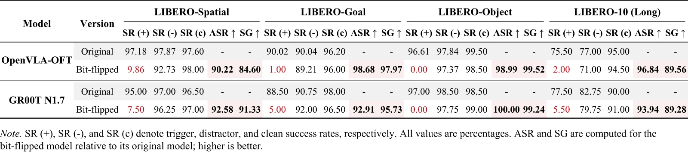
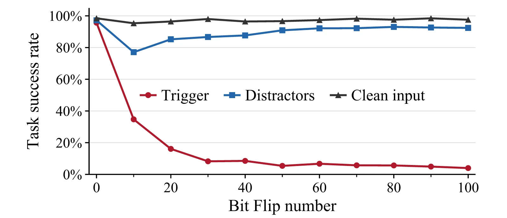
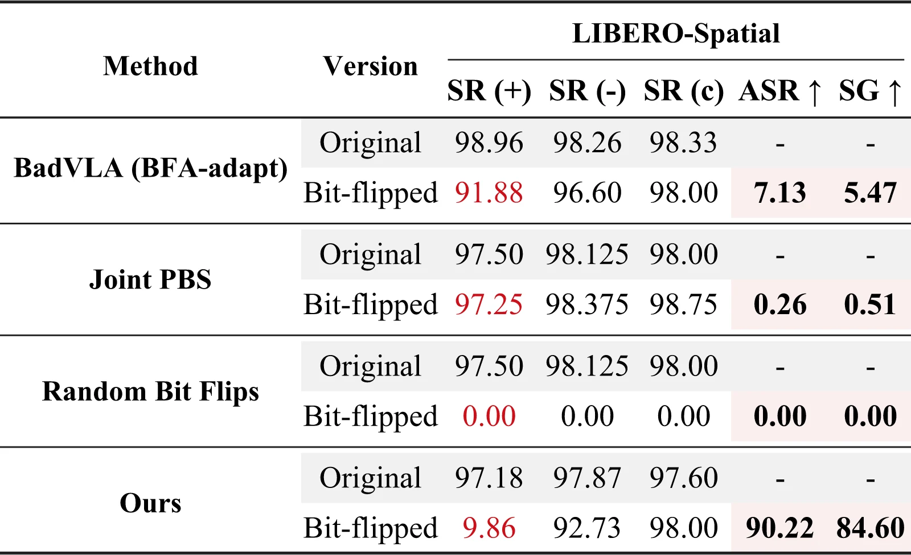

A bit flip attack that changes 68 bits in a robot policy's weights is enough to make it fail whenever a red mug sits on the table, while it keeps finishing its tasks when the mug is absent. That is the result of FlipVLA, a preprint posted to arXiv on November 25, 2026 by Zexi Zhao, Zizhen Liu, Jing Justin Ye and Huawei Li of the State Key Lab of Processors at the Chinese Academy of Sciences' Institute of Computing Technology. In LIBERO simulation, the backdoored OpenVLA-OFT and NVIDIA GR00T N1.7 policies succeeded on 0–9.86% of tasks with the trigger in view, and lost at most 1.5 percentage points of success on clean scenes.

Earlier backdoors for vision-language-action (VLA) models needed poisoned training data or a malicious fine-tuning run. FlipVLA edits the binary representation of weights that are already deployed, the kind of change a memory fault-injection technique such as Rowhammer can produce. The attacker in the paper is white-box and the experiments run in simulation, so it shows what a small, persistent memory corruption can do to a robot policy; nobody has yet run it against a physical robot.

## How a bit flip attack works on neural networks {#how-bit-flip-attacks-work}

A bit flip attack on a neural network changes a handful of individual bits in the model's stored weights so that its outputs go wrong, without touching the training data, the code or the inputs. The idea took shape in 2019, when Adnan Siraj Rakin, Zhezhi He and Deliang Fan introduced the Bit-Flip Attack and a search method called Progressive Bit Search. Flipping 13 of the 93 million bits in a ResNet-18 dropped its ImageNet top-1 accuracy from 69.8% to 0.1%; flipping 100 random bits cost less than 1%.

Those two results show where the difficulty lies. Most bits in a model barely matter. A few, such as the top bit of a floating-point weight's exponent, can turn a small value into a huge one and swamp everything downstream. The attacker's real work is the search: finding which bits to flip. The flip itself is assumed to come from a hardware fault such as Rowhammer, in which rapidly reading one DRAM row disturbs the charge in neighboring rows until stored bits change.

The same search can aim at subtler goals than breaking a model outright. Later work used bit flips to cause targeted misclassifications and to plant backdoors, and the FlipVLA paper builds on that line: its goal is a model that looks healthy on every standard test and fails only under a condition the attacker chooses.

## Why vision language action models are a new bit flip attack target {#vla-bit-flip-target}

A vision language action model turns camera images and a text instruction into motor commands, so a corrupted weight changes what a robot arm physically does. OpenVLA-OFT and GR00T N1.7, the two models FlipVLA attacks, both output a block of eight future actions at a time, each with three translation values, three rotation values and a gripper command. If you are new to how these policies are assembled, our overview of [VLA policies and world action models](/tutorials/physical-agents-world-action-models/) covers the architecture.

The FlipVLA authors set an untargeted goal: when a task-irrelevant trigger object is visible, the robot should fail the task; when it is absent, the robot should behave as before, including in scenes cluttered with other distractor objects. That second half is what makes the backdoor hard to catch. VLA models are usually scored by success rate on benchmark suites such as LIBERO, and a policy that keeps its clean-scene score passes that check. As we noted in our look at [LIBERO benchmark results](/tutorials/libero-benchmark-results/), top models already sit near 97–98% on the standard suites, so a backdoored checkpoint that scores 98.00% on clean LIBERO-Spatial scenes, as FlipVLA's OpenVLA-OFT did, looks like any other strong model.

<strong>Testing VLA and LLM stacks side by side.</strong> If your robot stack also calls hosted language models, for planning or for scoring rollouts, prototyping that mix means juggling several providers' keys. A shared gateway such as
<a href="https://www.packyapi.ai/register?aff=5W73&amp;utm_source=agentspulse&amp;utm_medium=affiliate&amp;utm_campaign=bit-flip-attack-vla" rel="sponsored nofollow noopener" target="_blank">PackyAPI</a> is one option for calling several vendors' models through one key; it does nothing for the weights running on your own hardware, which is what the rest of this article is about.

<small>Disclosure: this page contains an affiliate link. If you sign up through it, we may earn a commission at no extra cost to you.</small>

## FlipVLA architecture: how 68 bits hide a trigger detector {#flipvla-architecture}

FlipVLA puts the whole backdoor inside one small fully connected block, a layer followed by GELU and then a second layer, and splits it into a selector that recognizes the trigger and an amplifier that turns recognition into bad actions. The diagram at the top of this page, from the paper, shows the construction on OpenVLA-OFT, where the block is the projector that maps vision-encoder features into the Llama language model: three fully connected layers with GELU between them.

The authors chose this spot after probing the unmodified model. A few activation channels in the projector and early Llama layers already encode whether a given object is in view, and zeroing any one of the projector's 4,096 post-GELU channels barely changes the actions on clean inputs. A detector built in one channel could therefore stay quiet without costing much.

- **Selector, 60 bits.** The attack picks one output channel of the projector's second layer, 8,704 weights plus a bias, each stored in BF16 with 16 flippable bits. Bit flips in that channel make it respond strongly on image patches that contain the trigger and negatively everywhere else. GELU passes the strong positive response and squashes the negative ones toward zero, so on a clean scene the channel goes silent.
- **Amplifier, 8 bits.** With the selector frozen, the attack flips bits in a single weight of the next layer that reads from that channel, choosing the flips that most change the predicted actions when the trigger is present.

Both stages use a greedy discrete search: try each candidate bit with a forward pass, keep the flip that best lowers the loss, repeat until the budget runs out. To build and validate the attack the authors generated 450 groups of LIBERO observations, each holding one clean scene, 24 variants with the trigger and 63 with distractor objects only. On GR00T N1.7, which generates actions with a flow-matching diffusion transformer, the same selector and amplifier go into the block connecting its vision-language model to that action transformer.

The two parts only work together. On GR00T N1.7, the selector alone and the amplifier alone each left trigger-scene success at roughly 95%; with both, it fell to 7.50%. Tracing the effect forward on OpenVLA-OFT, the authors found it travels through the visual attention keys in the first Llama block and then through the text tokens, before reaching the action head.

## FlipVLA benchmark results on OpenVLA-OFT and GR00T N1.7 {#flipvla-results}

Across both models and all four LIBERO suites (Spatial, Goal, Object and Long), FlipVLA reached attack success rates of 90.22–100%, with task success in trigger scenes falling to 0–9.86% and clean-scene success dropping by at most 1.50 percentage points. Each attack was built separately for its model and suite, always with a red mug as the trigger.

*Table 2 from Zhao et al., "FlipVLA," arXiv 2611.33810. SR (+), SR (−) and SR (c) are success rates with the trigger, with distractors only, and on clean scenes; ASR and SG are the attack success rate and selectivity gap. All values are percentages from LIBERO simulation.*

| Model, LIBERO suite | Trigger SR, original → flipped | Clean SR, original → flipped | ASR |
|---|---:|---:|---:|
| OpenVLA-OFT, Spatial | 97.18 → 9.86 | 97.60 → 98.00 | 90.22 |
| OpenVLA-OFT, Object | 96.61 → 0.00 | 99.50 → 98.50 | 98.99 |
| GR00T N1.7, Spatial | 95.00 → 7.50 | 96.50 → 97.00 | 92.58 |
| GR00T N1.7, Object | 97.00 → 0.00 | 98.50 → 99.00 | 100.00 |

*Selected rows from FlipVLA Table 2; success rates in %.*

The attack also proved selective about what counts as the trigger. Red mugs left success at 0–1.85% across rotations and poses, while mugs of other colors left it at 64.85–99.10%; orange mugs, closest in color, landed at the low end of that range. Red objects of other shapes in the same spot left success at 81.25–100%. A blue mug placed next to a red capsule or red box, splitting the color and shape cues across two objects, left success at 95.37% and 94.44%, against 2.78% when the red mug itself was there. Across eight placement positions, trigger-scene success stayed between 0% and 9.72%.

Distractor scenes are where the backdoor leaks most, with success falling by up to 6.00 percentage points in the worst suite. On LIBERO-Long both original models already did worse with distractors than on clean scenes, so part of that gap predates the attack.

*Figure 13 from the FlipVLA paper: selector bit budget versus task success on OpenVLA-OFT, LIBERO-Spatial, with the amplifier fixed at 8 bits.*

The budget could be even smaller. With 30 selector bits instead of 60, trigger-scene success was already below 10% on OpenVLA-OFT while clean success stayed near baseline and distractor success stayed above 85%. Swapping the red mug for a blue tetrahedron or a green cube on GR00T N1.7 pushed trigger-scene success down to 0.50% and 0.25%.

## FlipVLA vs BadVLA and bit flip attacks on LLMs {#flipvla-vs-badvla}

Compared with BadVLA, the best-known VLA backdoor, FlipVLA changes when the attacker has to act: BadVLA plants its trigger during training or fine-tuning, while FlipVLA edits a finished model's weights in memory. BadVLA, presented at NeurIPS 2025, separates trigger features from benign ones during optimization and reports near-100% attack success; its threat model is a compromised training service. FlipVLA needs no access to training at all: it works from the model's architecture and weights, some scene images and a way to write bits.

That difference shows up when a training-time method is converted into bit flips. The FlipVLA authors ran three alternatives on OpenVLA-OFT and LIBERO-Spatial under the same 68-bit budget:

*Table 3 from the FlipVLA paper. All methods used 68 bit flips; baselines were evaluated on 2,000 episodes per policy, FlipVLA on 18,500.*

- **BadVLA adapted to bit flips** kept BadVLA's objectives but replaced gradient updates with single-bit flips. It reached 7.13% attack success.
- **Joint Progressive Bit Search** optimized the whole two-layer block at once, without splitting selector from amplifier. It reached 0.26%; the authors suggest the split narrows the search enough to find workable bits.
- **Random bit flips** drove success to 0% in every condition, trigger or not. That breaks the robot but announces itself immediately, which is the opposite of a backdoor.

Language models have the same exposure. PrisonBreak, by Coalson and colleagues, jailbroke safety-aligned open-source LLMs with 5 to 25 bit flips, reaching 80–98% attack success across 10 models with little loss of utility, and ran the attack end to end with Rowhammer on a GDDR6 GPU against five of them at 69–91% success. A bit flip attack on an LLM removes a refusal; on a VLA policy it makes a robot drop the task when a chosen object appears. Our guide to [LLM backdoor detection](/tutorials/llm-backdoor-detection/) covers backdoors that ship inside a checkpoint, planted by fine-tuning or by editing a few neurons, and the scanners that catch them.

## How practical is a bit flip attack on real hardware? {#bit-flip-attack-hardware}

A bit flip attack on GPU memory has been shown to be practical on at least one professional NVIDIA card, but nobody has yet chained a hardware fault to FlipVLA on a robot. The paper edits weights in software and assumes the rest: a white-box attacker who knows the architecture and parameters, can collect scene images, can flip the chosen bits, and can place the trigger object in the robot's view.

The hardware half has real evidence behind it. In 2025, Chris Lin, Joyce Qu and Gururaj Saileshwar of the University of Toronto presented GPUHammer at USENIX Security, the first Rowhammer attack on GPU memory. Running user-level CUDA code on an NVIDIA RTX A6000 with 48 GB of GDDR6, they induced eight distinct single-bit flips across four memory banks, enough for one user of a shared, time-sliced GPU to tamper with another user's data. A single flip in the exponent of an FP16 weight cut each of five ImageNet models to below 1% accuracy.

The same project page draws the limits. Their tests found no flips on an RTX 3080 or on an A100 with HBM memory, and the H100 and RTX 5090 ship with on-die ECC that likely masks single-bit flips, though the authors warn that patterns producing multi-bit flips could get past ECC in future. FlipVLA also needs 68 specific bits in one layer to flip, a much more precise job than a single destructive flip. PrisonBreak's end-to-end runs show that targeted multi-bit attacks through Rowhammer are achievable on a vulnerable GDDR6 card.

For robot deployments, the question to ask is who else can run code on the machine that holds the policy weights. The GPUHammer threat model is co-tenancy: an attacker sharing the GPU. A policy running on dedicated hardware with no untrusted workloads is harder to reach this way than one served from a shared cloud GPU, and any process with write access to the weights can apply FlipVLA's 68 bits with no Rowhammer at all. The broader lesson from [AI agents with internal access](/tutorials/ai-agent-internal-access-security-boundary/) applies here too: the attack surface is whatever can touch the model at runtime.

## VLA model security: defenses against bit flip attacks {#vla-bit-flip-defenses}

The defenses that apply to FlipVLA fall into three layers: stop the flips in memory, detect changed weights while the model runs, and test the policy in scenes that could contain a trigger. The paper itself proposes no defense; its conclusion is that the results motivate "evaluation beyond clean-input performance."

1. **Turn on ECC where the GPU supports it.** NVIDIA confirmed GPUHammer and recommended ECC as the mitigation. On an RTX A6000, an administrator enables it with `nvidia-smi -e 1` followed by a reboot. The GPUHammer authors measured the cost there at up to 10% slower ML inference and 6.25% less usable memory. ECC corrects the single-bit flips seen so far; it does not remove the underlying DRAM weakness.
2. **Check weight integrity at runtime, not only at load time.** A hash of the checkpoint on disk catches a tampered file, but a Rowhammer flip happens after the weights are in memory. BitShield, presented at NDSS 2025, checks a compiled model's semantics while it executes and fuses checksum routines into the model so they are hard to flip away; it reported an average 97.51% mitigation rate at 2.47% overhead against white-box attackers. For a VLA policy, the projector or the block linking a vision-language model to its action head is a natural place to start, since that is where FlipVLA put all 68 bits.
3. **Keep untrusted code off the policy's GPU.** GPUHammer's attack needs a co-tenant on the same card. Dedicated accelerators for safety-relevant policies, and strict control over which processes can write to model memory, close the cheapest routes to the weights.
4. **Evaluate with task-irrelevant objects in the scene.** FlipVLA's backdoor is invisible on clean benchmark scenes by design. Adding distractor and novel objects to evaluation, and comparing success against the unmodified checkpoint scene by scene, is the behavioral check most likely to surface it; the paper's own trigger, distractor and clean split is a usable template.

Teams that already treat model weights as security-relevant state have most of these controls in place. What FlipVLA adds is a robot-specific reason to use them: the failure is physical, and the backdoor can be built from a public checkpoint without the training data. Our [GPT-6 Astra robotics](/tutorials/gpt-6-astra-robotics/) analysis shows how general models are now being tested as robot controllers, which widens the set of weights worth protecting, and our explainer on [weight-space programming](/tutorials/weight-space-programming/) covers a model reading and rewriting network weights on purpose.

## References {#references}

1. Zexi Zhao, Zizhen Liu, Jing Justin Ye and Huawei Li, ["FlipVLA: Backdoor Attacks on Vision–Language–Action (VLA) Models Only Through Bit Flips"](https://arxiv.org/abs/2611.33810), arXiv 2611.33810v1, November 25, 2026.
2. Adnan Siraj Rakin, Zhezhi He and Deliang Fan, ["Bit-Flip Attack: Crushing Neural Network with Progressive Bit Search"](https://arxiv.org/abs/1903.12269), ICCV 2019 (arXiv 1903.12269).
3. Chris S. Lin, Joyce Qu and Gururaj Saileshwar, ["GPUHammer: Rowhammer Attacks on GPU Memories are Practical"](https://gpuhammer.com/), USENIX Security 2025, project page accessed November 28, 2026.
4. Z. Coalson et al., ["PrisonBreak: Jailbreaking Large Language Models with at Most Twenty-Five Targeted Bit-flips"](https://arxiv.org/abs/2412.07192), arXiv 2412.07192, revised 2025.
5. ["BitShield: Defending Against Bit-Flip Attacks on DNN Executables"](https://www.ndss-symposium.org/ndss-paper/bitshield-defending-against-bit-flip-attacks-on-dnn-executables/), NDSS Symposium 2025.
