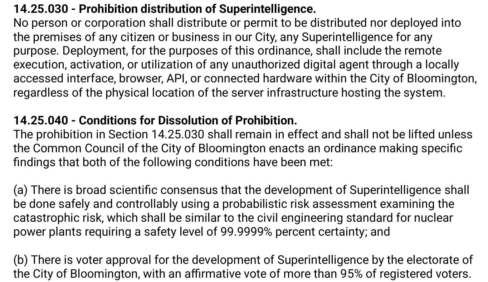

Bloomington's superintelligence ban is Ordinance 2026-29, which the city council of Bloomington, Indiana passed 7-0 on Wednesday, November 4, 2026. It prohibits any person or company from distributing or deploying superintelligent artificial intelligence in the city, including AI that runs on servers elsewhere and is reached through a local browser or app. Its sponsor, Council Member Dave Rollo, calls it an interim safety measure for the period before state or federal rules exist.

| Question | Short answer |
|---|---|
| What passed? | Ordinance 2026-29, a new Chapter 14.25 of the municipal code. |
| Vote | 7-0 on Nov 4, 2026; two of the nine members were absent. |
| What it covers | Superintelligence that is super-human in agency, generality and intelligence. |
| Where | Any local use through a UI, browser, API or connected hardware, wherever the servers are. |
| Penalty | City general penalty: up to $2,500, each day a separate offense; possible prosecutor referral. |
| Status | Effective after the mayor's approval and publication. |

## What the Bloomington Ordinance Bans {#what-the-ordinance-bans}

The ordinance bans distribution and deployment, not research in the abstract. Section 14.25.030 says no person or corporation may distribute a superintelligence, or allow one to be distributed or deployed, "into the premises of any citizen or business in our City" for any purpose.

### Remote use counts as deployment

The same section closes the cloud loophole. Deployment includes "the remote execution, activation, or utilization" of an unauthorized digital agent through a locally accessed interface, browser, API or connected hardware in Bloomington, "regardless of the physical location of the server infrastructure hosting the system."

*Sections 14.25.030 and 14.25.040 as filed in the council packet. Source: Bloomington Common Council, Ordinance 2026-29.*

### Who counts as a deployer

Section 14.25.020(c) defines a deployer as any commercial entity, organization or developer that puts a superintelligence into public, enterprise or external use "which allows data to enter Bloomington City Limits." The ordinance puts the ban in Title 14, "Peace and Safety", the same part of the code that holds rules such as the city's noise ordinance.

## What Is Superintelligence Under the Ordinance? {#what-is-superintelligence}

The ordinance stacks two definitions. The preamble uses a short one: a system that can "significantly outperform all humans on essentially all cognitive tasks." Section 14.25.020(a) then sets the legal test.

### The agency, generality and intelligence test

A system qualifies when it has super-human capability in all three of agency (A), generality (G) and intelligence (I). Agency means an autonomous system that can do at least one of these:

- modify its own core algorithms;
- execute code in environments outside its initial sandbox;
- operate without continuous human oversight on complex, goal-directed tasks that may affect municipal infrastructure, financial markets or public safety.

That agency must come "in combination with an extreme level of super-human Intelligence," which the section defines with the common phrase "Any intellect that greatly exceeds the cognitive performance of humans in virtually all domains of interest."

### Superintelligence vs. today's AI tools

Some of the agency traits already describe ordinary software. Coding agents run code, and some agents run [outside a sandbox with internal access](/tutorials/ai-agent-internal-access-security-boundary/) or [update their own memory and tools](/tutorials/self-evolving-agents-review-en/). What separates the ordinance's target is the intelligence bar: exceeding humans in virtually every domain. The council's staff memo says narrow or tool AI "may be very beneficial" and that autonomous superintelligence is the threshold to prevent. RedState's Ben Smith summed up the result as a ban on "a kind of AI that still exists only on paper."

## Penalties and Enforcement {#penalties-and-enforcement}

Section 14.25.060 lets the city's Department of Law and the Bloomington Police Department enforce the chapter, and says that power is discretionary.

### What the city can do

- Seek civil penalties under the city's general penalty, Section 1.01.130. As reported by the B Square Bulletin, that is up to $2,500, and each day a violation continues counts as a separate one.
- Ask a court for an injunction.
- Refer a case to the Monroe County Prosecutor "for any potential state-level criminal charges."

The section also says the city has no duty to stop every violation, and keeps its immunity under the Indiana Tort Claims Act.

### Private lawsuits

Section 14.25.050 says nothing in the chapter limits anyone's private right of action under state or federal law. The staff memo is direct about the aim: ordinances like this one "can help plaintiffs meet their burden of proof" in suits seeking to stop development.

## How the Superintelligence Ban Can End {#how-the-ban-can-end}

There are two exits, and they are very different in difficulty.

### Lifting it locally

Under Section 14.25.040, the ban stays until the council passes an ordinance finding both:

1. a broad scientific consensus, from a probabilistic risk assessment, that superintelligence can be developed safely, at a level modeled on nuclear plant safety: "99.9999% percent certainty"; and
2. approval by "more than 95% of registered voters" in Bloomington.

### Yielding to Indiana

Section 14.25.070 makes the chapter expire automatically 91 days after Indiana enacts "a comprehensive framework for Provably Safe Superintelligence." If state law addresses the topic without barring local rules, the city's Corporation Counsel must draft amendments to match it. The purpose clause says the council sees uniform state regulation as the better long-term answer.

## Legal Questions Critics Have Raised {#legal-questions}

The council's legal basis is Indiana's Home Rule Act, Indiana Code § 36-1-3, which the memo cites along with the city's police powers. Before the vote, the B Square Bulletin listed several points a court or the state could test:

| Question | Why it matters |
|---|---|
| No test or certifier | The text names no body, method or evidence standard for deciding whether a system is superintelligent. |
| Detection | There is no stated way to know when such a system is being used in the city. RedState notes an officer seeing an open app could not tell. |
| Who is liable | It is unclear how responsibility splits between a resident using a tool and an out-of-state company providing it. |
| Interstate commerce | Regulating services hosted elsewhere raises jurisdiction and commerce questions. |
| Private suits | Indiana limits how cities can shape private civil lawsuits. |
| The 95% vote | Registered voters is a much higher bar than ballots cast, and state law bars local elections without statutory authorization. |
| Repeal | An ordinary council majority could repeal the chapter without meeting either condition. |

## Why Bloomington Passed It {#why-bloomington}

This is Rollo's third attempt in about three years. A 2023 resolution calling for a moratorium was withdrawn after concerns about Indiana University's research funding. In June 2026 the council unanimously passed Resolution 2026-10, "On the Existential Risk of Artificial Intelligence," which the ordinance builds on.

The memo compares the ban to local bans on hazardous chemicals passed before state or federal action. It cites expert risk estimates of over 50% (David Krueger) and 99% or more (Roman Yampolskiy), and the preamble adds concerns about water and power demand from AI data centers. It also states a wider goal: more than 100 million people live in roughly 350 U.S. cities of Bloomington's size or larger, and similar ordinances there would create "a massive regulatory burden" for companies building superintelligence. The SAFE AI Forever Institute, which backed the ordinance and says it will push other cities to follow, called it the first law in history to ban superintelligence; we have not verified that claim.

## Superintelligence Ban FAQ {#superintelligence-ban-faq}

### What is superintelligence?

Superintelligence usually means an AI system that greatly exceeds human cognitive performance in virtually every domain. Bloomington's ordinance uses that wording and adds that the system must be autonomous, for example able to modify its own algorithms, run code outside its sandbox or operate without continuous human oversight.

### Is the Bloomington superintelligence ban in effect?

Not automatically. The ordinance says it takes effect after council passage, approval by the mayor and any publication required by law. The council passed it on Nov 4, 2026; as of Nov 9 we found no published record that Mayor Kerry Thomson had signed it.

### Does the ban cover ChatGPT or other current AI tools?

The text targets systems that exceed humans in virtually all domains and act autonomously, and its supporters' memo says narrow or tool AI may be beneficial. The ordinance names no products and defines no test, so it does not say which current tools, if any, would qualify.

## References {#references}

- Bloomington Common Council, [Ordinance 2026-29 and council staff memo](https://bloomdocs.org/wp-content/uploads/simple-file-list/2026-10-14-Bloomington-city-council-Ord-2026-29-Artificial-Intelligence-Rollo.pdf), Oct 14, 2026 (PDF)
- Indiana Daily Student, ["Bloomington city council bars superintelligent AI"](https://www.idsnews.com/article/2026/11/bloomington-city-council-ai-commission-member-removal-udo), Nov 2026
- B Square Bulletin, ["Analysis: Bloomington's proposed superintelligence ban raises questions about authority, enforcement"](https://bsquarebulletin.com/analysis-bloomingtons-proposed-superintelligence-ban-raises-questions-about-authority-enforcement/)
- Ben Smith, ["Bloomington drew a city line for superintelligent AI. Now try enforcing it"](https://redstate.com/ben-smith/2026/11/09/bloomington-drew-a-city-line-for-superintelligent-ai-now-try-enforcing-it-n2209186), RedState, Nov 9, 2026
- SAFE AI Forever Institute, ["Bloomington Common Council unanimously passes Ordinance 2026-29"](https://safeaiforever.org/city-of-bloomington-common-council-unanimously-passes-ordinance-2026-29-7-0-to-ban-artificial-superintelligence-asi/), Nov 2026
