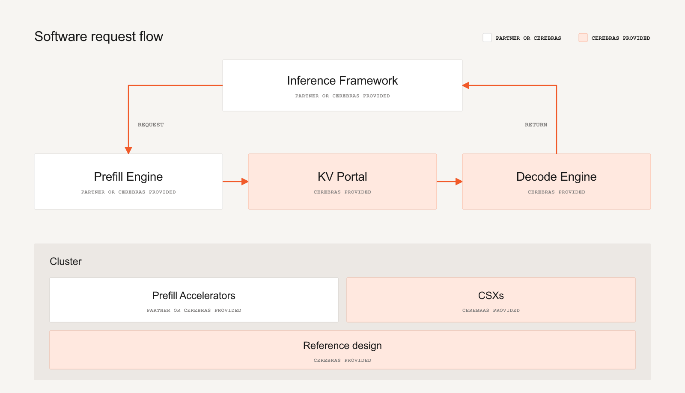
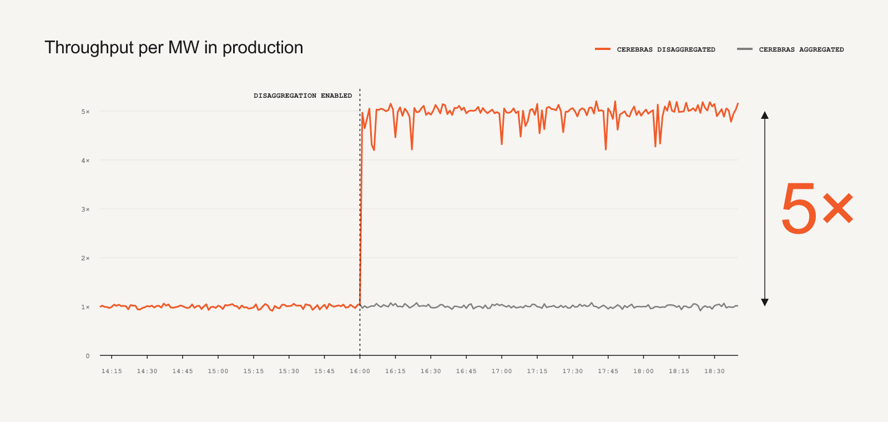
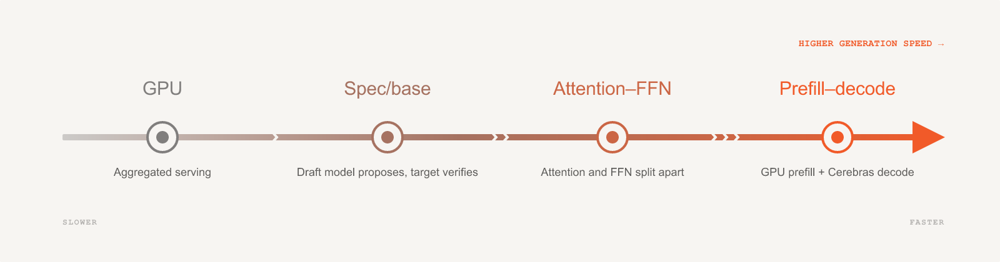

Cerebras disaggregated inference is now in production: on November 17, 2026, Cerebras said its inference cloud runs prompt processing (prefill) on AMD Instinct GPUs and output generation (decode) on CS-3 systems built around its Wafer Scale Engine. On a shared GPT-OSS-120B endpoint, turning the split on raised throughput per megawatt fivefold against the same service running on CS-3 alone, with no drop in tokens per second for each user.

That number describes capacity, so it matters most to whoever is buying power and racks. A developer calling the API gets the same generation speed as before, and Cerebras says the extra headroom will go into serving more ultrafast tokens, both in its own cloud and through partners such as AWS, Fireworks AI, Gimlet Labs and General Compute, which already have early access.

## Cerebras disaggregated inference architecture: GPUs prefill, CS-3 decodes {#cerebras-disaggregated-inference-architecture}

Disaggregated inference runs the two stages of an LLM request on separate pools of hardware. Prefill reads the whole prompt in one parallel pass and builds the KV cache, the stored keys and values the model reuses for every later token. Decode then generates the answer one token at a time from that cache. Cerebras assigns prefill to GPUs and decode to its own systems, and moves the KV cache between them.

A request in Cerebras's design passes through four pieces of software:

1. **Inference framework.** Routes each request between the prefill and decode pools and tracks replica capacity and health.
2. **Prefill engine.** Processes the prompt on the GPUs, using an open-source engine such as vLLM or SGLang.
3. **KV Portal.** Cerebras software that copies the intermediate model state, including the KV caches, from the prefill engine to the decode engine over RDMA.
4. **Decode engine.** Generates the response on Cerebras systems and returns it through the framework.

Underneath sits a cluster built from a Cerebras reference design, with the prefill accelerators and the Cerebras systems (CSX in the diagram) co-located on one network. Cerebras supplies the KV Portal, the decode engine, the CSX systems and the reference design. The framework, the prefill engine and the prefill hardware can come from Cerebras or from the partner.

*Software request flow for Cerebras disaggregated inference. Shaded boxes are always Cerebras components; white boxes can come from Cerebras or a partner. Source: Cerebras, "Cerebras launches disaggregated inference," November 17, 2026.*

The production deployment in Cerebras Inference Cloud uses AMD Instinct GPUs for prefill and CS-3 systems for decode. Two earlier announcements follow the same pattern with other prefill silicon. In March 2026, AWS and Cerebras described a version with Trainium for prefill and CS-3 for decode, connected by Elastic Fabric Adapter networking and offered through Amazon Bedrock. In July, AMD and Cerebras announced one that pairs AMD Helios racks with the Wafer Scale Engine.

## Why Cerebras wafer scale engines handle decode {#why-cerebras-wafer-scale-engines-decode}

Cerebras wafer scale engines get the decode stage because decode is limited by memory bandwidth, and the WSE keeps model weights in on-chip SRAM instead of off-chip HBM. Every new token needs the model's weights again, so the speed of each decode step depends on how fast those weights reach the compute units. Prefill does far more arithmetic per byte it reads, which suits GPUs.

Cerebras quantifies the gap in its own terms. The WSE-3 inside a CS-3 has 44 GB of on-chip SRAM and 21 PB/s of memory bandwidth, according to the company's March post. The November post describes the chip as having "tens of gigabytes of SRAM and tens of petabytes per second of memory bandwidth," which it puts at 350 times the SRAM capacity and 5,400 times the memory bandwidth of "a typical GB300 GPU." Those are Cerebras's comparisons of on-chip SRAM with on-chip SRAM; a GPU keeps its weights mainly in off-chip HBM, which is what Cerebras's own diagram contrasts, and the post does not define the GB300 configuration it used.

Running prefill on the same CS-3 systems takes capacity away from generation. Prefill is compute-heavy, and when it shares hardware with decode, a long prompt arriving can stall the responses already streaming. Cerebras's October explainer describes the scheduler's dilemma: start new requests quickly, keep active responses smooth, or maximize total throughput. Moving prefill to GPUs lets the CS-3 spend its capacity on generating tokens, which is the part where it has the bandwidth advantage. For a sense of how other chip makers attack the same memory wall, Google's [TPU 8i Max](/tutorials/tpu-8i-max/) adds more SRAM and HBM bandwidth per package instead of splitting the work across vendors.

## Cerebras disaggregated inference 5x benchmark: what was measured {#cerebras-disaggregated-inference-5x-benchmark}

The Cerebras disaggregated inference 5x benchmark is throughput per megawatt on one production endpoint, compared before and after the split was switched on. Cerebras's chart footnote gives the conditions: the shared GPT-OSS-120B endpoint in Cerebras Inference Cloud on November 14, 2026, normalized so the aggregated, CS-3-only configuration equals 1x. The plot shows the line near 1x until 16:00, when disaggregation was enabled, then near 5x for the rest of the window to about 18:30, with brief dips to roughly 4.2x.

*Throughput per megawatt on Cerebras's shared GPT-OSS-120B endpoint, November 14, 2026, normalized to the aggregated baseline (1x). Cerebras's own production measurement. Source: Cerebras, November 17, 2026.*

Three things about that baseline shape how far the number travels:

- **It is CS-3 against CS-3 plus GPUs.** The comparison is with Cerebras serving the same model without GPUs, not with a GPU cluster serving it. AMD and Cerebras attached the same "up to 5x" tokens per second per watt to their July announcement, modelled on the Kimi 2.6 1T model against a WSE-only configuration; November's figure is the first production measurement.
- **It is one model on one day.** GPT-OSS-120B on a shared endpoint is a single workload. The post does not give the prompt and output lengths, and disaggregation pays off differently when prompts are long and answers short than the other way round.
- **The denominator is not broken out.** Cerebras does not say how many GPUs were added or whether their power is inside the megawatt figure. If it is, the GPUs' draw is already netted out; if not, the gain per total megawatt would be smaller.

The second half of the claim, "no loss in token generation speed," is about per-user output speed, which the chart does not plot. An earlier Cerebras result, from its October 1 post, reported the same 5x in early tests "with the same number of Cerebras systems," which is consistent with GPUs taking prefill off the wafer and freeing it to run more concurrent decode streams.

## Cerebras KV Portal: moving the KV cache from GPU to wafer {#cerebras-kv-portal-kv-cache-transfer}

Cerebras KV Portal is the software that carries each request's KV cache from the GPU prefill engine to the Cerebras decode engine, over RDMA. Both deployment options described below include it, and the decode engine cannot start on a request until that request's cache arrives.

This handoff is the cost that every disaggregated design pays. NVIDIA's Dynamo documentation describes the same three steps on GPUs (prefill computes the cache, the cache is transferred, decode runs), moves the cache directly between GPU memories with its NIXL library, and adds a shortcut: if a prompt is short once prefix-cache hits are subtracted, or the prefill queue is backed up, Dynamo prefills on the decode worker and skips the transfer. Cerebras has not said whether its framework does anything similar, or how large the transfer is for a long prompt.

Readers in the Hacker News thread on the launch asked exactly these questions: how much time goes into moving the KV cache, whether models with heavily compressed KV caches would gain even more, and whether the split could finally let Cerebras offer real prefix caching with discounts on cache hits. The launch post does not answer them. Transfer time is the number to look for in a follow-up, because it sits between finishing the prompt and streaming the answer.

## Cerebras vs GPU prefill/decode disaggregation in Dynamo and vLLM {#cerebras-vs-gpu-prefill-decode-disaggregation}

Cerebras vs GPU-only prefill/decode disaggregation comes down to one change: the two pools run on different vendors' chips. Splitting the stages across separate GPUs is already standard. The DistServe paper (OSDI 2024) put prefill and decode on different GPUs to stop them interfering and tuned each pool's parallelism separately; it reported serving 7.4 times more requests, or meeting 12.6 times tighter latency targets, than the systems it compared against. NVIDIA Dynamo, vLLM, SGLang and llm-d all support the same pattern today.

| | GPU-only disaggregation (DistServe, Dynamo, vLLM) | Cerebras disaggregated inference |
|---|---|---|
| Prefill hardware | GPUs | GPUs (AMD Instinct in production; Trainium in the AWS design) |
| Decode hardware | GPUs, often with a different parallelism setting | CS-3 wafer-scale systems |
| KV cache transfer | GPU memory to GPU memory (Dynamo uses NIXL) | GPU to CS-3 over RDMA via KV Portal |
| Main goal | Meet time-to-first-token and per-token latency targets without over-provisioning | Free the wafer for decode to raise fast-token capacity per megawatt |
| Published result | 7.4x more requests within latency targets (DistServe, vs 2024 baselines) | 5x throughput per MW vs CS-3-only (Cerebras, one endpoint) |

The two results measure different things and cannot be ranked against each other. DistServe counts requests served within a latency target; Cerebras counts tokens per megawatt at a fixed generation speed.

*Cerebras's own qualitative ranking of ways to split inference work. The ordering is the vendor's view, not a measured comparison. Source: Cerebras, November 17, 2026.*

Cerebras also places prefill/decode against two other ways of dividing the work: speculative decoding, where a small draft model proposes tokens and the target model verifies them, and splitting attention from the feed-forward layers. It argues the prefill/decode split is the best fit when the goal is highly interactive output. GPU providers also chase faster generation in software; Together AI's work on [megakernels and CUDA Graphs](/tutorials/megakernel-vs-cuda-graphs/) is one example, and Sarvam's [Token Factory](/tutorials/sarvam-token-factory/) shows a GPU-only stack with separate prefill and decode pools and a shared prompt cache.

## How partners deploy Cerebras disaggregated inference: full stack or decode-only SDK {#cerebras-disaggregated-inference-partner-deployment}

Partners deploy Cerebras disaggregated inference by building a cluster from Cerebras's reference architecture, with their chosen prefill accelerators and Cerebras systems on one network, and then picking one of two software paths.

- **End-to-end disaggregated stack.** Cerebras supplies everything in the request flow: the framework that routes between prefill and decode pools and manages replicas, a prefill engine built on vLLM or SGLang, the Cerebras decode engine and KV Portal. Cerebras pitches this for partners who want to ship quickly.
- **Decode-only SDK.** The partner keeps its own inference framework and prefill engine and connects them to the Cerebras decode engine through KV Portal. The SDK includes a mock Cerebras decode replica for development and a reference integration with an open-source disaggregation framework and prefill engine. Cerebras pitches this for partners who want control.

The SDK route suits a provider that already runs disaggregated serving on GPUs and wants to add Cerebras as a faster decode tier without replacing its scheduler. AWS, Fireworks AI, Gimlet Labs and General Compute have early access, and Cerebras says it is opening the program to more partners. It plans to roll disaggregated inference out across hundreds of megawatts in its own cloud and partner sites by the end of 2027. Cerebras has not published public documentation or code for either option.

## What Cerebras disaggregated inference means for API users {#cerebras-disaggregated-inference-for-api-users}

For API users, Cerebras disaggregated inference changes how much fast inference Cerebras can sell, while each answer streams at the speed it already did. The company's claim is the same generation speed with five times the capacity per megawatt; if that holds beyond one endpoint, it gives Cerebras room to serve more traffic on its hosted models as the rollout spreads. Whether that turns into lower prices or new models on Cerebras Inference Cloud is a commercial decision the launch post does not address.

Two practical checks follow from what was and was not published. If your traffic is dominated by long prompts, such as agents that resend large contexts, measure time to first token on Cerebras-hosted models before and after the rollout reaches them, since that is where the KV handoff lands. And treat the 5x as a capacity figure for one model until Cerebras or a third party publishes results for other models and prompt lengths. If you are weighing hosted inference against renting GPUs yourself, our [cloud GPU prices](/tutorials/cloud-gpu-prices/) roundup and the case for tracking [cost per successful task](/tutorials/coding-agents-finops-cost-per-successful-task/) give the other side of that comparison.

## References {#references}

1. Atharva Talpade, Cerebras. "Cerebras launches disaggregated inference." November 17, 2026. [cerebras.ai/blog/cerebras-launches-disaggregated-inference](https://www.cerebras.ai/blog/cerebras-launches-disaggregated-inference)
2. Sarah Chieng, Cerebras. "The GPU Is Being Split in Half." March 26, 2026. [cerebras.ai/blog/disaggregated-inference](https://www.cerebras.ai/blog/disaggregated-inference)
3. AMD and Cerebras. "AMD and Cerebras Announce Industry-Leading Ultra-Low-Latency and High Throughput AI Inference Solution." July 23, 2026. [ir.amd.com](https://ir.amd.com/news-events/press-releases/detail/1293/amd-and-cerebras-announce-industry-leading-ultra-low-latency-and-high-throughput-ai-inference-solution)
4. Yinmin Zhong et al. "DistServe: Disaggregating Prefill and Decoding for Goodput-optimized Large Language Model Serving." OSDI 2024. [arxiv.org/abs/2401.09670](https://arxiv.org/abs/2401.09670)
5. NVIDIA. "Dynamo Disaggregation: Separating Prefill and Decode for Enhanced Performance." Dynamo documentation, v0.7.1. [docs.nvidia.com/dynamo](https://docs.nvidia.com/dynamo/v-0-7-1/design-docs/disaggregated-serving)
