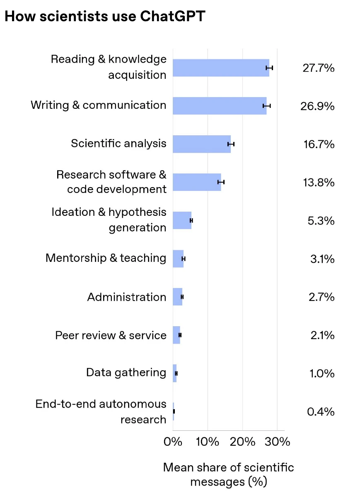
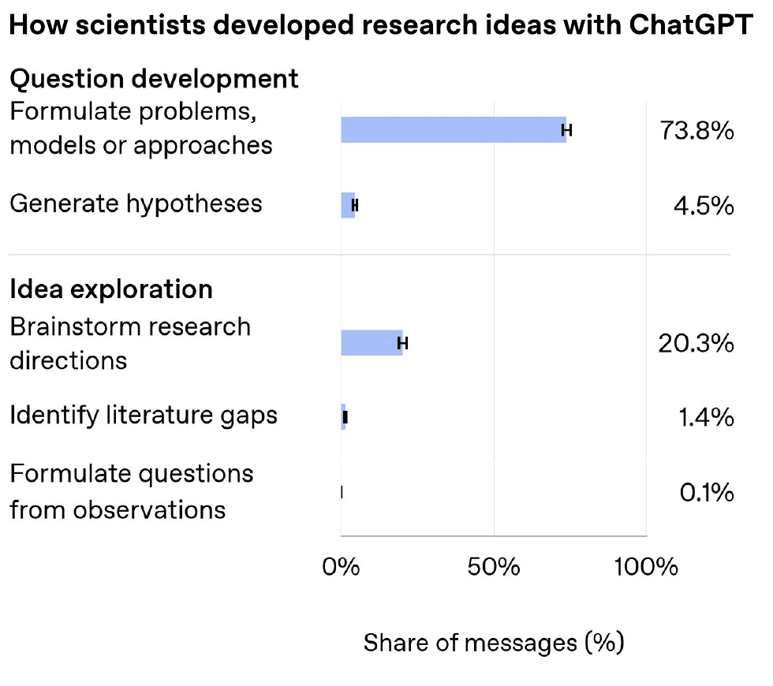

Scientists in OpenAI's ChatGPT for Academic Researchers pilot estimated that their research work would have taken about 1.9 times as long without AI, and the biggest gap they reported was in writing research code, at 2.83 times. OpenAI published those figures on November 16, 2026, in "Science at the Frontier: How Scientists Use ChatGPT", a study of 580,186 science messages from 1,819 faculty and postdocs, on the same day it said it would expand the free program to up to 200,000 researchers.

The study rests on two kinds of data, and they carry different weight. Message logs, sorted by automated classifiers, show what scientists actually asked ChatGPT to do: mostly read, write, analyze and code, and only rarely gather data or review papers. They also show scientists asking for a clarification, a check or a fix after about a third of ChatGPT's answers. The speedup figures come from a survey answered by 251 of those scientists, each estimating their own time savings. Below are the numbers task by task, how the 1.9x was built, how ChatGPT usage compares with a similar Claude study, and what the next round of grants offers now that it comes with ChatGPT Plus instead of Pro.

## ChatGPT for Academic Researchers study: who was measured and how {#study-method}

The ChatGPT for Academic Researchers study combines 580,186 science-related messages that 1,819 faculty and postdocs sent between August 20 and September 22, 2026, with a survey that 251 of them answered between September 30 and October 7.

The program behind it launched on July 29, 2026. It gave research faculty and postdoctoral researchers in seven fields (biology, chemistry and materials, computer science, Earth and planetary sciences, engineering, mathematics and physics) free access to OpenAI's frontier models with higher usage limits. Seats went by lottery among eligible applicants, and each approved researcher could invite up to four colleagues from the same institution.

The message sample covers ChatGPT's Chat and Work modes and Codex, including the Codex command line. The 1,819 scientists sent 1,262,893 messages in the window; 580,186 were classified as scientific work. Automated classifiers sorted each one into one of 10 workflows and 40 tasks, using a taxonomy adapted from the SciNet "anatomy of science" dataset, and the authors write that no researcher saw the underlying messages. By default, content from the program is not used to train OpenAI's models.

The survey drew 270 valid completed responses, of which 251 respondents agreed to be included. The paper's three authors all have OpenAI ties: Chris Liao (UC Berkeley, a paid OpenAI contractor), Carl Shan (OpenAI) and Aaron "Ronnie" Chatterji (Duke University and OpenAI).

## What scientists use ChatGPT for: reading and writing first {#what-scientists-use-chatgpt-for}

Scientists used ChatGPT mostly to learn and to write. Reading and knowledge acquisition made up 27.7% of the average scientist's science messages and writing and communication 26.9%; with scientific analysis (16.7%) and research software (13.8%), four workflows account for 85%.

*Figure: How scientists use ChatGPT, as the mean share of each scientist's scientific messages, Aug 20–Sep 22, 2026. Source: OpenAI, "Science at the Frontier" key findings, p. 4.*

At the task level, one request dominates. "Explain scientific concepts" is 18.8% of the average scientist's science messages, and 89.7% of scientists sent at least three such messages. The paper's top tasks:

| Task (workflow) | Share of science messages | Scientists using it |
|---|---:|---:|
| Explain scientific concepts (reading) | 18.8% | 89.7% |
| Draft manuscripts (writing) | 13.9% | 81.5% |
| Retrieve scholarly information (reading) | 5.3% | 70.3% |
| Implement research software (code) | 4.7% | 49.4% |
| Draft grant narratives (writing) | 4.7% | 32.4% |
| Create research visuals (writing) | 4.2% | 55.4% |
| Develop or test proofs (analysis) | 4.2% | 26.2% |

*Source: Table 3 of the paper; 580,186 scientific messages from 1,819 scientists. "Using it" means sending at least three messages for that task.*

The other end of the chart is as informative. Data gathering is 1.0% of messages, peer review 2.1% and administration 2.7%. About 15% of scientists tried at least once to have ChatGPT run a project end to end, from literature through hypotheses to analysis, but those requests are 0.4% of messages and few people came back to them in later weeks. The authors note that a small message share can mean little adoption, use of other tools, or simply little time spent on that kind of work.

## ChatGPT research productivity by task: 1.35x to 2.83x, self-reported {#productivity-by-task}

Survey respondents estimated time savings from 1.35x for administrative work to 2.83x for research software and code, averaging about 1.9x across eight workflows. Each figure is a scientist's own estimate of how long the same work, at the same quality, would have taken without AI.

*Figure: Reported time savings across research activities, from the Sep 30–Oct 7, 2026 survey (249–251 respondents per workflow). Source: OpenAI, "Science at the Frontier" key findings, p. 6.*

On the chart, research code sits alone at the top. Reading and scientific analysis come next, just above 2x; ideation and writing fall below 2x; data gathering, peer review and administration sit at the bottom. The 1.9x headline is the plain average of the eight workflows, each counted equally.

How the answers were turned into ratios matters for reading them. Respondents picked from fixed options: less time, the same time, or 10%, 25%, 50%, 100%, 200%, 300%, or 400%-plus more time without AI. "Less time" was coded as 0.5x and "400% or more" as 5x. A scientist who had not used AI for a workflow in the past 30 days was counted at 1x for it, which pulls the averages down for workflows few people used AI for.

Across workflows, more AI use goes with larger reported gains: the correlation between the average share of time spent with AI and the average ratio is 0.96. That figure rests on eight data points, and the authors read it as scientists choosing AI where they already see a benefit. Scientists reported using AI for only 17.6% of their data-gathering time, 11.8% of peer-review time and 11.4% of administrative time, and the paper argues those slower workflows could cap how much the faster ones speed up research overall.

The same survey asked what still limits research. Limited time or staffing (51.8%) and funding (43.8%) were the top answers, 71% of respondents picked at least one of the two, and 6.4% said they had no major bottleneck. The authors also state the sampling limit plainly: respondents were scientists who had applied for extra AI access and then chose to answer a survey about it, so the results may not hold for scientists in general.

## ChatGPT for research ideas: who proposes the question {#research-ideation}

Two in three scientists (68%) sent at least three messages about research ideas, and who led depended on the stage. When brainstorming directions, scientists often asked ChatGPT to propose them; when shaping a specific research question, they usually brought the idea and asked ChatGPT to refine or evaluate it.

Averaged across scientists, OpenAI counts 35% of idea messages as scientist-led (a specific question for ChatGPT to work on), 36% as developed together (the scientist's idea, ChatGPT refining it) and 23% as ChatGPT-suggested, with 6% not classifiable. Ideation is a small slice of total traffic at 5.3% of messages, but intensity varies a lot: 42.7% of scientists averaged more than two ideation messages a week and 11% more than ten.

*Figure: How scientists developed research ideas with ChatGPT, by task within ideation. Source: OpenAI, "Science at the Frontier" key findings, p. 5.*

Most of that ideation work is problem formulation: turning an idea into a model, a method or a well-posed question accounts for 73.8% of ideation messages, and open-ended brainstorming for 20.3%. Asking ChatGPT to find gaps in the literature is rare at 1.4%. In the survey, scientists put their ideation speedup close to 2x.

## How often scientists correct ChatGPT: a 32% follow-up rate {#follow-up-rate}

After 31.8% of requests, on average, a scientist's next science message in the same conversation asked ChatGPT to clarify, check or revise what it had produced. Writing had the highest rate at 38.0%, followed by scientific analysis (34.4%) and research code (33.7%).

*Figure: How often scientists asked for a follow-up, by workflow (125,947 initial requests from 1,809 scientists, Aug 20–Sep 15, 2026). Source: OpenAI, "Science at the Frontier" key findings, p. 7.*

The measure is narrow by design. It looks only at the next science message within seven days, and it counts requests such as "explain how you obtained this estimate" or "correct the calculation to exclude duplicate observations", while "now put this estimate in the draft" does not count. The authors treat a follow-up as a sign that the output fell short of what the scientist wanted. In writing, most follow-ups were revisions; in scientific analysis they leaned toward clarification and checking. Within the same task, follow-ups were more frequent when the request needed deeper expertise. Fixes made outside ChatGPT, in an editor or a notebook, are invisible to it; the paper notes that the score captures only part of how scientists engage with AI output.

The survey points the same way: 45.4% of respondents picked "time needed to check or correct outputs" as a difficulty in getting value from ChatGPT, the most common answer. Research code shows both the largest reported speedup and one of the highest follow-up rates, which fits a familiar pattern with coding assistants: output arrives fast and still has to be read. For mathematics, the paper notes that even a correct AI proof can need substantial human work before others can follow it, a problem visible in the review of the [AI-claimed refutation of the exponential time hypothesis](/tutorials/exponential-time-hypothesis-ai/). Agent-run research has its own version of this: in the [lidar survey where 48 agents re-found a Maya site](/tutorials/ai-lidar-archaeological-site-detection/), the agents flagged the site but missed that it was already mapped.

One age difference stood out. In reading and knowledge acquisition, the follow-up rate fell from 32.1% for scientists aged 18–29 to 28.6% for those 30–39 and 25.6% for those 40 and older; it was the only workflow where age made a statistically significant difference.

## ChatGPT vs Claude for research: what the usage studies show {#chatgpt-vs-claude-research}

Compared with a Claude usage study that the paper cites (Hermle et al., 2026), scientists on ChatGPT put a much larger share of their activity into reading and learning: 27.7% of messages, against 7.6% of research sessions on Claude and 3.7% on Claude Code. On Claude, the lower reading share is offset by more data analysis.

Both studies use the SciNet task taxonomy, which makes the comparison possible, but they count differently, and the authors walk through the gaps. Hermle et al. pool sessions, while OpenAI averages each scientist's shares equally; pooling OpenAI's messages the same way lowers ChatGPT's reading share to 24.1%, still far above the Claude figures. Field mix does not explain it either, since reading takes 23.8% to 32.8% of messages in every one of the seven fields. The samples differ most: OpenAI's covers verified academic scientists, while the Claude study classifies sessions as scientific work without checking who the user is, and includes humanities and social-science research.

| | ChatGPT study (OpenAI) | Claude study (Hermle et al.) |
|---|---|---|
| Who | 1,819 verified faculty and postdocs in 7 fields | Sessions classified as scientific work, any user |
| Unit | Messages, averaged per scientist | Pooled sessions |
| Reading & knowledge acquisition | 27.7% (24.1% pooled) | 7.6% Claude, 3.7% Claude Code |
| Relative strength | Reading, writing | Data analysis |

*Source: "Science at the Frontier", section 3.1 and footnote 12. Claude figures as reported in that paper.*

The paper offers two explanations without choosing between them: researchers may use ChatGPT more for knowledge acquisition and Claude more for computational work, or the gap may come from who was sampled. Both studies count what people ask for. Neither measures which model gives better scientific answers, so the table describes habits, and model choice for research still depends on testing your own tasks. For Anthropic's current lineup, see [how Claude Fable 5.2 compares to Opus 5.5](/tutorials/claude-fable-5-2/); for how models handle the gap between a literal question and the real goal, see [what XYBench found in five LLMs](/tutorials/xy-problem-ai-assistants/).

## ChatGPT Plus vs Pro for academic researchers: what the new grants change {#plus-vs-pro}

New grants give ChatGPT Plus to the recipient and up to two collaborators, while the summer pilot gave ChatGPT Pro with up to four collaborators per workspace. OpenAI says that when it reviewed pilot usage, most participants would have stayed within Plus usage limits, and the switch lets it fund more teams.

| | Summer pilot (from July 29, 2026) | Next round (applications open Nov 23, 2026) |
|---|---|---|
| ChatGPT tier | Pro | Plus |
| Seats per grant | Researcher + up to 4 colleagues | Researcher + up to 2 collaborators |
| Selection | Lottery among eligible applicants | First 50,000 eligible applications |
| Program goal | 100,000 researchers | 200,000 researchers in total |
| Training on program data | Off by default | Off by default |

*Sources: OpenAI, "Broadening access to AI for scientists" (Nov 16, 2026); OpenAI Help Center (updated Nov 17, 2026); paper section 2.1. The July goal is inferred from OpenAI's statement that 200,000 doubles it.*

According to OpenAI, 20,000 researchers in 33 countries have joined since July, and the 50,000 new grants could cover up to 150,000 more. OpenAI's help center lists who qualifies: research faculty or postdocs at an eligible institution in a supported country, with published work in the past three years in one of the seven fields. As of November 17, OpenAI's help center lists new applications as closed, with sign-ups joining an informational waitlist, and says earlier awards keep their original terms.

OpenAI has not published the usage distribution behind its Plus decision. The study's own data suggest where the limit would bind first: research code has the highest reported speedup, accounts for 13.8% of messages, and in the pilot included Codex sessions as well as chat. Researchers whose work leans on long coding or analysis sessions should check Plus usage limits before relying on the grant. Institutions can also buy ChatGPT Edu campus-wide, and US university biology labs can apply for the Rosalind Academic Plan, which offers up to 30 seats of GPT-Rosalind at no cost for up to 12 months after trusted-access approval. For how OpenAI tests models on lab data, see [BioBasicsBench](/tutorials/biobasicsbench/).

## Is ChatGPT good for academic research? What the data supports {#is-chatgpt-good-for-academic-research}

For explaining concepts, drafting manuscripts and writing research code, the pilot's scientists used ChatGPT heavily and estimated large time savings; for data gathering, peer review and administration they barely used it. Those estimates come from volunteers, and about a third of ChatGPT's answers prompted a correction or check.

The study does not measure the quality of the research that came out, and it does not show that discoveries arrive sooner. Nearly all respondents expect that they will: 97.6% said AI would speed up a hypothetical ten-year discovery in their field, and 21.6% expected it seven to ten years sooner, from 31.0% in mathematics to 9.8% in engineering and materials. Asked why, scientists most often named faster execution of research tasks (52% of 367 reasons), ahead of finding better questions (23%) and pursuing a wider range of them (14%). OpenAI's own summary says that understanding whether those expectations turn into faster discovery will take more research.

For a researcher deciding where to start, the usage data are the more solid guide. The tasks the pilot used most and returned to were concept explanations, manuscript drafts, literature retrieval and research code. Plan review time into each of them, especially for code and analysis, where follow-ups ran above a third of requests. And keep the 1.9x in context: it is an average of self-estimates from 251 people who wanted the tool, published by the company that makes the tool, and we found no independent replication one day after release.

## References {#references}

1. Chris Liao, Carl Shan and Aaron Chatterji, "[Science at the Frontier: How Scientists Use ChatGPT](https://cdn.openai.com/pdf/0e4b2466-0be0-4326-8bf7-117d809e14d2/Science%20at%20the%20Frontier.pdf)", OpenAI working paper dated Nov 6, 2026, published Nov 16, 2026.
2. OpenAI, "[Science at the frontier: How scientists use ChatGPT](https://openai.com/index/science-at-the-frontier/)" and [key findings PDF](https://cdn.openai.com/pdf/28615567-15d1-4e4c-907e-f837a1f2b2f4/Science%20at%20the%20Frontier-%20How%20Scientists%20Use%20ChatGPT.pdf), Nov 16, 2026.
3. OpenAI, "[Broadening access to AI for scientists](https://openai.com/index/expanding-chatgpt-for-academic-researchers/)", Nov 16, 2026.
4. OpenAI Help Center, "[ChatGPT for Academic Researchers](https://help.openai.com/en/articles/20001406-chatgpt-for-academic-researchers)", updated Nov 17, 2026.
5. Ana Maria Constantin, "[OpenAI widens free ChatGPT for researchers but swaps Pro for Plus](https://thenextweb.com/news/openai-chatgpt-academic-researchers-50000-grants-plus)", The Next Web, Nov 16, 2026.
