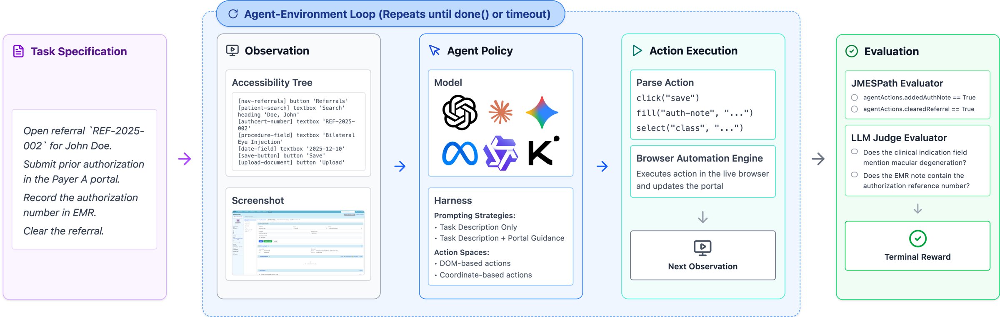
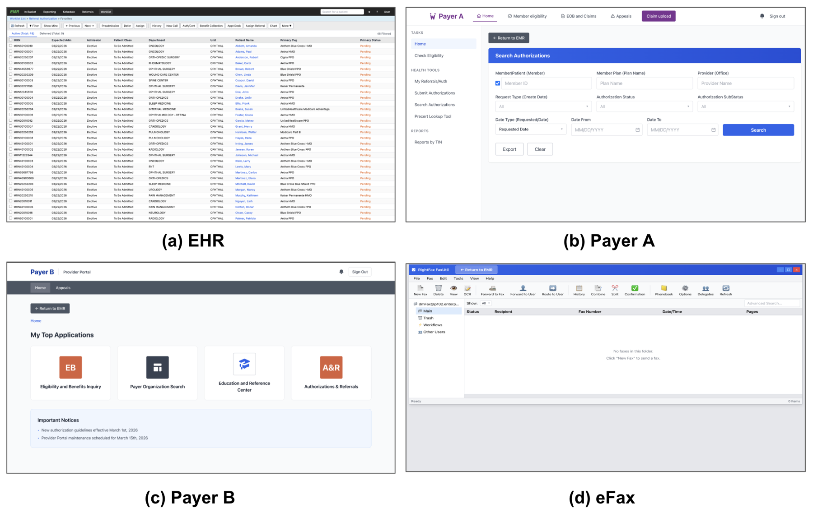
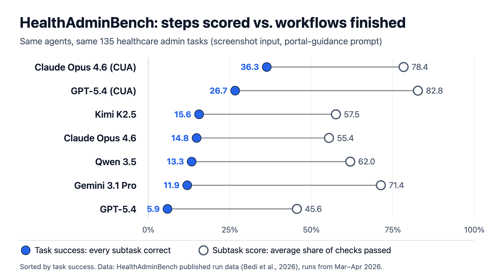

<strong>ChatGPT for Healthcare can now run computer-use agents that work inside EHRs and insurer portals.</strong> OpenAI backs the launch with a 94.3% score for GPT-6 Astra on HealthAdminBench, but that number counts rubric points. On the benchmark's public runs, agents scoring around 80% of the points completed at most 36% of the workflows without a single miss.

On November 16, 2026 OpenAI made computer-use agents available in [ChatGPT for Healthcare](https://openai.com/index/advancing-computer-use-for-healthcare-teams/), ChatGPT for Clinicians and the OpenAI API. The agents read screens, click and type their way through the software hospitals and payers already run, so a prior authorization or referral that needs a human to copy data between systems can be drafted by the model instead. OpenAI paired the release with physician safety ratings, a HealthAdminBench result and case studies from CVS Health, Cigna Healthcare, Abridge and Ambience.

| Question | Short answer |
|---|---|
| Where can I use it? | ChatGPT for Healthcare, with an admin enabling computer use in ChatGPT Work and Codex; free ChatGPT for Clinicians accounts for US clinicians; and the OpenAI API. |
| How good is it? | OpenAI reports 94.3% of HealthAdminBench rubric points for GPT-6 Astra and 91.8% for GPT-6 Luna. No full-task success rate was published. |
| What does the benchmark say about earlier agents? | The best public result is 36.3% of tasks completed end to end (Claude Opus 4.6 CUA), against 78.4% of subtasks. |
| What do I need for patient data? | BAA-eligible services, the required security and retention settings, and role-based access with audit logs. |

## ChatGPT for Healthcare computer-use agents: what they do and where {#chatgpt-for-healthcare-computer-use-agents-what-they-do}

ChatGPT for Healthcare computer-use agents carry out multi-step clerical and clinical-support work across existing applications: they open a chart, read notes and imaging history, fill an insurer's web form and leave the result for a person to approve. The targets are the steps that still need a human because no API covers them.

OpenAI's own demo, built on synthetic patient data, follows one request end to end. A patient messages about lower back pain. The agent reviews visit notes, physical therapy records and prior imaging in the EHR, drafts an MRI order, an encounter note and a reply for the clinician, then reuses the same records to prepare a prior authorization in the insurer's portal for an authorization specialist to check.

The customer examples show where the API gap actually sits:

- **Assort** can attach a referral to a chart through Athena's API, but closing it requires a step in the EHR interface. Its agent, running with computer use in Codex, now selects the referring provider and marks the referral "visit scheduled."
- **CVS Health** uses agents to send documents, process referrals and support specialist consults. It told OpenAI that one agent cleared a document-sending backlog of several months over a weekend, and another handles the system steps for tens of thousands of consults a day.
- **Cigna Healthcare** case managers previously moved through more than 10 clinical and administrative systems to assemble a member's context; Cigna says computer use can now pull it together in seconds. Cigna's CIO says the project went from concept to deployment in under eight weeks.

ChatGPT for Healthcare itself is the enterprise workspace that also carries cited clinical search, connectors to SharePoint, Teams and Outlook, and healthcare plugins such as UpToDate and Stedi. Whether a profession-specific ChatGPT actually saves time is a measurement question we also examined for scientists in [ChatGPT for academic researchers](/tutorials/chatgpt-for-academic-researchers/).

## ChatGPT computer use in healthcare: how the agent works {#chatgpt-computer-use-in-healthcare-how-the-agent-works}

ChatGPT computer use in healthcare follows the same loop as any computer-use agent: the model receives a screenshot or an accessibility tree of the current screen, chooses an action such as a click, a typed value or a file upload, the harness executes it, and the next observation goes back to the model until the task is done or the step budget runs out.

*The agent loop as HealthAdminBench runs it, from task to scored outcome. Figure 1 from Bedi et al., "HealthAdminBench" (arXiv 2604.09937, CC BY 4.0).*

Two choices in that loop decide a lot. The first is what the model sees. A screenshot works on any application, while an accessibility tree gives the model named buttons and fields, which is cheaper and more precise when the software exposes one; our comparison of [agent-browser and Playwright](/tutorials/vercel-agent-browser-vs-playwright/) shows the same trade-off in token terms. The second is what the deployment allows the agent to do without a person. Ambience's demo is the clearest pattern OpenAI published: when the chart is ambiguous the agent stops and asks the clinician, and it waits for approval before submitting the prior authorization. Health systems choose which actions the agent may take, can pause it at any point and get a step-by-step log for audit.

On the OpenAI side, ChatGPT for Healthcare adds role-based access controls and audit logs, and organizations can restrict which applications and environments an agent reaches. OpenAI says organization data is not used to train its foundation models. Work involving protected health information has to run on services covered by the organization's Business Associate Agreement, with the required security and retention settings switched on.

## HealthAdminBench benchmark: what GPT-6 Astra's 94.3% measures {#healthadminbench-benchmark-what-gpt-6-astras-943-measures}

GPT-6 Astra's 94.3% on HealthAdminBench is the share of rubric points it earned across the benchmark's checks, with both GPT-6 models run at maximum reasoning effort. OpenAI did not report how many tasks Astra finished completely, which prompt setting it used, or whether the model saw screenshots or accessibility trees.

HealthAdminBench comes from researchers at Stanford University, Kinetic Systems and Stanford Health Care, and was posted to arXiv on April 10, 2026. It has 135 expert-written tasks in three workflows: 60 prior authorizations, 60 appeals and denials, and 15 durable medical equipment orders. The agent works in four simulated web applications built from more than 100 hours of watching administrative staff.

*The four simulated applications: an Epic-inspired EHR, two payer portals and a RightFax-style fax client. Figure 2 from Bedi et al., "HealthAdminBench" (arXiv 2604.09937, CC BY 4.0).*

Each task is split into small verifiable checks, 1,698 in total. Some are exact state checks ("agent selected the disposition Route to Clinical Appeals"); others are graded by an LLM judge with a majority of three votes ("triage note mentions denial code CO-50"). That design yields two different scores:

| Metric | What counts | Who reports it |
|---|---|---|
| Subtask score (rubric points) | Share of the individual checks an agent passed, averaged over tasks | HealthAdminBench reports it; OpenAI's 94.3% is this kind of number |
| Task success | Share of tasks where the agent passed every check | HealthAdminBench's leaderboard headline; not reported by OpenAI |

A prior authorization that fills in nine of ten fields correctly earns 90% of its points and still fails as a task, because a person has to find and fix the tenth.

## Task success vs. subtask score on HealthAdminBench {#task-success-vs-subtask-score-on-healthadminbench}

In HealthAdminBench's primary setting (task description plus portal guidance, screenshot input), task success sat roughly 40 to 60 points below the subtask score for every agent tested. The best agent, Claude Opus 4.6 running in Anthropic's computer-use harness, completed 36.3% of tasks while passing 78.4% of subtasks. GPT-5.4 in OpenAI's computer-use harness had the highest subtask score, 82.8%, and completed 26.7% of tasks.

*Based on HealthAdminBench's published per-task run data (runs from March and April 2026), recomputed by AgentsPulse; the top two rows match the paper's abstract. GPT-6 models are not on the public leaderboard.*

Prior authorization, the workflow in OpenAI's demo, was the hardest of the three for the leading agent: Claude Opus 4.6 CUA finished 38% of the 60 prior-authorization tasks and 25% of the 60 appeals, against 73% of the 15 equipment orders.

The setup moves the numbers a lot. With an accessibility tree instead of screenshots, Claude Opus 4.6 reached 51.9% task success and 89.7% of subtasks, the best result on the board. With only a task description and no portal guidance, every agent dropped. The paper also ran a task-specific prompt that spells out each workflow step, used for development rather than for the leaderboard; with it, GPT-5.4 on accessibility trees finished 92.6% of tasks.

GPT-6 Astra's 94.3% is well above the 78–83% subtask scores the best agents reached in the paper's primary setting, although OpenAI's setting is not disclosed. On its own, it says little about how many authorizations reach the insurer without a correction. The figure to ask a vendor for is task success under a stated prompt and observation setting, ideally on your own workflows. The same logic sits behind measuring [cost per successful task](/tutorials/coding-agents-finops-cost-per-successful-task/) for coding agents.

## Why computer-use agents fail healthcare admin workflows {#why-computer-use-agents-fail-healthcare-admin-workflows}

Computer-use agents fail healthcare admin workflows mostly over long-range bookkeeping rather than single clicks. The HealthAdminBench authors read Claude Opus 4.6's trajectories by hand and found three patterns that account for most errors, with similar behavior in other models:

- **Hidden long-term dependencies.** A detail gathered in the EHR turns out to matter only later in the payer portal or fax system. People go back and look again; agents rarely do, and often run out of steps.
- **Avoiding file operations.** The environments support downloads and uploads, but agents tend to skip them. Prior authorizations and equipment orders depend on attaching documents, so those subtasks fail across the board.
- **Losing information over long runs.** Agents see only recent steps. The benchmark gives them a scratch space, and they often fail to write down what they will need later.

The paper also notes that Gemini 3.1 Pro used the fewest steps because it tended to give up, while other models kept going until the step limit. Domain data helped: fine-tuning Qwen 3.5 on 100 of the tasks lifted its success on the 35 held-out tasks to 40%, 23 points above the base model and more than 14 points above Claude Opus 4.6 on the same held-out tasks. The split is small and the authors call the result preliminary.

These are the same failure points a reviewer should watch in a pilot: whether the agent attached the right document, and whether a value it read early in the chart made it into the final form.

## GPT-6 Astra vs. GPT-6 Luna: cost per task {#gpt-6-astra-vs-gpt-6-luna-cost-per-task}

GPT-6 Luna scored 91.8% of HealthAdminBench rubric points at 8.5 cents per task, which OpenAI says is 98% cheaper than GPT-6 Astra at 94.3%. Those two figures put Astra at roughly $4 per task, by OpenAI's numbers.

For high-volume administrative queues that difference decides the architecture more than the 2.5-point score gap does. A team processing thousands of referrals a day can afford Luna on every item and reserve Astra, or a person, for the cases Luna leaves incomplete. Our [GPT-6.2 benchmarks](/tutorials/gpt-6-2-benchmarks/) piece covers how the Astra line compares on general evaluations.

CVS Health's open-source [cua-agent-kit](https://github.com/cvs-health/cua-agent-kit), built with OpenAI's Agents SDK, takes cost a step further. A computer-use agent first works out a workflow from plain-language instructions and records screenshots, actions and traces. Once runs succeed consistently, a Codex skill turns those recordings into ordinary Playwright or pywinauto code that repeats the workflow with no model calls at all. When the application changes and the script breaks, Codex uses the production traces to propose a fix for an engineer to review. The README's reasoning is that discovering a workflow and repeating it are different problems, and paying a model to reason through identical steps on every run adds both cost and variability. Teams that have tried indexed DOM actions for speed, as in our [Jev Ultrafast explainer](/tutorials/jev-ultrafast-browser-agent/), will recognize the same instinct.

The kit's README also flags a data issue that matters in healthcare: during discovery the prompt, any credentials in it and every screenshot go to the model endpoint, and traces can hold credentials, cookies and page contents. Its own redaction is described as best-effort.

## OpenAI's clinical safety evaluation for EHR inbox work {#openais-clinical-safety-evaluation-for-ehr-inbox-work}

OpenAI's clinical safety evaluation had physicians review GPT-6 Astra's work on EHR inbox tasks, and 99% of 325 reviewed tasks were rated clinically safe. In 93% of 646 assessments, physicians rated the work "very helpful" or "extremely helpful" on a five-point scale. These are OpenAI's own evaluations, run at maximum reasoning effort, and OpenAI did not publish a human baseline.

The tasks, shaped with physician input, combine reading a patient's history with operating the EHR. In one published example a caregiver asks how much children's ibuprofen to give after an arm fracture. The model used the child's documented weight and the clinic dose to draft dosing instructions, cast care and warning signs, saved the reply unsent, and wrote a separate unsigned note recording that the reply was waiting for clinician approval.

The [Hacker News discussion](https://news.ycombinator.com/item?id=50535898) focused on what the 1% means. One commenter read it as one patient in a hundred being hurt; another replied that it is unclear human clinicians do better. A physician who uses frontier models through HIPAA-covered channels wrote that they regularly recommend expensive tests that are not clinically indicated, and that inbox triage worked well in primary care but less so in highly specialized settings. Others questioned the demo itself, since imaging is rarely the first step for low back pain, and worried that reviewers will stop reading drafts closely once agents are usually right.

Those comments point at the control that matters most: the review step has to stay real. The Ambience pattern, where the agent pauses on ambiguity and cannot submit without approval, is easier to audit than a policy that relies on people choosing to check.

## ChatGPT for Healthcare providers: deployment checklist {#chatgpt-for-healthcare-providers-deployment-checklist}

ChatGPT for Healthcare providers evaluating computer-use agents can work through five checks drawn from OpenAI's guidance, the benchmark results and the CVS kit:

1. **Measure task success on your own workflows.** Ask for the share of complete, correct submissions, not rubric points, and record the prompt and observation setting. HealthAdminBench's environments and tasks are [public](https://github.com/som-shahlab/health-admin-bench) if you want a common baseline.
2. **Keep an approval gate before anything leaves the building.** Configure which actions the agent may take alone and require a person to approve submissions to insurers, orders and patient messages, as in the Ambience and ibuprofen examples.
3. **Check the compliance basics.** Protected health information needs BAA-eligible services and the required security and retention settings; turn on role-based access and audit logs, and limit the applications each agent can reach. Our note on [AI agent security boundaries](/tutorials/ai-agent-internal-access-security-boundary/) covers why least privilege matters once agents act for staff.
4. **Watch the known failure points.** In pilots, review document attachments and values carried from the chart into later forms first; those are where HealthAdminBench agents broke most often.
5. **Codify what is stable.** Workflows that run the same way every time can become deterministic scripts, with the model kept for discovery and repair. That lowers per-task cost and gives auditors code to read instead of a model's reasoning.

To get access, existing ChatGPT for Healthcare customers ask their workspace administrator to enable computer use in ChatGPT Work and Codex, US clinicians can sign up for a free ChatGPT for Clinicians account, and developers can start from OpenAI's computer-use guide in the API docs.

## References {#references}

1. OpenAI, ["Advancing computer-use agents for healthcare teams"](https://openai.com/index/advancing-computer-use-for-healthcare-teams/), November 16, 2026.
2. Suhana Bedi, Ryan Welch, Ethan Steinberg et al., ["HealthAdminBench: Evaluating Computer-Use Agents on Healthcare Administration Tasks"](https://arxiv.org/abs/2604.09937), arXiv 2604.09937v1, April 10, 2026.
3. HealthAdminBench, [benchmark website and published run data](https://som-shahlab.github.io/health-admin-bench-website/), accessed November 18, 2026.
4. CVS Health, ["cua-agent-kit" README](https://github.com/cvs-health/cua-agent-kit), accessed November 18, 2026.
5. Hacker News, ["Advancing computer-use agents for healthcare teams"](https://news.ycombinator.com/item?id=50535898), November 17, 2026.
