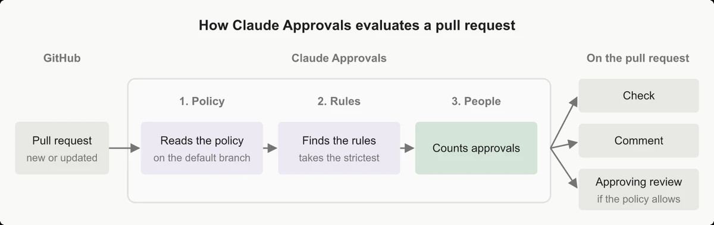
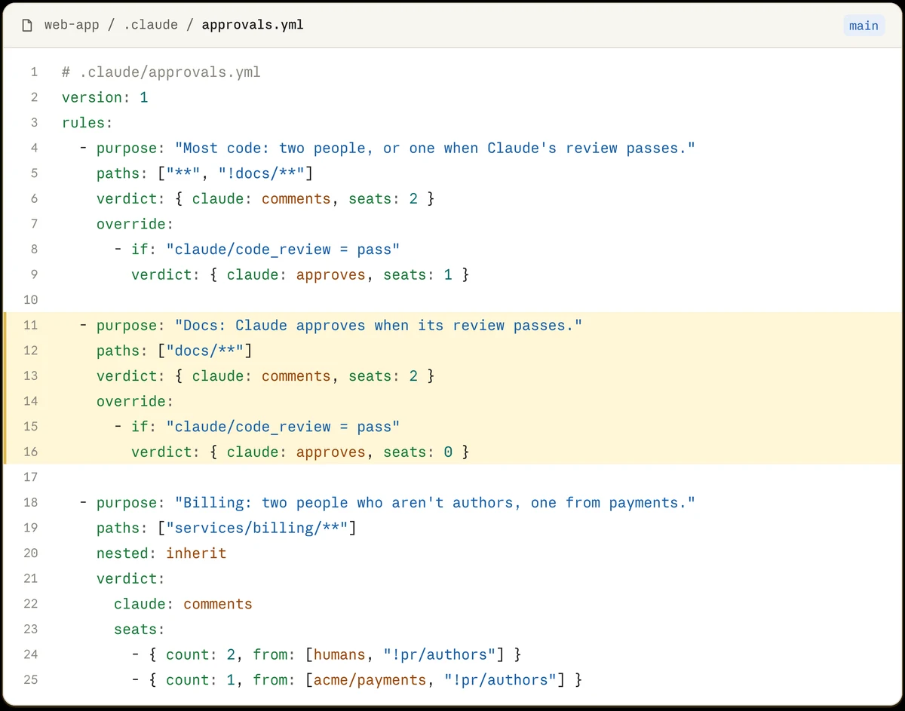
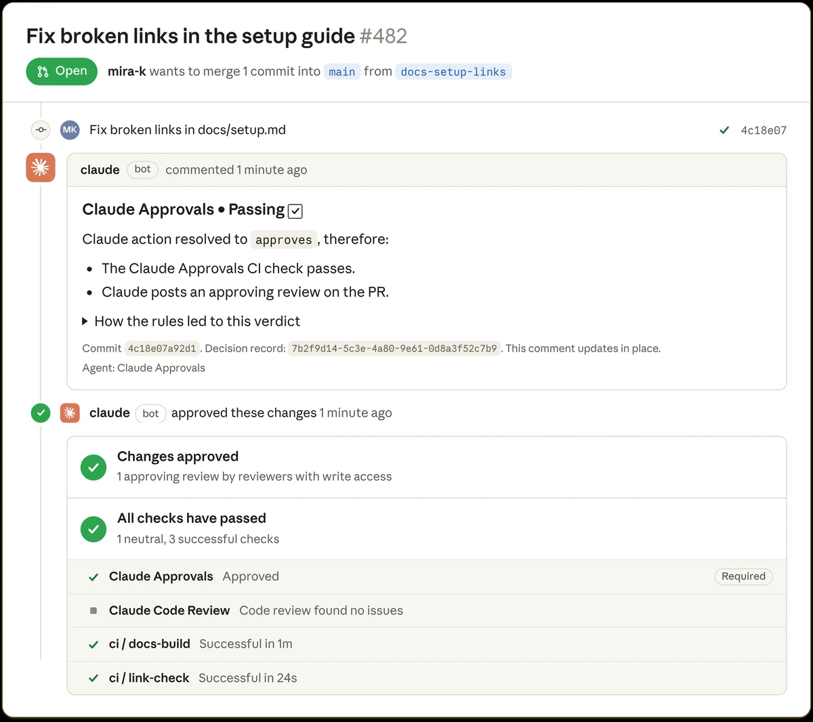

Claude Approvals lets Claude post an approving review on a GitHub pull request when a policy your team writes allows it. Anthropic shipped it in beta on November 23, 2026 as one of three agents in Claude Ship: Code Review reads the change, PR Steward pushes fixes for review comments and failing checks, and Claude Approvals decides who still has to sign off. The approval step is the new part. A badly written policy, or a GitHub rule that counts Claude's review as the only approval, can let code merge that no person besides its author has read.

The policy is a YAML file, `.claude/approvals.yml`, and the decision it encodes is familiar to anyone who has maintained a CODEOWNERS file: which paths need whom. What changes is that a rule can also say "Claude may approve here", conditioned on Claude's own review passing or on a model's answer to a question you write. This guide covers how Approvals reads that file, a policy you can adapt, the GitHub settings that have to change with it, and the configurations Anthropic's documentation flags as able to merge code with no reviewer.

## Claude Approvals vs CODEOWNERS: what the policy file adds {#claude-approvals-vs-codeowners}

Claude Approvals does what a CODEOWNERS file plus required reviews does, then adds two things: a rule can let Claude approve, and a rule's requirement can change with facts about the pull request or a model's judgment. Anthropic's announcement says it "works like a smarter CODEOWNERS file". It runs as a GitHub check named **Claude Approvals** whose title spells out the approvals still needed, for example *Waiting on human review from any person (1/2)*, and Claude posts a comment explaining the decision.

| | CODEOWNERS + branch protection | Claude Approvals |
|---|---|---|
| Where the rules live | `CODEOWNERS` file and GitHub settings | `.claude/approvals.yml`, read from the default branch |
| What a rule says | Which owners must review a path | How many people (`seats`), from which people list, and whether Claude `approves`, `comments` or `blocks` |
| Conditions | None | Pull request facts such as `pr/diff_lines`, `pr/authors` or `pr/base`, and classifier answers such as `claude/code_review = pass` |
| Lets Claude approve | No | Yes, where every applying rule says `approves` |
| Can it read CI results? | Required status checks do | No. Keep CI as its own required check |

Classifiers are what make the rules "smarter". Two come built in: `claude/code_review` answers `pass` when a Code Review finished with no Important finding open, and `claude/diff` rates how much a push changed since an earlier approval (`trivial`, `same_intent` or `different`). You can also define your own in `.claude/classifiers/<name>/def.yml`, which holds a prompt, the answers the model may pick, and the model to use; Anthropic's example asks Opus to rate a change's risk as `low`, `medium` or `high`, with sign-in, billing and data migrations counting as high.

<p><strong>Drafting a classifier prompt first.</strong> Each custom classifier run is a billed Claude Code cloud session, so it pays to settle the wording of a risk prompt like that one on a handful of real diffs before you commit <code>def.yml</code>. If you want to try it against Claude Opus and Sonnet from your own scripts, a shared API gateway such as
<a href="https://www.packyapi.ai/register?aff=5W73&amp;utm_source=agentspulse&amp;utm_medium=affiliate&amp;utm_campaign=claude-approvals"
rel="sponsored nofollow noopener" target="_blank">PackyAPI</a> is one option.</p>

The policy file is also where the risks sit. Anyone who can merge into the default branch can turn Approvals on by merging a policy file, and the same people can loosen it later. Approvals treats the policy file, everything under `.claude/classifiers/`, `REVIEW.md`, `CODEOWNERS`, `.gitmodules`, `.gitattributes`, symlinks and submodule pointers as protected files that normally need a person with write access, but that person can be the pull request's author. The documentation tells you not to assume anything else is protected and to write rules for files such as `.github/`, `CLAUDE.md`, `AGENTS.md` and `.mcp.json`. Those files change what agents are allowed to do, the same identity-and-permission problem we described in [AI agents with internal access](/tutorials/ai-agent-internal-access-security-boundary/).

## How Claude Approvals picks a verdict {#claude-approvals-verdict-rules}

Claude Approvals takes the strictest verdict that applies to any changed file, and every applying rule's seats must be filled. `blocks` outranks `comments`, which outranks `approves`, so one rule that says `comments` on a single file is enough to stop Claude from approving the whole pull request.



*How Claude Approvals evaluates a pull request. Source: [Claude Code docs](https://code.claude.com/docs/en/approvals), converted from SVG.*

Each rule has a `purpose`, a list of `paths` and a `verdict`. The verdict's `claude` field is `approves`, `comments` or `blocks`, and `seats` is a number from 0 to 16 or up to eight sets such as `{ count: 1, from: acme/payments }`. A rule can carry an `if`, and an `override` list whose first true entry replaces the rule's verdict. Rule order does not matter.

Three details decide most real outcomes:

- **The author fills a seat.** On a pull request opened by someone with write access, the author counts as one person without approving. `seats: 1` therefore means the author alone is enough, and `seats: 2` means the author plus one other person. To require someone else, exclude authors with `"!pr/authors"`.
- **`approves` reviews nothing.** The field starts no Code Review on its own, so a rule that says `claude: approves` without reading a classifier lets Claude approve a change no review has read.
- **A missing classifier answer falls back to the rule.** When a classifier run ends with `error` or `incomplete`, an override that reads it is skipped and the rule's own verdict applies. Anthropic's advice is to keep the strict verdict on the rule and put the lighter one in the override.

People lists decide who can fill a seat. `humans` includes machine users, meaning user accounts that a script or agent drives, but not the `claude` account that Claude's cloud sessions commit as. `bots` and `everyone` admit Claude's own app, and if a set admits Claude and every applying rule says `approves`, Approvals counts that seat as filled before Claude approves, so the check can pass with no person at all.

## Claude Approvals policy example for routine and risky paths {#claude-approvals-policy-example}

A workable Claude Approvals policy covers every path with a root rule that has no `if`, lets Claude approve only where its review passed, and asks for a non-author human on the paths you care about most. The file below combines the documentation's examples into one policy for a typical service repository. Approvals validates a policy in the pull request that adds it, so treat this as a starting point to check there, not a tested configuration.

```yaml
# .claude/approvals.yml
version: 1
mode: observe
rules:
  - purpose: "Most code: two people, or one when Claude's review passes."
    paths: ["**", "!docs/**"]
    verdict: { claude: comments, seats: 2 }
    override:
      - { if: "claude/code_review = pass", verdict: { claude: approves, seats: 1 } }

  - purpose: "Docs: Claude approves once its review passes; the author is the one person."
    paths: ["docs/**"]
    verdict: { claude: comments, seats: 1 }
    override:
      - { if: "claude/code_review = pass", verdict: { claude: approves, seats: 1 } }

  - purpose: "Billing: two people who aren't authors, one of them from payments."
    paths: ["services/billing/**"]
    nested: inherit
    verdict:
      claude: comments
      seats:
        - { count: 2, from: [humans, "!pr/authors"] }
        - { count: 1, from: [acme/payments, "!pr/authors"] }

  - purpose: "Files that steer agents and CI need a person who isn't an author."
    paths: [".github/**", "**/CLAUDE.md", "**/AGENTS.md", ".mcp.json", "**/.claude/**"]
    nested: inherit
    verdict:
      claude: comments
      seats: [{ count: 1, from: [humans, "!pr/authors"] }]
```

What each rule does once the policy is enforced:

1. **Root rule.** Every file outside `docs/` needs two people, one of whom can be the author. When Code Review passes, the override drops that to one seat and lets Claude approve, which in practice means the author plus Claude. Reading `claude/code_review` in a condition can start a billed review when the pull request opens and at each push.
2. **Docs rule.** Same shape with one seat throughout, so a docs change needs only its author once Claude's review passes. Anthropic's own example in the launch post goes further and sets `seats: 0` for docs when the review passes; under `seats: 0` nobody besides the author has to look, and a docs change a bot wrote can merge with no person involved.
3. **Billing rule.** Two non-authors, one of them from the `acme/payments` team. Because the strictest verdict wins, this `comments` rule stops Claude from approving any pull request that touches billing, whatever the root rule says. The documentation notes that a named set should contain at least one more person than its `count`, or an author from that team can end up waiting.
4. **Agent and CI files.** Instruction files that change how agents and CI behave get a non-author reviewer. If you run an agent under its own GitHub user account, add `"!<its-login>"` to the list, because machine users count as `humans`.



*Anthropic's example policy from the launch post. The highlighted docs rule uses `seats: 0`, so a passing review alone is enough there. Source: [Anthropic](https://claude.com/resources/articles/introducing-claude-ship).*

Two refinements are worth knowing before you copy anything. Dependency bots can get a lighter rule with a condition such as `"ALL pr/authors = bot:dependabot"`; the documentation recommends `ALL` for conditions that relax a rule, because with `ANY` a single listed author relaxes it for everyone else's commits too. And by default every push that changes the diff drops earlier approvals; a `reuse` condition such as `"claude/diff <= same_intent AND claude/code_review = pass"` keeps them, at the price of a billed `claude/diff` answer per push.

## Claude Approvals and GitHub branch protection settings {#claude-approvals-github-branch-protection}

Claude Approvals only blocks a merge where GitHub requires the **Claude Approvals** check, and GitHub keeps deciding what merges. Three existing settings interact with it, and Anthropic's GitHub rules page gives a specific instruction for each:

| GitHub setting | How it interacts with Approvals | What to set |
|---|---|---|
| Required approvals | GitHub can count Claude's approving review as one approval. It does not count an author filling a seat, or an `@claude approve` comment | Require no more than one approval in GitHub and put the real headcount in `seats`; otherwise a pull request can stay blocked after the check passes |
| CODEOWNERS | A branch rule can still require a Code Owner's review | To name owners in the policy instead, use a team or login list in `seats` on their paths |
| Stale approvals | Claude's approval sits on one commit, and GitHub can keep counting it until it is dismissed | Turn on **Dismiss stale pull request approvals when new commits are pushed** or **Require approval of the most recent reviewable push** |

Two more settings are easy to miss. When you add the required check, set its source to the Claude app; with "any source", GitHub accepts a check named Claude Approvals from anywhere. Through the API, the Claude app's ID is `1236702`, set as `integration_id` in a ruleset or `app_id` in a branch protection rule. And because policy conditions cannot read CI results, keep your test workflows as separate required checks.

An enforced policy also evaluates pull requests into branches other than the default branch, so list every branch the check should gate and require it there as well. Direct pushes to the default branch get no check at all, which makes "require a pull request before merging" a prerequisite.

If you use a merge queue, ask a GitHub organization owner to accept the Claude GitHub App's **Merge queues** permission. Approvals does not evaluate the queue's own commits; it normally stamps them as passed, and without that permission they get no check and wait wherever the check is required.

## Can Claude Approvals merge code with no human review? {#claude-approvals-merge-without-human-review}

Yes. Anthropic's documentation says a pull request can merge with no person but its author looking at it, or with no person at all if a bot wrote it. These are the configurations it lists, and each is worth searching your policy for before you enforce it:

- The **Claude Approvals** check is not required in GitHub, which is also the normal state in observe mode.
- `seats: 0`, or `seats: 1`, which the author fills alone.
- A `from` list that admits bots, including `everyone`, `bots` or `bot:claude`.
- A machine user, which counts as a person.
- A `reuse` condition that keeps seats after a push. Two people who each held the author's seat at different commits can fill `seats: 2` with nobody approving.
- Files no rule covers. GitHub counts the check's neutral result as passing.
- A condition that reads a classifier's answer.
- GitHub auto-merge or a merge queue combined with a policy that needs no person, which can merge without anyone acting.

The classifier case is the one specific to AI review. A custom classifier runs as a Claude Code cloud session with read-only GitHub access, and it reads the pull request's title, description and diff. Text the author wrote can steer its answer, so a condition such as `repo/change_risk = low` that lowers the headcount can be talked down. Meta's [just-in-time catching test pipeline](/tutorials/just-in-time-catching-test-generation/) puts rule-based filters next to its LLM judges for a similar reason. The documentation's remedy is to require a non-author person on the paths that matter, in a rule that reads no classifier:

```yaml
  - purpose: "A change takes one person who isn't an author."
    paths: ["**"]
    nested: inherit
    verdict:
      claude: comments
      seats: [{ count: 1, from: [humans, "!pr/authors"] }]
    advisory: [claude/code_review]
```

Adding that rule to the root policy guarantees at least one person besides the author on every path while keeping automatic Code Reviews. The other agents in Claude Ship do not close the gap. PR Steward is designed not to approve or merge, and `/ship` in Claude Code leaves the merge to you, but both act with real credentials: the `/ship` watch uses your own `gh` and `git` sign-ins, so it could merge a pull request that your branch rules already let you merge alone.

## Claude Approvals observe mode: rollout from observe to enforce {#claude-approvals-observe-mode-rollout}

Claude Approvals starts in observe mode when the policy file contains `mode: observe`: the check shows what the policy would decide, Claude does not approve, and GitHub normally counts the check as passing. Anthropic recommends running there until the check titles match what your reviewers actually decide. Before you begin, the documentation lists these prerequisites:

- A Claude organization on a Team or Enterprise plan, with usage credits to pay for the model runs a policy starts.
- The Claude GitHub App installed on the repository and linked to the Claude organization.
- Admin access to the repository to require the check; a private repository also needs a paid GitHub plan.
- At least two people with write access. With one, the starter policies cannot pass on changes under `.claude/`.

Turning it on takes two pull requests. Add the policy at `.claude/approvals.yml` in a pull request of its own and merge it when Claude comments that it "found the policy file in this change valid"; an invalid file produces a failed check titled *This change breaks a policy file*. Then open any non-draft pull request into the default branch and look for a **Claude Approvals** check whose title starts with *(observe mode)*.



*An enforced policy approving a docs fix: the required Claude Approvals check passes and Claude's review counts as the one GitHub approval. Source: [Anthropic](https://claude.com/resources/articles/introducing-claude-ship).*

Switching to enforcement has an order, because open pull requests keep a passing observe-mode check until Approvals runs again:

1. Delete the `mode: observe` line and merge that change.
2. About five minutes later, comment `@claude approvals rerun` on each open pull request whose check title starts with *(observe mode)* or *Observe mode ended*. Keep those pull requests out of the merge queue until then.
3. In GitHub, require the **Claude Approvals** status check on the default branch and every other branch you listed, with the Claude app as its source.
4. Confirm it blocks: open a pull request that changes a file under `.claude/` and check that the title reads *Waiting on human review from any person (1/2)* and GitHub lists the check as required.
5. Only after that, change the number of approvals GitHub requires, down to one if your branch rules ask for more and the headcount now lives in `seats`.

Turning it off also has an order. Turn on stale-approval dismissal, stop requiring the check, then turn Approvals off and dismiss any approving reviews Claude left on open pull requests. Suspending the GitHub App first leaves new commits without a check, so a required check blocks merges while old Claude approvals can still count. This is the same observe-then-enforce pattern the Claude Code team recommends for its own commit gates in our [Claude Code verification guide](/tutorials/claude-code-verification/), applied at the merge step.

## Claude Approvals cost and availability {#claude-approvals-cost-availability}

Claude Approvals has no base charge, but the model runs a policy starts are billed by tokens to the organization's usage credits, separately from the plan's included usage, and observe mode is billed too. Claude Ship as a whole is available on Team and Enterprise plans for repositories on github.com, including GitHub Enterprise Cloud. Code Review is generally available; PR Steward and Claude Approvals are in public beta.

What starts a charge:

- **`claude/code_review` in a condition** can start a billed Code Review when a pull request opens and at each push, on top of whatever your Code Review settings already run. Listing it only under `advisory` keeps reviews on your existing schedule.
- **Custom classifiers** bill every run, including runs in observe mode, under `advisory`, runs that end with no answer and automatic retries after an error. A run stops when its estimated spend reaches $10 by default, and the bill can come in a little higher; `budget: { cost: 5 }` in `def.yml` lowers the cap, and switching `model` from `opus` to `sonnet` picks a lower-cost model.
- **`claude/diff`** bills each answer that calls a model.

An Owner can cap spending at **Organization settings > Usage** for the whole organization, for Code Review, and separately for classifier runs. Turning off usage credits does not stop agents that are already on; to stop charges, turn Approvals off first, then PR Steward, then Code Review, because a policy can start billed reviews even where Code Review is off. Eligible Enterprise organizations can claim at least $10,000 in Claude Ship credits by January 15, 2027, to be used within 30 days of claiming.

Some organizations cannot use it at all. Claude Ship is unavailable with Zero Data Retention, the HIPAA configuration or customer-managed encryption keys, and Approvals cannot be started under FERPA or Access Transparency settings. Pull requests with 2,000 or more changed files get an *Action required* check titled *Change too large to evaluate*.

Developer reaction so far comes from comment threads. In the [Hacker News thread](https://news.ycombinator.com/item?id=50618513), one commenter whose team writes a lot of code with OpenAI models plans to pitch Claude Ship as a reviewer from a different provider, another said they had already assembled the same review-fix-approve chain from parts, with several model families as reviewers, and a third questioned who needs a vendor-specific version of a bot most teams could build. Anthropic's own evidence is internal: on the Claude Code team, where Claude's review is one layer of a wider process, merged pull requests more than doubled from June to September while the share later reverted fell by more than 40%. No independent measurement of Approvals exists yet.

For a team deciding whether to turn it on, the practical path is to start with one repository, run the root rule above in observe mode for a few weeks, and compare its check titles with what your reviewers decided. Approvals only governs the merge step, so the checks that run before a pull request exists, such as the plan-and-TDD loop in [Superpowers for Claude Code](/tutorials/superpowers-claude-code/), still decide what reaches it. Teams already weighing token spend per merged change can use the same yardstick as in our look at [cost per successful task for coding agents](/tutorials/coding-agents-finops-cost-per-successful-task/): count the reviews and classifier runs a policy triggers per merged pull request, not just the monthly bill.

## References {#references}

1. Anthropic, ["Introducing Claude Ship"](https://claude.com/resources/articles/introducing-claude-ship), November 23, 2026.
2. Claude Code Docs, ["Claude Approvals policy file reference"](https://code.claude.com/docs/en/approvals-policy), read November 24, 2026.
3. Claude Code Docs, ["Claude Approvals and your GitHub rules"](https://code.claude.com/docs/en/approvals-github-rules), read November 24, 2026.
4. Claude Code Docs, ["Set up Claude Approvals"](https://code.claude.com/docs/en/approvals-setup), read November 24, 2026.
5. Claude Code Docs, ["Claude Approvals classifiers"](https://code.claude.com/docs/en/approvals-classifiers), read November 24, 2026.
