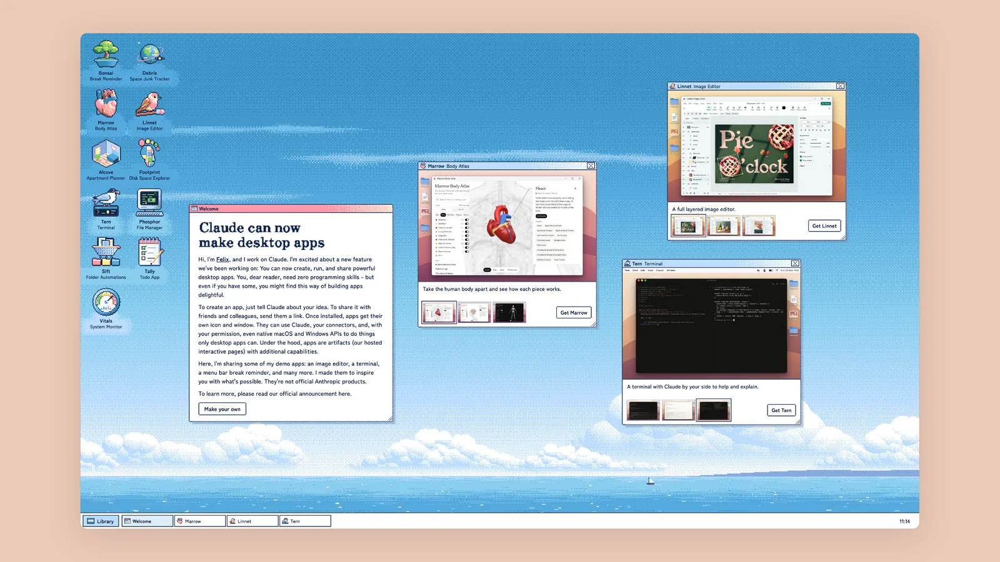
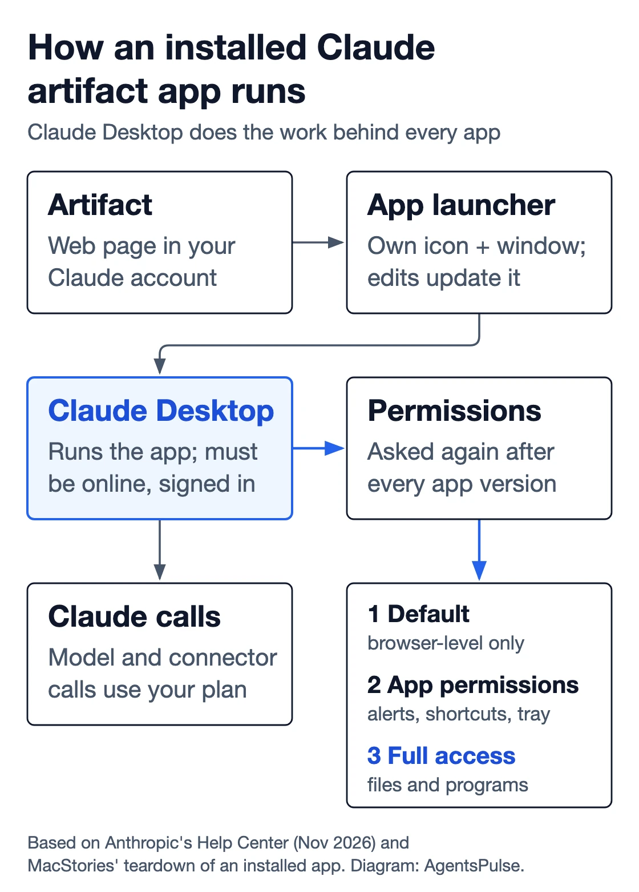

Claude artifacts as desktop apps arrived on November 24, 2026. Anthropic's "Install as app" beta takes an artifact you built in a Claude chat, such as a tracker, a dashboard or a small utility, and puts it on your Mac or Windows PC with its own icon and window. Once installed, it can send notifications, sit in the menu bar or system tray, and, if you approve it, run programs and edit your files.

Anthropic spreads the details across a launch post, a Help Center guide and an admin guide. This page puts them in one place: how to install and remove an app, what each of the three permission tiers lets it do, how the apps run inside Claude Desktop, which switches Team and Enterprise admins control, and why the Install as app option may be missing from your account.

## How to install Claude artifacts as desktop apps {#install-claude-artifacts-as-desktop-apps}

To install a Claude artifact as a desktop app, open it in the main Claude Desktop window, open the artifact's title menu (or right-click it), choose **Install as app**, then click **Install**. The same option sits under **Share**. You need Claude for Mac or Claude for Windows version 6.28899.0 or later, and the beta is rolling out on Free, Pro, Max, Ultra, Team and Enterprise plans.

You do not package, sign or notarize anything, and there is no API key: the app uses the Claude account you are signed in with. Claude asks for confirmation whichever menu you use, and you can also ask Claude to build an install button into the artifact itself.

Anthropic's Help Center suggests starting with a plain description in chat, for example:

- "Make a Pomodoro timer that lives in my menu bar."
- "Make a small Mac app that reminds me to stretch every hour."
- "Make a Windows app that renames the photos in a folder by date."

Try the result as a normal artifact first, then install it. After that, the app and the artifact stay linked: when you or another editor changes the artifact, the installed app changes too.

*Demo apps built as Claude artifacts, including the Linnet image editor and the Tern terminal. Source: Anthropic, "Turn artifacts into Mac and Windows apps" (Nov 24, 2026).*

**Where installed apps live.** On macOS they go into a Claude Apps folder inside the Applications folder in your home folder, show up in Spotlight, and can be kept in the Dock. On Windows they appear in the Start menu under Claude Apps and as a desktop shortcut. Inside Claude Desktop, **File > Apps** lists them (on Windows, File is under the ☰ menu). An app with a menu bar item or tray icon keeps running after you close its window; quit it from the Dock or with Cmd+Q on a Mac, or choose **Exit** from its tray menu on Windows.

**Usage.** Building the app and every request it later makes to Claude count toward your plan's usage limits, the same pool your chats draw on. A tray app that calls Claude on a timer keeps spending that allowance while it runs.

<strong>Need Claude outside the app?</strong> Installed apps can only spend your Claude plan, so scripts and tools you run elsewhere need their own API access. If you want one key for Claude Opus and Sonnet alongside other vendors' models, a shared gateway such as
<a href="https://www.packyapi.ai/register?aff=5W73&amp;utm_source=agentspulse&amp;utm_medium=affiliate&amp;utm_campaign=claude-artifacts-desktop-apps"
rel="sponsored nofollow noopener" target="_blank">PackyAPI</a> is one option.

<small>Disclosure: this page contains an affiliate link. If you sign up through it, we may earn a commission at no extra cost to you.</small>

**Uninstalling.** Go to **File > Apps**, select the app and choose **Uninstall**. On macOS the app moves to the Trash; on Windows its shortcuts are removed. Uninstalling drops the permissions you granted but leaves the artifact in your Claude account. Unpin it from the Dock, taskbar or Start yourself.

## Claude artifact app permissions: Default, App permissions and Full access {#claude-artifact-app-permissions}

A Claude artifact app starts with Default permissions, meaning it can do only what the same page could do in a browser. Anything more, from a notification to deleting a file, needs an explicit request that you answer with **Allow** or **Don't allow**. Anthropic groups those requests into two higher tiers.

| Tier | What the app can do | Who can grant it |
|---|---|---|
| Default | Only what a web page in a browser can do | Every app has it |
| App permissions | Show notifications while you use other apps; respond to global keyboard shortcuts; float above other windows, which also lets it read where the cursor is; add a macOS menu bar item or Windows tray icon | You, per app; Team and Enterprise admins can turn the tier off |
| Full access to this computer | Run programs and read, change or delete files without asking each time; includes the App permissions unless they were turned off | Only for apps you made, or on Team and Enterprise, apps made inside your organization; off by default on Team and Enterprise |

*Source: Claude Help Center, "Install an artifact as an app", read Nov 27, 2026.*

Three rules decide how far an app can go after you click Allow.

**An Allow covers one version.** Any update, including your own edit to the artifact, brings the request back. A Don't allow stays in place until you change it. The exception is code the app loads from another website: that part can change without a new prompt, so an app that pulls scripts from a third-party server is only as stable as that server.

**Full access depends on who wrote the app.** Claude generally refuses a full-access request if someone outside your organization wrote any part of the app, or if it cannot tell who made it. On Free, Pro, Max and Ultra plans, "outside your organization" means anyone but you. Apps from outside your organization, or from an unknown maker, show a warning when they ask. Anthropic does not review apps before installation, so the warning and your own judgment are the only checks.

**Revoking stops running programs but does not undo changes.** To change an answer on macOS, click the app's name in the menu bar and choose **Permissions**; on Windows, right-click the title bar or press Alt+Space; in Claude Desktop, use **File > Apps > Permissions**. Turning off full access can reload or close the app and stops the programs it started, except any that detached themselves. Files it already changed stay changed. If you lose access to a shared app because its owner stops sharing it, the programs it started stop within about 20 minutes, and later if Claude is offline or signed out.

A practical default: keep apps someone shared with you at Default or App permissions, and reserve Full access for apps you wrote and have read, such as a photo renamer that has to move files in your own folders.

## How Claude artifact apps work inside Claude Desktop {#how-claude-artifact-apps-work}

An installed Claude artifact app is the same web artifact, run by Claude Desktop in its own window. The launcher in your Applications folder or Start menu supplies the icon; Claude Desktop renders the page, calls Claude and your connectors, and enforces the permission gate. That is why Anthropic requires Claude Desktop to be open, online and signed in before any app will start.

*How an installed artifact app runs. Based on Anthropic's Help Center and MacStories' teardown of an installed app; diagram by AgentsPulse.*

MacStories' Federico Viticci took one apart. He asked Claude for a disk-space analyzer with a menu bar companion, watched it edit a single `index.html` file, then had Claude Code inspect the installed bundle. The roughly 900 KB app held a 51 KB Objective-C launcher that uses Electron's app-shim mechanism to load the Electron framework inside Claude.app, an 80 KB notification helper that only runs when launched by a signed Claude.app, and an icon. The page itself reached the file system through `window.claude.use('desktop')`, an API that mirrors Electron's own calls such as `childProcess.spawn`, `fs.readdir` and `shell.trashItem`, and used it to run `df`, `du` and `mdfind`.

Those findings come from one app on one Mac, explained by Claude Code rather than by Anthropic's documentation, but they match what the Help Center describes and they explain the behavior you will see:

- **Claude has to stay running.** Every action, including file access, goes through the Claude Desktop process, so quitting Claude stops the apps.
- **The interface is HTML.** Viticci's app imitated macOS styling with CSS and still broke some Apple interface conventions.
- **macOS permissions are shared.** Because Claude Desktop already had Full Disk Access on his Mac, the app's own Full Disk Access prompt changed nothing at the macOS level. The meaningful gate is Claude's per-app permission, not the system dialog.
- **Some integrations need helpers.** Finder cannot open a file with a Claude-built app directly, so his Markdown-redirect app had Claude install a small AppleScript helper in the Applications folder in his home folder.

The Help Center draws one comparison directly: a browser's "Add to Dock", "Add browser shortcut" or "Add to Home Screen" only adds a shortcut, without the desktop features. A native app runs on its own, offline, without counting against a Claude plan. An installed artifact sits between the two: more reach than a bookmark, but tied to your Claude account. If you need an app that stands alone, build it with [Claude Code](/tutorials/claude-code-projects/) and ship it the normal way.

On Hacker News, one early commenter called the design a software supply-chain risk. The per-version prompts and the limits on who can request Full access are the controls Anthropic ships against that risk, and they only help if Full access stays reserved for code you trust.

## Claude artifact apps admin settings for Team and Enterprise {#claude-artifact-apps-admin-settings}

Team and Enterprise owners control Claude artifact apps from **Organization settings > Artifacts**, using three switches. Team starts with apps and App permissions on and Full access off; Enterprise starts with all three off. If the switches are not on that page yet, the beta has not reached your organization.

| Setting | What it allows | Team default | Enterprise default |
|---|---|---|---|
| Install as app | Users can install artifacts as apps (requires Artifacts) | On | Off |
| App permissions | Apps can ask for notifications, shortcuts, a menu bar or tray item, and floating windows | On | Off |
| Full access to the computer | Apps can ask to run programs and read, change or delete files without asking | Off | Off |

*Source: Claude Help Center, "Artifacts admin guide for Team and Enterprise plans", read Nov 27, 2026.*

A change can take up to about an hour to apply, and it only covers sessions where the organization is selected in Claude. To cover personal accounts on company computers, Anthropic points admins to device policy. Three MDM keys can only turn features off: set them to `false` on macOS or DWORD `0` on Windows.

- `isArtifactAppsEnabled` turns off installed apps.
- `isArtifactAppPermissionsEnabled` turns off App permissions and Full access.
- `isArtifactAppFullAccessEnabled` turns off Full access only.

On macOS the keys go in a computer-level profile for the `com.anthropic.claudefordesktop` domain; on Windows they go under `HKLM\SOFTWARE\Policies\Claude`, and once HKLM holds any Claude value, HKCU values are ignored. The keys need Claude Desktop 6.6395.1 or later on macOS and 6.6395.0 or later on Windows; on Windows, an older build that does not recognize them can turn off computer use. Turning a key off takes effect within about five minutes, turning it back on needs a restart, and setting any key marks the machine as managed, which hides the release-channel setting and turns off features such as WSL sessions unless you allow them.

Two gaps matter for security reviews. The Compliance API logs opening an app and its access checks as artifact views, but installs, permission answers, changes to the three settings and what an app does on the computer are not logged. And in organizations with zero data retention for Claude Code, apps can be installed once an owner enables them, but the apps themselves are not covered by zero data retention. HIPAA-ready and hybrid deployments cannot turn the feature on at all, and K-12 organizations cannot enable Full access. The same Artifacts page also governs newer artifact types such as [Claude Whiteboards](/tutorials/claude-whiteboards/), so one review can cover both.

On Enterprise there is no separate custom-role capability for apps: users whose role lacks the Artifacts capability cannot use them. Apps can also call any [connector](/tutorials/claude-plugins/) the user has authorized, so connector scopes, which admins already manage through [MCP gateways and approvals](/tutorials/stateless-mcp-agent-gateway/), are part of the same risk surface.

## Install as app missing in Claude: limitations and fixes {#install-as-app-missing}

If Install as app does not appear, the usual causes are an old Claude Desktop build, an organization setting, or an artifact type the beta cannot install. Check them in this order.

1. **Update Claude Desktop.** You need version 6.28899.0 or later. On macOS use **Claude > Check for Updates**; on Windows open the ☰ menu and choose **Help > Check for Updates**.
2. **Use the desktop app.** Apps are not available in Claude on the web, on mobile or on Linux, and a browser's own "install" or "Add to Dock" option only creates a shortcut.
3. **Ask your owner on Team or Enterprise.** Enterprise has the feature off until an owner enables it, and HIPAA-ready and hybrid deployments cannot use it. In Claude for Teachers and K-12 organizations, Full access is unavailable and installing may be off as well.
4. **Check the artifact type.** Artifacts made from a template, such as Claude Docs, Slides or Sheets, cannot be installed, and neither can legacy artifacts or live artifacts from Claude Cowork. If you built a deck with the [Claude PowerPoint skill](/tutorials/claude-powerpoint-skill/), that is a document, not an app.

Two behaviors look like bugs but are documented. An app will not open while you are offline or signed out of Claude Desktop. And on macOS, Claude's computer use can see an installed app on screen but cannot click or type in it, so an agent cannot operate your artifact apps for you yet.

Shared apps carry one more risk. MacStories' Viticci advises against building a serious workflow on someone else's app, because the owner can stop sharing it and your copy stops working. If a shared tool becomes part of your day, ask Claude to build your own version of it so the artifact sits in your account.

## References {#references}

1. Anthropic, ["Turn artifacts into Mac and Windows apps"](https://claude.com/resources/articles/install-as-app), November 24, 2026.
2. Claude Help Center, ["Install an artifact as an app"](https://support.claude.com/en/articles/18516354-install-an-artifact-as-an-app), read November 27, 2026.
3. Claude Help Center, ["Artifacts admin guide for Team and Enterprise plans"](https://support.claude.com/en/articles/16994751-artifacts-admin-guide-for-team-and-enterprise-plans), read November 27, 2026.
4. Federico Viticci, MacStories, ["A Closer Look at Claude's Mac 'Apps'"](https://www.macstories.net/stories/a-closer-look-at-claudes-mac-apps/), November 25, 2026.
5. Hacker News discussion, ["Claude artifacts can now be installed as desktop apps on Mac and Windows"](https://news.ycombinator.com/item?id=50634369), November 2026.
