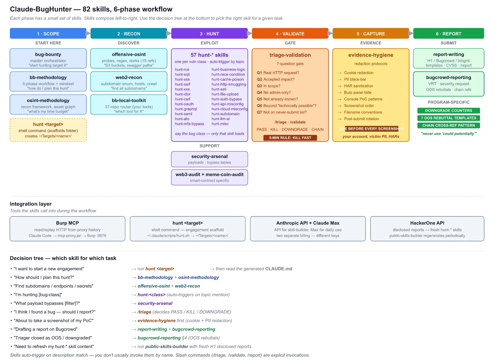

For Claude Code bug bounty work, Claude-BugHunter is the add-on drawing a wave of write-ups this month: an MIT-licensed bundle of 83 skills and 15 slash commands that, in its README's words, makes Claude Code behave "like a senior bug-hunting researcher or red-team operator." The repository also ships something you can check for yourself, a harness that runs the same agent with the skills on and off. In the published run, the skills changed nothing about what got solved. Both versions cleared all three test challenges, and the skilled version cost more.

That result has shaped the project. Its engagement engine now launches hunting agents with skills disabled, and the case for the bundle has moved to scope control, a pre-report validation gate and reporting templates. An independent blind-lab test of Claude Code by YesWeHack points the same way: the model found bugs fast and fell down on proving them.

## Claude Code Bug Bounty Skills Benchmark: Skills On vs Off {#claude-code-bug-bounty-skills-benchmark}

Claude-BugHunter's benchmark found no difference in solve rate between Claude Code with and without the bug bounty skills, and a higher cost with them. The run, dated August 25, 2026 in `eval/BASELINE.md`, held the model at Claude Opus 4.8 and pointed headless Claude Code (`claude -p`) at three OWASP Juice Shop challenges:

| Condition | Solved | Solve rate | Median turns | Median cost |
|---|---:|---:|---:|---:|
| Skills off | 3/3 | 100% | 2 | $0.178 |
| Skills on | 3/3 | 100% | 3 | $0.254 |
| Difference | +0 | +0% | +1 | +$0.076 |

The three challenges were an admin login via SQL injection auth bypass, retrieving an unlinked confidential document, and reading another user's shopping basket through an IDOR. Juice Shop grades itself through `GET /api/Challenges`, so no human scored the runs, and the container was restarted before each attempt so every run began from an all-unsolved state. The skills-off condition used Claude Code's `--disable-slash-commands` flag, which disables skills; everything else stayed the same.

The author's own reading is blunt. On these memorized, curl-solvable tasks, "the hunt-* skill context is pure overhead": the skilled agent spent an extra turn and about 43% more per challenge. The engine README repeats the conclusion in its design notes, saying skills add "~0 capability on benchmarkable tasks" because the base model already exploits standard bug classes, while loading them costs about 12,000 to 15,000 tokens per agent. As a result, the agents that `engine/engine.py` dispatches for hunting and validation run with skills off by default.

## Claude-BugHunter Benchmark Limits: Juice Shop, PortSwigger and False Positives {#claude-bughunter-benchmark-limits}

The Juice Shop baseline mainly shows that the pipeline works end to end. The eval README says so directly: Juice Shop's solutions are in model training data, so a capable model "already knows" them, and a tie is the expected ceiling effect. Three challenges is also a small sample, and solving single-bug lab puzzles says little about business logic, chaining or messy production targets, which the README calls the place "where experts actually spend time."

Two harder tests are already in the repository but have no published numbers yet:

- **PortSwigger tier.** `eval/ps_labs.json` lists nine HTTP-solvable Web Security Academy labs across SQL injection, IDOR, access control, SSRF and authentication. The harness reads each lab's own solved/not-solved widget as the oracle. Labs must be launched from a logged-in Academy account, and the baseline file notes this tier was not run because Academy credentials were not available.
- **False-positive benchmark.** `eval/run_fp.py` feeds the agent ten cases, mostly trap endpoints that look vulnerable but are safe, plus a few real bugs as controls, with a neutral prompt. The skills win if they lower the false-positive rate on traps without lowering the true-positive rate on controls. The script's header states the reasoning: since the base model already finds standard bugs, "the skills' real value is DISCIPLINE: not claiming bugs that aren't there."

The project's latest commit on November 16, 2026 changed this benchmark to report false-positive rates alongside grading coverage, but no result table had been committed at that point. Until those numbers land, the claim that the skills reduce bad reports is a hypothesis the repository has built a test for, not a measured result.

## Claude-BugHunter Architecture: Skills, Slash Commands and the Engine {#claude-bughunter-architecture}

Claude-BugHunter's architecture has three parts that do different jobs: Agent Skills that load knowledge by topic, slash commands that force a specific workflow step, and a Python engine that maps a target deterministically before any agent runs. The skills follow a six-phase engagement, scope, recon, hunt, validate, capture and report, and Claude Code picks them by matching your prompt against each skill's `description` field. Mentioning a `?url=` parameter, for example, loads `hunt-ssrf` and nothing else.



*Claude-BugHunter's phase-by-phase architecture. Source: Claude-BugHunter, docs/architecture.md (CC BY 4.0). The diagram predates the current count and shows 82 skills and 57 hunt skills; the README now lists 83 and 58.*

Most of the 83 skills sit in the hunt phase. The architecture doc counts 58 `hunt-*` skills, one per vulnerability class or framework (XSS, SQLi, SSRF, IDOR, OAuth, GraphQL, Next.js, Spring Boot, LLM/AI and so on), plus an enterprise layer for M365/Entra ID, Okta, vCenter, SSL VPN appliances and cloud IAM. By origin, 55 skills are the author's, 20 came from community contributions and 8 are vendored from shuvonsec/claude-bug-bounty. The README says the hunt skills draw on 681 patterns from disclosed HackerOne reports, of which 433 reports are now individually cited; the latest changelog entry lowered some counts, such as `hunt-source-leak` from 31 to 7, where earlier numbers lacked a backing corpus.

The validate phase is the part that matches the false-positive thesis. Its `triage-validation` skill, also reachable through `/triage` and `/validate`, runs a 7-Question Gate before any report is drafted:

1. Can an attacker use this right now with a real HTTP request?
2. Is the impact on the program's accepted impact list?
3. Is the asset in scope?
4. Does it work without privileged access an attacker can't get?
5. Is this not already known or documented behavior?
6. Can impact be proved beyond "technically possible"?
7. Is this not on the never-submit list?

One "no" kills the finding. The capture and report phases then handle cookie and PII redaction in screenshots and HAR files, and produce HackerOne, Bugcrowd, Intigriti or Immunefi report drafts with CVSS scoring.

The engine (`engine/`) is the piece most shaped by the benchmark. A default run is deterministic Python with no agents and no API spend: it records service fingerprints, mines JavaScript bundles for endpoints and leaked keys, collects parameters with `gau` and `katana`, and writes an `arsenal.md` map that pairs each endpoint and parameter with the matching `hunt-*` skill and a starter `curl` probe. Agents only run when you add `--hunt`, they stay read-only unless you pass `--allow-intrusive`, and a scope file with deny-wins, default-deny rules is enforced during both recon and hunting. In this design the skills act as a routing index for the human operator, which is what the engine README means by letting you "spend your expert 20% where the 80% automation points".

## Claude Code Bug Bounty Results on Blind Labs: Where It Stalls {#claude-code-bug-bounty-blind-labs}

Independent testing points to a different weak spot than knowledge: Claude Code finds bugs quickly but struggles to prove them. In a July 17, 2026 guide, bug bounty platform YesWeHack ran Claude Code with Opus 4.8 and the Burp MCP server against two PortSwigger labs whose vulnerability class was hidden from the model, using a minimal prompt and no skill pack.

On a DOM XSS lab ("DOM XSS using web messages and a JavaScript URL"), Claude Code identified the vulnerable client-side JavaScript within seconds and wrote a fitting payload, then failed to solve the lab. After almost 15 minutes it was still sending requests that looked correct in Burp's Logger, and it kept repeating the same loop for close to 20 minutes. The missing step was small: it never followed the redirect that fires when the exploit is delivered to the victim, so it assumed a POST was enough and never checked what happened next.

On a server-side lab, response queue poisoning via H2.TE request smuggling, it did better. It fingerprinted the application, tested XSS and SQL injection as routes to admin access, then pivoted to request smuggling and produced exploitation steps after 34 minutes. The author confirmed the finding by hand in Burp Intruder, where a 302 response exposed another user's session cookie.

YesWeHack's suggested fix for the first failure is a skill, but a narrow one: write a reusable instruction for the step the model keeps missing, such as inspecting redirects, verifying every response and stopping a loop after repeated failures. That is closer to Claude-BugHunter's validation gate than to its per-class payload libraries, and it lines up with the bundle's own benchmark result that class knowledge was not the bottleneck.

## Claude Code Bug Bounty Setup: Plugin, Copy Install and Burp MCP {#claude-code-bug-bounty-setup}

The quickest Claude Code bug bounty setup with this bundle is the plugin route, run from inside Claude Code:

```text
/plugin marketplace add elementalsouls/Claude-BugHunter
/plugin install claude-bughunter@elementalsouls
```

Skills and slash commands then load under the `claude-bughunter:` namespace and update when the plugin version changes. The two install paths differ in what you get:

| Install path | Skills + slash commands | `cbh` CLI | `hunt` scaffolder + engine |
|---|---|---|---|
| Plugin | Yes, namespaced | Separate pipx install | No |
| Copy install | Yes, in `~/.claude/` | Yes | Yes |

The copy install and the standalone CLI use these commands:

```bash
git clone https://github.com/elementalsouls/Claude-BugHunter.git
cd Claude-BugHunter
bash scripts/install.sh          # macOS / Linux
pwsh ./scripts/install.ps1       # Windows
# cbh CLI only, for plugin users:
pipx install git+https://github.com/elementalsouls/Claude-BugHunter
```

The `hunt <target>` command scaffolds an engagement folder with a `CLAUDE.md`, `scope.md`, `findings/`, `evidence/` and a submissions log. The engine takes its own JSON scope file (`--scope my-engagement.json`) listing in-scope and out-of-scope targets. To give Claude Code HTTP access through Burp, install the MCP Server extension from Burp's BApp Store; YesWeHack's guide then registers it with `claude mcp add burp --transport http http://127.0.0.1:PORT/mcp` and checks it with `claude mcp list`, and the bundle's installer can wire the same server with `--burp-mcp`.

The knowledge layer is portable. `install.sh --all` detects which harnesses you have and copies the skills into their directories, covering OpenCode, OpenAI Codex CLI, Hermes Agent and Google AntiGravity, and the changelog reports end-to-end checks on OpenCode, Codex and Hermes. Slash commands, the plugin marketplace and the `/hunt` engine stay Claude Code only. If you run work in Claude Code's cloud threads, note that they do not load `.claude/skills` from your machine, as covered in our [guide to what Claude Code Projects cloud threads leave behind](/tutorials/claude-code-projects/), so skills there have to come from your claude.ai account or Project settings.

## Claude Code Bug Bounty Limits: Opus 5 Fallback and Cyber Safeguards {#claude-code-cyber-safeguards}

Anthropic's cyber safeguards affect any Claude Code bug bounty session, with or without a skill pack. According to Anthropic's Help Center, Opus 5 and Opus 5.5 may fall back to Opus 4.8 when cyber classifiers flag higher-risk offensive requests, naming exploit generation, binary-based vulnerability scanning and penetration testing. Secure-coding work such as scanning source code for vulnerabilities and triaging security issues stays on Opus 5. The classifiers read everything the model reads, including memory, connector content, web search results and files, so a fallback can come from content you did not type, such as a response body pulled in through Burp.

The response is labeled with the model that answered, but in a long agentic run that label is easy to miss, and Claude-BugHunter's README warns it can look like "Opus 5 quietly got worse." Its advice follows Anthropic's: describe defensive review of your own code as exactly that, and for authorized offensive work, apply to Anthropic's Cyber Verification Program (CVP) rather than rewording requests to slip past the classifier. Anthropic says individuals, including bug bounty hunters, can apply for its Defense Access tier. The `/hunt` command states the engagement frame, authorized and scope-bounded, in its first turn for this reason. The README adds that automatic model switching can be turned off under Settings → Capabilities.

The bundle's scope is narrower than "red team" suggests. It covers the external attack surface: web apps and APIs, internet-facing enterprise platforms, cloud misconfiguration and recon. Internal Active Directory attacks, C2 frameworks, post-exploitation, persistence and EDR evasion are out of scope by design, as are hardware, RF, ICS and binary exploitation. Every skill assumes you own the target or hold written authorization, and the validation gate asks about scope before anything is reported.

## Is Claude-BugHunter Worth Installing? {#is-claude-bughunter-worth-installing}

Claude-BugHunter is worth installing for the workflow around a finding more than for finding bugs. On the evidence published so far, the hunt skills do not make Opus 4.8 solve more standard challenges, and they add tokens to every agent that loads them. The parts with a plausible payoff are the ones a base model does not supply on its own: a written scope that the engine enforces in code, a seven-question gate before you spend time on a report, redaction rules for evidence, and platform-specific report templates. Whether the gate actually lowers false positives is exactly what the unpublished FP benchmark is meant to show.

A practical way to use it, given those results:

- **Use the engine's map first.** The default `python3 engine/engine.py --scope my-engagement.json` run costs nothing in API spend and gives you an endpoint-by-endpoint list of which class to test. Add `--hunt` only for targets you have ranked.
- **Keep skills off in automated hunting agents** unless your own runs show a gain; that is the engine's default for a measured reason.
- **Run `/triage` before every report**, and add a narrow skill for any step your sessions keep missing, the way YesWeHack suggests for redirects.
- **Run the eval on your own targets.** The harness is in the repo; the PortSwigger tier needs an Academy account, and the FP benchmark runs against a local trap app. Treat any solve rate as necessary rather than sufficient: lab puzzles do not test chaining or business logic.

For a contrast, the [Modern Web Guidance evals](/tutorials/modern-web-guidance-evals/) show a skill pack that did raise Claude Code's scores, from 57% to 88% on Google's web checks. How much context a tool layer adds per agent is also measurable, as our [agent-browser vs Playwright MCP token benchmark](/tutorials/vercel-agent-browser-vs-playwright/) did for browser tools. For the model side of security work, [GPT-6 Cyber's exploit benchmarks](/tutorials/gpt-6-cyber/) show what a purpose-built model is being measured on, and [Claude Fable 5.2's comparison with Opus 5.5](/tutorials/claude-fable-5-2/) covers the Claude models these safeguards apply to. If you are giving an agent access to systems beyond a lab, the [security boundary changes for agents with internal access](/tutorials/ai-agent-internal-access-security-boundary/) apply here too.

## References {#references}

1. elementalsouls (Sachin Sharma), [Claude-BugHunter repository](https://github.com/elementalsouls/Claude-BugHunter): README, `docs/architecture.md` and `engine/README.md`, commit 2f9a226, November 16, 2026.
2. Claude-BugHunter, [eval/BASELINE.md](https://github.com/elementalsouls/Claude-BugHunter/blob/main/eval/BASELINE.md) and [eval/README.md](https://github.com/elementalsouls/Claude-BugHunter/blob/main/eval/README.md): skills-on/off baseline dated August 25, 2026.
3. YesWeHack, [How to use Claude Code for Bug Bounty: find fast, validate manually](https://www.yeswehack.com/learn-bug-bounty/llm-series-claude), July 17, 2026.
4. Anthropic Help Center, [Why Claude switched models in your conversation with Opus 5](https://support.claude.com/en/articles/16049681-why-claude-switched-models-in-your-conversation-with-opus-5).
5. Anthropic Help Center, [Real-time cyber safeguards on Claude](https://support.claude.com/en/articles/14604842-real-time-cyber-safeguards-on-claude) and the Cyber Verification Program.
