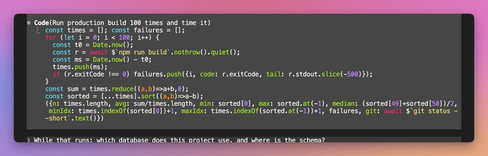
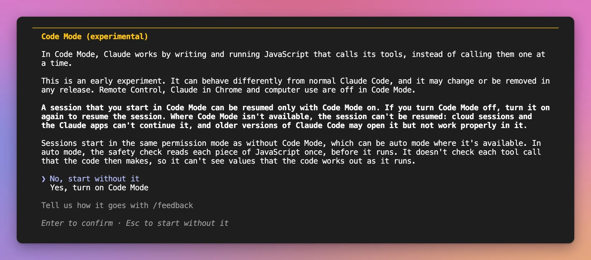
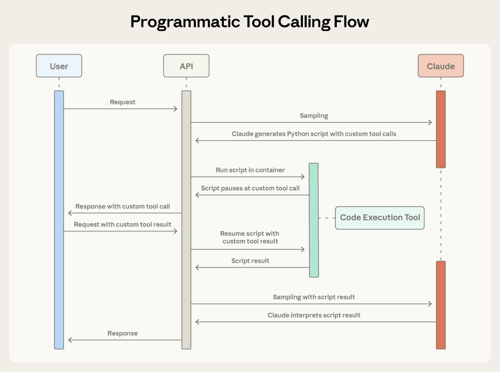
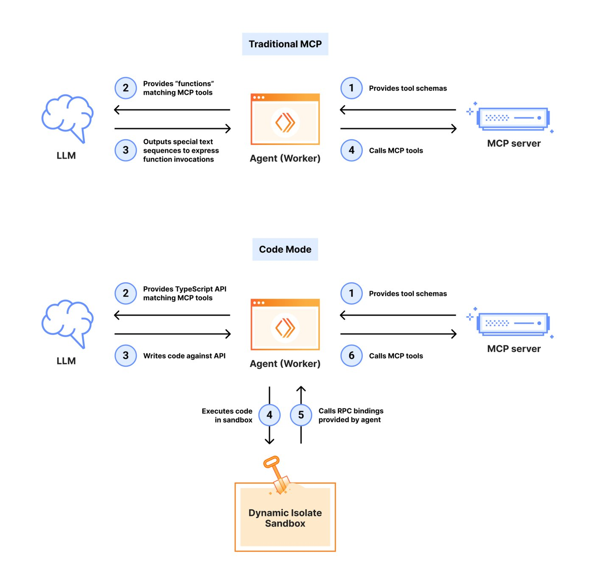

Claude Code Code Mode is an experimental switch, added in Claude Code v2.1.323 on November 12, 2026, that makes Claude write a short JavaScript program to call its tools instead of requesting Bash, Read and Edit one call at a time. Anthropic's Claude developer account introduced it on November 17 with a single promise: Claude "writes scripts that chain your tools together" and "can answer you while long commands are still running." Anthropic has not published any token or speed figure. Two developers have, and their numbers show where Claude Code mode actually saves and where it costs time.

## Claude Code Code Mode at a Glance {#claude-code-code-mode-at-a-glance}

Claude Code Code Mode replaces the one-call-per-turn loop with JavaScript that runs inside your session. It is off by default, works only in an interactive terminal on a direct Anthropic account, and in published tests mainly cuts the fixed tool context sent with every request.

| Question | Short answer |
|---|---|
| What changes | Claude writes JavaScript that makes the tool calls; only what the code returns goes back to the model. |
| How to turn it on | `CLAUDE_CODE_EXPERIMENTAL_CODE_MODE=1 claude`, then confirm once. |
| Measured saving | System tools 11.1k vs 24.6k tokens; total input about 37% lower in one Opus 5.5 run (wmedia). |
| Measured speed | 35 s → 15 s on a link audit, 17 s → 14 s on parallel checks (Flavio Copes); 15 s → 37 s on a data task (wmedia). |
| Best fit | Many related calls: repeated edits across files, searches that need filtering, independent commands. |
| Main catch | Auto mode reviews each script once, before it runs; waiting code stops after 10 minutes. |

*Figures are single runs published by wmedia.es and Flavio Copes, November 13–18, 2026.*

## How Claude Code Code Mode Works {#how-claude-code-code-mode-works}

In Code Mode, Claude still reads your prompt, but its answer is a piece of JavaScript that Claude Code runs locally. The code can start commands in parallel, pass one result into the next call and return a small object, so the search hits, file contents and build logs it touched along the way never enter the conversation.

Anthropic's documentation uses a retry-limit change as the example. Without Code Mode, Claude would search, read the result, edit, read the diff, run the tests and read the output, one model turn per step. With it, one block does the whole chain and hands back only the edited path and the test result:

```javascript
const files = await $`rg -l "function retryPolicy" src`.text();
const target = files.trim().split("\n")[0];
await edit(target, "maxAttempts: 3", "maxAttempts: 5");
({ edited: target, tests: $`npm test -- retryPolicy`.nothrow() });
```

The chat still shows the tool calls and diffs. The code itself sits in the transcript viewer: press `Ctrl+O` and expand a **Code** row. The screenshot at the top of this page, taken by Flavio Copes, shows one such row from a broken-link audit of a project's Markdown files: a single script listed the files, read each one, pulled out links with a regular expression, ran `test -e` on every local path and returned one object with the totals.

The tool list the model sees also changes. wmedia.es found that a Code Mode session exposes two tools to Claude: `REPL`, which runs the JavaScript, and `Poll`, which collects results from code that is still running. Bash, Read, Edit and the rest arrive as JavaScript functions described inside `REPL` in a shorter form. Variables also survive from one script to the next, so a file list built in one block can be reused in the following one.

## Claude Code Code Mode Benchmark: Two Hands-On Tests {#claude-code-code-mode-benchmark}

Two developers have published side-by-side runs with Code Mode on and off. Both are single runs on their own projects, and both authors say so. Read together, they show that the token saving is steady and comes from the smaller tool context, while wall-clock time can move either way.

### Token test: 40 JSON files on Opus 5.5

wmedia.es ran the same request in two Claude Opus 5.5 sessions at medium effort, identical except for Code Mode, on Claude Code v2.1.323. The task was to read an `orders/` folder of 40 daily JSON files and name the three customers who spent the most on paid orders.

| Metric | Code Mode off | Code Mode on |
|---|---|---|
| Requests to the model | 4 | 4 |
| Input tokens, first request | 36,404 | 22,233 |
| Input tokens, total incl. cache | 150,364 | 94,659 |
| Output tokens | 1,172 | 1,213 |
| Time | 15 s | 37 s |
| Answer | initech, umbrella, acme | initech, umbrella, acme |

*Single run each, published by wmedia.es; tested November 13, 2026.*

Total input fell by about 37% while the number of requests stayed at four. Without Code Mode, Claude had also written a script, in Python through Bash, so the turn count was already low. The difference came from the fixed context: `/context` reported system tools at 24.6k tokens with Code Mode off and 11.1k with it on. That smaller block rides along on every request, so the saving grows with longer sessions, although after the first request most of it is billed as cheaper cache reads. On this task Code Mode was also more than twice as slow.

### Timing test: links, builds and a 100-run loop

Flavio Copes tried Code Mode on Claude Code v2.1.325 with Events Logger, an Astro app with 8 Markdown files, and then repeated two prompts in a fresh session without it.

| Task | Code Mode off | Code Mode on |
|---|---|---|
| Find broken local links | 35 s; 2 searches and 3 shell commands, one call at a time | 15 s; 2 scripts, the first with 8 file reads and 16 shell commands |
| Build + `tsc --noEmit` + `npm outdated` | 17 s; 3 parallel shell calls plus 1 to fetch the tsc exit code | 14 s; one script using `Promise.all()` |
| Run the build 100 times and time it | not tried | 2 min 23 s; 101 commands from one script, while answering another question |

*Single runs on one project, published by Flavio Copes on November 18, 2026.*



*The 100-build loop as one Code Mode script. Screenshot by Flavio Copes.*

Both modes found the same links. The gain was largest where many small, related calls would otherwise each cost a model turn, such as the 16 `test -e` checks. The parallel build check barely moved because Claude Code already runs independent tool calls in parallel without Code Mode. Daniel Avila reported the same pattern on a link audit with Claude Fable 5.2: 13 tool calls in two model turns, with all three broken links found.

For cost tracking, these numbers are a starting point rather than a rate. A smaller tool block lowers the price of every request, which matters for [cost per successful task](/tutorials/coding-agents-finops-cost-per-successful-task/), but the time a task takes still depends on what Claude decides to run.

## When to Use Code Mode in Claude Code {#when-to-use-code-mode}

Use Code Mode when a task needs many related tool calls whose intermediate output Claude doesn't need to read. Anthropic's documentation names three cases:

- a change that repeats across many files
- a search whose results need filtering before Claude reads them
- several independent commands that can run at the same time

Long jobs are the fourth case. In a session started in auto or `bypassPermissions` mode, code can move to the background and run for up to two hours while you keep talking to Claude. Flavio Copes asked about the project's database while his 100-build loop was running and got a correct answer before the loop finished.

A one-file question gains nothing. The closest public data on the opposite case comes from Anthropic's Programmatic Tool Calling, the API feature that applies the same idea: on τ²-bench, where each turn makes one or two sequential calls, it left scores unchanged and cost roughly 8% more. That figure is for the API, not for Claude Code, but the reason carries over. When every step depends on Claude reasoning over the previous result, a script cannot skip the model's turn. In that setting, what Code Mode can still change is the size of the fixed tool context.

## Code Mode Permissions and Hooks: What Auto Mode Reviews {#code-mode-permissions-and-hooks}

Code Mode keeps your permission rules but changes what the auto-mode classifier sees. Each tool call inside a script still passes your `deny` and `ask` rules and your `PreToolUse` hooks under its usual name, such as `Bash`. In auto mode, however, the classifier reviews each piece of code once, before it runs, and cannot see values the code works out at run time, such as a path taken from search output.



*The one-time confirmation states the auto-mode change before Code Mode starts. Screenshot by Flavio Copes.*

In the other permission modes, scripts start without a review and you are prompted for each call that would normally prompt you. Three details from the documentation matter if you rely on hooks:

- A shell command can reach a hook with a `cd` in front, for example `cd 'app' && git push`. A hook that blocks `git push` has to check each part of the command.
- To inspect the script itself, match the `REPL` tool in a `PreToolUse` hook and read the JavaScript from `tool_input.code`.
- On calls from code, a hook that fails to start or times out refuses the call. Raise the hook's `timeout` or set `"onFailure": "continue"` if that is the behaviour you want.

Bash rules match command text with or without Code Mode, so Anthropic points to sandboxing for limits that must not depend on how a command is written. If your setup already uses hooks as gates, the patterns in our [Claude Code verification guide](/tutorials/claude-code-verification/) keep working, but they should be tested against scripted calls before you turn Code Mode on for a team. The wider point about agents holding real access is covered in [the agent security boundary](/tutorials/ai-agent-internal-access-security-boundary/).

## How to Turn On Claude Code Code Mode {#how-to-turn-on-claude-code-code-mode}

Set `CLAUDE_CODE_EXPERIMENTAL_CODE_MODE=1`, start an interactive `claude` session and confirm once. Check the requirements first, since a missing one makes Claude Code start with the ordinary tools and print the reason.

1. Run `claude --version`. You need v2.1.323 or later on the native build, or v2.1.326 or later if you use agent teams. Run `claude update` if you are behind.
2. Start a session with the variable set:

   ```bash
   CLAUDE_CODE_EXPERIMENTAL_CODE_MODE=1 claude
   ```

   To keep it on, put it in the `env` block of `~/.claude/settings.json`. Claude Code ignores the variable in a project's settings file, so a cloned repository can't switch it on for you.
3. Select **Yes, turn on Code Mode** in the confirmation. Claude Code restarts and shows `Code Mode (experimental) is on · this session can be resumed only with Code Mode on`.
4. Give it a task with many calls, such as Anthropic's suggested prompt: "Read every Markdown file in this project and list the links that point to local files that don't exist." Then press `Ctrl+O` to read the code.

Code Mode requires a Claude subscription or Console account talking directly to the Anthropic API, one of Claude Opus 5.5, Sonnet 5.5, Haiku 5.5 or [Fable 5.2](/tutorials/claude-fable-5-2/), and Git for Windows on Windows. It does not start through a gateway, a custom `ANTHROPIC_BASE_URL`, Amazon Bedrock, Claude Platform on AWS, Google Cloud or Microsoft Foundry, or for organizations on the HIPAA configuration or zero data retention.

If you see `Code Mode (experimental) isn't available`, the reason follows on the same line and in `/status`. The common ones:

| Reason on screen | Fix |
|---|---|
| doesn't work with an API key helper | Remove `apiKeyHelper`, `ANTHROPIC_AUTH_TOKEN` and custom auth headers; sign in or set `ANTHROPIC_API_KEY`. |
| needs settings that Claude Code downloads from Anthropic | Unset `DISABLE_TELEMETRY` or the other variables that turn off feature-flag fetching. |
| OpenTelemetry is on | Unset `CLAUDE_CODE_ENABLE_TELEMETRY` and `ENABLE_BETA_TRACING_DETAILED`. |
| can't be used together with agent teams yet | Update to v2.1.326 or later, or unset `CLAUDE_CODE_EXPERIMENTAL_AGENT_TEAMS`. |
| only works with Opus 5.5, Sonnet 5.5 and later models | Start with a supported model, for example `--model opus`. |

*From the Claude Code Code Mode documentation, read November 19, 2026.*

Flavio Copes hit two of these on his first tries: a terminal that exported `CI`, which makes Claude Code skip the start-up check, and agent teams on v2.1.325. To turn Code Mode off, remove the variable or set it to `0`; a `0` in either the shell or your settings wins. Administrators can block it for everyone with `"CLAUDE_CODE_EXPERIMENTAL_CODE_MODE": "0"` in managed settings, but cannot force it on.

## Code Mode vs Programmatic Tool Calling vs Cloudflare Code Mode {#code-mode-vs-programmatic-tool-calling}

All three let a model write code that calls tools so intermediate results stay out of its context. They differ in where the code runs, which tools it can reach and who has to host it. Claude Code's version works on the CLI's own tools in your terminal; Programmatic Tool Calling is an API feature for tools you define; Cloudflare's Code Mode wraps MCP servers.

| | Claude Code Code Mode | Programmatic Tool Calling (Claude API) | Cloudflare Code Mode |
|---|---|---|---|
| Released | v2.1.323, Nov 12, 2026; experimental | Nov 24, 2025; documented as stable | Sep 26, 2025 |
| Language Claude writes | JavaScript | Python | TypeScript |
| Where code runs | Your local Claude Code session | Anthropic's code execution container | V8 isolate on Cloudflare Workers, no Internet access |
| Tools it calls | Claude Code's tools (Bash, Read, Edit and others) | Your custom tools marked with `allowed_callers` | MCP servers exposed as a TypeScript API |
| Time limits | 10 min while Claude waits; up to 2 h in the background | Each pending tool call times out after about 4 min | Not stated in the launch post |
| Published savings | None from Anthropic | ~38% input tokens on a 75-tool benchmark; 20–40% typical with 10–49 tools | Not given as a number |
| Platforms | Direct Anthropic API only | Claude API, Claude Platform on AWS, Google Cloud (Anthropic managed), Foundry (hosted on Anthropic) | Cloudflare Agents SDK |

*Sources: Claude Code and Claude API documentation, Anthropic's advanced tool use post, Cloudflare's Code Mode post.*

Programmatic Tool Calling pauses the script at each of your tools: the API returns a `tool_use` block, your application runs the tool and sends the result back, and the script continues in the container. Anthropic's internal evaluations for it are the most detailed public numbers on the pattern, with token savings on wide tool sets and no gain on strictly sequential work. It does not cover MCP connector tools, and it is not eligible for zero data retention.



*Programmatic Tool Calling flow. Image by Anthropic.*

Cloudflare published the idea under the Code Mode name in September 2025. Its Agents SDK turns an MCP server's schema into a TypeScript API and gives the model one tool that runs code in a disposable V8 isolate whose only way out is the bindings to those MCP servers. Cloudflare's argument is that models have seen far more real code than tool-call tokens, so they handle more and more complex tools when the tools look like an API.



*Traditional MCP vs Code Mode. Image by Cloudflare.*

Claude Code's Code Mode is the coding-agent version: the script runs locally in your session and acts on your working tree under your permission rules. DeepSeek Harness has a similar switch, described in [how its PTC mode works](/tutorials/deepseek-harness-ptc-mode/), and the gateway side of MCP is covered in [stateless MCP and the agent gateway](/tutorials/stateless-mcp-agent-gateway/).

## Claude Code Code Mode Limitations: Resume, Surfaces and Timeouts {#claude-code-code-mode-limitations}

The limits that change daily work are about where a Code Mode session can go and how long its code may run:

- **Resume**: a session started in Code Mode resumes only in the terminal with the variable still set to `1`. Without it, `claude --continue` and `claude --resume` refuse and print the command to use. Sessions started without Code Mode resume without it.
- **Surfaces**: no `-p`, Agent SDK, VS Code panel, Desktop app or cloud sessions, and a Code Mode session can't be moved to the Desktop app or turned into a background session.
- **Features off**: Remote Control, Claude in Chrome and computer use are unavailable while Code Mode is on.
- **Timeouts**: code that Claude waits on stops after ten minutes, including time spent at permission prompts. Background code can run for two hours, but only in sessions started in auto or `bypassPermissions` mode.
- **Countdown prompts**: when Claude starts new code in auto mode while earlier code is still running, the earlier code loses its classifier review and Claude Code asks you about its remaining calls, with a countdown if no IDE is connected. An unanswered prompt refuses the call.

The feature is experimental and may change or disappear in any release. It has already changed twice in its first week: v2.1.326 made it work with agent teams, and wmedia reports that since v2.1.327 a plugin whose hooks check tool calls no longer stops it from starting. Before you set it in shared settings, try it per shell on the kind of task where the tests above saw a gain, and compare `/context` with it on and off. Teams that already run long agent workflows, such as the [Superpowers plugin for Claude Code](/tutorials/superpowers-claude-code/), should check their plugins and hooks against the troubleshooting table first.

## References {#references}

1. Anthropic, [Run tool calls from code with Code Mode](https://code.claude.com/docs/en/code-mode), Claude Code documentation, read November 19, 2026.
2. wmedia.es, [Code Mode in Claude Code: turn it on and every request costs fewer tokens](https://wmedia.es/en/tips/claude-code-code-mode-turn-on), tested November 13, 2026, updated November 18, 2026.
3. Flavio Copes, [How to use Code Mode in Claude Code](https://flaviocopes.com/claude-code-code-mode/), November 18, 2026.
4. Anthropic, [Programmatic tool calling](https://platform.claude.com/docs/en/agents-and-tools/tool-use/programmatic-tool-calling), Claude API documentation, and [Introducing advanced tool use](https://www.anthropic.com/engineering/advanced-tool-use), November 24, 2025.
5. Kenton Varda and Sunil Pai, [Code Mode: the better way to use MCP](https://blog.cloudflare.com/code-mode/), Cloudflare, September 26, 2025.
