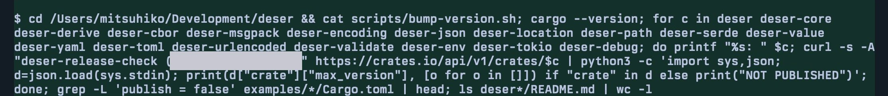

<p class="sky-direct-answer"><strong>The Claude Code email leak is a model behavior, not a feature: Claude Code put the signed-in user's account email in the model's context, and Claude sometimes copied it into the User-Agent header of requests it wrote itself.</strong> Websites that received those requests saw the address. Anthropic shipped a partial check in version 2.1.317 and says the next release removes the email from the context entirely.</p>

The report that set this off, GitHub issue [#107757](https://github.com/anthropics/claude-code/issues/107757), was filed on November 5, 2026. Its author, running v2.1.318 on macOS, wrote that Claude Code had sent their email to third parties "while conducting web searches without my permission", blamed it for "dozens of scam emails per day", and said they were moving their company to [Pi](/tutorials/deepseek-harness-vs-pi-agent/) with OpenRouter. The Hacker News thread "Claude Code sends your email address to websites" reached 1,571 points and 504 comments. By November 7 the issue had 102 comments and 941 reactions and was still open.

| Question | Short answer |
|---|---|
| What leaked? | The Claude account email, placed in User-Agent strings such as `curl -A "tool/1.0 (you@example.com)"`. |
| Who saw it? | Whatever site the request went to: public APIs, package registries, data portals. |
| Which versions? | Any version that puts the email in context; the 2.1.317+ check is partial and the stable channel was still on 2.1.311. |
| Is it fixed? | Not fully as of v2.1.319. Anthropic says the next release removes the email from the model context. |

## What is the Claude Code email leak?

The Claude Code email leak is the account email address showing up in HTTP User-Agent headers that Claude composed on its own, for example in `curl -A` flags or in Python scripts it wrote and ran. The cases users posted are commands the model wrote, not a header that Claude Code's fetch tool adds by default.

Armin Ronacher, the creator of Flask, posted a screenshot from his own session. While checking release versions for his Rust crates, the agent looped over each crate and called the crates.io API with `curl -s -A "deser-release-check (<his email>)"`. "It's not Claude Code, it's a behavior of the claude models," he wrote. In his case the model took the address from a `Cargo.toml` file. He said it usually happens "after a 401/403 or when the server asks for it nicely (in robots.txt or similar)."



*The agent's curl call to the crates.io API carries the user's email in the User-Agent (redacted by us). Crop of a screenshot by Armin Ronacher on X, November 5, 2026; the page cover shows a wider crop of the same screenshot.*

Other users found the same pattern in their own logs. One commenter on the issue scanned `~/.claude/projects/**/*.jsonl` and found 53 tool calls that put their address in a User-Agent, spread across 8 sessions from August 9 to November 1, 2026. "Almost all came from workflow subagents writing their own `curl -A`," they wrote, "not from `WebFetch`."

## Why Claude Code puts your email in the User-Agent

Claude Code puts your email in the User-Agent because two things meet: the model can see the address, and many sites ask automated clients to identify themselves with a contact. Claude treats that request as a rule worth following.

On the first point, Lydia Hallie, who works on Claude Code, explained on Hacker News that users had reported Claude inventing names for things like `@author` tags because it knew nothing about the account. "So we added the account email in the model's context for signed-in users." An earlier issue, [#81138](https://github.com/anthropics/claude-code/issues/81138) from July 25, 2026, quotes the injected block from the v2.1.220 bundle: `The user's email address is <account email>.`, read from `oauthAccount.emailAddress` in `~/.claude.json`.

On the second point, Anthropic engineer mpoteat wrote that "some sites like Wikipedia have a policy where scripted clients identify themselves, and there's a standard in HTTP to have a contact email in the User-Agent for such cases. Claude apparently tends to decide that this policy is worth following." SEC EDGAR is another example a commenter cited: it asks for a User-Agent in the form `Sample Company Name AdminContact@<domain>.com`.

The address does not have to come from the account. Ronacher's came from `Cargo.toml`, and another commenter said theirs came from `gitconfig`. A March 2026 report, [#37201](https://github.com/anthropics/claude-code/issues/37201), describes Claude Sonnet in another tool setting `git config --global user.email` from data the user never typed. Removing one source does not remove every address the model can read.

The User-Agent can also reveal what you are working on. A commenter found requests such as `"<project-name>-site-build/1.0 (<account email>)"` sent to a public geocoding API, tying their identity to a project name and an address query.

## Claude Code email leak timeline

The Claude Code email leak timeline starts in July 2026, when the injected email was first reported, and runs to the v2.1.319 release on November 6. Dates come from GitHub, the Claude Code changelog and the release list.

| Date (UTC) | What happened |
|---|---|
| Jul 25, 2026 | Issue #81138 reports the account email injected into the system prompt without disclosure. |
| Aug 17, 2026 | v2.1.234: "Claude is now told to use your account email only to identify you, and not to send it to unrelated services unless you ask." |
| Nov 3, 2026 | v2.1.317 adds "a check that asks before a web or shell tool call sends your account email address to the network" (the cc-plugin-privacy mod). |
| Nov 5, 2026 | Issue #107757 filed; Hacker News thread takes off. mpoteat says Anthropic learned of it "a few days ago" from Reddit. |
| Nov 6, 2026 | Users on macOS and Windows report the mod did not stop test commands. Lydia Hallie says the email will be removed from context in the next release, "early next week." |
| Nov 6, 2026 | v2.1.319 ships; its changelog has no entry removing the email. |

The August instruction told the model not to send the address. The reports in #107757 show that a prompt-level instruction did not stop it.

## cc-plugin-privacy: what it blocks and what it misses

cc-plugin-privacy blocks one shape of leak: a Bash, PowerShell or Monitor tool call whose text contains the account address and also names a User-Agent, such as `User-Agent`, `--user-agent`, `curl -A` or `wget -U`. It is on by default from v2.1.317. Users can turn it off with `/plugin disable` or the `enabledPlugins` setting; a repository's settings cannot.

Anthropic published the mod's source under [`mods/privacy`](https://github.com/anthropics/claude-code/tree/main/mods/privacy). Its README is blunt: "This is a courtesy, not a boundary, and it covers one shape." It lists what passes:

- The address with no User-Agent named: in a URL, a request body, `curl -u` or a `From:` header.
- Web tool calls. WebFetch, WebSearch and MCP tools are not checked.
- Values computed at run time, such as `$(git config user.email)`, variables, files sent by name, and scripts that hold the address.
- Encodings other than one pass of percent-encoding.

That last group matters most, because the commenter with 53 leaked calls found most came from subagents, and Hallie herself said the mod "doesn't prevent all cases, like when Claude writes a script and runs on its own." The README also says it refuses the call with no prompt, while the changelog and Hallie describe it as asking first.

Users also reported that the mod did not fire on the case it targets. On macOS, one tester ran `echo 'User-Agent: test <account email>' > /dev/null` on 2.1.317 and 2.1.318 with the plugin listed as enabled, and it ran without a refusal. A second tester got the same result on Windows 11 with 2.1.318, for both `echo` and `curl -A`. No Anthropic reply to those reports had appeared in the GitHub thread by the morning of November 7 (UTC).

## Is the Claude Code email leak fixed?

The Claude Code email leak is not fully fixed as of v2.1.319, released November 6. Anthropic's stated fix is to stop giving the model the address at all. "We're removing the account email address from the context Claude Code gives the model," Hallie wrote. "I'm sorry we let this happen." She said the release "should arrive early next week" and that she would post in the Hacker News thread when it ships.

Until then, her guidance was to update: "The stable channel is still on 2.1.311, so update to 2.1.317 or later." That gets you the partial mod, not a fix. Even after the context change, the model can still read addresses in project files, and it can still name requests after your projects.

## How to check whether Claude Code sent your email

You can check whether Claude Code sent your email by searching your local session logs for your address next to User-Agent strings. Claude Code stores transcripts as JSONL under `~/.claude/projects/`.

```bash
grep -rlF "you@example.com" ~/.claude/projects | xargs grep -n -i -E "user-agent|curl -A|wget -U" | head
```

Replace the address with your own, and also search for any address in `git config user.email` or your package manifests. A hit shows the tool call; the destination host is in the same command.

To cut the risk now:

- **Update** to 2.1.317 or later and keep `cc-plugin-privacy` enabled, knowing its gaps.
- **Add a PreToolUse hook** that blocks your address in outbound calls. The open-source [whoami-guard](https://github.com/ChrystianSchutz/whoami-guard) hook also scans scripts the agent writes. Its author measured 8 leaks in 60 runs of a mock "send us a contact" site without the hook and 0 in 60 with it; all 8 leaks came from Haiku. That is one person's test on one machine.
- **Set a rule in `CLAUDE.md`** that requests use a generic User-Agent and that any contact address needs your approval. Treat this as a hint, since Anthropic's own instruction in v2.1.234 did not hold.
- **Keep personal addresses out of what the agent reads** where you can, such as using a no-reply address in `gitconfig` for agent sessions.

For teams, the broader lesson is to control egress, not only prompts. Our piece on [AI agent security boundaries](/tutorials/ai-agent-internal-access-security-boundary/) covers identity and least-privilege controls once agents act for you, and an [enterprise model gateway](/tutorials/model-gateway-enterprise-ai-control-plane/) is one place to log and filter what agents send out. If you run several agents side by side, tools like [T3 Code](/tutorials/t3-code/) wrap Claude Code but do not change what the model writes into its own requests; the separation of [harness and runtime](/tutorials/agent-framework-harness-runtime-production/) is where an outbound check belongs.

## References

- taylor-edwards, ["Bug Report: Privacy violation in User-Agent header" #107757](https://github.com/anthropics/claude-code/issues/107757), anthropics/claude-code, Nov 5, 2026
- Lydia Hallie (Anthropic), [reply on Hacker News](https://news.ycombinator.com/item?id=50388176), Nov 6, 2026
- Anthropic, [`mods/privacy` README](https://github.com/anthropics/claude-code/tree/main/mods/privacy), anthropics/claude-code
- Anthropic, [Claude Code CHANGELOG](https://github.com/anthropics/claude-code/blob/main/CHANGELOG.md), v2.1.234, v2.1.317, v2.1.319
- Armin Ronacher, [post on X](https://x.com/mitsuhiko/status/2118487181366804847), Nov 5, 2026
