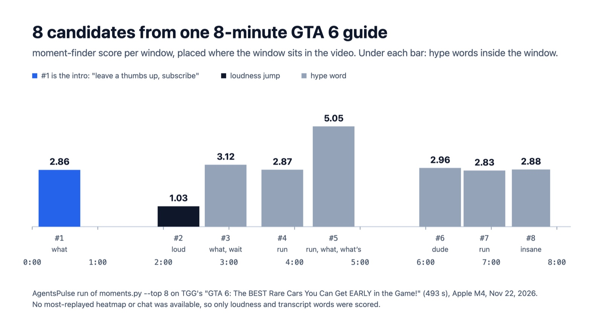

The Claude Code GTA 6 clipper that launch-week videos keep demonstrating, gtavi-claudecode, no longer installs the way its README says. As of November 22, 2026, both github.com/Bodila51/gtavi-claudecode and the Bodila51 account return 404, so the two-line plugin install fails before it starts. The plugin survives in copies that kept the author's commit history. We installed one in Claude Code 2.1.161 on an Apple M4 Mac and ran its trend, moment and cut scripts on a fresh GTA 6 video.

The short version: a verified copy installs cleanly and adds 16 skills. Its moment finder ran in about two minutes on an 8-minute video, but with no chat or replay data to lean on it mostly scored filler words. The clip cutter stopped at the first step on a stock Homebrew FFmpeg. Each of these has a fix, and each is below.

## gtavi-claudecode install error: repository not found {#gtavi-claudecode-repository-not-found}

The install command fails because the repository it names no longer exists. The README asks you to run two lines inside Claude Code:

```text
/plugin marketplace add Bodila51/gtavi-claudecode
/plugin install gtavi-claudecode@gtavi-claudecode
```

Run from the terminal with `claude plugin marketplace add Bodila51/gtavi-claudecode`, the first line exits with this:

```text
✘ Failed to add marketplace: Failed to clone marketplace repository: SSH authentication failed.
Please ensure your SSH keys are configured for GitHub, or use an HTTPS URL instead.

Original error: ... ERROR: Repository not found.
```

The SSH advice is a red herring: GitHub's API returns 404 for both the repository and the user account, and a plain HTTPS clone gets the same "Repository not found." Plugin directories and Google still list the old address, which is why the command keeps circulating. We found no public statement on why the account went offline, and a search of GitHub's public DMCA notice repository turned up nothing for it.

At least a dozen repositories on GitHub now carry the gtavi-claudecode name. Some are straight copies, some patch the code, and some are separate projects that borrowed the name. One copy labelled as a mirror rewrites its install commands to point at a different account that also returns 404, so its own README fails the same way.

## How to install the Claude Code GTA 6 plugin from a verified copy {#install-claude-code-gta-6-plugin}

Install from a copy whose files match the author's last commit, then pin it. Two public copies, under the Vivian1987 and aleksandrbeljakov accounts, kept all 11 of Bodila51's commits, from `1f66066` on November 18 to `dd95d39` at 11:30 on November 19 (UTC+2). Both resolve to the same Git tree, `35470e0c`, so their files are byte-identical to that commit.

| Copy | What it holds | Use it? |
|---|---|---|
| Vivian1987/gtavi-claudecode | Bodila51's full history, HEAD `dd95d39` | Yes; installed and tested |
| aleksandrbeljakov/gtavi-claudecode | Same history and tree as above | Same files; install not tested |
| gzonlin/gtavi-claudecode | One "Mirror of" commit; scripts and skills match, README and `plugin.json` changed | Its own install command points to another account that 404s |
| dasepmoch/gtavi-claudecode | History to `67acdb4` plus two local patches | Only if you want those patches |

Claude Code installs from a GitHub `owner/repo` or from a local folder that contains `.claude-plugin/marketplace.json`, which these copies keep. The quickest route works as is:

```bash
claude plugin marketplace add Vivian1987/gtavi-claudecode
claude plugin install gtavi-claudecode@gtavi-claudecode
```

A copy can be rewritten later, so the safer route is to clone it, check the tree hash, and install from your own folder:

```bash
git clone https://github.com/Vivian1987/gtavi-claudecode.git
cd gtavi-claudecode && git checkout dd95d39
git rev-parse 'HEAD^{tree}'   # expect 35470e0cf9376b67ea461e380e981dc08e6e9b29
cd .. && claude plugin marketplace add ./gtavi-claudecode
claude plugin install gtavi-claudecode@gtavi-claudecode
```

Both routes installed cleanly on our Mac. `claude plugin details` lists the "GTA 6 Clip Desk" 0.1.0 with 16 skills and no agents, hooks, MCP servers or LSP servers. Claude Code estimates the plugin adds about 933 tokens to every session while it is enabled, plus 140 to 630 tokens each time a skill fires, with setup the largest. Large skill packs are a familiar cost in Claude Code; our [Superpowers cost breakdown](/tutorials/superpowers-claude-code/) shows how that adds up, so disable the plugin in projects that have nothing to do with clipping.

The plugin runs code on your machine. Its setup skill pip-installs faster-whisper, yt-dlp, OpenCV, edge-tts and a translator, and 10 of the 16 skills tell Claude to run Python scripts from the plugin folder. Read the scripts in the copy you install before you let Claude run them; with a copy of a deleted project, nobody upstream is reviewing changes for you.

## How the Claude Code GTA 6 clipper works: five script steps {#claude-code-gta-6-clipper-architecture}

The clipper is a set of instructions that tell Claude Code which Python script to run next and what to show you; the scripts do the video work locally with yt-dlp, faster-whisper and FFmpeg. That is the same pattern as other [Claude skills that turn a prompt into a file](/tutorials/claude-powerpoint-skill/), with a longer chain. The 16 skills reduce to five steps, shown in the diagram at the top of this page.

1. **Find.** `trend-radar` searches YouTube for "gta 6" sorted by upload date and ranks the last 24 hours of uploads by views per hour, dropping Shorts and live streams. `stream-finder` lists who is live on YouTube and Twitch by viewer count. Neither needs an API key.
2. **Score.** `moment-finder` downloads a video, transcribes it with Whisper's small model, and proposes 15–40 second windows. `live-mode` does the same in real time on a stream, cutting whenever chat spikes.
3. **Cut.** `clip-cutter` renders the chosen window at 1080×1920 and 30 fps, burns in word-by-word captions and a hook box, and normalizes audio to −14 LUFS. Layouts are fill, blurred background, facecam on top, or a reaction layout. Slurs in captions are always masked; swears are masked unless you pass `--allow-profanity`.
4. **Check.** `rule-check` runs `check.py` against the finished file.
5. **Post.** Claude shows you the clip, caption and credit line and waits for a yes. The plugin never uploads; you post the clip and submit the link to a campaign yourself.

The other skills feed this loop. `campaign-finder` reads public pages on Whop's Content Rewards and Clip to record each campaign's rate per 1,000 views, budget and rules, writing "unknown" where a page does not show a value. `hook-writer` drafts three hook lines, `multilang` re-renders a clip with captions in Spanish, Portuguese, German and Russian, and `learning-loop` keeps a scoreboard of views at 12, 24 and 72 hours.

## gtavi-claudecode moment-finder scoring: what makes a clip {#gtavi-claudecode-moment-finder-scoring}

moment-finder gives every second of the video a score and cuts windows around the highest peaks. In `moments.py` the score is a weighted sum of four signals, each standardized against the rest of the video:

| Signal | Weight | Where it comes from |
|---|---|---|
| Loudness jump | 1.0 | Audio level above its own 30-second rolling average |
| Hype words | 0.8 | Transcript words matching a fixed list |
| Most replayed | 2.0 | YouTube's replay heatmap, only when the video has one |
| Chat rate | 1.5 | Messages per second from YouTube chat replay or a Twitch chat export, only when present |

The two heaviest signals are optional, and a missing signal drops out rather than being estimated. A recorded stream with chat replay is scored mostly on audience reaction. A fresh upload with no heatmap and no chat is scored on loudness and words alone.

Each pick places the peak a little past the middle of a 40-second window, at 55% of its length, snaps both ends to word boundaries, and skips windows that overlap an earlier pick. In practice most picks run the full 40 seconds; the README's own advice is to trim posts to 7–30 seconds, so expect to shorten them at the cut step.

The hype-word list has a quirk you can see in the code. It contains 17 patterns, including phrases such as "no way", "oh my god", "let's go", "look at" and "go go", but the script tests them against one transcript word at a time. Those five multi-word phrases can never match. The single words that remain include common ones like "what", "wait", "run", "bro" and "dude", so ordinary narration can score as hype.

`live-mode` uses a separate rule for streams. It records in 60-second segments, reads chat as it arrives, and cuts 15 seconds before and 20 seconds after any 10-second stretch where chat runs at three times its average over the previous five minutes, with at least eight messages, then waits 45 seconds before the next cut.

## Claude Code GTA 6 clipper test on an M4 Mac {#claude-code-gta-6-clipper-test}

On an Apple M4 Mac, trend-radar and moment-finder ran without changes, and clip-cutter failed on its first FFmpeg call. We ran the scripts the skills call by hand, in a Python 3.13 virtual environment with the plugin's own `requirements.txt` (faster-whisper 1.2.1, yt-dlp 2026.10.26) and Homebrew FFmpeg 8.1.

**trend-radar** took 11 seconds. From the first 15 "gta 6" search results, sorted by upload date, six were regular uploads under 24 hours old. The top two by views per hour were a 64-minute let's-play part (13,682 views an hour) and an 8-minute car guide from the channel TGG (10,900 an hour). None of the six had a most-replayed heatmap yet, which is normal for videos only hours old, so on launch-week uploads the score's heaviest signal is usually missing.

**moment-finder** on the 8-minute TGG guide took 125 seconds end to end, including a 221 MB 1080p download and a CPU transcription of 1,966 words. That is in line with the README's own estimate of about 5 minutes for a 12-minute video on a CPU. With no heatmap and no chat, it returned eight windows:



*moment-finder's eight picks on TGG's "GTA 6: The BEST Rare Cars You Can Get EARLY in the Game!" (493 seconds). Source: AgentsPulse run on an Apple M4 Mac, Nov 22, 2026.*

Seven of the eight picks were driven by hype words and one by a loudness jump. The whole transcript held only 11 hype-word hits: "what" four times, "run" four times, and "wait", "dude" and "insane" once each. The top-scoring window, 4:15 to 4:55, is the narrator explaining how to reach a 4×4 in an enemy compound; it scored highest because it says "run" and "what" close together. The first pick is the video's intro, where the narrator asks viewers to leave a thumbs up and subscribe. Seven of the eight windows were exactly 40 seconds.

The scorer did what its code says. It is built around chat explosions and replay peaks, and a narrated guide has neither. Point moment-finder at stream recordings with chat replay, or use `live-mode` on a live stream, where the 1.5-weight chat signal has something to measure. On a plain upload, treat the candidate list as a shortlist to watch, the way the moment-finder skill already tells Claude to drop spoilers and recommend only three.

**clip-cutter** failed on its first command. We picked window 5 with the fill layout and a hook line, and FFmpeg stopped while parsing the filter chain:

```text
Error parsing filterchain '[v]fps=30,subtitles='jobs/a1m3p0tvlms-d0c9463e/edits/clip_5.ass'[vo]' around: [vo]
command failed (234): /opt/homebrew/bin/ffmpeg -y -v error -ss 255.72 -to 295.72 ...
```

Because no clip was produced, `rule-check` had nothing to check.

## gtavi-claudecode subtitles filter error on Mac: the ffmpeg-full fix {#fix-clip-cutter-subtitles-filter-mac}

The error means your FFmpeg was built without libass, the library behind FFmpeg's `subtitles` filter. `cut.py` writes captions and the hook box to an `.ass` subtitle file and burns it in with that filter on every layout, so there is no flag that skips it. The plugin's setup skill installs FFmpeg on macOS with `brew install ffmpeg`, and Homebrew's standard formula does not include libass: on our machine `ffmpeg -filters` listed no `subtitles` filter, and Homebrew's formula data for ffmpeg 9.0.2 has no libass dependency. Homebrew's separate `ffmpeg-full` formula does.

```bash
ffmpeg -hide_banner -filters | grep -w subtitles   # no output means no libass
brew install ffmpeg-full
export PATH="$(brew --prefix ffmpeg-full)/bin:$PATH"   # ffmpeg-full is keg-only
ffmpeg -hide_banner -filters | grep -w subtitles   # should now list the filter
```

`ffmpeg-full` is keg-only, so it does not replace the `ffmpeg` on your PATH until you add its `bin` folder as above, either in the shell you start Claude Code from or in your shell profile. It pulls in 47 dependencies; we did not install it on the test machine, so the cut after this fix is not part of our results. We hit the same build gap in our [ffmpeg-skill test](/tutorials/claude-code-video-editing/), where three caption and graphics tools needed `ffmpeg-full`. On Windows the setup skill installs the Gyan.FFmpeg build through winget instead; we did not test it.

## Claude Code GTA 6 claims vs what the clipper does {#claude-code-gta-6-claims}

Many "claude code gta 6" results this week are about a different claim: an X post on November 19 said Claude Code finished GTA 6's story in 12 hours by itself while its owner was at work. CellCog's check of that post found no recording or log anyone else could review, and noted that GTA 6 launched only on PlayStation 5 and Xbox Series X|S while Claude Code's computer use, the screen-and-keyboard mode such a run would need, works only on macOS. 3DM's report reached the same verdict: no independent and reliable evidence. Within hours, CellCog counted copies with new numbers, including clip farms said to earn $11,860 or $21,000 a night, none with a run anyone could check.

gtavi-claudecode does not play the game. It finds other people's GTA 6 videos and streams, proposes moments, renders clips, and leaves posting to you. Its README pitches paid clipping campaigns, says "around $1 per 1K views is common" on Whop Content Rewards, and in the same section says "No income is promised." It also notes that platforms do not pay for reposted clips, which is why the money route runs through campaigns.

Those campaigns set rules the plugin cannot verify for you. `check.py` confirms resolution, frame rate, audio, length (7–60 seconds by default) and a short list of banned words such as "leak", "play early" and "money glitch" in the hook and caption. With a campaign file it also checks required hashtags and a required mention; without one it prints that defaults were used and that this is "NOT a rules check." It does not look at what is in the video or whether you are allowed to clip that creator. The README tells you to clip only the creator a campaign covers, and the live-mode skill tells you to ask streamers for permission when you can reach them. If you want Claude to enforce more of that before it reports a clip as ready, the approach in our guide to [Claude Code verification](/tutorials/claude-code-verification/) applies here too.

## References {#references}

1. Bodila51, *gtavi-claudecode* (GTA 6 Clip Desk) 0.1.0, commit `dd95d39`, Nov 19, 2026, as preserved in the [Vivian1987/gtavi-claudecode copy](https://github.com/Vivian1987/gtavi-claudecode/tree/dd95d39). README, `scripts/moments.py`, `scripts/cut.py`, `scripts/check.py`, `scripts/live.py`. The original github.com/Bodila51/gtavi-claudecode returned 404 on Nov 22, 2026.
2. Homebrew, [ffmpeg-full formula](https://formulae.brew.sh/formula/ffmpeg-full) and [ffmpeg formula](https://formulae.brew.sh/formula/ffmpeg), checked Nov 22, 2026.
3. Nitish Garg, CellCog, ["Did Claude Code Beat GTA 6 in 12 Hours? The Claim, Checked"](https://cellcog.ai/blog/claude-code-gta-6-claim/), Nov 19, 2026.
4. 3DM, ["User Claims Claude Code Beat GTA 6 in 12 Hours! No Reliable Evidence Yet"](https://en.3dmgame.com/news/11166), Nov 20, 2026.
