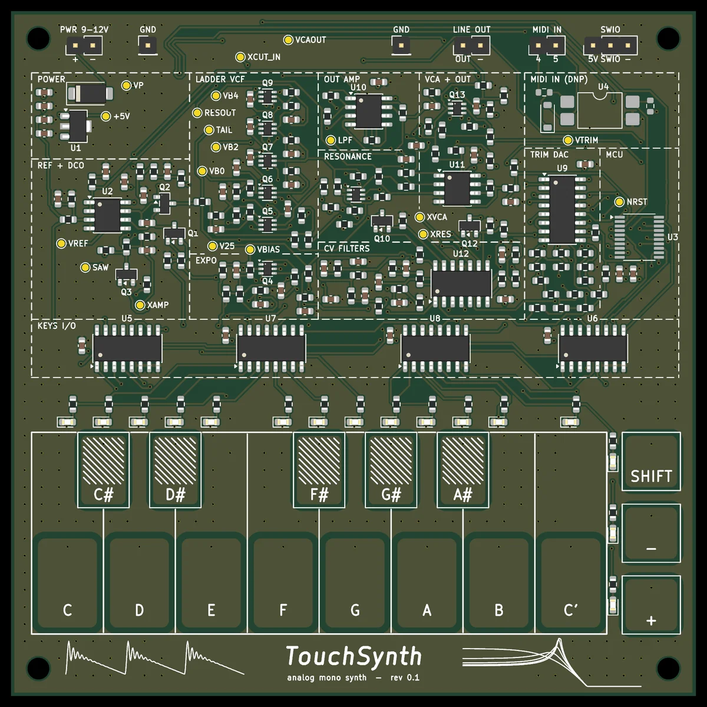
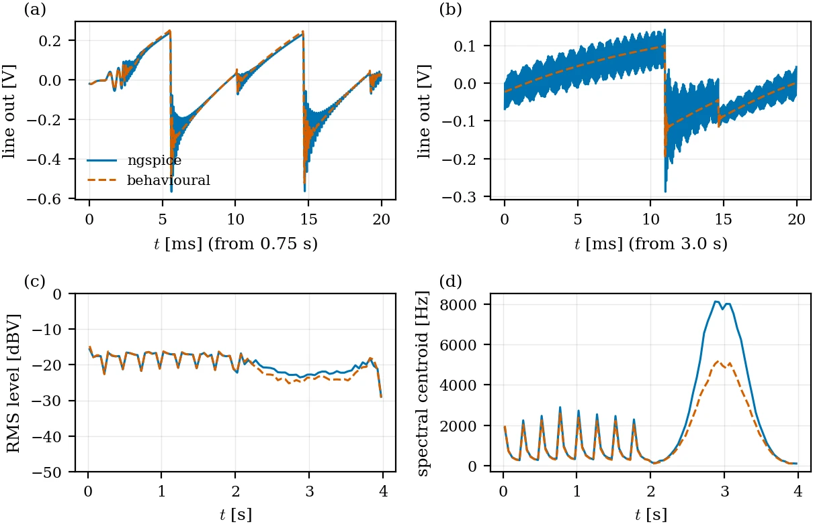
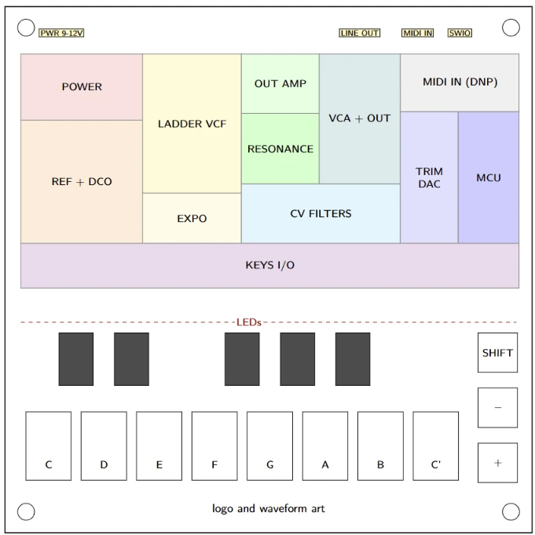
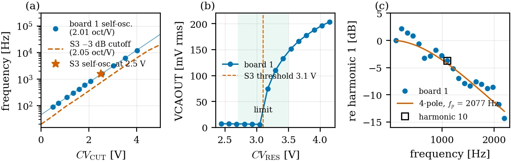

Claude Code took an analog synthesizer from an empty folder to a working PCB in a build published on November 14, 2026, an end-to-end test of Claude Code PCB design on real hardware. The engineer behind the cpldcpu blog gave Claude Code with Opus 5.5 a blank KiCad project and a list of free JLCPCB parts. The agent designed the synthesizer, called TouchSynth, simulated it, laid out a 4-layer PCB and wrote the firmware. Nineteen hours after the first prompt the order files were ready, and the assembled board measured close to its own SPICE simulations.

The human did not stay out of the loop. PCB layout took the most intervention, and the author chose the board concept and the microcontroller. What makes the build useful for anyone trying this is that the repository keeps the whole chain: specification, ngspice test benches, a Python behavioral model, generator scripts and the measured results from board 1.

| Question | Short answer |
|---|---|
| Agent and model | Claude Code with Claude Opus 5.5, run in VS Code |
| What it designed | A monophonic analog synth: Juno-style DCO, Moog-style transistor ladder filter, VCA, 13 capacitive touch keys |
| Board | 100 × 100 mm, 4 layers, CH32V00x RISC-V microcontroller, about USD 3.65 in parts at JLCPCB list price |
| Time | 19 hours from first prompt to Gerbers, BOM and placement file |
| Human input | Concept and MCU choice, PCB floorplan, switch to 4 layers, routing guidance, touch-key recalibration |
| Result | Board 1 passed bring-up and most functional tests; noise was marginal and two tests were not run |

## Claude Code PCB Design Workflow: Spec First, One Layer at a Time {#claude-code-pcb-design-workflow}

The workflow that produced TouchSynth runs top-down: write a complete specification, then have the agent generate each lower layer of the design from it in one pass, without going back to patch earlier layers. The author borrows the structure from the V-model used in systems engineering and asks the agent to keep a design report up to date alongside the work.

His reasoning is about context. A model generates the next abstraction layer more reliably from a finished specification than from a trail of incremental edits, probably because the specification gives it a compact context to work from. He found trial-and-error prompting, which is tempting with an agent, "far less successful."

The author set up the test after Claude Opus 5.5 and GPT-6 Astra shipped in September 2026 with clearly better spatial and engineering reasoning. OpenAI had even shown a PCB designed by Astra in its announcement; our [look at GPT-6 Astra's robotics benchmark](/tutorials/gpt-6-astra-robotics/) covers that model's other hardware-facing results. For how Opus 5.5 compares with Anthropic's Fable 5.2, see our [Claude Fable 5.2 pricing and benchmark breakdown](/tutorials/claude-fable-5-2/).

The project started with a question rather than a design. The author pointed Claude Code at JLCPCB's free parts list and asked what could be built from it. After rejecting what he calls "boring options", he suggested an MCU-controlled analog synthesizer with touch keys on the PCB and named the microcontroller family, CH32V00x. The circuit topology, simulations, layout scripts and firmware all came from the agent; the author's later input was mostly about layout. It is the hardware counterpart of software builds like [Karpathy's HackerTube, built by talking to Claude Code](/tutorials/how-karpathy-built-hackertube/).

## Claude Code PCB Design Setup: KiCad 10, ngspice and Python {#claude-code-pcb-design-setup}

The setup is ordinary command-line tooling that Claude Code can drive: KiCad 10 on Windows, and WSL for ngspice, pdflatex, the RISC-V toolchain and Python. "Almost everything is a Python script," the author writes, and the repository shows what that means in practice.

A single file, `hw/design.py`, holds the parts, values, LCSC part numbers and nets. Every downstream artifact is generated from it:

| Stage | Script | Output |
|---|---|---|
| Simulate | `sim/s*/s*.py` | ngspice-42 runs, result CSVs and plots |
| Model | `sim/behav/validate.py` | behavioral model checked against ngspice |
| Schematic | `hw/gen_sch2.py` | KiCad 10 schematic sheets |
| Cross-check | `hw/check_netlist.py`, `hw/check_sim.py` | KiCad netlist and simulation netlists compared with `design.py` |
| PCB | `hw/gen_pcb.py` | placement, Freerouting 1.9.0 routing, ground stitching |
| Fabrication | `hw/fab.py` | Gerbers, drill, BOM and placement files |
| Bench | `tools/hwtest.py` | functional tests over the MCU's debug console |

The KiCad project is treated as generated output; the README tells contributors to edit the Python sources, not the KiCad files. The two checker scripts keep what the agent simulated, what it drew and what goes to the fab in agreement, even when those files were produced hours apart.

The agent also fetched JLCPCB's parts list through its JSON API (1,586 parts saved as CSV) and built its own SPICE model library from models found on the web. If you want to try Claude Code PCB design yourself, this layout is the reusable part: one source of truth, generators for each format, and scripted checks between them. Agents that drive desktop tools directly are another route; our look at [how agent-desktop gives coding agents computer use](/tutorials/agent-desktop-computer-use/) covers that approach, while this build sticks to files and command-line tools.

## AI-Designed Analog Synthesizer Circuit: DCO, Ladder Filter and VCA {#ai-designed-analog-synthesizer-circuit}

Claude Code proposed a classic subtractive synthesizer: a Juno-style digitally controlled oscillator (DCO) produces a harmonically rich sawtooth, a Moog-style transistor ladder filter shapes it, and a voltage-controlled amplifier (VCA) sets the level. The microcontroller supplies the timing and four PWM-derived control voltages. The author, who says he had limited prior experience with analog synthesizers, reviewed the design in detail and left it unchanged.

*KiCad render of the TouchSynth board, with each functional block outlined and labeled. Image by cpldcpu, from the TouchSynth blog post.*

The parts list shaped the circuit. Only JLCPCB Basic and Promotional Extended parts were allowed for assembly, so the board uses components a 1970s designer would recognize:

- **DCO.** A resettable integrator built on a TL072 op-amp and a 10 nF capacitor. The MCU's timer resets it to set pitch, and a PWM voltage sets the ramp slope. The author notes the agent picked a low-leakage op-amp and a 50 V X7R capacitor to reduce nonlinearity, since no C0G part was available.
- **Ladder filter.** A 24 dB/octave low-pass built from matched NPN transistor pairs (BC847BS). Its tail current has to span roughly 1:1400, from hundreds of nanoamps to milliamps, so the agent added an exponential voltage-to-current converter.
- **Resonance.** A differential pair controlled by PWM, which the author calls "quite excessive" next to the potentiometer the original Moog used. With no OTA or JFET in the parts list, the agent built it from discrete parts.
- **VCA.** A tail-current-controlled differential pair plus an 8-bit R-2R trim DAC, driven by a 74HC595 shift register because the MCU had run out of PWM outputs. The DAC cancels the "thump" that control-voltage changes would otherwise leak into the audio.

The author asked for one feature himself: an audio loopback from the output into an ADC pin on the MCU. It later let the agent test and calibrate the board without extra instruments. The full board uses 40 BOM lines and 196 placements, about USD 3.65 in parts per board at list price.

## Claude Code ngspice Simulation: What the Agent Changed {#claude-code-ngspice-simulation}

Claude Code wrote seven ngspice test benches, S1 to S7, one per block from the oscillator to the power supply, and changed the circuit when results missed the specification. Its simulation report lists every block as passing after those changes, using TI macromodels for the TL072 and LM324 and NXP's model for the BC847B transistors. In two benches, the firmware's own timer and PWM arithmetic run inside the simulation.

The changes it made are the evidence that the loop did real work:

| Block | Change made during simulation | Effect (simulated) |
|---|---|---|
| VCA | 470 kΩ anti-offset resistor on the V→I emitter | off-attenuation 52 → 121 dB |
| CV filters | 10-bit PWM at 46.9 kHz with 2-bit dither | ripple −67 → −81 dB, settling 2.2 → 1.3 ms |
| Power | VREF follower with an RC snubber | hum −47 → −81 dB |
| Ladder filter | ladder capacitors 47 → 33 nF | cutoff range extended above 15 kHz |

To hear the whole instrument without minutes of SPICE time per note, the author had the agent build a Python behavioral model and calibrate it against the ngspice results. Its constants come straight from the simulations, which write them to result files that other scripts read back instead of copying by hand. On the test score it tracked ngspice to within −0.6 dB mean level and 1.1 dB RMS. It is less accurate right at the resonance threshold, where its brightness reads about 300 cents low.

*Behavioral model (dashed) against the ngspice simulation (solid) for the same score: waveform details, RMS level and spectral centroid. Figure from the TouchSynth simulation report.*

The report also lists what the models leave out: circuit noise, PCB parasitics, coupling between neighboring touch pads, and the TL072's input common-mode limit, which the design handles by keeping every op-amp input at 4 V or more.

## Claude Code PCB Layout: Where the Human Stepped In {#claude-code-pcb-layout}

PCB layout was where the author had to intervene most. Claude Code wrote Python programs to place the parts and then ran Freerouting, the open-source autorouter, but its first placement bunched most of the analog components together. Things improved significantly once he asked it for a floorplan that follows the functional blocks.

*The block floorplan the author asked for after the first placement crowded the analog parts. Image by cpldcpu.*

Routing still did not close. A two-layer board never fully routed, so he switched to four layers. It then took several more rounds of him pointing out how to move circuit blocks to open routing channels before Freerouting cleared the board and it passed design-rule checks. He suspects a board larger than 10 × 10 cm would have been easier.

For anyone planning a Claude Code PCB layout, this is the step to budget your own time for. In this build the agent wrote the placement scripts and ran the router, while the decisions about block placement, layer count and routing channels came from the human.

## Claude Code PCB Design Timeline: 19 Hours From Prompt to Order {#claude-code-pcb-design-timeline}

The build log puts the whole design at 19 hours, from the first prompt on a Saturday evening to fabrication files the next afternoon. Most of that time went into Freerouting runs that needed no interaction, so the time the author actually spent was much shorter.

| Time | Step | Result |
|---|---|---|
| Sat 20:59 | First prompt | General KiCad and JLCPCB flow |
| 21:09 | Parts list | JSON API found; 1,586 parts saved as CSV |
| 21:18–21:28 | Concept | Juno-style DCO, ladder VCF, written specification |
| 21:53–22:59 | Simulation | Seven ngspice test benches |
| 23:00 | Model | Behavioral model validated against SPICE, audio samples |
| 23:24–23:39 | Schematic | KiCad sheets generated |
| 00:01–10:48 | PCB, 2 layers | Freerouting never fully routed |
| 10:48–15:18 | PCB, 4 layers | New stack-up and floorplan; fully routed, DRC clean |
| 16:04 | Order | Gerbers, BOM and placement file generated |

*Build log from the author's blog post.*

Concept to a simulated, validated circuit took under two hours. Layout took more than 15, most of it the two-layer attempt that failed. Claude Code also wrote the firmware and a bring-up plan before the order went out. For a sense of how this compares with agent builds in software, our [Fable 5.2 review](/tutorials/fable-5-2-review/) follows a single overnight prompt that produced a 12-level game.

## Claude Code PCB Bring-Up: Automated Tests vs SPICE {#claude-code-pcb-bring-up}

The assembled boards arrived two weeks later. After a few manual checks before fitting the microcontroller, the author connected board 1 to a lab PC through the MCU programmer and hooked an oscilloscope to the audio output. Claude Code controlled that lab PC over SSH. From there, bring-up ran without him: the agent drove tests through the audio loopback and the scope, and used the loopback to calibrate trim and control parameters automatically. An agent driving lab instruments is a small version of agents acting in the physical world; our overview of [VLA policies and world action models](/tutorials/physical-agents-world-action-models/) covers the robotics side.

The match with simulation was, in the author's word, excellent. The only hardware fix was a solder bridge on the MCU, which he had soldered by hand. The verification plan records the numbers from October 17:

| Test | Board 1 measured | Limit or simulation |
|---|---|---|
| Pitch accuracy, C2–C7 | −0.28 to +0.26 cent (relative to the MCU clock) | < 1 cent |
| Saw amplitude, C2–C7 | −0.9 / +1.2 %, uncalibrated | ±5 % |
| Filter tracking | 2.01 oct/V over 89 Hz–12.1 kHz | 2.05 ± 0.2 oct/V |
| Resonance onset | 3.05–3.17 V | 3.1 V in simulation |
| VCA gain law | within −0.23 to +0.05 dB of simulation | ±2 dB |
| CV thump after trim | 0 ± 2 mV | < 3 mV |
| Hum, 100 Hz | −79 dB | < −75 dB |
| Broadband noise | about −55 dB | < −60 dB (marginal) |

*Board 1 filter measurements against the S3 ngspice simulation: cutoff tracking, resonance threshold and harmonic response. Figure from the TouchSynth verification plan.*

The filter self-oscillated at 1,611 Hz with 2.55 V of cutoff control voltage, against 1,606 Hz at 2.5 V in simulation. Measurements also exposed something no simulation covered: the microcontroller's internal RC clock runs 0.8 % slow, so every pitch sits about 14 cents flat until a clock trim is calibrated.

The touch keys were the weak point. They were too sensitive at first and needed recalibration, and at their small size they proved hard to play, so the author drove the synthesizer from microcontroller programs instead. The demo tracks on the project's audio page were recorded from board 1 this way, one voice at a time, then mixed.

## AI PCB Design With KiCad: What Still Needs a Human {#claude-code-pcb-design-limitations}

AI PCB design in KiCad worked here because each stage had an external check. The agent's circuit claims were tested by ngspice, its schematic by netlist comparisons against the design file, its layout by design-rule checks and, at the end, its board by an oscilloscope and the audio loopback.

Judgment came from the human at a few specific points. He picked the product and the microcontroller, enforced the spec-first order of work, asked for the audio loopback that made automated testing possible, and steered the floorplan and layer count. He also hand-soldered the parts JLCPCB does not assemble, including the MCU, and did the first power-on checks.

Some work is still open. As of the repository's October status, the board had not had its touch-scan rate or MIDI input tested, calibration values were not yet stored in flash, and the noise figure could not be checked properly through the loopback, whose own quantization floor sits at −58 dB. An audio interface would be needed to confirm the −60 dB target. We found no independent reproduction of the build, and the Hacker News thread had 12 points and a single comment when we checked.

If you try this yourself, the transferable pieces are the single design file with generated outputs, simulation benches that gate each block, and a hardware path such as the audio loopback that lets the agent measure its own board. Budget your own attention for layout. The author's verdict on whether generative AI can design PCBs with complex mixed-signal circuits is one word, "Absolutely," followed by a prediction that design flows will need rethinking the way software is now being rethought.

## Claude Code PCB Design FAQ {#claude-code-pcb-design-faq}

### Can Claude Code design PCBs?

Yes, for at least one documented mixed-signal board. In the TouchSynth build, Claude Code with Opus 5.5 produced the circuit, ngspice simulations, KiCad schematic and PCB, firmware and fabrication files in 19 hours, and the assembled board matched its simulations closely. The engineer still guided the PCB floorplan and routing strategy and hand-soldered the microcontroller.

## References {#references}

1. cpldcpu, "[Agentic AI Designs an Analog Synthesizer](https://cpldcpu.github.io/2026/11/14/touchsynth/)," blog post and build log, November 14, 2026.
2. cpldcpu and Claude Opus 5.5, "[TouchSynth](https://github.com/cpldcpu/TouchSynth)," design repository (README, flow and key numbers), status of October 18, 2026.
3. cpldcpu and Claude Opus 5.5, "[TouchSynth — Circuit Simulation Report](https://github.com/cpldcpu/TouchSynth/blob/master/docs/sim_report.md)," ngspice benches S1–S7 and behavioral model.
4. cpldcpu and Claude Opus 5.5, "[TouchSynth — Verification & Validation Plan](https://github.com/cpldcpu/TouchSynth/blob/master/docs/verification_plan.md)," board 1 results, October 17, 2026.
5. Hacker News, "[Agentic AI Designs an Analog Synthesizer](https://news.ycombinator.com/item?id=50512933)," discussion thread, read November 16, 2026.
