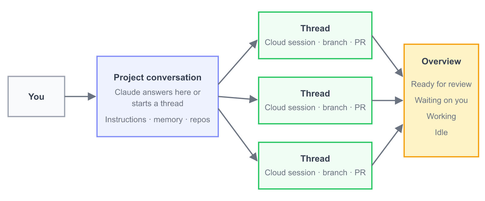
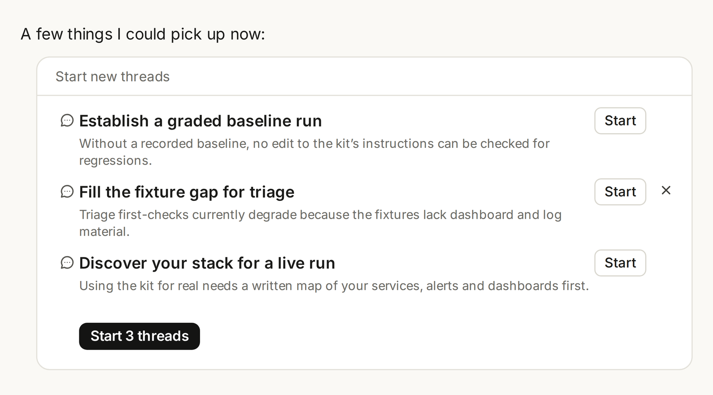

Claude Code Projects now has a coordinator that talks back. In an update on November 13, 2026, Anthropic made the project chat answer your questions in place and post status on its parallel threads without being asked, so you no longer have to open each thread to learn which one is blocked or which pull request is ready. The same release brought `/btw`, `/fork`, reminders and read-only thread links into projects.

The update changes how a project feels day to day. What decides whether a project actually delivers is still the setup: a project's threads run as cloud sessions that ignore most of the Claude Code configuration on your machine, permission prompts wait inside individual threads, and the defaults spend your plan quickly. This guide covers what changed, how a project routes work, how to set up a first batch, and the fixes for the gaps people hit first.

## Claude Code Coordinator Update: What Changed on Nov 13 {#claude-code-coordinator-update}

The Claude Code coordinator, the Claude instance in a project's main chat, now replies to questions there and pushes updates on ongoing threads by itself. Progress used to live mainly in the Overview pane; now the coordinator raises finished work, blocked threads and open questions in the chat. Anthropic's @ClaudeDevs account listed the changes in a six-post thread:

| Change | What it does in a project |
|---|---|
| Proactive coordinator | Answers questions in the project chat and reports the status of ongoing threads |
| `/btw` | Moves a side topic into its own thread so the current thread stays on task |
| `/fork` | Starts a new thread from the state of the thread you are in, to try a different approach |
| Reminders | Set one on any thread, or ask Claude; the thread leaves your view until the time comes, then Claude brings it up in the project chat |
| Read-only share links | Share a single thread with anyone signed in to Claude, from the thread's menu; threads that had access to your computer cannot be shared |
| Threads panel | A top row of recently opened, updated or pinned threads, plus artifact thumbnails per thread that you can switch off |

The screenshot at the top of this page comes from Anthropic's announcement thread. It shows the coordinator confirming it started a thread for each of three checkout tasks, and the Threads panel with artifact thumbnails, a pull request ready for review and a thread waiting on the user.

Anthropic also said project settings and local folder access are simpler, and the latest mobile app has the new design. The share option is newer than the documentation, which as of November 16 still says thread transcripts can't be shared.

Boris Cherny of the Claude Code team explained the motivation on Hacker News: people who get comfortable with Claude Code start running more agents in parallel, and switching attention among them gets hard. The coordinator is meant to absorb that. Threads "bubble up information and questions to the main thread," and you can still open any thread when a task needs focused back-and-forth.

## How Claude Code Projects Work: Coordinator, Threads and Overview {#how-claude-code-projects-work}

A Claude Code project is one long-running conversation in which Claude acts as coordinator, plus the threads it starts to do the work. Each thread is a separate Claude Code session with its own context window, usually running in Anthropic's cloud on its own branch, and it opens a pull request when the work calls for one.

*How a project is organized. Source: Claude Code documentation, "Let Claude coordinate ongoing work with Projects."*

The coordinator routes each message. A quick question gets an answer in place. New work goes to a new thread or to a thread already working in that area, and several unrelated tasks in one message become separate threads. The coordinator sees what threads report back, not every step they take, so a thread that looks quiet is usually still working. A follow-up you send in the project chat reaches a thread only when Claude matches it to that thread, while a message typed in the thread's own box goes straight there.

When a cloud thread changes code, it branches from the repository's default branch and opens a pull request when you ask or for a concrete fix. Once a pull request is open, the thread watches it with auto-fix on, pushing fixes when CI fails and responding to review comments. Two threads that touch the same code meet as an ordinary merge conflict, as Anthropic's [launch article](https://claude.com/resources/articles/projects-redesigned) puts it.

The Overview pane sorts threads into **Ready for review**, **Waiting on you**, **Working**, **Landing**, **Idle** and **Resolved**; threads with no activity for a week resolve automatically. A **Library** collects files you upload and files threads produce, and project memory, a set of notes indexed by a `MEMORY.md` file, carries decisions from one thread to the next. Anthropic's example is remembering that a release moved to Friday. It is a narrower relative of the memory rewriting we covered in [Claude Dreaming](/tutorials/claude-dreaming/), scoped to one project.

## Claude Code Projects Setup: Prerequisites and Your First Batch {#claude-code-projects-setup}

To set up Claude Code Projects, you need a Pro, Max or Ultra plan with Projects in your sidebar (look under **More** if it is not listed), code on github.com, and the Claude GitHub App installed on each repository the project uses. The `/web-setup` token that lets other cloud sessions clone a repository is not enough for project threads. GitHub Enterprise Server, GitLab and Bitbucket are not supported.

Create the project from **Projects > New project** at claude.ai/code or in the desktop app's Code tab. Only the name is required. An optional one-line goal, such as "Hold p95 API latency under 200 ms," gives the coordinator something to work toward, and the **Context** field takes the repositories and files most tasks need. You can also turn an existing cloud session into a project with **Continue in project > Continue as new project** in its sidebar menu; Claude then reads the session and proposes a setup.

On a first project, Claude may take a turn on its own right after creation, which uses your plan. It can start a read-only exploration thread or post **Setup recommendations** based on your recent cloud sessions, with every suggested repository and scheduled task switched on by default.

*Claude proposes threads before starting them; you can start one, dismiss one, or start all. Source: Anthropic, "Projects redesigned: from folder to conversation."*

Before sending real work, the documentation recommends four steps:

1. **Write project instructions** in **Project settings > Memory > Project instructions** (up to 16,000 characters). Say which branch to start from, how to name pull requests, how a thread checks its own work, what to do when access is missing, and what needs your approval. Anthropic's sample brief includes the line "If you can't reach something you need … say exactly what's missing in your first message and stop. Don't substitute, mock, or guess."
2. **Send one small piece of real work** and open the thread when it finishes, to see how it reports and what it did on its branch.
3. **Check Thread model and Thread effort** in **Project settings > General**. A new project runs every thread on Opus at high effort.
4. **Ask Claude to propose threads before starting them and to run a few at a time**, then relax those limits once threads come back the way you want.

Repository-specific rules, like build commands, belong in that repository's `CLAUDE.md`. When you correct a thread, also tell Claude to remember the correction so it lands in project memory and later threads start with it.

## What Claude Code Projects Cloud Threads Don't Load {#claude-code-projects-cloud-threads}

Claude Code Projects cloud threads load each repository's root `CLAUDE.md`, `.claude/CLAUDE.md` and `.claude/rules/`, and nothing else from your local Claude Code setup. This is the most common reason a thread behaves differently from your terminal sessions. Here is what the documentation says is skipped, and where each item goes instead:

| In your repository or machine | In a cloud thread | Where to set it instead |
|---|---|---|
| Root `CLAUDE.md`, `.claude/CLAUDE.md`, `.claude/rules/` | Loaded at thread start | — |
| `CLAUDE.md` in subdirectories, path-specific rules | Not loaded | Root `CLAUDE.md` or project instructions |
| Skills in `.claude/skills/` | Not loaded | Enable the skills on your claude.ai account |
| Agents and commands in `.claude/` | Not loaded | Run that thread on your own computer |
| MCP servers in `.mcp.json` | Not loaded | Connect them as claude.ai connectors |
| Plugins in `.claude/settings.json` | Not loaded | **Project settings > Plugins** |
| Permission rules in `.claude/settings.json` | Not applied | Approve inside the thread, or run it locally |
| Hooks | Not run | Run that thread on your own computer |
| `env` in `.claude/settings.json` | Not applied | Environment variables in the cloud environment |
| CLI tools and packages | Only what the environment installs | The environment's setup script |

Network access, environment variables and secrets come from the project's cloud environment, which by default reaches common package registries. If threads need an internal API or a private registry, change the environment in **Project settings > Environment**. The project chat itself has no connectors, so send work that needs one as a task for a cloud thread.

Two smaller rules catch people. Settings changes reach new threads only, not threads already running. And a repository a thread adds to itself mid-task, which it can do for repositories from a GitHub owner the project already uses, arrives after the thread started, so its `CLAUDE.md` was not loaded.

When several threads come back having guessed, worked around missing access or stopped as "blocked," the docs suggest asking the coordinator: "For every open thread, list what you asked it to do, what it assumed or couldn't reach, and what it's waiting on." Then fix the gap once in the instructions or environment, and send one thread before resending the rest.

## Claude Code Projects Approvals and Local Threads {#claude-code-projects-approvals-local-threads}

In Claude Code Projects, a permission prompt lives inside the thread that raised it, and the thread waits until you answer there. Telling the coordinator "go ahead" in the project chat does not reach it. Threads run in auto mode when their model supports it, so most tool calls need no approval, and cloud threads don't read permission rules from `.claude/settings.json`.

This trips people up in practice. One commenter on Hacker News described a save that was blocked "because the approval reached me through the coordinator, not from you in this thread," which is exactly the documented behavior. Open the thread from Overview, where waiting threads sit under **Waiting on you**, and approve it there; each approval covers that prompt or, if you choose the broader option, the rest of the thread.

For tasks that need something only your computer has, such as a local database, a device emulator or an API behind a VPN, a project can run that one thread on your machine through Remote Control while the others stay in the cloud:

1. **Connect a folder** on a machine with Claude Code v2.1.280 or later. In the desktop app, turn on **Use this computer from your phone and claude.ai** under **Settings > Code** (or **Settings > Claude Code**) and add the folder. In a terminal, run `claude remote-control` in the folder and leave it running; add `--spawn worktree` in a git repository to give each thread its own worktree.
2. **Ask for the task with Work locally** from the **+** menu beside the message box, or say in the message that it should run on your computer.
3. **Click Allow once** on the "Allow Claude to work in a folder on your device" card, and turn on **Worktree** if another thread might use the same folder.

A local thread uses that machine's files, tools, MCP servers, hooks and permission rules. It starts with the project instructions but not the memory files, pauses while the computer sleeps, and stops if the app or `claude remote-control` quits. It is unavailable when **Require trusted devices** is on for your account, and a thread that had access to your computer can't be shared as a link.

## Claude Code Projects Usage Limits and Token Cost {#claude-code-projects-usage-limits}

Claude Code Projects draws on the same plan limits as your other Claude Code sessions and uses them faster, because every thread is a full session and several run at once. On Pro, the docs warn, expect to reach your limit sooner on days you run a project. The coordinator also spends tokens reading reports and deciding what to do next.

How much faster depends on how many threads run. Boris Cherny said on Hacker News that in Anthropic's A/B tests and evals the coordinator adds under 10% token overhead compared with running the same sessions directly. Those are Anthropic's internal numbers, without published methodology. Most of the cost comes from the threads themselves, and the defaults favor capability over thrift:

| Setting or behavior | Default | Effect on usage |
|---|---|---|
| Thread model and effort | Opus, high | The fastest way to spend a plan, per the docs |
| Coordinator model and effort | Opus, low | Cheaper than threads, still uses tokens |
| Concurrent threads | No fixed number; 500 new threads a day is the enforced cap | A limit you state in chat is a preference, not a cap |
| Auto-continue when usage limits reset | On | A thread stopped at the five-hour or weekly limit resumes in the next window |
| Threads watching a pull request | On after a PR opens | An idle thread wakes and spends again when CI fails or a review arrives |
| Prompt cache lifetime | One hour | A follow-up to a thread idle longer than that rereads its whole conversation |

Practical ways to keep a project in budget come straight from these defaults. Pick a smaller model or lower effort for threads that don't need Opus at high effort, ask the coordinator to run fewer threads at a time or answer small questions itself, start a fresh thread for new work instead of reviving a long idle one, and tell a thread to stop watching its pull request once you take over. Cherny also said that asking the model to "use around 300k tokens" "somewhat works" for pacing. If you would rather a thread wait for you than continue into the next usage window, switch off **Auto-continue when usage limits reset**; it applies to the whole project.

Cost was the most common worry in the Hacker News thread. One user on a Max plan reported running out of usage within about ten minutes after a single request fanned out to seven subagents, though that was an ordinary session with Fable 5.2 rather than a project. If you are weighing models for threads, our [Claude Fable 5.2 pricing comparison](/tutorials/claude-fable-5-2/) and the [token bill from an overnight Fable 5.2 build](/tutorials/fable-5-2-review/) show how quickly a large model adds up, and [cost per successful task](/tutorials/coding-agents-finops-cost-per-successful-task/) is a better yardstick for parallel runs than raw token totals.

## Claude Code Projects vs Subagents, Agent Teams and Agent View {#claude-code-projects-vs-subagents}

Claude Code Projects differs from subagents and agent teams in who starts the sessions and how long they live. In a project, Claude starts and tracks whole sessions for you, each starting from the same instructions, and the project keeps going across many tasks. Subagents and agent teams live inside a single session and end with its task.

| Option | What runs | Where | Lifespan | Pick it when |
|---|---|---|---|---|
| Projects | Whole sessions (threads) started and tracked by a coordinator | Cloud, or your machine via Remote Control | As long as the project | A goal keeps producing tasks: multi-repo changes, an area you keep feeding bugs, a migration bigger than one session |
| Subagents | A side task in its own context window, returning a summary | Inside one session | One side task | You want a summary back without cluttering the main context |
| Agent teams | One session starting teammate sessions for one task | Your machine or inside a cloud session | That task | One large task benefits from parallel helpers |
| Agent view | Several local sessions side by side | Your machine | Each session | Every task needs local tools, and you start each one yourself |
| Cloud session | A single Claude Code session in the cloud | Cloud | One task | One task that fits in one session |

A thread inside a project can still use subagents for its own side tasks. Asked on Hacker News how projects differ from a coordinator session that opens side sessions, Cherny said the two are "fairly similar" at a high level, with prompting tuned for talking to a coordinator without jumping into sub-threads and "small differences around effort, tools, permission forwarding."

Several commenters already run their own orchestration, from custom `/orchestrate` skills to tools such as [T3 Code](/tutorials/t3-code/), which runs Claude Code, Codex and other agents from one local interface. The case for Projects over a homegrown setup is mainly the managed parts: cloud threads that keep running with your laptop closed, the Overview states, project memory and pull-request auto-fix. The case against is that cloud threads lose your local configuration and run only on Anthropic models. Google's take on the same problem, a milestone-gated team with audit roles, is covered in [Antigravity Teamwork](/tutorials/antigravity-teamwork/).

## Claude Code Projects CLI Support and Availability {#claude-code-projects-cli-availability}

Claude Code Projects does not run in the terminal CLI yet. It is available at claude.ai/code, in the Code tab of the desktop app and in the Claude mobile app, and not in the CLI, the VS Code extension or the JetBrains plugin. Asked on Hacker News whether CLI support was planned, Cherny replied, "Yep, working on it."

Projects is a public beta. The documentation lists Pro, Max and Ultra plans with a gradual rollout that began with accounts that had used cloud sessions and had no existing projects in claude.ai chat or Cowork; the November 13 announcement named Pro and Max. Team and Enterprise plans are not included yet. If Projects is missing from the sidebar and from **More**, the rollout has not reached your account, and Anthropic offers a waitlist. Projects also is not available through Amazon Bedrock, Google Cloud's Agent Platform or Microsoft Foundry, since threads use Anthropic as the model provider.

A few limits shape how you use it during the beta:

- **Uncommitted work can be lost.** A cloud thread's sandbox pauses between turns. If it can't resume, the thread continues from a fresh clone, so ask Claude to commit and push work in progress on long tasks.
- **A project belongs to one person.** You can share a thread as a read-only link, but not the project, and there are no organization-level controls yet. Slack-based team use is a separate product, Claude Tag, on Team and Enterprise plans.
- **Threads can't move.** A thread stays in the project that started it, and two projects can't be merged.
- **Uploads are copies.** Files you add (up to 1,000 files and 2 GB per upload, 480 MB per file) don't update when you change them locally.

If your work keeps producing tasks across repositories and you can live with cloud threads, start with the instructions brief, one small task and a smaller thread model, and let the coordinator's new status updates tell you when to look. If every task needs your local setup, local sessions with agent view or Remote Control threads remain the better fit until the CLI version arrives.

## References {#references}

1. Anthropic, "[Let Claude coordinate ongoing work with Projects](https://code.claude.com/docs/en/claude-projects)," Claude Code documentation, fetched November 16, 2026.
2. Anthropic, "[Projects redesigned: from folder to conversation](https://claude.com/resources/articles/projects-redesigned)," launch article, September 17, 2026.
3. @ClaudeDevs, "[We've made some big updates to Projects in Claude Code](https://x.com/ClaudeDevs/status/2121375309287301360)," X thread, November 13, 2026.
4. Hacker News, "[Anthropic upgrades Claude Code Projects to run parallel AI workers](https://news.ycombinator.com/item?id=50492141)," discussion with comments from Boris Cherny, November 14, 2026.
