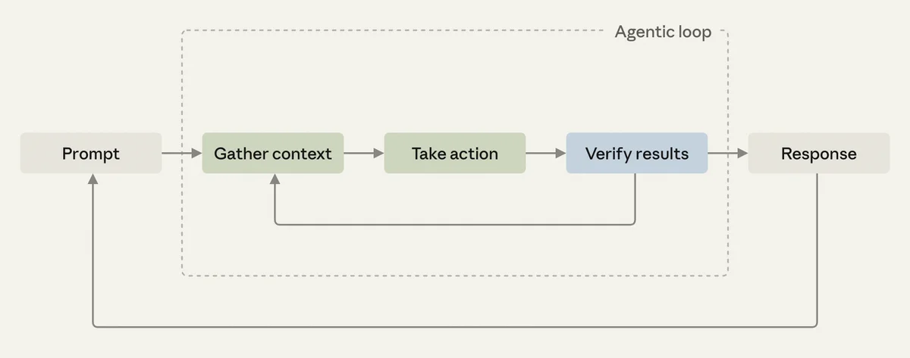

Claude Code verification is the loop in which Claude proves a change works before it hands the change back: it runs the app, runs the tests, fixes what fails and only then reports. On November 16, 2026, Addy Osmani described how the Claude Code team runs that loop on its own repository, where the team says about 90% of the code is written and reviewed by Claude. The post's argument is about scale. Without a way for agents to check their own work, the team writes, you can run one or two Claudes at a time because you have to check everything yourself; with one, you can run dozens or hundreds.

The one number in the post comes from Anthropic's internal testing on structured file generation, where a separate grader checking Claude's output against a rubric raised task success by up to 10 points over a standard prompting loop, with the biggest gains on the hardest problems. The post gives no method beyond that sentence, and the task is narrower than coding in general. The practices around it are more useful than the number, and most of them map onto features Claude Code already ships.

## How to set up a Claude Code verification loop {#claude-code-verification-loop-setup}

A Claude Code verification loop needs three pieces: commands Claude can run without guessing, a skill that exercises the running app, and a hook that stops Claude from declaring victory while a check is red. Claude already reacts to type checkers, linters, tests and runtime errors it sees in the codebase; the loop adds the checks you would otherwise do by hand.



*The agentic loop as Anthropic draws it: verification sends Claude back to gather more context until the result passes. Source: [Anthropic](https://claude.com/resources/articles/building-verification-loops-in-claude-code-with-skills).*

1. **Write down your manual follow-ups.** Anthropic's guide to verification loops suggests starting with the correction you made most often this week, written in plain English as you would explain it to a new teammate. Deterministic project rules count too; its example is "reject any migration that drops a column without a backfill step".
2. **Put exact commands in CLAUDE.md.** List the build, lint and test commands so Claude doesn't have to infer them.
3. **Create a verify skill.** Add a skill named `verify` under `.claude/skills/`, as close to the relevant code as you can, and add more for other parts of the repo. The next section covers what goes in it.
4. **Make finishing conditional.** The post suggests a hook that runs the tests when Claude finishes, or a `/goal` of a passing test suite. Both use the `Stop` event, which fires when the main agent finishes responding.
5. **Set an escalation rule.** On the Claude Code team, Claude fixes failing checks itself, and if a check still fails after three rounds it stops and brings in a human.

A `Stop` hook lives in `.claude/settings.json`, which can be committed with the repo. The documentation's prompt-based example asks a model whether the work is done before Claude may stop; a command hook can run your suite instead and return a block:

```json
{
  "hooks": {
    "Stop": [
      {
        "hooks": [
          {
            "type": "prompt",
            "prompt": "Evaluate if Claude should stop: $ARGUMENTS. Check if all tasks are complete."
          }
        ]
      }
    ]
  }
}
```

A command hook that prints `{"decision": "block", "reason": "Tests failing: …"}`, or exits with code 2 and writes the reason to stderr, sends Claude back to work with that reason. The hook input carries `stop_hook_active`, which is `true` when Claude is already continuing because of a stop hook; check it so the hook cannot block forever on a condition that will never resolve. Claude Code also caps consecutive continuations at eight. If you only need "keep going until the tests pass" for one session, `/goal` is the built-in shortcut for a session-scoped prompt-based Stop hook.

One caveat for cloud work: Claude Code Projects threads skip `.claude/skills` and the hooks in `.claude/settings.json`, as our [Claude Code Projects setup guide](/tutorials/claude-code-projects/) found, so a verify skill committed to the repo will not protect those threads.

## Claude Code verification skill: what to put in /verify {#claude-code-verification-skill}

A Claude Code verification skill should start the app, drive it the way a user or QA engineer would, and report what it saw. The Claude Code team's rule is that running the change end to end matters more than tests: you would not ship an iOS change without trying it in a simulator, and Claude shouldn't either.

The post names a driver for each kind of change:

| Change | How Claude runs it |
|---|---|
| Web front end | The Claude Chrome extension |
| iOS or Android | An iOS or Android MCP server |
| Desktop app | Computer use |
| Backend service | Run the service locally and call it |

The skill file itself is short. Anthropic's example of the smallest useful verification skill checks one rule on the current diff:

```markdown
# .claude/skills/verify-log-hygiene/SKILL.md
---
name: verify-log-hygiene
description: Check that error logs include the request ID and never
  include the request body. Use when the diff touches error handling
  or logging.
allowed-tools: [Read, Edit, Grep]
---
Read the error-handling paths in the current diff.

For each log call on an error path, confirm it includes the request ID
and does not pass the request body, headers, or any user-supplied payload.

Report each violation with file:line, then fix it: add the request ID
where it's missing and strip the payload from the log call.
```

For an end-to-end `verify` skill, the body holds the steps you take by hand: how to boot the app or simulator, which flows to click through, and what each should show. Osmani recommends a feature map as the guide and grading rubric, listing features from the user's point of view with paths, keyboard shortcuts, selectors and expected results. Anthropic's guide also suggests the skill-creator plugin, which interviews you and writes the file, for example `/skill-creator Create a skill for verifying frontend changes end-to-end. Interview me about my workflow.`

Treat the skill as infrastructure. The team asks Claude to iterate on it and stress-test it, because it is the smoke-test harness for every change and a flaky harness teaches the wrong lesson. When a skill should run only sometimes, such as a pre-PR accessibility audit, keep it standalone; when it belongs to one workflow, append it to that skill; when several checks should run in sequence, chain them. The Claude Code team's own chain runs `/code-review`, `/simplify`, then `/verify`, and a `/design` check against DESIGN.md when the diff touches UI. Anthropic notes that chaining raises token spend, so test a chain before rolling it out. Extra skill context is not free in general: in Claude-BugHunter's own skills-on/off baseline, covered in our [Claude Code bug bounty skills](/tutorials/claude-code-bug-bounty/) review, Claude Code solved 3 of 3 challenges either way, and median cost per challenge rose from $0.178 to $0.254 with the skills loaded.

## E2E vs property vs differential tests for coding agents {#e2e-vs-property-vs-differential-tests}

End-to-end tests are the first choice when an agent will act on the result, property tests cover the edge cases the agent did not imagine, and differential tests fit migrations where behaviour must stay the same. Osmani picks these three as the tests most worth investing in, and each answers a different weakness of agent-written code.

| Test type | What it checks | Best for | Tools named in the post |
|---|---|---|---|
| End-to-end | A real user flow works from start to finish | Any feature with a user-visible path | CDP, simulators, API harnesses |
| Property | A statement that must hold for thousands of generated inputs | Parsers, serializers, money and state logic, rewrites | fast-check (JS/TS), Hypothesis (Python), proptest (Rust) |
| Differential | Old and new systems give the same output for the same input | Large migrations and ports | Random inputs or sampled production traffic |

Two failure modes apply to all three. Flaky tests train the agent to rerun them rather than fix the code, and slow tests mean fewer runs per batch, which makes failures harder to pin down. The post's advice is to run the heavier tests before changes are committed.

### End-to-end tests

End-to-end tests are hard to fool: the whole flow either works or it doesn't, and the failure says what broke. The image at the top of this page is the example from [Osmani's post](https://claude.dev/blog/how-the-claude-code-team-thinks-about-verification/). The same checkout bug produces "Error: Timeout after 30s" in a unit test, while the end-to-end run shows that registration and add-to-cart passed, checkout failed, and "Place order" stayed disabled because the payment form never loaded. Unit tests are faster and less flaky, but the post notes an agent can pass them and still break the feature, since neither the agent nor the unit test sees the whole task. If you are choosing a browser driver for these runs, our [agent-browser vs Playwright benchmark](/tutorials/vercel-agent-browser-vs-playwright/) compares their token cost and speed on an 11-step task.

### Property tests

Property tests start from a statement you believe cannot fail and let a library generate thousands of inputs to break it. The post lists four properties that show up in most codebases:

- **Round trip:** encode X and decode it, and you get X back; the same works for parsing and serialization.
- **Invariant:** something that is always true, such as "account balance can never become negative".
- **Idempotency:** running a migration, normalization or retry twice has the same effect as running it once.
- **Equivalence:** an optimized implementation returns the same result as a naive, correct one.

Their value for agents is independence. The generated edge cases are not produced with the same bias as the agent that wrote the code, which is also why property tests help on rewrites where the written spec has drifted from production behaviour. Meta's [just-in-time catching test generation](/tutorials/just-in-time-catching-test-generation/) attacks the same blind spot from the other side, by having an LLM write tests aimed at the specific diff.

### Differential tests

Differential tests run the old system and the new one on the same inputs and flag any difference as a bug or a breaking change. They fit large migrations where behaviour is supposed to stay the same. Feed them randomly generated inputs or a sample of production traffic, normalize differences that don't matter, such as whitespace, and keep a list of approved changes for the cases where the new system is meant to differ.

## How to stop Claude Code from gaming its own checks {#claude-code-verification-tamper-proof-checks}

Keep every rule that judges a change somewhere the change cannot write. The Claude Code team's principle is blunt: if a change can modify the check that judges it, the check is broken. Its Code Review reads REVIEW.md, the file that tells the reviewer what to watch for in this code, from the base or default branch and never from the pull request, and the team keeps every gating rule on a branch the change cannot touch.

Several smaller rules close the remaining gaps:

- **Review the commit, not the branch.** A review is tied to one commit. If someone pushes while it runs, the result no longer applies; a passing review on an out-of-date commit means nothing.
- **Run cheap checks first.** Claude runs the tests, the build and the linter before it opens a pull request, so it doesn't spend shared review and CI time on a bug it could have caught locally.
- **No shortcuts on flaky tests.** Claude may not skip a flaky test, add sleeps or retry until it passes. If it can't find the root cause, it deletes the test and writes down why.
- **Owners write the checks.** The people who own a piece of code write its checks and tune them until they flag what the owner would flag. A check that pulls in a reviewer has to say why.
- **Tune one reviewer instead of adding more.** The team found that stacking a second, more expensive reviewer on top of the first often works worse than tuning the first through REVIEW.md, and it points each review round at what earlier rounds and past failures found.

The team also checks reliability risks by diff. It keeps a checklist of 39 items, each with a trigger that can be read from a diff, the check to run, and the incidents or pull requests that produced it. One item is "--resume loads old transcripts": when session storage or message types change, the check asks whether a new field loads safely from older transcripts that don't have it. Claude reads the diff and runs only the items whose trigger matches, usually 3 to 10, so nobody has to remember past outages.

## Claude Code commit gate: observe mode before enforce {#claude-code-commit-gate-observe-enforce}

Roll out any new gate in observe mode first and switch to enforce only after you have reviewed what it would have blocked. In its own repositories, the Claude Code team stamps every commit with how it was verified, including "none", so unverified commits can be queried. A commit gate then blocks commits from sessions that did not run `/code-review` or `/verify`, with three modes:

| Mode | What happens |
|---|---|
| Off | Nothing is checked |
| Observe | The gate logs what it would have blocked, so false positives can be reviewed before anyone is affected |
| Enforce | The commit is blocked; the commit message can explain why it wasn't verified |

The gate has an escape hatch. After two blocked commits in a session, the next one goes through, so Claude doesn't get stuck; the post adds that Claude Code isn't perfect. The same sequence works for team-wide gates in general. Anthropic's skills guide advises holding off on gates that run on every pull request while your own chain is still changing, because every adjustment then becomes visible to the whole team.

## How to evaluate a code review agent {#evaluate-code-review-agent}

Measure a verifier against the bugs that mattered to you: changes that were reverted, changes a maintainer rejected, and a size-matched set of changes that stayed clean as the control. The Claude Code team reviews its reviewers this way on a routine basis.

For a formal evaluation, the post points to the method of Anthropic's Code Review team. For each past incident or revert, they restore the repository to its state at review time and write a one-sentence answer key describing the bug. A finding scores only if it describes that bug correctly. Merged, stable changes act as the control against over-flagging, and the tuning set is kept apart from the fixed test set. They measure recall at three points, raw findings, after verification and in the final review, to see whether the pipeline drops bugs it had already found; a single end-to-end score would hide that loss. Findings are also tagged Important, Nit or Pre-existing, the last meaning the author shouldn't be blamed for a bug that was already there. Recall is tuned up to the point where the next gain would come from overfitting the eval rather than catching bugs.

Misses become rules in two ways. Patterns from human review comments and reverts qualify if they appear in at least two pull requests and can be spotted from a diff; three agents then try to disprove each candidate before a human approves it in a pull request. The team also replays three bug finders against pull requests tied to known incidents. If at least two find the bug, it counts as detectable, and a miss on a small diff becomes a new rule in REVIEW.md. Rules are pruned on a schedule as well, since test suites, verification steps and markdown files only ever grow if left alone. Our look at [Modern Web Guidance evals](/tutorials/modern-web-guidance-evals/) shows the same discipline from the outside: a fixed set of checks run against Claude Code with and without the guidance.

## Claude Code verification cost and limitations {#claude-code-verification-cost-limitations}

The main cost of Claude Code verification is tokens: every agent-driven smoke test, review round and chained skill is a model call, and that is where the Hacker News discussion of the post concentrated. One commenter already spending about $2,000 a month on one or two agents asked how running dozens in parallel was meant to work. Another argued that asking Claude to drive a browser for every regression check is an expensive way to get what a Playwright test gives deterministically, written once and run at close to zero marginal cost. Replies pointed out that nothing in the post rules out Playwright, and that natural-language invariants such as "subagents don't block the original thread" survive refactors that would break a scripted test.

A practical middle path follows from both sides: let the agent explore the app through the verify skill, then have it turn stable flows into deterministic end-to-end tests that run in CI without tokens. The post makes the same point in general terms, noting that tests and benchmarks an agent generates run as ordinary software afterwards. Our [cost per successful task analysis](/tutorials/coding-agents-finops-cost-per-successful-task/) covers how to budget the remaining agent-driven checks.

Two of the post's rules drew specific objections:

- **Differential tests and agent behaviour.** One commenter warned that when an oracle test fails, an agent may rewrite the test, copy the old system's buggy quirks to match it, or build both behaviours side by side. The approved-changes list and the rule that changes can't edit their own checks address the first; the other two still need a human to decide which behaviour is correct.
- **Deleting flaky tests.** Another argued that a hermetic test's flakiness can always be traced by bisecting to the change that introduced it, and that a non-hermetic one points to a dependency that should be named before the test is removed.

The evidence base is also thin. The 90% figure, the 39-item checklist and the "up to 10 points" result describe Anthropic's own codebase and internal tests, and only the last comes with any measurement detail. What transfers to other teams is the structure: a smoke-test skill Claude must run, a hook that won't let it stop on red, checks kept out of reach of the change, and a habit of measuring the verifier against the bugs that actually reached users. With those in place, Osmani writes, your job shifts from reading every diff to defining what "done" looks like and reviewing the evidence.

## References {#references}

1. Addy Osmani, Anthropic. "How the Claude Code team thinks about verification." claude.dev blog, November 16, 2026. [claude.dev/blog/how-the-claude-code-team-thinks-about-verification](https://claude.dev/blog/how-the-claude-code-team-thinks-about-verification/)
2. Delba de Oliveira, Anthropic. "Building verification loops in Claude Code with skills." July 22, 2026. [claude.com/resources/articles/building-verification-loops-in-claude-code-with-skills](https://claude.com/resources/articles/building-verification-loops-in-claude-code-with-skills)
3. Anthropic. "Hooks reference," Claude Code documentation. Read November 17, 2026. [code.claude.com/docs/en/hooks](https://code.claude.com/docs/en/hooks)
4. Hacker News. "How the Claude Code team thinks about verification," discussion thread, November 17, 2026. [news.ycombinator.com/item?id=50529612](https://news.ycombinator.com/item?id=50529612)
