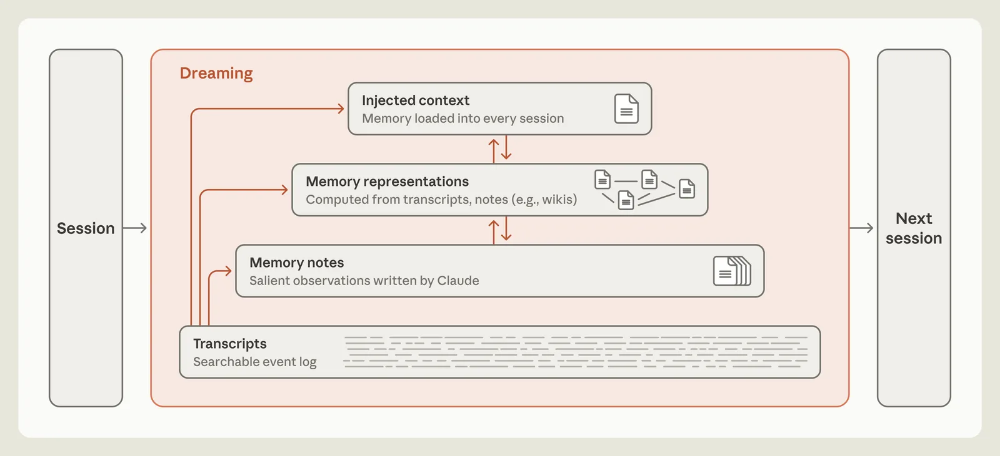
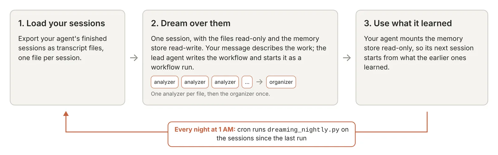
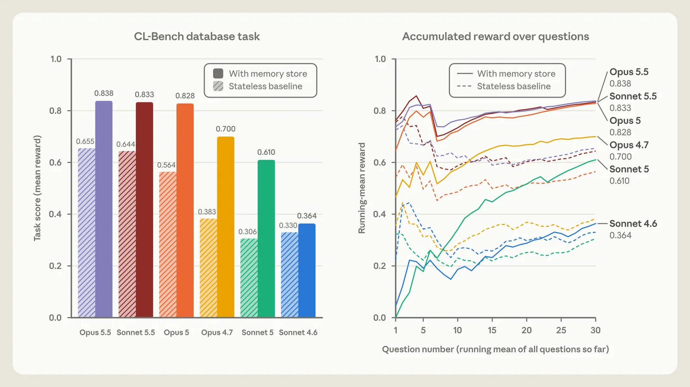
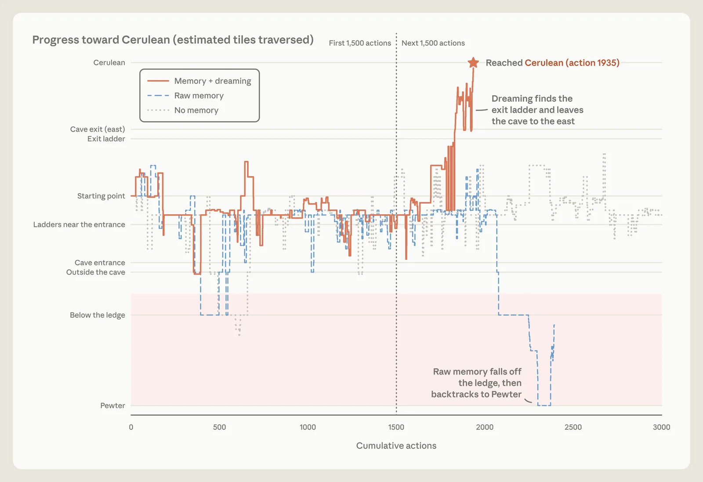
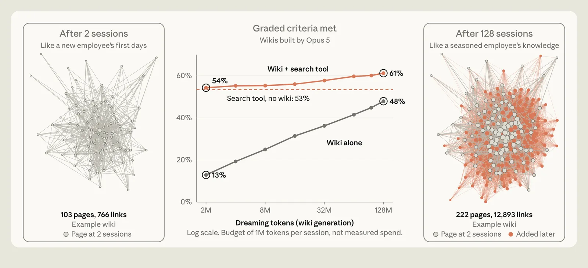
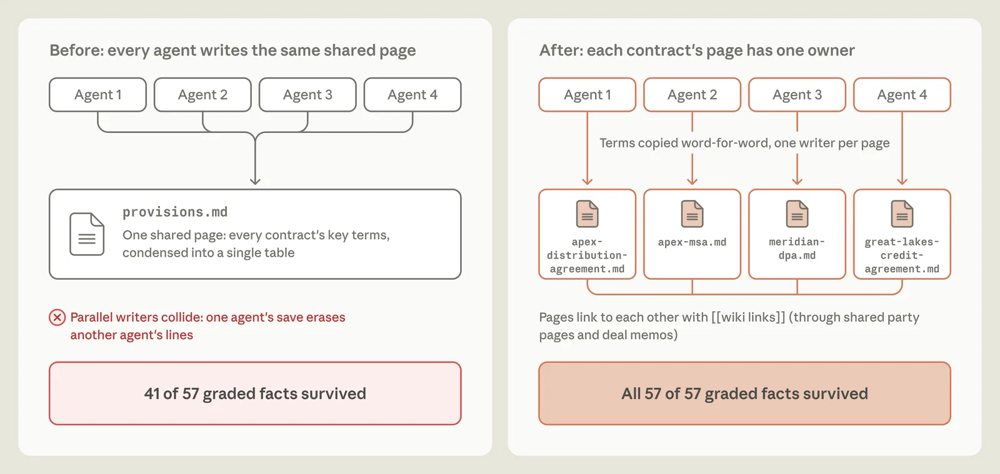

Anthropic has added **Claude dreaming** to Claude Managed Agents. The new Dreams endpoint takes an agent's memory store and up to 100 of its past sessions, and writes a reorganized memory store with duplicates merged, contradictions resolved and stale entries replaced. Agents that run for weeks can start each new session from cleaner notes. On November 6, 2026, Anthropic published the research behind it, "The components of agent memory," with test results on benchmarks, Pokémon Red and document wikis.

Dreams is a research preview. You request access, and it runs only on the Claude API.

## What Is Claude Dreaming

Claude dreaming is an offline pass in which Claude reads its own session transcripts and rewrites its memory: fixing wrong notes, writing new ones, and building larger structures such as linked wikis. Anthropic's post borrows the name from how sleep is thought to consolidate memory in the brain, and credits sleep-time compute, proposed by researchers at Letta and UC Berkeley, as the starting idea.

Anthropic defines agent memory narrowly. It is knowledge Claude gains from experience and keeps between sessions as context it can read later. Weight updates, in-context learning within one conversation and compaction (summaries that replace older turns) fall outside that definition.

The problem Dreams targets is described in the Claude Platform docs. When an agent writes to memory a little at a time, the store collects duplicate entries, contradictions and facts that have gone out of date. A note that was wrong when written, or that drifted as the environment changed, is still read and trusted in later sessions.

## How Agent Memory Layers Work

Anthropic describes agent memory as four layers, and dreaming can write to each of them.



*The memory hierarchy from Anthropic's research post. Dreaming reads transcripts and writes to the layers above them. Source: Anthropic.*

| Layer | What it holds | Who writes it |
|---|---|---|
| Transcripts | Full, searchable log of each session | The harness |
| Memory notes | Salient observations, rules, warnings | Claude, during a session |
| Memory representations | Linked structures such as wikis | Claude, mostly while dreaming |
| Injected context | A small set of notes loaded into every session | Promoted by dreaming or by Claude |

The transcripts act as ground truth. In-session notes reflect what Claude judged important at the time, before it knew what would come next. Dreaming checks those notes against what actually happened. For a wider survey of how agents learn across runs, see our [guide to self-evolving agents](/tutorials/self-evolving-agents-review-en/), which places memory beside weight updates and prompt optimization.

## Claude Managed Agents Dreams API: How to Use It

In Claude Managed Agents, a dream is an asynchronous job: you pass a memory store and a list of sessions, and you get back the ID of a new memory store when it finishes. The documented call uses the Python SDK:

```python
dream = client.beta.dreams.create(
    inputs=[
        {"type": "memory_store", "memory_store_id": store_id},
        {"type": "sessions", "session_ids": [session_a, session_b]},  # 1 to 100 sessions
    ],
    model="claude-opus-5-5",
    instructions="Focus on coding-style preferences; ignore one-off debugging notes.",
)
```

Requests need two beta headers, `managed-agents-2026-04-01` and `dreaming-2026-04-21`. The first one alone does not unlock dreams. If the agent has no memory store yet, create an empty one and pass it as the input.

The three parameters do different jobs:

- **inputs**: one existing memory store and between 1 and 100 sessions. The input store is never changed; the output is always a new store.
- **model**: only some models are supported. The docs list Haiku 5.5, Haiku 4.5, Opus 4.6, Opus 4.5, Sonnet 4.5 and the Mythos models as unsupported.
- **instructions**: guidance on what to focus on. Line-level edit commands in this field generally have no effect; the docs point to the Memory Stores API for direct edits.

A dream moves through `pending`, `running`, `completed`, `failed` or `canceled`. The docs say it can take from a few minutes to a few hours, depending mostly on how many transcripts it reads. A failed or canceled dream still leaves a partial output store. When it completes, you attach the output store to new sessions as a `memory_store` resource, or archive and delete it if you prefer the old one. Because the input is untouched, rolling back means pointing your agents at the previous store.

Deleting the input store or a source session during a run fails the job with `input_memory_store_unavailable` or `input_session_unavailable`.

## Claude Dreaming Pricing, Limits and Access

Dreams has no separate fee. According to the docs, it bills at the standard token rates of the model you choose, and cost scales roughly linearly with the number and length of sessions. Anthropic's advice is to start with a small batch.

Other limits from the documentation:

- Research preview; access is by request.
- Claude API only.
- Not eligible for Zero Data Retention or HIPAA.
- Standard rate limits apply; listing dreams returns 20 by default and at most 100.
- Errors include `timeout`, `memory_store_org_limit_exceeded` and `input_memory_store_too_large`.

For teams that already track agent spend per task, as in our piece on [cost per successful task for coding agents](/tutorials/coding-agents-finops-cost-per-successful-task/), a dream is one more line item: a periodic job whose cost follows transcript volume.

## DIY Claude Dreaming with a Dynamic Workflow

The Dreams docs link to a Claude Cookbook recipe by Brad Abrams, published November 2, 2026, for teams that want to control the prompts, models and schedule themselves. It builds a dream from Managed Agents parts.



*The cookbook's do-it-yourself dream. Source: Claude Cookbook.*

The recipe works in three steps:

1. **Export sessions** as transcript files, one per session. By default it reads the last 14 days for a given agent ID.
2. **Dream over them** in one session. A lead agent (Sonnet 5.5 by default) writes a dynamic workflow and starts it: one analyzer agent per transcript distills it into small linked Markdown files, then an organizer agent merges duplicates, fixes links and completes an index. Analyzers and organizer default to Haiku 5.5.
3. **Use the result.** The production agent mounts the memory store read-only. A cron job runs the script every night at 1 AM over sessions since the last run.

Anthropic's cookbook gives these costs at list price:

| Input | Cost | Time |
|---|---|---|
| 11 example transcripts (283 KB) | $0.36 | ~2.5 min |
| 50 long transcripts (~12 MB), cost-saving settings | ~$8 | ~10 min |
| Same 50, without those settings | ~$10 | ~9 min |

The recipe reports that stores built with and without the cost-saving settings held about the same share of a fixed list of facts. Its default budget ceiling is $40 per run.

The recipe also treats transcripts as untrusted input. Analyzers get file tools only, with no shell, no web and an empty network allowlist, and the dreaming session is the only place the store is mounted read-write. The cookbook notes that, at worst, an injected instruction in a transcript could change what the store says and spend up to the budget, so it suggests reading the store after the first run. Our article on [what changes when AI agents get internal access](/tutorials/ai-agent-internal-access-security-boundary/) covers why that boundary matters once agents act on what they read.

## Claude Memory Results from Anthropic's Tests

Anthropic's post reports results in two groups: plain memory folders written during sessions, and dreaming on top of them. All numbers below are Anthropic's internal runs.

### Memory alone on CL-Bench

On a database task from Continual Learning Bench 1.0, run on Claude Managed Agents, Claude started each question in a fresh session and could read a memory directory that persisted between sessions.



*CL-Bench database task, memory store versus stateless baseline. This chart measures memory notes, not dreaming. Source: Anthropic.*

Newer models gained most. Opus 5 rose from 0.564 to 0.828 and was the first to "close the loop," writing rules together with how it had verified them. Sonnet 4.6 barely moved (0.330 to 0.364) until it was prompted to read its memory and test its theories, which took it to 0.641.

Anthropic also found that fixed rules can hurt. Telling models to "record only failures" cut the gain from memory by 0.234 for Opus 5 and 0.150 for Opus 4.7. Its guidance is to tell Claude what memory is for, and leave the choice of what to save to the model.

### Dreaming corrects a wrong note

In a Pokémon Red run on Managed Agents, Claude wrote down the wrong side of Mt. Moon for a landmark, declared "Mt Moon DONE" and walked off a one-way ledge.



*Progress toward Cerulean City with corrected memory, raw memory and no memory. Source: Anthropic.*

Anthropic then ran dreaming on that memory folder. Claude checked the note against the session transcript, found the error and rewrote it. With the corrected note, it went back into the cave and reached Cerulean City at action 1,935. The run with the uncorrected note fell off the ledge three times and ended back in Pewter City. These are single runs, so they show the mechanism rather than a success rate.

### Dreaming builds wikis

Anthropic tested wikis on about 350,000 internal files (roughly 420M tokens) from Stainless, a company it acquired, using 25 questions. Opus 5 agents dreamed over 128 sessions, writing and correcting linked pages and checking claims against sources.



*Wiki quality as dreaming continues. The x-axis is a budget of 1M tokens per session, not measured spend. Source: Anthropic.*

| Setup | Graded criteria met |
|---|---|
| Wiki alone, after 2 sessions | 13% |
| Wiki alone, after 128 sessions | 48% |
| Search tool, no wiki | 53% |
| Wiki + search, after 128 sessions | 61% |

Anthropic reports that wiki plus search also used about 20,000 fewer tokens per question. On 24 questions about a merger, most of which needed information from several documents, Claude scored 87% with the wiki against 73% with search alone.

### Instructions decide what survives

On a legal-brief task built from contracts, several agents wrote to one shared table at the same time and overwrote each other. The brief built from that wiki met 41 of 57 graded facts.



*Graded contract facts before and after the wiki-building instructions changed. Source: Anthropic.*

Claude then ran a loop of reflecting on failures and rewriting its own build instructions. The new version gave each contract its own page, written by one agent and quoting terms word for word, and the brief met all 57. This is the kind of focus the Dreams `instructions` parameter is meant to carry.

## When Claude Dreaming Does Not Help

Anthropic's post lists cases where the wiki added little or cost too much:

- **Single-document answers.** On a task where most criteria came from one memo, the wiki showed no clear gain over text search.
- **Over-detailed wikis.** On another task the wiki reached 203 KB from a 115 KB corpus, 1.77 times its source, and abstracted nothing.
- **Compute cost.** Every dream spends tokens. Anthropic suggests focusing dreaming on information likely to change, or tuning how often it runs.
- **Error build-up.** Representations such as wikis need upkeep so they do not accumulate errors or hallucinations, and the post names plain transcript search as a reasonable foundation.

The Hacker News thread on the post (about 90 points when we read it) pushed in the same direction. Several commenters read the term "dreaming" as a label for rewriting Markdown notes. One said they delete about 95% of Claude Code memories as task-specific, and another read the wiki chart as showing that search does most of the work. For long-running systems, the design question is where memory sits in the harness, a theme in our piece on [why harnesses are taking over production agents](/tutorials/agent-framework-harness-runtime-production/) and in our [review of stateful long-horizon agents](/tutorials/stateful-long-horizon-agents-review/).

## Claude Dreams vs Claude Code Auto Memory

Claude Dreams and Claude Code auto memory handle the same problem at different times. Claude Code maintains its memory during the session; Dreams reorganizes a Managed Agents memory store afterwards, from transcripts.

| | Claude Dreams | Claude Code auto memory |
|---|---|---|
| Where | Claude Managed Agents (Claude API) | Claude Code |
| When it runs | Offline job after sessions | During the session |
| Input | Memory store + 1 to 100 sessions | The current session |
| Output | A new memory store | Updates to memory files, indexed by MEMORY.md |
| Status | Research preview, access by request | Part of Claude Code |

Both keep the always-loaded layer small. Anthropic's post says Claude Code loads only the first 200 lines or 25 KB of MEMORY.md, which works as an index pointing to the rest, and its Claude Code docs warn that longer instruction files reduce adherence. The sources reviewed here do not describe a dream command for Claude Code itself.

For agents on Managed Agents, the practical path is to keep writing memory during sessions, run a small Dreams batch on a copy of the store, read the output, and only then point production sessions at it.

## References

- Anthropic, ["The components of agent memory"](https://www.anthropic.com/research/components-of-agent-memory), Lance Martin, Nov 6, 2026
- Claude Platform docs, ["Dreams"](https://platform.claude.com/docs/en/managed-agents/dreams), Managed Agents, checked Nov 7, 2026
- Claude Cookbook, ["Dreaming with a dynamic workflow"](https://platform.claude.com/cookbook/managed-agents-cma-dreaming-with-a-dynamic-workflow), Brad Abrams, Nov 2, 2026
- Hacker News, ["The Components of Agent Memory"](https://news.ycombinator.com/item?id=50402212), discussion, read Nov 7, 2026
