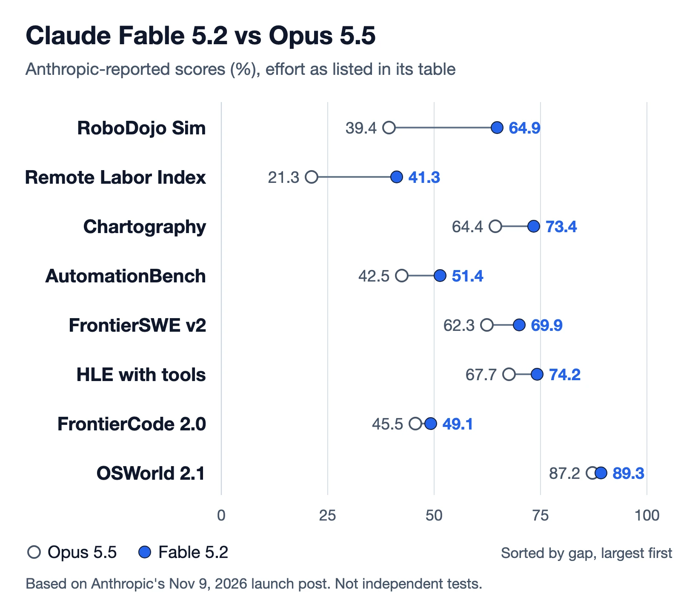

Anthropic released Claude Fable 5.2 and Claude Mythos 5.2 on November 9, 2026, its top-tier models for long, hard technical work. Fable 5.2 costs $8 per million input tokens and $40 per million output tokens, 20% less than Fable 5.1, generates output up to 30% faster, and scores above Claude Opus 5.5 on most of the benchmarks Anthropic published. Mythos 5.2 is the same model with its cyber and biology safeguards removed, offered only to vetted organizations.

| Question | Short answer |
|---|---|
| What is it? | Anthropic's top model open to all users, API id `claude-fable-5-2`. |
| Price | $8 input / $40 output per million tokens; fast mode $16 / $80. |
| Context | 1M tokens in, up to 128K tokens out; adaptive thinking always on. |
| Headline score | 65 on the Artificial Analysis Intelligence Index, first of 74 models. |
| Main catch | Twice Opus 5.5's token price, and slow and verbose in independent testing. |

## What Is Claude Fable 5.2 {#what-is-claude-fable-5-2}

Claude Fable 5.2 is the general-release version of Anthropic's newest frontier model, aimed at what Anthropic calls "the most daunting technical challenges": large migrations, long agent runs and research problems. It replaces Fable 5.1 and sits above the Opus, Sonnet and Haiku 5.5 models.

### Specs from Anthropic's docs

Anthropic's models overview lists Fable 5.2 with a 1M-token context window, 128K maximum output tokens, adaptive thinking that is always on, a default effort level of high, a training-data cutoff of June 2026 and retirement no sooner than November 9, 2027. It is available in the Claude apps and Claude Code, on the Claude Platform API, and through Amazon Web Services, Google Cloud and Microsoft Azure.

### What Anthropic says it did before launch

Anthropic's launch post lists prerelease projects run with Fable 5.2:

- A team of 1,000 Fable 5.2 agents fully formalized Fermat's Last Theorem in Lean in 30 hours. An earlier unreleased research version of Claude took 11 days with a purpose-built harness and human guidance; Opus 5.5 in the same setup reached 26% in 18 hours.
- More than 1,000 subagents built a prototype operating system from an empty folder over 8 days.
- A Python service was migrated to Rust, and Anthropic says the result starts about 26 times faster.
- Working with Diode, it designed three electronic devices that worked without electrical modifications.

These are Anthropic's descriptions; no outside group has reproduced them yet.

## Claude Fable 5.2 Pricing {#claude-fable-5-2-pricing}

Claude Fable 5.2 costs $8 per million input tokens and $40 per million output tokens on the Claude Platform, down from $10 and $50 for Fable 5.1 and Fable 5. Mythos 5.2 has the same price. Opus 5.5 costs half as much per token.

| Model | Input / 1M | Output / 1M |
|---|---|---|
| Fable 5.2 / Mythos 5.2 | $8 | $40 |
| Fable 5.1 / Mythos 5.1 | $10 | $50 |
| Opus 5.5 | $4 | $20 |
| Sonnet 5.5 | $2 | $10 |
| Haiku 5.5 | from $0.10 | from $0.50 |

*Source: Anthropic models overview and pricing pages, November 9, 2026.*

Other line items in Anthropic's pricing docs:

- **Cache:** a 5-minute cache write costs $10 per million tokens and a 1-hour write $16. Cache reads cost $0.20, or 0.025x the input price, half the 0.05x rate on Opus and Sonnet 5.5.
- **Batch API:** $4 input and $20 output, the same as Opus 5.5 at standard rates.
- **Fast mode:** up to 2.5x faster token generation at $16 input and $80 output, across the full context window. It does not combine with the Batch API, and Mythos 5.2 fast mode is limited to organizations in Anthropic's verification programs.
- **US-only inference:** setting `inference_geo` to US adds a 1.1x multiplier.

### Cost per task in independent testing

Fable 5.2 thinks at length by default, so per-task cost runs far above what the token price suggests. Artificial Analysis measured $26.54 to run one task of its Intelligence Index with Fable 5.2 at max effort, the highest cost of the 73 models on that chart. It also took 44.1 minutes per task, with 103 output tokens per second and about 232 seconds before the first answer token. Artificial Analysis describes the model as "notably slow per task and very verbose." Our piece on [cost per successful task](/tutorials/coding-agents-finops-cost-per-successful-task/) explains why that number matters more than the rate card when choosing a model for agents.

Anthropic's own cost claims point the other way at lower effort settings. It says Fable 5.2 at high effort scored 45.3% on FrontierCode 2.0, level with Opus 5.5's best 45.5%, at roughly half the cost per task; that it matched Opus 5.5's top Humanity's Last Exam score at low effort for under a tenth of the cost; and that it matched Opus's top WANDR score at medium effort for about 40% of the cost. Effort level moves Fable's bill as much as the token price does.

## Claude Fable 5.2 Benchmarks {#claude-fable-5-2-benchmarks}

Anthropic's launch table compares Fable 5.2 with Fable 5.1, Opus 5.5, GPT-6 Astra and Gemini 4 Carbon. Scores are Anthropic's runs at each model's highest effort unless noted; on the cybersecurity and protein-design rows the Anthropic entries are Mythos models, because Fable's safeguards block most of those tasks.

| Benchmark | Fable 5.2 | Fable 5.1 | Opus 5.5 | GPT-6 Astra | Gemini 4 Carbon |
|---|---|---|---|---|---|
| FrontierCode 2.0 (agentic coding) | 49.1% (xhigh) | 32.4% | 45.5% | 42.8% | 41.1% (medium) |
| FrontierSWE v2 (agentic coding) | 69.9% | 56.3% | 62.3% | 65.5% | 61.2% |
| AutomationBench (business workflows) | 51.4% | 31.4% | 42.5% | 41.4% | 53.9% |
| Terminal-Bench-Science 0.1 | 74.6% | 52.6% | 58.7% | 68.1% | 64.8% |
| OSWorld 2.1 (computer use, partial) | 89.3% | 83.5% | 87.2% | 79.5% | 81.5% |
| Remote Labor Index | 41.3% (high) | 17.9% | 21.3% | 20.8% | — |
| Humanity's Last Exam (with tools) | 74.2% | 65.6% | 67.7% | 57.2% | — |
| Chartography (no tools) | 73.4% | 44.8% | 64.4% | 71.0% | 72.5% |
| RoboDojo Sim (robotics) | 64.9% | 27.6% | 39.4% | 29.8% | — |
| CVE Rediscovery (cyber) | 89.6% (Mythos 5.2) | 78.3% (Mythos 5.1) | 81.3% | — | — |

*Source: Anthropic, "Claude Fable 5.2 and Mythos 5.2," November 9, 2026. Opus 5.5 cyber score is without safeguards.*

*Fable 5.2 vs Opus 5.5 on the eight benchmarks where Anthropic reports both. Based on Anthropic's launch post; not independent tests.*

### Where the gains are largest

The biggest jumps over Fable 5.1 are on long, multi-step work. Remote Labor Index, which grades freelance-style projects end to end, more than doubles from 17.9% to 41.3%, and Opus 5.5 and GPT-6 Astra both sit near 21%. RoboDojo Sim, a robotics control benchmark, goes from 27.6% to 64.9%. Chart reading improves from 44.8% to 73.4% without tools.

### Where it does not lead

Gemini 4 Carbon scores higher on AutomationBench, 53.9% to 51.4%. On the Elo version of the AA-Briefcase knowledge-work test, Opus 5.5 rates 1800 against Fable 5.2's 1785, though Fable leads on the rubric score (66.1% vs 61.2%).

### Caveats raised about the table

Hacker News commenters pointed out two setup differences. FrontierCode 2.0 compares Fable at xhigh effort with Gemini 4 Carbon at medium, and one commenter said the benchmark runs Gemini through Devin CLI while other models use their own harness. The harness is part of what an agent benchmark measures (our [HarnessDev benchmark write-up](/tutorials/harnessdev-agent-harness-benchmark/) looks at this directly), so small cross-vendor gaps on these rows say less than the Fable-vs-Fable comparisons.

The independent figure so far comes from Artificial Analysis, which ranks Fable 5.2 at max effort first of 74 models with an Intelligence Index of 65.

## Claude Fable 5.2 vs Opus 5.5 {#claude-fable-5-2-vs-opus-5-5}

Fable 5.2 scores higher than Opus 5.5 on nearly every benchmark Anthropic published and costs twice as much per token, so it pays off mainly on long, open-ended tasks. Anthropic's launch post says to start with Opus 5.5 for most coding and knowledge work and to use Fable for "the most ambitious, open-ended technical work." Anthropic also suggests pairing them, with Fable acting as an advisor or orchestrator over cheaper models.

| | Fable 5.2 | Opus 5.5 |
|---|---|---|
| Price per 1M tokens | $8 / $40 | $4 / $20 |
| FrontierSWE v2 | 69.9% | 62.3% |
| Remote Labor Index | 41.3% | 21.3% |
| OSWorld 2.1 | 89.3% | 87.2% |
| Anthropic's recommendation | Hardest, longest technical work | Default starting point |

Early users on Hacker News described a similar split. One commenter who had been testing Fable 5.2 said they had a hard time telling it apart from Opus 5.5 on ordinary coding, and that you "really have to push the ambition of your prompt" to see a difference; they also found it faster than Fable 5.1 and free of the max-output-token overflows they had hit before. Another said Opus 5.5 at xhigh effort handled a 125,000-line project fine, and a reply said Fable was better at choosing a research direction, such as picking a model architecture. These are individual reports.

If you route traffic across several models, the [model gateway](/tutorials/model-gateway-enterprise-ai-control-plane/) pattern is how teams send only the hardest requests to the expensive tier.

### Claude Code notes

Fable 5.2 is available in Claude Code from launch. On Hacker News, one Ultra subscriber reported the context window capped at 200K tokens instead of 1M; another user said updating the desktop app fixed it. A different commenter reported frequent context compactions in Claude Code.

## Claude Fable 5.2 vs Mythos 5.2 {#claude-fable-5-2-vs-mythos-5-2}

Fable 5.2 and Mythos 5.2 are the same underlying model at the same price. The difference is access and safeguards. Fable runs with classifiers that block high-risk cybersecurity requests and most research-biology tasks, and anyone can use it. Mythos 5.2 drops those blocks and is available only to organizations approved through Anthropic's Cyber Verification Program or Life Sciences Verification Program.

When Fable's classifiers block a query, Anthropic says the request falls back to an older model: Opus 4.8 for cyber and Opus 5 for biology. In early testing across claude.ai, Claude Code and Cowork, Anthropic saw about 55% fewer blocks than with Fable 5.1.

On the cyber side, Anthropic reports Mythos 5.2 at 89.6% on CVE Rediscovery, 10.2 points above Opus 5.5 and 14.4 points above Mythos 5.1. That puts it in the same space as OpenAI's gated security model, covered in our [GPT-6 Cyber explainer](/tutorials/gpt-6-cyber/).

### Safety results Anthropic reported

- In a new evaluation of more than 1,800 sandbox-escape scenarios, Mythos 5.2 used credentials or files placed outside its sandbox in 3.1% of them, about as often as Opus 5.5 (3.3%) and well below Mythos 5.1 (21%) and Mythos 5 (39%). On one other measure, taking harmful actions after wrongly concluding it was in a simulation, it scored slightly worse than Opus 5.5.
- Anthropic says both models voice suspicion that they are being evaluated more often than any of its recent models, which makes test results harder to read. It considers high-stakes misalignment risk low.
- During training Anthropic limited gains in skills that most directly speed up AI development, such as accelerator kernel optimization, where the model performs about at Opus 5.5's level.
- Preserved thinking now applies to all accounts. Enterprise customers can join a private beta, Enterprise Frontier Safeguards, that works with zero data retention; other accounts have prompts and outputs kept for 30 days for safety monitoring.

## Claude Fable 5.2 Launch Offer and Free Resets {#claude-fable-5-2-launch-offer}

For launch week Anthropic is giving paid subscribers extra Fable usage, according to its support article on the promotion:

| Plan | What you get | Use by |
|---|---|---|
| Pro, Team standard seats | 1 Fable reset, plus Fable access counting for up to 50% of weekly limits | November 16, 2026 |
| Max, Ultra, Team premium seats | 1 reset under 6 months paid, 2 for 6–12 months, 3 over 12 months | March 8, 2027 |

A reset restores your Fable usage and refills the five-hour limit; it does not raise your limits. When one is available, a "Reset for free" option appears under Settings > Usage. Paid tenure is measured from your first paid bill, and your billing must have started before 10 a.m. PT on November 9. The Free plan is not covered.

## Claude Fable 5.2 FAQ {#claude-fable-5-2-faq}

### Is Claude Fable 5.2 better than Opus 5.5?

On Anthropic's launch table Fable 5.2 (or Mythos 5.2 on the cyber and biology rows) scores higher than Opus 5.5 on every benchmark except the Elo score of AA-Briefcase, with the largest gaps on Remote Labor Index and robotics. It costs twice as much per token, and Anthropic itself recommends starting with Opus 5.5 for most coding and knowledge work and reaching for Fable on the most ambitious, open-ended technical tasks.

### What is the difference between Claude Fable and Claude Mythos?

Fable 5.2 and Mythos 5.2 are the same underlying model. Fable runs with classifiers that block high-risk cybersecurity and most research-biology requests and is available to all users. Mythos has those safeguards lifted and is available only to organizations approved through Anthropic's Cyber Verification Program or Life Sciences Verification Program.

### How do I get a free Claude Fable reset?

Pro plans and Team standard seats get one reset plus a week of included Fable usage through November 16, 2026. Max, Ultra and premium seats get one to three resets depending on paid tenure, usable until March 8, 2027. Resets appear under Settings > Usage as Reset for free; Free plans are not eligible.

## References {#references}

1. Anthropic, [Claude Fable 5.2 and Claude Mythos 5.2](https://www.anthropic.com/claude-fable-and-mythos-5-2), November 9, 2026.
2. Anthropic, [Models overview](https://platform.claude.com/docs/en/about-claude/models/overview), accessed November 9, 2026.
3. Anthropic, [Pricing](https://platform.claude.com/docs/en/about-claude/pricing), accessed November 9, 2026.
4. Anthropic Help Center, [Claude Fable 5.2 launch promotion](https://support.claude.com/en/articles/17506494), November 9, 2026.
5. Artificial Analysis, [Claude Fable 5.2 model page](https://artificialanalysis.ai/models/claude-fable-5-2), accessed November 10, 2026.
6. Claude, [launch post on X](https://x.com/claudeai/status/2119867114450268322), November 9, 2026.
7. Hacker News, [Claude Fable 5.2 discussion](https://news.ycombinator.com/item?id=50429906), November 9, 2026.
