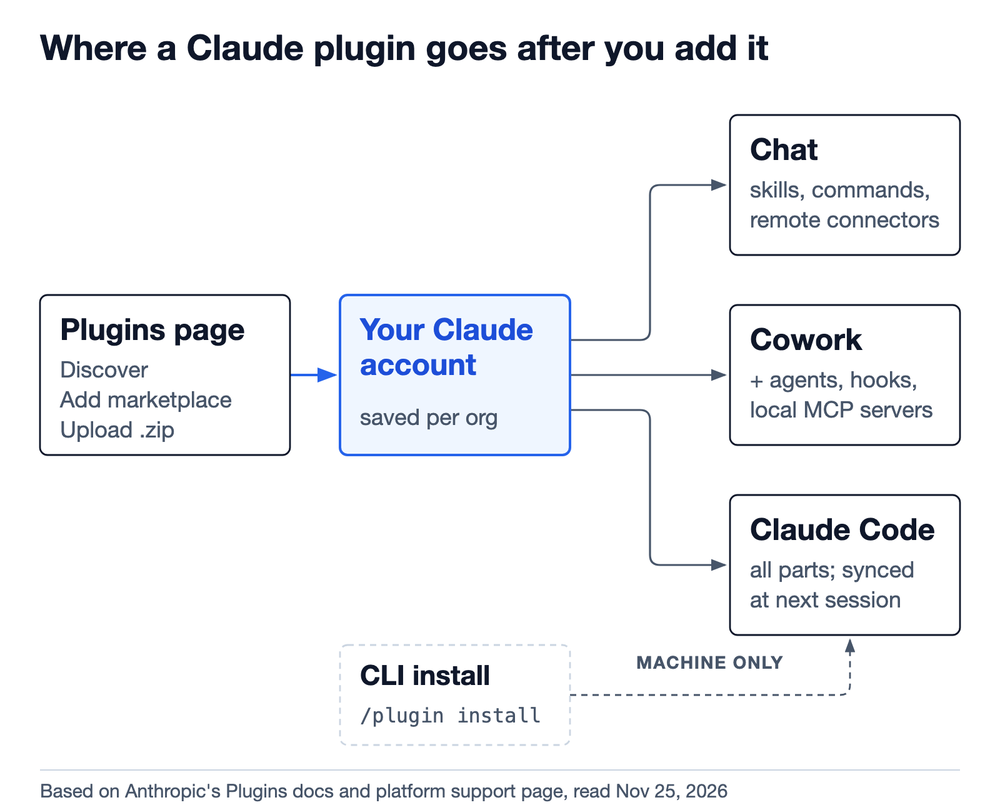

Claude plugins are now the single way to add anything to Claude. On November 23, 2026, [Anthropic merged connectors](https://x.com/claudeai/status/2124970294523945328), which give Claude access to outside tools and data, and skills, which teach it a task, into one Plugins page that replaces the separate Skills, Connectors and Plugins tabs. The change is live on Free, Pro, Max and Ultra plans on the web and in the Claude desktop app, and Anthropic says users can browse more than 10,000 plugins.

Nothing you already set up is removed: installed skills, connectors and plugins stay where they were, now listed under one heading. What changes is how you find and manage them, and for Team and Enterprise admins, one policy setting that starts to matter on November 30. This guide sets out how the three pieces relate after the merge, which parts of a plugin load in chat, Cowork and Claude Code, how to add one, and where Anthropic's review of third-party plugins stops.

## Claude Plugins vs Skills vs Connectors {#claude-plugins-vs-skills-vs-connectors}

A skill tells Claude how to do something, a connector lets Claude reach something, and a plugin is the package that can carry both. Anthropic's docs define a plugin as a bundle of skills, MCP connectors, commands and agents that you add to Claude as one unit. A standalone skill or connector is still valid on its own; after the merge it simply appears on the Plugins page as a card labeled with its type.

| | What it adds | Example | Where it runs |
|---|---|---|---|
| Skill | Instructions Claude follows when a task matches, sometimes with scripts | Your team's format for a weekly report, or Anthropic's [PowerPoint skill](/tutorials/claude-powerpoint-skill/) | Chat, Cowork, Claude Code |
| Connector | Access to an outside tool or data source over MCP, signed in with your account | Your calendar, files or issue tracker | Chat, Cowork, Claude Code (remote servers) |
| Plugin | A package of skills, connectors, commands and agents, installed and updated together | A sales or code-review kit | Depends on the parts, see the next section |

*Based on Anthropic's Plugins documentation and Help Center, read November 25, 2026.*

The practical difference shows up when the pieces depend on each other. A plugin's skills load as soon as you add it, whether or not anything is connected. A skill that needs a connector's service cannot reach it until that connector shows **Connected** on the plugin's Connectors tab, which lists each bundled connector as Connected, Not connected or Not added. Adding the plugin does not sign you in to anything.

The reverse catches people too. Anthropic's Help Center notes that removing a plugin that packages skills and a connector does not disconnect the connector; you disconnect it separately, from the plugin's Connectors tab or the Connectors page. If you are cleaning up access to a service, removing the plugin is not enough.

### Why Anthropic says "10,000+ plugins"

The headline number counts more than packaged bundles. Claude's public Marketplace page, which lists bundles of "tools, skills, and integrations", showed 543 plugins when we read it on November 25. Anthropic's MCP anniversary post the next day put the number of MCP connectors for Claude at over 10,000. With connectors and skills now shown as plugins, most of the 10,000-plus figure is likely individual connectors rather than multi-part kits.

## Claude Plugins in Chat vs Cowork vs Claude Code {#claude-plugins-chat-cowork-claude-code}

One Claude plugin installs everywhere you use your account, but chat, Cowork and Claude Code each load a different subset of it. Chat is the most limited: it ignores agents, hooks and local MCP servers, and it refuses any plugin that ships executables in a top-level `bin/` folder. Anthropic's platform support page warns that the result can look complete in one app and partial in another.

| Plugin component | Chat (web, desktop, mobile) | Cowork | Claude Code |
|---|---|---|---|
| Skills | Loads | Loads | Loads |
| Commands | Loads as a skill | Run with `/plugin-name:command` | Loads |
| Agents | Ignored | Loads | Loads |
| Hooks | Ignored | Loads | Loads |
| Remote MCP server (fixed URL) | Works once connected on the Connectors tab | Loads, connect on the Connectors tab | Loads |
| Local MCP server, including `.mcpb` | Ignored | Only when the Cowork session runs on your computer | Loads |
| Executables in `bin/` | Plugin can't be installed | Plugin can't be installed | Loads |
| LSP servers, output styles, themes, settings | Ignored | Ignored | Loads |

*Source: Anthropic, "Plugin feature support across platforms", read November 25, 2026.*

Installs also travel in one direction only. A plugin you add on claude.ai or in the desktop app is saved to your account and reaches Claude Code as a synced plugin the next time you start a signed-in session; run `/reload-plugins` to pick it up without restarting. A plugin you install from the Claude Code command line stays on that machine and never appears in your claude.ai account.

*Where a plugin goes after you add it. Diagram by AgentsPulse, based on Anthropic's Plugins documentation and platform support page, read November 25, 2026.*

In practice, a plugin built for Claude Code, with agents, hooks or a local server, can show up in chat with only its skills working. If a plugin seems to do less than its listing promises, check which app you opened it in before assuming it is broken.

## How to Add Claude Plugins From the Directory, a Marketplace or a File {#how-to-add-claude-plugins}

To add a Claude plugin, open **Plugins** in the sidebar of claude.ai or the desktop app (it was called Customize before the merge), then pick one of three routes. Each install is saved to your account for the organization you are in.

1. **Discover.** Browse plugins from Anthropic's default marketplaces, the public directory and anything your organization provides. Open a plugin to see its Skills, Connectors and other tabs, then select **Add**.
2. **Add > Add marketplace.** Point Claude at a Git repository that contains plugins, using a full URL or `owner/repo` shorthand. GitHub and GitHub Enterprise work, as do public GitLab and Bitbucket repositories. For a private GitHub repository, connect your GitHub account and give the Claude GitHub App access when the dialog asks.
3. **Add > Upload plugin.** Upload a `.zip` or `.plugin` file of a plugin folder. The archive must contain exactly one `.claude-plugin/plugin.json`.

To use what you added, type `/` in the message box: the menu lists your skills with the name of the plugin each came from, and typing `plugin-name:skill-name` narrows it. Claude also loads a plugin's skill on its own when a task matches it. In Cowork you run a command with `/plugin-name:command`; in Claude Code, `/plugin-name:skill-name`. The [Superpowers plugin for Claude Code](/tutorials/superpowers-claude-code/) is a good example of a skills-heavy package that behaves this way.

### Claude plugins on the Free plan

The Free plan has the new Plugins page, according to both Anthropic's announcement and its Help Center. Anthropic's plugin documentation, however, lists the public directory under Discover only for Pro, Max, Ultra, Team and Enterprise plans. If you are on Free and Discover does not show the public directory, that matches the documentation; Anthropic has not reconciled the two pages.

### Claude plugin limits

Claude's account-level installs have hard caps that Claude Code installs do not:

- Up to 25 marketplaces you add yourself, per account in each organization
- Up to 5,000 files and 200 MB per plugin, and 200 MB for a single uploaded file
- Directory browsing inside Claude Code requires version 2.1.287 or later (`/plugin directory`)

Plugins from the directory or a marketplace update automatically from their source. For a marketplace you added yourself, use **Check for updates**, or turn on **Sync automatically** for GitHub-hosted ones.

## Claude Plugins Admin Changes for Team and Enterprise on November 30 {#claude-plugins-admin-changes}

Team plans start receiving the single Plugins page on November 30, 2026, and Enterprise plans get it on by default over the following weeks. Most organizations do not need to do anything. The exception is any organization that has Skills turned off.

Skills are now packaged into plugins, so from November 30 the Skills switch also governs plugins in the desktop app. If Skills stay off, plugins stop working in Claude Desktop, including Cowork and the Code tab. Anthropic says this matches how Claude on the web and Claude Code already behave. An Owner who wants plugins to keep working should, before November 30:

1. Go to **Organization settings > Library > Policy**.
2. Turn on **Cloud code execution and file creation**, which plugins require.
3. Turn on **Skills**, which is renamed **Plugins** on November 30.

Leaving Skills off is the way to block plugins. In Organization settings, the old Plugins & skills and Connectors sections become one Plugins group with separate pages for plugins, connectors, policy, marketplaces and requests. Owners can set each plugin to Not available, Available to install, Installed by default or Required; members can turn off a default plugin but not a required one. A plugin's page also shows how many people used it in the last 30 days and how many runs it had.

Organizations on Claude's HIPAA configuration have one more constraint: Anthropic's Business Associate Agreement does not cover connectors, plugins or skills, even after an Owner turns them on, so protected health information should stay out of them. Anthropic's other restricted setup, zero data retention on the Claude Platform, has its own rules, covered in our guide to [Enterprise Frontier Safeguards](/tutorials/enterprise-frontier-safeguards/).

## Claude Skills over MCP and Plugins {#claude-skills-over-mcp}

Skills over MCP lets a connector bring its own skills, so you get the playbook without installing a separate plugin. Anthropic put it into public beta in Claude and Claude Code on November 24, a day after the plugins merge, as part of MCP's second anniversary. An MCP server can now publish skills alongside its tools; Claude loads a skill only when a task needs it, and the skill updates whenever the server does.

The difference from a plugin is who ships and maintains the bundle. A plugin is a package you add and that updates from its marketplace. A skill delivered over MCP lives on the service's own server, next to the tools it explains. Anthropic's launch examples are all vendor playbooks: Shopify uses one to help Claude design and update a merchant's store end to end, HubSpot to onboard customers, Atlassian to draw on organizational context, and Carta, soon, to draft equity documents from an uploaded file.

Skills over MCP is on by default for Pro, Max and Ultra, available to Team plans once an admin enables it, and coming to Enterprise. Two related MCP features reached general availability the same day: Tasks, which lets a server run long jobs or full agent loops in the background while Claude keeps working, and Elicitation, which lets a server pause and ask the user to confirm something like spending money or deleting data. File Uploads, for passing PDFs, spreadsheets and images to a server outside the context window, is rolling out soon. All of these are part of the open MCP specification, so servers that adopt them work in other compatible clients too. For how the protocol underneath has changed this year, see our explainer on [stateless MCP and agent gateways](/tutorials/stateless-mcp-agent-gateway/).

Loading skills and tool definitions only when needed is also how Anthropic keeps setups with many connectors from filling the context window. Its MCP post says tool search, which defers tool definitions until they are used, can cut the context they take by more than 85% in multi-server setups. That is Anthropic's own figure; our [Claude Code Code Mode test](/tutorials/claude-code-code-mode/) measured a different context-saving approach at about 37% less input.

## Claude Plugins Security: What Anthropic Reviews {#claude-plugins-security-review}

Anthropic reviews plugins listed in its directory, and nothing else. According to its documentation, every version of a directory plugin gets automated validation and a security scan, and a person reviews each new listing before it goes live. Public listings carry a **Verified** or **Community** label. Plugins you add from a marketplace URL or upload as a file skip that review.

Even directory review has limits. The README of Anthropic's own plugin repository warns that "Anthropic does not control what MCP servers, files, or other software are included in plugins and cannot verify that they will work as intended or that they won't change." Third-party plugins are now submitted through Claude's directory portal, and Anthropic is trimming the old Claude Code marketplace file down to its own plugins.

Before adding a plugin, look at what it will run. A skill or command is text Claude follows, and a connector acts with whatever account you sign in with. In Cowork and Claude Code, agents and hooks can run commands on your computer when certain events happen, and a connector marked **Runs in each session** starts a program locally. A sensible order is to add the plugin, read its tabs, connect only the services it needs for the task in front of you, and remove anything that does not earn its place, remembering to disconnect connectors separately.

## References {#references}

1. Anthropic Help Center, [“Manage plugins, skills, and connectors from one Plugins page”](https://support.claude.com/en/articles/17740565-manage-plugins-skills-and-connectors-from-one-plugins-page), updated November 24, 2026.
2. Anthropic, [“Plugins”](https://claude.com/docs/plugins/overview), Claude.ai Documentation, retrieved November 25, 2026.
3. Anthropic, [“Plugin feature support across platforms”](https://claude.com/docs/plugins/platform-support), Claude.ai Documentation, retrieved November 25, 2026.
4. Anthropic, [“MCP servers can now ship skills, run tasks, and more with Claude”](https://claude.com/resources/articles/skills-over-mcp-tasks-and-more), November 24, 2026.
5. Anthropic, [anthropics/claude-plugins-official README](https://github.com/anthropics/claude-plugins-official), retrieved November 25, 2026.
