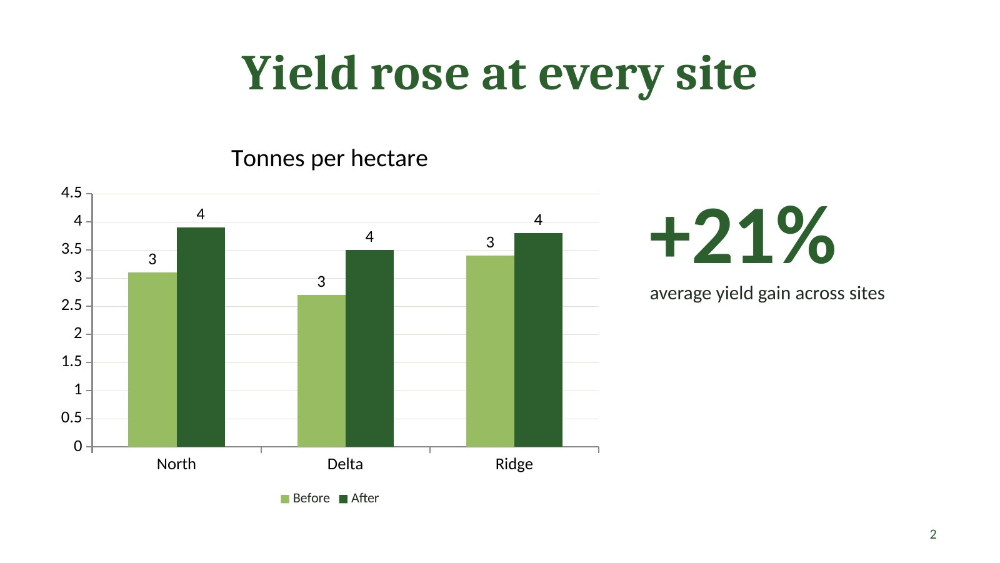

The Claude PowerPoint skill, published as `pptx` in Anthropic's skills repository, is the set of instructions and scripts Claude follows when it writes a PowerPoint file. A Japanese post about it drew more than 430,000 views on November 15 with a simple pitch: no more white slides full of bullets, default blue and a line under every title. The skill does spell out those bans, and on November 6 Anthropic moved it to the Apache 2.0 license, so anyone can install it in Claude Code or other agents and read exactly what it tells the model.

This guide explains which Claude path produces a real, editable .pptx, how to install the skill in each place, what changed in the November updates and which design rules are worth knowing when you prompt. We also built a deck with the skill's own scripts, then broke one on purpose, to see what its checker catches and what still needs your eyes.

## Claude PowerPoint skill vs Claude Slides vs Claude for PowerPoint {#claude-powerpoint-skill-vs-claude-slides}

Use the Claude PowerPoint skill when you need a .pptx file whose charts, text and layouts stay editable in PowerPoint. Use Claude Slides when the deck can live in Claude, and Claude for PowerPoint when you are already working in a branded PowerPoint template. The three paths produce different things:

| | pptx skill | Claude Slides | Claude for PowerPoint |
|---|---|---|---|
| What you get | A .pptx file written by a script | A deck that opens beside the chat, edited and presented in Claude | Slides added or edited inside your open PowerPoint file |
| Where it runs | Claude apps with file creation on, Claude Code, the API, other agents | Claude on web, desktop, mobile and Claude Code | The PowerPoint add-in |
| Charts | Native PowerPoint charts | Drawn on the slide; on PowerPoint download they become pictures | Native charts you can edit |
| Branding | Theme colors and fonts set in the script | Your design system in Claude | Reads the template's slide master, layouts, fonts and colors |
| How to ask | Name the file type: "make a .pptx" | Ask for a deck, or start one under Artifacts | Select a slide and describe the change |

*Sources: anthropics/skills pptx SKILL.md; Claude Academy, "Making slides and presentations with Claude" and "Building a PowerPoint with Claude". Read November 17, 2026.*

The difference matters at download time. Claude Academy's slides guide says that in a PowerPoint export of a Claude Slides deck, "charts, icons and shapes become pictures," and slide transitions and skipped slides are left out. Text boxes, tables, pictures, backgrounds and speaker notes stay editable. The pptx skill, by contrast, tells Claude to "keep charts native" and to draw only chart types PowerPoint lacks, such as Sankey diagrams, as images.

If Claude gives you the wrong one, the same guide's fix is to say what you want by name: ask for "a .pptx" to get the file, or ask Claude to "make this a Slides deck" to go the other way. Teams that already work in Claude artifacts such as [Claude Whiteboards](/tutorials/claude-whiteboards/) can move a plan from a board into a Slides deck; when the deck has to end up in a company template, the add-in or the pptx skill is the better end point.

## How to install the Claude PowerPoint skill {#how-to-install-claude-powerpoint-skill}

In the Claude apps there is nothing to install: Anthropic's built-in PowerPoint skill is available on Free, Pro, Max, Ultra, Team and Enterprise plans once code execution is on, and Claude picks it automatically for a request like "Create a PowerPoint presentation about Q3 results." Elsewhere you install the open-source copy.

**Claude.ai and the desktop app.** Go to Settings > Capabilities and turn on Code execution and file creation (called Create and edit files in the newer settings layout). Example skills can be toggled under Customize > Skills. Team plans have skills on by default; on Enterprise an owner enables them under Organization settings > Plugins & skills.

**Claude Code.** Register Anthropic's repository as a plugin marketplace, then install the document skills bundle, which includes pptx alongside docx, xlsx and pdf:

```text
/plugin marketplace add anthropics/skills
/plugin install document-skills@anthropic-agent-skills
```

After that, mention the deck in a prompt. If you already run Claude Code on [multi-step projects](/tutorials/claude-code-projects/), the skill works the same way inside them.

**Other agents.** The skills CLI from skills.sh installs just this skill into Claude Code, Cursor, Codex and other agents it supports:

```bash
npx skills add https://github.com/anthropics/skills --skill pptx
```

**The API.** Anthropic's pre-built skills, pptx included, are in beta for API users through the code execution tool, and the Skills API quickstart covers uploading your own edited copy.

One caveat comes from the repository's own README: the skills there are published "for demonstration and educational purposes," and the implementation you get inside Claude "may differ" from the repository copy. The repo shows what Claude is told; the app may run a newer or older version.

## Anthropic pptx skill November 2026 update {#pptx-skill-november-2026-update}

Three changes landed in the Anthropic pptx skill within ten days. On November 6, pull request #2146 moved the Office skills (docx, pdf, pptx and xlsx) to the Apache 2.0 license used by most of the repository. The README now says these are the skills that "power Claude's document capabilities under the hood," shared as a reference for complex skills used in production.

On November 14, #2217 added two scripts and expanded the deck guidance:

- `scripts/slide_text.py` prints every slide's title, text, tables, chart data, alt text and speaker notes as Markdown, one block per slide.
- `scripts/apply_theme.js` writes your theme's twelve colors and name into the deck after pptxgenjs saves it. Without it, the skill notes, scheme colors fall back to Office's stock blue-and-orange palette, because pptxgenjs cannot write theme colors itself.
- The same update made validation stricter and added the "structured decks" section described below.

On November 16, #2221 switched the edit workflow to Python's `zipfile` for unpacking and `zip -y` for repacking, made `validate.py` stop with "cannot unpack" when the `--original` template can't be read, and changed `soffice.py` to cut links to files outside the document before converting a deck to PDF or images.

## pptx skill design rules Claude follows {#pptx-skill-design-rules}

The pptx skill gives Claude a build method and a list of visual rules. For a new deck, the method is a script using the pptxgenjs library, written as a "structured deck" unless you ask for a throwaway:

1. Define a theme first: a name, a heading font, a body font and twelve scheme colors.
2. Use scheme colors (`pres.SchemeColor`) for everything, so the deck can be restyled in one place.
3. Add a section before each group of slides.
4. Create one layout per slide frame (title, section divider, title only, chart plus commentary, table), with named placeholders and the footer, logo and slide number on the layout.
5. Fill slides by placeholder name, without hard-coded positions or colors.
6. Save, then run `apply_theme.js`.

For an existing deck or a company template the method changes: unpack the .pptx, make structural changes such as adding or deleting slides first with the skill's `add_slide.py` and `clean.py`, edit the slide XML, zip it again and validate against the original with `--original`.

The visual rules read like a style guide aimed at the habits people associate with AI slides. Claude is told to pick a palette that "should feel designed for THIS topic," let one color carry 60 to 70 percent of the visual weight, put a visual element on every slide and vary layouts between slides. Several rules are outright bans:

- No accent lines under titles, which the skill calls "a hallmark of AI-generated slides."
- No decorative color bars, side stripes or single-edge borders on cards.
- No default blue and no cream or beige background unless the brand calls for it.
- No centered body text, and no titles that move between slides of the same type.
- No text below 14 pt in a new deck; cut words or split the slide instead.

Fonts get their own rule because the skill previews slides in LibreOffice, which substitutes fonts it lacks. Arial, Calibri, Cambria, Times New Roman, Courier New, Bookman Old Style and Century Schoolbook render at true width in that preview and ship with Office. Georgia, Garamond, Trebuchet MS and a few others can make the preview show overflow that the real deck won't have, and the skill tells Claude never to default to Aptos. If you want a font outside the safe list, say so in the prompt and expect Claude to leave about 10 percent extra room around it.

These rules are useful in your own prompts too. "Use a forest-green palette, Cambria headings, no title underlines, one chart per slide" lines up with what the skill already expects, so Claude has less to reconcile.

## Claude PowerPoint skill test: what validate.py catches {#claude-powerpoint-skill-test}

In our test, the skill's checker passed a deck built by its rules and caught one of the four mistakes we planted in a second deck. The visual problems in the clean deck only showed up when we rendered it and looked, which is why the skill makes that step mandatory.

We checked out the skill at commit e4bb5d9 (November 16), installed pptxgenjs 4.0.1 and followed the structured-deck method on a three-slide report with made-up field-trial numbers: a forest-green theme, Cambria headings over Calibri body text, two layouts, three sections, a native column chart and speaker notes. The first obstacle came before any slide existed. macOS ships Python 3.9.6, and `validate.py` stopped with a `SyntaxError` on a `match` statement, which needs Python 3.10 or newer. In a Python 3.13 virtual environment with lxml, defusedxml, python-pptx and Pillow, it ran.

**The clean deck.** `validate.py` printed "All validations PASSED!" and `slide_text.py` returned each slide's title, the chart as a Markdown table and the speaker notes. Converting to PDF through the skill's `soffice.py` wrapper took about five seconds. The first render still had three problems a reader would notice:



*First render of slide 2, before fixes. The data labels round 3.1 and 3.9 to 3 and 4, and the title is centered while the title slide's subtitle is left-aligned. Sample data. Rendered by AgentsPulse with LibreOffice from a deck built with the pptx skill.*

- The chart's data labels rounded 3.1 and 3.9 to whole numbers, because no number format was set.
- Titles were centered by default while the title slide's subtitle sat on the left.
- Our callout said +21%, but the three sites' gains average 22.4%. The checker reads XML, so a wrong number passes.

Setting `dataLabelFormatCode: "0.0"`, left-aligning the layout titles and correcting the figure fixed all three; the deck validated again and the cover image above shows the result. None of these would have been caught without looking at the rendered slide, and the skill's QA section says as much: "Your first render usually has a few real issues."

**The broken deck.** We then wrote one slide with four mistakes the skill warns about: a color written as `"#1E2761"`, literal "•" characters for bullets, a stacked column chart with `dataLabelPosition: "outEnd"`, and a shadow with a negative offset. `validate.py` exited with an error:

```text
FAILED - Found 1 chart problem(s) PowerPoint rejects:
  ppt/charts/chart1.xml: 3 data label(s) use dLblPos="outEnd" on a stacked barChart;
  PowerPoint allows only ctr, inEnd, inBase there
```

It also warned that the file had 19 folder entries in its ZIP, which "have failed to open or co-edit through a cloud service," and gave the command to remove them. The deck built through `apply_theme.js` did not get that warning. The other three mistakes went unreported. pptxgenjs 4.0.1 had already stripped the `#` from the color, so that one was harmless here. The negative shadow offset was written into the XML as `dist="-38100"`, which the skill says corrupts the file, and the literal bullets were saved as text, the cause of the double bullets the skill warns about. We did not open the broken deck in PowerPoint to see how it reacts.

The skill's QA section warns that "a pass is not proof of a valid file," and our run shows the split: `validate.py` is good at chart XML PowerPoint refuses, and the visual check catches what people see. The footguns list in SKILL.md covers the rest, which is a reason to keep the skill's rules in the loop even when you write the pptxgenjs script yourself. For a different measure of what a skill adds, Claude-BugHunter ran its [bug bounty skills for Claude Code](/tutorials/claude-code-bug-bounty/) on and off and solved the same three tasks either way, at a higher cost with the skills on.

## Claude PowerPoint skill limits {#claude-powerpoint-skill-limits}

The Claude PowerPoint skill writes a solid first deck, but matching a corporate template exactly still takes work. One Hacker News commenter put it this way in August: template-matched slide generation is one of the most requested AI features they see, and "Claude with skills comes close but not close enough," with adjustment work "nearly equal to doing it yourself from scratch." The add-in, which reads the template's slide master directly, is aimed at that case.

A few limits come from the skill itself:

- **The preview is LibreOffice, and PowerPoint renders the real deck.** The skill's visual check runs on a LibreOffice render. With fonts outside the safe list the preview's text fit is approximate, so check long titles in PowerPoint before you present.
- **Some layout features are partial.** `addImage` and `addTable` into placeholders take position but not full size, tables that auto-page can run off the slide unless extra options are set, and pptxgenjs has no gradient fills.
- **Templates need the `--original` flag.** Many templates contain XML the schema rejects. Validating an edited template without `--original` reports errors you didn't cause and can hide one you did.
- **Running it locally needs a toolchain.** Node with pptxgenjs, Python 3.10+ with lxml, defusedxml, python-pptx and Pillow, LibreOffice and Poppler's `pdftoppm`. The skill expects pptxgenjs to be preinstalled in Claude's sandbox; on your own machine you set all of it up yourself.

For most people the practical routine is short: ask for "a .pptx" by name, give Claude the audience, the palette and fonts you want, and ask it to render and check every slide before handing the file over. If the deck must follow a template you already own, attach the template and ask Claude to validate with `--original`, or edit it directly with Claude for PowerPoint. For the model side of the trade-off, our [Claude Fable 5.2 guide](/tutorials/claude-fable-5-2/) covers pricing for Anthropic's newest model, and the [Univer Office SDK test](/tutorials/univer-office-sdk-ai-agents/) shows the same inspect, edit and review loop applied to spreadsheets.

## References {#references}

1. Anthropic, ["pptx" SKILL.md](https://github.com/anthropics/skills/blob/main/skills/pptx/SKILL.md), anthropics/skills, commit e4bb5d9, November 16, 2026.
2. Anthropic, [Update docx, pptx, xlsx, and pdf skills (#2217)](https://github.com/anthropics/skills/pull/2217), merged November 14, 2026; see also [#2146](https://github.com/anthropics/skills/pull/2146) (Apache 2.0, November 6) and [#2221](https://github.com/anthropics/skills/pull/2221) (November 16).
3. Anthropic, [Use skills in Claude](https://support.claude.com/en/articles/12512180-using-skills-in-claude), Claude Help Center, read November 17, 2026.
4. Claude Academy, [Making slides and presentations with Claude](https://academy.claude.com/tutorials/using-claude-design-for-presentations-and-slide-decks) and [Building a PowerPoint with Claude](https://academy.claude.com/tutorials/building-a-powerpoint-with-claude), read November 17, 2026.
5. Hacker News, [comment on "What's in a PowerPoint File?"](https://news.ycombinator.com/item?id=49402536), August 22, 2026.
