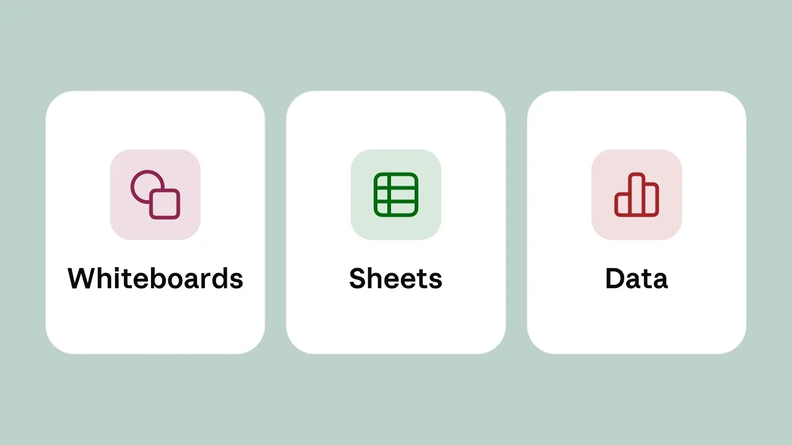

Claude Whiteboards, which Anthropic released in beta on November 10, 2026, puts a shared board inside Claude: you talk through a messy plan, Claude lays it out as groups, steps and a timeline with owners and dates, and your team edits the same board live. It is available on Claude's paid plans, on the web, desktop and mobile apps, alongside two other new artifact types, Claude Sheets and Claude Data.

For teams that already run retros and planning sessions in Miro or FigJam, the official pages answer how to use Anthropic's board but not how it compares. This guide does that from each vendor's current documentation: who can use the AI features, how usage is billed, where the AI gets its context and how a board leaves each tool. It then walks through a first session in Claude and lists the settings that hide Whiteboards from some accounts.

## Claude Whiteboards vs Miro AI vs FigJam AI {#claude-whiteboards-vs-miro-figjam}

Claude Whiteboards is the better first stop when the plan starts as a conversation with Claude, because the board, the chat and the follow-up document share one context. Miro AI and FigJam AI are better homes for boards that already exist, need templates and integrations, or have to pull live context from other tools. The table lines up what each vendor documents as of mid-November 2026.

| | Claude Whiteboards (beta) | Miro AI | FigJam AI |
|---|---|---|---|
| Plans with AI | Pro, Max, Ultra, Team, Enterprise; not Free | All plans, including Free, with a monthly credit allowance | Professional, Education (not K-12), Organization, Enterprise |
| How AI use is metered | Counts toward your normal Claude usage limits | Pooled AI credits: 25/month on Free, 25 per license on Starter, 50 per license on Business | Included with paid plans; Figma's FigJam AI guide describes no per-action meter |
| Build a board from a prompt | Yes, from any chat or the Artifacts tab | Yes (board layout, diagrams; 5 credits each) | Yes (boards, flow charts, timelines, Gantt charts) |
| Voice input | Dictation in 25 languages, following the browser language | Dictation, 1 credit each | Not listed among FigJam AI tools |
| Group and summarize notes | Claude regroups the board by theme and drafts action items | Sticky-note actions and Sidekick agents | Sort or summarize a selection of stickies |
| Context the AI can use | Only what is on the board at launch | Board objects; connectors to other tools announced at Canvas 26 | Selected stickies and prompt text |
| Getting a board out | Doc or deck in Claude, Send to Lucid, Miro or Zoho Vani, PNG export | Native Miro boards, Docs and Slides | Native FigJam files |
| Model and data path | Anthropic's Claude | Miro AI; Business plans can pick the model for custom Sidekicks | Figma sends prompts to OpenAI, which does not train on them |

*Sources: Claude Help Center, "Get started with Claude Whiteboards"; Miro Help Center, "Miro AI credits" and "Sidekicks overview"; Figma Learn, "Use AI tools in FigJam". Read November 15, 2026.*

Three differences decide most choices.

**Context.** Anthropic's guide says that at launch "Claude works from what's on the board and doesn't use context from your connected apps." Claude's chat can reach other tools through [MCP connectors](/tutorials/stateless-mcp-agent-gateway/), but a whiteboard cannot use them yet. Miro is moving the other way: its Sidekicks take context from board objects, and its Canvas 26 announcements describe connectors to Slack, GitHub, Amplitude and others. If your plan depends on live tickets or metrics, Miro keeps them closer to the board.

**Cost.** Claude has no separate meter for whiteboards. A long board session draws on the same allowance as your chats, documents and code. Miro prices each AI action. A generated diagram or board layout costs 5 credits, a sticky note 1 and a dictation 1, and when the team's pooled balance runs out, AI actions pause until it refreshes. FigJam's AI tools come with paid Figma seats.

**Handoff.** Anthropic built Claude's board as a starting point. When the structure settles, Claude turns it into a doc or deck, or Send to moves it into Lucid, Miro or Zoho Vani. There is no import in the other direction: the Help Center says you can add pictures and videos to a board, "but you can't import a board from a file." A team that keeps its retros in Miro can draft in Claude and send the result over, but it cannot bring last quarter's Miro board into Claude.

### Claude Whiteboards or Miro: which to use

Use Claude Whiteboards when one person or a small group is thinking out loud, the source material can be pasted in, and the output you want is a written plan. Keep Miro or FigJam for recurring workshops built on templates, boards that regularly include people outside your company, and work that depends on connected-tool context. (Claude boards can take outside guests by email invite, but on Team and Enterprise an admin has to allow it first.) For mixed teams the practical path is to start the draft in Claude and send it to the board everyone else already uses.

## Claude Whiteboards Pricing and Usage Limits {#claude-whiteboards-pricing-usage}

Claude Whiteboards has no price of its own. It comes with the Pro, Max, Ultra, Team and Enterprise plans during the beta, and the Help Center says it "counts toward your plan's usage limits, like the rest of your work with Claude." The cost of a board is therefore the share of your Claude allowance it uses. Our [Claude Fable 5.2 guide](/tutorials/claude-fable-5-2/) covers the newest model's prices and how usage limits reset.

One exception applies to boards made during a call. According to [VentureBeat's report on Claude Meetings](https://venturebeat.com/technology/anthropic-brings-claude-into-google-meet-to-draft-documents-and-whiteboards-during-your-meetings), documents, whiteboards and other materials Claude creates in a meeting are free to use until February 10, 2027, separate from the notes and transcripts included during the Meetings beta.

## How to Use Claude Whiteboards for a Retro or Planning Session {#how-to-use-claude-whiteboards}

To use Claude Whiteboards, ask for a board in any chat or pick the Whiteboard tile in the Artifacts tab, paste in the facts, talk through the plan, then have Claude regroup it and turn it into a doc. The steps below follow Anthropic's Help Center guide, plus one addition that matters because the board cannot read your other apps.

1. **Start the board.** In any chat, ask for one, for example "Start a whiteboard to plan our product launch" or "Put the options for this decision on a whiteboard, with the trade-offs of each." You can also open the Artifacts tab and pick the tile labeled "Whiteboard." Every board is saved in the Artifacts tab.
2. **Paste the facts first.** Because Claude only works from what is on the board, put in the material it should reason over: last sprint's issues, the launch dates, the budget lines. Otherwise the timeline it drafts rests on guesses.
3. **Talk through the plan.** Select the microphone next to the send button and describe the plan, the options or the messy process. Claude groups related ideas, puts steps in order and connects the ones that depend on each other. Press Escape or select the microphone again to stop; the text stays in the box until you send it. Typing and sketching also work.
4. **Reshape it.** Ask Claude to regroup the board by theme or turn it into a timeline. For a retro, have everyone add notes, then ask Claude to group them by theme and draft action items for each person, which is Anthropic's own example.
5. **Find the gaps.** Ask what is missing between two steps. Claude adds its suggestions to the board for you to check instead of rewriting the plan.
6. **Zoom in on one part.** Drag across a region of the board and ask about just that section.
7. **Bring the team in.** Click Share. Everyone edits live, and you can follow a teammate around the board to see what they are looking at.
8. **Turn it into the next thing.** Ask "Turn this board into a project plan" for a doc or deck, use Send to for Lucid, Miro or Zoho Vani, or go to Share > Export and choose PNG.

Dictation follows your browser's language and covers 25 languages, among them English, Spanish, Hindi, Japanese, Korean and Simplified Chinese. If voice is how your team plans, that is also where Claude's board and Miro differ in cost: each Miro dictation spends a credit, while Claude's counts toward the plan allowance. For background on what it takes to run AI on live speech, see our explainer on [real-time voice agents](/tutorials/real-time-voice-agents-distributed-systems/).

## Claude Whiteboards with Sheets, Data and Meetings {#claude-whiteboards-sheets-data-meetings}

A whiteboard is one of several artifact types in Claude, next to documents, slide decks, designs and the two that launched with it: Claude Sheets, a spreadsheet Claude builds and edits with you, and Claude Data, the renamed Claude Dashboards, which reached general availability the same day. Anthropic's second launch post says that "since Claude carries the same context through every step, an idea can carry over from a whiteboard to a spreadsheet to a dashboard, without the need to reiterate the details."

*The three artifact types Anthropic launched on November 10, 2026. Source: Anthropic, "Introducing Claude Whiteboards, Sheets, and Data" launch video.*

That is the pitch for keeping the board in Claude: a launch plan drafted on a board can become a tracker in Sheets without restating the details. Sheets has the same kind of exit as the board: export to .xlsx or CSV, or continue in Airtable, Asana, monday.com or Smartsheet.

Claude Meetings, which began rolling out in beta on November 12 for Team and Enterprise plans with Google Meet as the first platform, brings the board into calls. In Anthropic's event-planning example, a team asks Claude to map the schedule on a whiteboard and then adjusts it while the meeting continues. Teammates can edit what Claude produces during the call, and the board ends up on the meeting page with the notes and transcript.

## Claude Whiteboards Not Showing Up: Plan and Admin Settings {#claude-whiteboards-not-showing}

If you cannot find the Whiteboard tile or Claude does not offer to start a board, check these in order. Each comes from Anthropic's Help Center or launch post.

- **Plan.** Whiteboards is not on the Free plan. It is in beta on Pro, Max, Ultra, Team and Enterprise.
- **Enterprise admin setting.** On Team plans it is on by default. On Enterprise plans it is off by default until an admin turns it on in Organization settings > Artifacts. The same page controls whether members can invite people outside the organization by email.
- **Claude for Teachers.** Whiteboards is not available there yet.
- **HIPAA-ready configurations.** Organizations set up as HIPAA-ready do not get Whiteboards.
- **Zero data retention.** In organizations with zero data retention for Claude Code, Whiteboards works in chat and Cowork, is not covered by zero data retention, and does not appear in Claude Code.
- **Platform.** It runs on the web, Claude Desktop and Claude Mobile, so the tile should appear on all three once the plan and settings allow it.

Settle the HIPAA and zero-data-retention questions before a team adopts it, because they decide which kinds of data can go on a board. If you are drawing up rules for which internal systems AI tools may touch, our piece on [AI agents with internal access](/tutorials/ai-agent-internal-access-security-boundary/) covers the identity and permission questions, and [model gateways as an enterprise control plane](/tutorials/model-gateway-enterprise-ai-control-plane/) covers routing and audit. For the developer side of Anthropic's November releases, see our guide to [Dreams memory for Claude Managed Agents](/tutorials/claude-dreaming/).

## References {#references}

1. Anthropic, [“Introducing Claude Whiteboards, Claude Sheets, and Claude Data”](https://claude.com/resources/articles/sheets-whiteboards-data), November 10, 2026.
2. Anthropic Help Center, [“Get started with Claude Whiteboards”](https://support.claude.com/en/articles/18324319-get-started-with-claude-whiteboards), updated November 2026.
3. Anthropic, [“More ways to work with Claude: Sheets, Whiteboards, and Interactive Connectors”](https://claude.com/resources/articles/more-ways-to-work-with-claude-sheets-whiteboards-and-interactive-connectors), November 10, 2026.
4. Miro Help Center, [“Miro AI credits”](https://help.miro.com/hc/en-us/articles/19756209116178-Miro-AI-credits) and [“Sidekicks overview”](https://help.miro.com/hc/en-us/articles/29902701849618-Sidekicks-overview), retrieved November 15, 2026.
5. Figma Learn, [“Use AI tools in FigJam”](https://help.figma.com/hc/en-us/articles/16822138920343-Use-AI-tools-in-FigJam), retrieved November 15, 2026.
