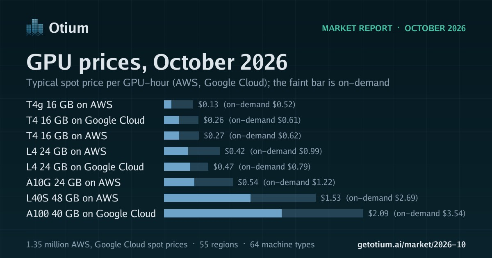
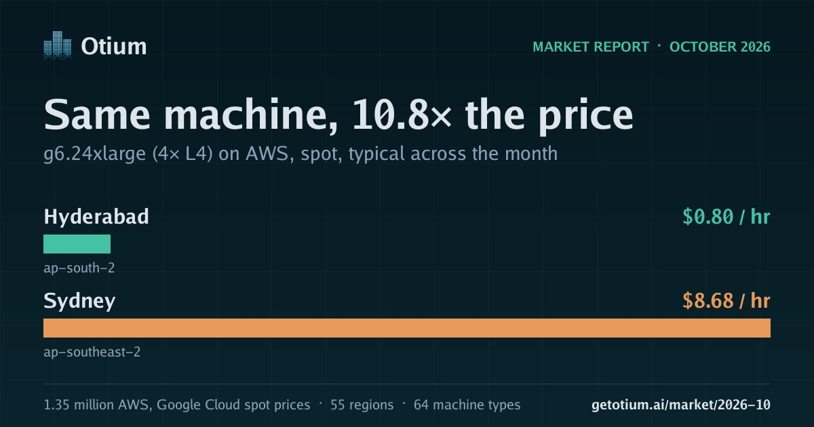
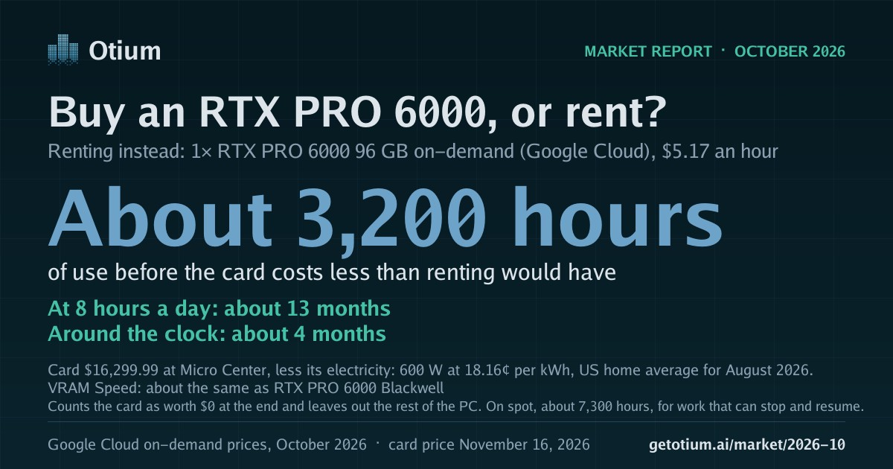

Cloud GPU prices mostly held still in October 2026, with one exception that matters to anyone renting for AI work: the H100. On AWS spot, a typical H100 80 GB hour cost $3.00, up 13% from September, while the A100 80 GB fell 12% to $2.82. That reversed September's oddity of an H100 renting for less than an A100. Ten of the 13 GPUs tracked moved less than 5%.

Those figures come from Otium's October market report, built from 1.35 million spot price readings on AWS and Google Cloud across 55 regions and 64 GPU machine types. Otium sells batch AI inference that waits for cheap compute, so it has a stake in watching these prices; its data is published under CC BY 4.0 with the method in full. This guide lays out what each cloud GPU costs per hour, how much spot saves, how AWS and Google Cloud compare, how hyperscaler list prices stack up against neocloud rates, and what the latest reporting on Nvidia's financing says about where H100 prices are heading.

## Cloud GPU prices per hour: H100, A100, L40S and L4 {#cloud-gpu-prices-per-hour}

In October 2026 a typical spot hour cost $0.42 for an L4, $1.53 for an L40S, $2.09–$2.22 for an A100 40 GB, $2.82–$2.91 for an A100 80 GB and $3.00 for an H100 on AWS. Each row below is the cheapest machine type for that GPU, divided by its GPU count and taken as the median across every region that sold it:

| GPU and cloud | Machine | Spot / GPU-hr | On-demand / GPU-hr | Spot discount | Daily swing | vs September |
|---|---|---|---|---|---|---|
| T4g 16 GB, AWS | g5g.xlarge | $0.13 | $0.52 | 66% | 2.8% | 0% |
| T4 16 GB, Google Cloud | n1-standard-4 | $0.26 | $0.61 | 56% | 2.8% | 0% |
| T4 16 GB, AWS | g4dn.xlarge | $0.27 | $0.62 | 59% | 5.0% | −1% |
| L4 24 GB, AWS | g6.xlarge | $0.42 | $0.99 | 60% | 6.2% | +1% |
| L4 24 GB, Google Cloud | g2-standard-4 | $0.47 | $0.79 | 40% | 2.0% | 0% |
| A10G 24 GB, AWS | g5.xlarge | $0.54 | $1.22 | 52% | 8.6% | +1% |
| L40S 48 GB, AWS | g6e.2xlarge | $1.53 | $2.69 | 50% | 11.9% | +2% |
| A100 40 GB, Google Cloud | a2-megagpu-16g | $2.09 | $3.54 | 40% | 2.0% | 0% |
| A100 40 GB, AWS | p4d.24xlarge | $2.22 | $3.29 | 36% | 6.0% | 0% |
| RTX PRO 6000 96 GB, Google Cloud | g4-standard-192 | $2.35 | $5.17 | 56% | 3.8% | +5% |
| A100 80 GB, AWS | p4de.24xlarge | $2.82 | $4.12 | 23% | 5.8% | −12% |
| A100 80 GB, Google Cloud | a2-ultragpu-1g | $2.91 | $5.54 | 47% | 1.2% | +2% |
| H100 80 GB, AWS | p5.48xlarge | $3.00 | $8.60 | 59% | 12.1% | +13% |

*Source: Otium, "AI compute market report: October 2026". Median per-GPU price across regions, Linux, before tax. The spot discount is the median of each region's own discount, so it will not match dividing the two medians. "vs September" compares only regions present in both months.*

*Spot against on-demand for the smaller GPUs, October 2026. The H100 and A100 80 GB rows are in the table above. Image: Otium, getotium.ai/market/2026-10, used with credit under its media kit terms.*

Readings were taken at least every half hour on AWS spot in 23 regions and at least once a day on Google Cloud in 32 regions, so a brief spike barely moves a median. October is also the first month to include Google Cloud and six more AWS regions, which is why an October price will not always equal September's printed price plus the change shown.

## GPU spot prices vs on-demand: how much the discount saves {#gpu-spot-prices-vs-on-demand}

GPU spot prices ran 23% to 66% below on-demand in October, and for the H100 on AWS the gap was 59%: $3.00 against $8.60 per GPU-hour. Spot is spare capacity the cloud can reclaim at short notice, so it fits training jobs with checkpoints, batch inference and evaluation runs that can stop and resume. Anything serving live traffic pays on-demand or a commitment.

Two numbers in the table decide whether spot is worth the effort for a given GPU:

- **The discount varies more than the list price suggests.** The A100 80 GB on AWS had the smallest discount at 23%, so its spot price of $2.82 sat close to the H100's $3.00 despite an on-demand price less than half the H100's. On Google Cloud the same A100 80 GB was 47% off.
- **The daily swing tells you whether timing matters.** Otium measures how far a typical day sat from the month's average. Under 2% is close to flat; over 10% means the day you rent changes the bill. The H100 (12.1%) and L40S (11.9%) on AWS crossed that line, while Google Cloud's A100 80 GB moved just 1.2%.

A published spot price is also a list price, with no promise of capacity behind it. Otium's method notes that a region that looks cheap may be one where spot machines had run out, so a low median tells you where to try first.

## H100 vs A100 vs L40S price: cheapest per hour and per GB {#h100-vs-a100-vs-l40s-price}

Per GPU-hour on spot, the L40S 48 GB at $1.53 was the cheapest card with more than 24 GB in October, about a third less than an A100 40 GB on AWS at $2.22. Per GB of GPU memory, which decides whether a model fits, Google Cloud's RTX PRO 6000 96 GB led the large cards at $0.025 per GB-hour:

| GPU (spot) | Memory | Spot / GPU-hr | Spot per GB-hr |
|---|---|---|---|
| RTX PRO 6000, Google Cloud | 96 GB | $2.35 | $0.025 |
| L40S, AWS | 48 GB | $1.53 | $0.032 |
| A100 80 GB, AWS | 80 GB | $2.82 | $0.035 |
| A100 80 GB, Google Cloud | 80 GB | $2.91 | $0.036 |
| H100, AWS | 80 GB | $3.00 | $0.038 |
| A100 40 GB, Google Cloud | 40 GB | $2.09 | $0.052 |
| A100 40 GB, AWS | 40 GB | $2.22 | $0.056 |

*Source: Otium, October 2026. Per-GB price is the spot price divided by GPU memory.*

Memory per dollar is only half the choice. Once a model fits, memory bandwidth sets how fast tokens come out, so a faster card can finish the same job in fewer billed hours. For a workload bound by memory capacity, such as hosting a large quantized model for low-traffic inference, the RTX PRO 6000 and L40S give the most room per dollar. For throughput-bound training or high-traffic serving, compare cost per finished job; our guide to [cost per successful task for coding agents](/tutorials/coding-agents-finops-cost-per-successful-task/) applies the same idea to model spend.

The month-on-month moves also changed the H100 vs A100 math. In September the H100 on AWS spot had been cheaper than the A100 80 GB. In October the H100 rose 13% and the A100 80 GB fell 12%, leaving the H100 about 6% more expensive per hour; the chart at the top of this page shows every GPU's move.

## Cloud GPU pricing: AWS vs Google Cloud, and the region gap {#cloud-gpu-pricing-aws-vs-google-cloud}

Cloud GPU pricing on AWS and Google Cloud was close for the GPUs both sell: of the four overlapping models, the widest spot gap was the L4 24 GB at $0.42 on AWS against $0.47 on Google Cloud, about 10%. The A100 40 GB went the other way, at $2.09 on Google Cloud and $2.22 on AWS. On-demand differed more: an A100 80 GB cost $4.12 per GPU-hour on AWS and $5.54 on Google Cloud, while Google's L4 on-demand rate of $0.79 undercut AWS's $0.99.

Where you rent mattered far more than which cloud. The same AWS machine, a g6.24xlarge with four L4s, cost 10.8 times as much on spot in Sydney as in Hyderabad:

*Same machine, 10.8 times the price: AWS g6.24xlarge spot, typical across October 2026. Image: Otium, getotium.ai/market/2026-10.*

Comparing each region's price for every machine against that machine's typical price, Otium found Stockholm (eu-north-1) the cheapest AWS region at 48% below typical, though its prices rose 12% from September. Hyderabad was 44% below typical, and Tokyo was the most expensive AWS region at 37% above. On Google Cloud, Seoul was 27% below typical and Dammam 37% above. A few machines show the spread directly: the 8× H100 p5.48xlarge was cheapest in Montréal and cost 4.6 times as much in its most expensive region.

Capturing those gaps means moving data, getting GPU quota in each region and shifting work when spot capacity disappears. The region gap pays off most for jobs that are easy to move: small inputs, containerized code and checkpoints that resume anywhere.

## H100 price: hyperscaler list prices vs neocloud rates {#h100-price-hyperscaler-vs-neocloud}

Neocloud H100 rates sat near $3 per GPU-hour on November 10, while the three big clouds' on-demand list prices worked out to roughly $6.88 to $12.29. USD.AI, a GPU lender, collected both sets of figures on November 10, 2026:

| Source | What it measures | H100 price per GPU-hour |
|---|---|---|
| Silicon Data SDH100RT | Neocloud rental index, adjusted to a benchmark contract | $3.06 |
| Ornn OCPI-H100 | Settled from executed compute trades (Ornn also sells compute) | $3.10 |
| AWS EC2 Capacity Blocks, P5 | Prepaid reserved capacity, published per GPU-hour (Nov 5) | $5.970 |
| AWS p5.48xlarge on-demand | 8-GPU instance at $55.04/hr (May 2026 list) ÷ 8 | ~$6.88 |
| Google Cloud a3-highgpu-8g | On-demand $88.49/hr ÷ 8; spot ~$6.59; 3-year commitment ~$4.86 | ~$11.06 |
| Azure ND96isr H100 v5, East US | Pay-as-you-go $98.32/hr ÷ 8 | ~$12.29 |

*Source: USD.AI, "H100 Rental Price: Neocloud Indexes Vs Hyperscaler List Prices in November 2026". Per-GPU figures for 8-GPU instances are calculated by dividing by eight.*

These list prices and Otium's medians measure different things. Otium's $8.60 for AWS on-demand H100 is the October median across regions, while USD.AI's $6.88 is a single May list price, so the two should not be read as a price change. Both sources point the same way: H100 spot on AWS and the neocloud index readings both land around $3 per GPU-hour, and hyperscaler on-demand list prices run two to four times higher.

## Why cloud GPU prices are rising for the H100 {#why-cloud-gpu-prices-are-rising}

H100 rental prices rose through 2026 because providers raised them while capacity stayed tight. CoreWeave said on its August 11 earnings call that its July pricing changes lifted rates about 25% across SKUs and called its near-term capacity "effectively sold out." Nebius changed its prices for H100, H200, B200 and B300 machines on October 1, taking H100 on-demand from $3.85 to $4.50 per GPU-hour, according to USD.AI's summary. Otium's 13% October rise for H100 spot on AWS fits the same direction.

A second story has pulled the phrase "GPU prices" into the headlines this month. The Wall Street Journal reported on November 15 that Nvidia's interim CEO, Colette Kress, is expected to rein in the company's financing of AI customers, a pullback that Jensen Huang had already begun before he resigned on November 12. As summarized by The Next Web and TechSpot, the Journal's account says:

- Nvidia announced a financing programme in July, took part in a record 129 venture deals over the past year and lists $36 billion of off-balance-sheet AI cloud agreements, the backstops it gives neoclouds, in its latest quarterly filing.
- By summer, Huang told his finance team that big cloud providers planned to use other chips, leaving Nvidia committed to more wafers and memory from TSMC than it needed. Nvidia scaled back its commitment to an OpenAI data centre lease in August and paused some deals by the end of that month.
- At Nvidia's GTC conference in Berlin in October, Huang told neocloud chief executives to get customers to pay upfront. Two executives who heard him and one briefed on the remarks gave his words as: "You're not charging what you should be charging."

TechSpot's headline goes further, saying Nvidia "deliberately kept GPU prices high" by financing its own demand. That is TechSpot's reading of the Journal's reporting, and we could not read the Journal article itself. The documented parts are narrower: Nvidia was underwriting demand for its chips, it is now pulling that support back, and its former CEO pushed neoclouds to charge more. UBS analyst Tim Arcuri estimated that the pullback could take $50 billion or more out of the market.

For renters, the open question is which effect wins. Less Nvidia money could mean fewer new neocloud buildouts and tighter supply, or a surplus of chips that would otherwise have been absorbed by financed customers coming to market and pulling rates down. Otium's October data predates the Journal's report and Kress's appointment, so the November and December readings are the ones to watch. Custom chips are part of the same picture: the hyperscaler shift Huang described is the one behind accelerators like Google's [TPU 8i Max](/tutorials/tpu-8i-max/).

## Renting vs buying a GPU: the break-even hours {#rent-or-buy-gpu-cost}

Renting wins for occasional use and buying wins for steady use, and Otium's break-even table puts numbers on the line. It compares a card's electricity cost with the on-demand price of the cheapest cloud machine holding the same memory, counting the card as worth nothing at the end and leaving out the rest of the computer:

- **24 GB (RTX 3090 or 4090).** The nearest rental is an L4 at $0.99 an hour on-demand, against about 6–8¢ an hour of electricity. Each $1,000 spent on the card buys about 1,100 hours of renting, roughly 40 days around the clock. The L4 also reads memory about three times slower than either card, so the owned card does the same work in fewer hours.
- **96 GB (RTX PRO 6000 Blackwell).** Renting the same card on Google Cloud costs $5.17 an hour on-demand. Each $1,000 of card price pays for about 200 rental hours.

*Buy or rent: an RTX PRO 6000 at a Micro Center price of $16,299.99 seen November 16, 2026, against Google Cloud on-demand. On spot the break-even stretches to about 7,300 hours. Electricity at 600 W and 18.16¢ per kWh, the US home average for August 2026. Image: Otium, getotium.ai/market/2026-10.*

At about 3,200 hours, an RTX PRO 6000 that runs eight hours a day pays for itself in about 13 months; around the clock, in about four. If your work can stop and resume, compare against spot instead, which roughly doubles the hours. Electricity is counted at each card's rated maximum power, so a real bill is likely lower, and rates ran from 12.72¢ per kWh in Nevada to 47.18¢ in Hawaii. For what owning looks like at the top end, our walkthrough of [serving GLM-5.3 NVFP4 on two DGX Stations](/tutorials/glm-5-3-nvfp4/) covers a 464 GB model on local hardware, and the [Qwen 3.8 27B local setup](/tutorials/qwen-3-8-27b/) uses a 17 GB build that fits within a 24 GB card's memory.

If you rent this month, the practical order is: pick the card by memory first, check whether the job can tolerate spot, then shop regions for short jobs. Treat the H100 as the GPU most exposed to price moves right now, and if a cheaper A100 80 GB or L40S fits the model, it was the better buy in October.

## References {#references}

1. Otium, ["AI compute market report: October 2026"](https://getotium.ai/market/2026-10), data CC BY 4.0, read November 17, 2026.
2. USD.AI, ["H100 Rental Price: Neocloud Indexes Vs Hyperscaler List Prices in November 2026"](https://usd.ai/blog/h100-rental-price), November 12, 2026.
3. The Next Web, ["Nvidia's new boss is expected to rein in its AI financing, WSJ reports"](https://thenextweb.com/news/nvidia-financing-kress-neoclouds-upfront-payments), November 16, 2026.
4. TechSpot, ["Nvidia deliberately kept GPU prices high through circular financing deals, report claims"](https://www.techspot.com/news/114558-nvidia-deliberately-kept-gpu-prices-high-through-circular.html), November 14, 2026.
