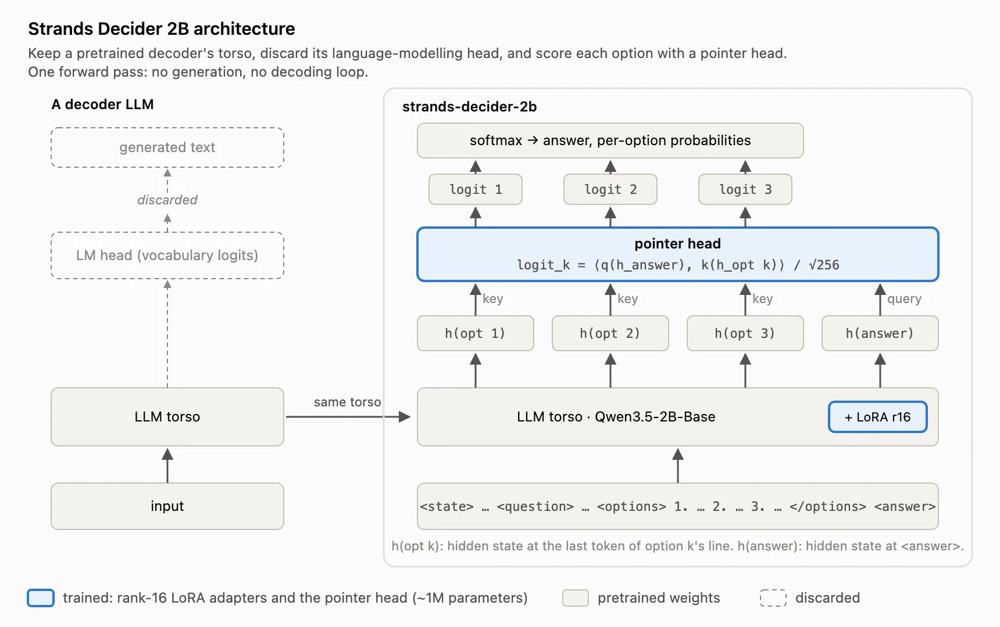
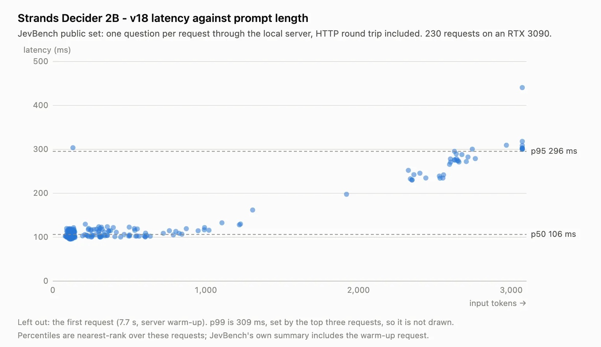
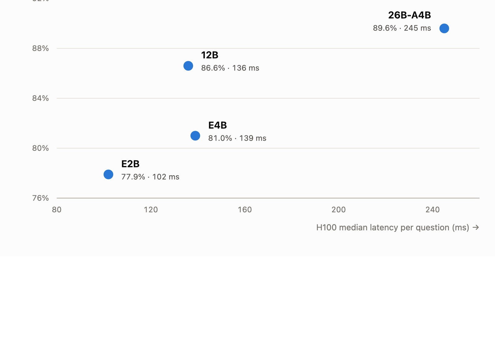

A **decision model vs LLM** comparison now has a production price tag. A team at Amazon swapped Claude Sonnet 4.6 for **Strands Decider** E4B in an internal ticketing system that labels escalations, capacity requests, alarms and security findings into 20 categories. At published us-east-1 list prices, labeling a million tickets went from about $22,200 to about $500. The team says the smaller model also beat production Sonnet on a separate ticket set, though it published no accuracy figures.

The saving comes from what the model is allowed to do. Sonnet read a long system prompt and wrote a JSON answer for every ticket. The decision model reads the ticket and a short list of label options, then returns a probability for each option and a confidence score. It cannot write a sentence, and that constraint is what made this job cheap.

## Decision model vs LLM for ticket classification

For a fixed label set at high volume, the decision model did the same job for about 2% of the list-price cost. The Strands blog post by Carr Onstott and Mehul Jaiswal frames the ticket as the model's state and the label catalog as its options. The LLM was doing classification with a text generator. The decision model only does the classification.

| | Claude Sonnet 4.6 (Bedrock) | Strands Decider E4B (SageMaker) |
|---|---|---|
| Output | JSON answer with reasoning, ~170 tokens | One choice, 1 output token |
| Input per ticket | 6,554 tokens | 2,009 tokens |
| Average time per call | 4,215 ms | 897 ms |
| Pricing basis | $3 per 1M input, $15 per 1M output tokens | $1.408 per instance-hour |
| Cost per ticket | $0.0222 | about $0.0005 |
| Per million tickets | about $22,200 | about $500 |
| Reliability score | Not offered by frontier LLM APIs, per Strands | Confidence per decision |

*All figures from the Strands blog's Nov 9, 2026 post. Costs are list-price calculations, not invoices, and exclude the Lambda function that calls either model.*

Amazon's ticket labeling is the kind of task this site covered when [Google shipped a hosted decision endpoint](/tutorials/gemini-decisions-api/): closed questions, many calls, and a need for a confidence number before acting.

## Strands Decider E4B vs Sonnet 4.6: cost and latency

Most of the cost gap comes from tokens. Total tokens per ticket fell 70%, from 6,724 to 2,010, and nearly all output tokens disappeared: Sonnet wrote about 170, the decision model returns one choice. At Bedrock's $15 per million output tokens, those JSON answers were the expensive part of each call.

The Decider side is priced by the instance-hour, so its cost depends on how busy each GPU stays. The team served E4B on SageMaker ml.g5.xlarge instances, one NVIDIA A10G with 24 GB each, at $1.408 an hour. The model used about 19 GiB and took about 640 ms per request. That works out to roughly 5,600 tickets an hour per instance, or $250 per million tickets at full use. They keep headroom for bursts, which puts the real figure near $500 per million. Self-hosting changes the cost model from per token to per busy GPU-hour, the same trade [Revolut made when it moved coding work to self-hosted GLM](/tutorials/glm-for-coding/). Against Sonnet's $0.0222 per ticket, that is about 44 times cheaper.

Latency fell too. Average time per call dropped 78%, from 4,215 ms to 897 ms. The post calls the yearly saving "millions of dollars of token costs" without giving ticket volume, so the absolute number cannot be checked from outside.

Hacker News readers raised two fair points. Two percent of a very large bill is still real money, and an older generation of ticket classifiers did this job without any language model: one commenter cited Linnaeus, an SVM-based issue classifier presented at ICSE 2021. A decision model sits between the two. It keeps a pretrained language model's reading ability but answers in a classifier's format.

## How a decision model differs from an LLM

A decision model is a language model with its text generator removed. Strands Decider 2B takes a Qwen3.5-2B torso, drops the LM head, and adds a small pointer head that scores the hidden state at each option against the hidden state at an `<answer>` position. Every option is scored in one parallel pass, so there is no token-by-token decoding.

*Figure 1: Strands Decider 2B architecture. Source: Strands Agents, "Introducing Strands Decider 2B" (Oct 1, 2026).*

The Strands team lists the trade in its launch post. Decision models are faster and more capable at a given size, always answer from the offered options, and attach a reliability score to each decision. They are significantly worse than reasoning models on complex problems, and they cannot do coding, chat or summarization. Asking several questions about the same input is cheap, because the input is read once.

The models accept three question types. `noul` returns the probability that a statement is true. `choice` picks one option and returns a probability for each. `score` returns an expected value over ordered labels. Amazon's ticket labeler used a single `choice` question. Strands credits TypeSafe AI's Jev with drawing attention to the category; [Jev uses the same typed-question design to pick browser actions](/tutorials/jev-ultrafast-browser-agent/), which is the closest comparison for anyone weighing Strands Decider vs Jev.

## How to move an LLM classifier to a decision model

The swap took four changes beyond the model ID, done in this order.

1. **Rewrite the labels as options.** The production label descriptions alone were longer than Strands Decider's 4,096-token window. The team rewrote each of the 20 labels as a one- or two-sentence criterion and sent them as options of one `choice` question, plus a "none" option. Ticket data stayed the same, except that long tickets drop their oldest comments to fit.
2. **Pick a size on your own tickets.** They started with Strands Decider 2B. The Gemma 4 E4B build scored clearly better on their ticket test set, so they switched.
3. **Tune the confidence threshold.** Each answer comes with a confidence value. The team set how confident the model had to be before a label was applied. The Gemma 4 release notes say the calibration temperatures were fit on short held-out classification tasks, so the threshold has to be tested on real traffic.
4. **Run both models on live traffic.** The labeling Lambda reads a three-way switch from AWS AppConfig on every message. `BEDROCK` sends every ticket to Sonnet only. `DUAL` calls both in parallel, applies Sonnet's label and logs the comparison. `DECIDER` sends every ticket to Strands Decider only. Going back took a 45-second config change.

The authors say the switch is the part they would copy regardless of model: judging every disagreement on real traffic told them more than any offline eval. The surrounding stack is standard AWS. Ticket events land in SQS, trigger a Lambda that calls a SageMaker endpoint, and CloudWatch carries logs and alarms. If you route model calls through a gateway, the same three-way switch belongs there; this site's piece on [model gateways as the enterprise control plane](/tutorials/model-gateway-enterprise-ai-control-plane/) covers that layer.

One bug is worth checking before any comparison. Sending the same content with JSON keys in a different order moved the output probabilities by up to 0.19. Amazon now sorts keys on every request. If you serve a decision model behind an API, fix key order before you compare runs.

*Figure 2: Decision latency vs task size for Strands Decider (v18) on a local RTX 3090. Latency grows roughly linearly with tokens, which is why trimming label text pays off. Source: Strands Agents, "Introducing Strands Decider 2B".*

## Decision model benchmarks: which size to start with

Start with the smallest model that clears your own test set; Strands recommends E2B first, then E4B and 12B before 26B-A4B. The Gemma 4 family comes in four sizes that accept the same questions, so you can switch without rewriting prompts. On JevBench v1's 231 public tasks with a 4,096-token window, Strands reports:

| Model | JevBench v1 accuracy | Brier score (lower is better) | Median latency, one H100 |
|---|---|---|---|
| E2B | 77.9% (180/231) | 0.313 | 102 ms |
| E4B | 81.0% (187/231) | 0.243 | 139 ms |
| 12B | 86.6% (200/231) | 0.173 | 136 ms |
| 26B-A4B | 89.6% (207/231) | 0.162 | 245 ms |

*Source: Strands Agents, "Strands Decider adds four Gemma 4 models" (Oct 15, 2026). Vendor-run results; JevBench has since moved to newer releases, so compare only against runs on the same task set.*

*Figure 3: JevBench v1 accuracy vs median latency per question on one H100. Source: Strands Agents Gemma 4 release post.*

Amazon chose E4B, the second-smallest size, and its H100 latency in this table is about the same as 12B's. Those benchmark latencies were measured on an H100. Amazon's ~640 ms per request on an A10G instance is a different number from a different stack, and the Strands team asks readers to measure end-to-end latency on their own serving setup.

## When an LLM should keep the job

Keep the LLM if your labels need written explanations, if the catalog changes weekly, or if the useful context does not fit in a few thousand tokens. Those are the Amazon authors' own limits. Their job worked because it was a closed choice from a known catalog, volume was high, and the old path's latency mattered.

The Strands launch post adds the model-side limits: decision models are worse than reasoning models on complex, multi-step problems, and the Gemma 4 post says they struggle with long documents that need several reasoning steps. A hybrid is the pattern Strands describes for agents: an LLM takes the hard calls and a decision model handles the rote ones. That is the same cost logic behind [measuring coding agents by cost per successful task](/tutorials/coding-agents-finops-cost-per-successful-task/).

For a team running an LLM classifier today, the cheapest test is the one Amazon ran: rewrite the labels as short options, run a decision model in parallel on real traffic, and read every disagreement before moving any traffic.

## References

1. Carr Onstott and Mehul Jaiswal, Strands Agents Team. "[Amazon saves millions by replacing Sonnet 4.6 with Strands Decider](https://strandsagents.com/blog/amazon-saves-millions-replacing-sonnet-with-strands-decider/)." Nov 9, 2026.
2. Marc Brooker, Mike Chambers and Fabio Nonato de Paula. "[Introducing Strands Decider 2B: a small, open source, decision model](https://strandsagents.com/blog/introducing-strands-decider/)." Oct 1, 2026.
3. Tim Moreton. "[Strands Decider adds four Gemma 4 models](https://strandsagents.com/blog/strands-decider-gemma-4-models/)." Oct 15, 2026.
4. [strands-labs/strands-decider](https://github.com/strands-labs/strands-decider), training and inference code, Apache 2.0.
5. Hacker News discussion of the Amazon post, [item 50436640](https://news.ycombinator.com/item?id=50436640), Nov 2026.
