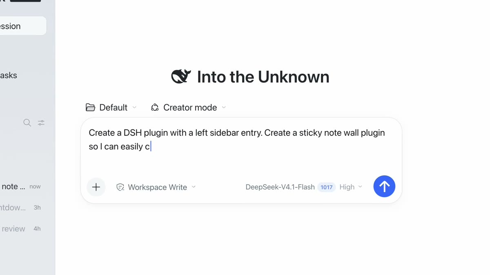
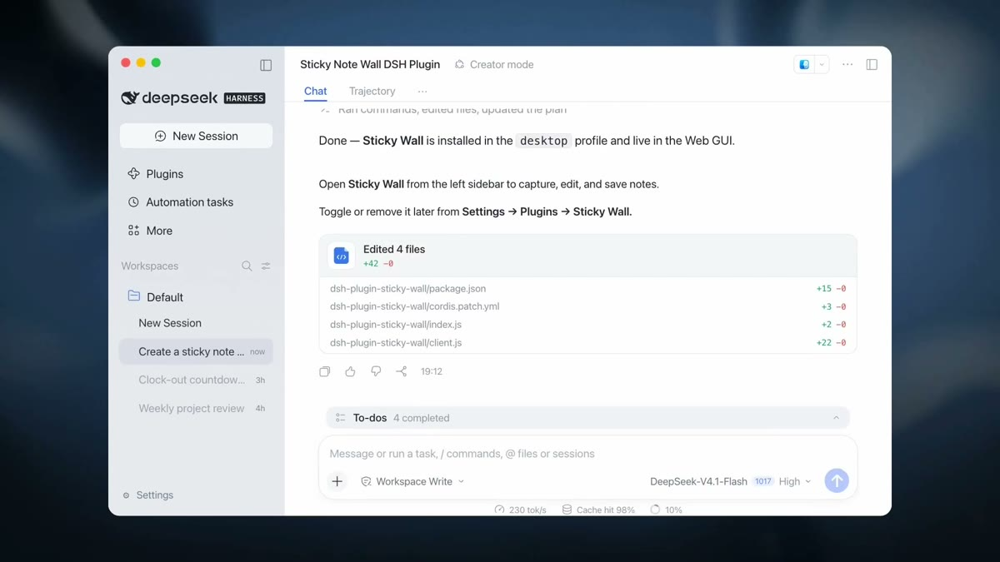
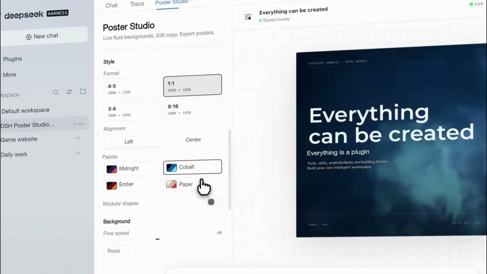
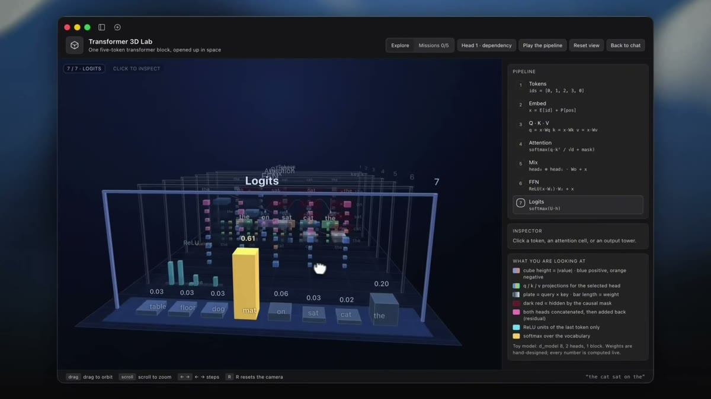

DeepSeek Harness Creator Mode lets the agent turn a prompt into a working DeepSeek Harness (DSH) plugin and install it into your profile. DeepSeek Harness introduced it on X on November 2, 2026 with the line "Your Harness. You Define It." and a 99-second demo that builds a design workspace, a sandbox game, and a 3D LLM visualizer. In the current source (`dsh-v0.2.2-rc.1`), the agent writes a plugin bundle, installs it with `plugin_manager`, and the result stays in the profile for every session until you disable or remove it.

| Question | Short answer |
|---|---|
| What is Creator Mode for? | Asking the agent to build, configure, or debug DSH plugins, including UI panels, tools, and MCP connections. |
| Do Creator Mode plugins persist? | Yes. Installed bundles survive restarts and apply to every session in the profile. |
| Does it need approval? | Every `plugin_manager` action needs danger-full-access permission or approval for that call. |
| Can I reproduce the demo plugins? | DeepSeek published English and Chinese prompts for them, noting a single prompt may not match the video exactly. |

DSH treats every capability as a plugin; the [DeepSeek Harness architecture guide](/tutorials/deepseek-harness-and-cordis-why-everything-is-a-plugin/) covers that runtime model.

## What Is DeepSeek Harness Creator Mode?

DeepSeek Harness Creator Mode is the agent preset for extending DSH itself. In the Web UI it appears in the mode picker beside Standard, and the plugin page offers "Let the agent create a plugin" with the hint "Enter Creator mode and make your own DSH plugin". Its internal preset id is still `cordis`, after the Cordis plugin framework DSH runs on.

*Creator mode selected in a new DSH session, with the sticky-note-wall prompt from the launch demo. Source: DeepSeek Harness video on X, November 2, 2026.*

The preset composes the everyday coding tools (shell, file editing, search, jobs, planning, subagents, web) and adds plugin work on top: the `plugin_manager` tool, two read-only runtime inspection tools, and a `cordis-plugin-development` skill that tells the agent how to author and install a bundle. When the user enables custom plugin indexes, Creator Mode also gets a read-only `plugin_market` tool for browsing them. The [DeepSeek Harness modes guide](/tutorials/deepseek-harness-modes-explained/) compares it with Standard, PTC, and Minimal.

## What Can Creator Mode Build?

Creator Mode builds plugins that add panels, tools, or connections to DSH, and the launch demo shows four kinds. Mashable's November 3 report lists a digital sticky-note wall, a poster design tool, and a Minecraft-like game; the video also shows a "Transformer 3D Lab" and a clock-out countdown session.

In the first demo, a prompt asks for "a DSH plugin with a left sidebar entry" and "a sticky note wall plugin". The agent reports that Sticky Wall is installed in the `desktop` profile and live in the Web GUI, lists four edited files, and points to **Settings → Plugins → Sticky Wall** to toggle or remove it.

*The Sticky Wall result: a plugin package of four files, installed into the profile. Source: DeepSeek Harness launch video.*

Those four files match the bundle layout in the source: `package.json` for the package, `cordis.patch.yml` for the plugin composition patch, `index.js` for the host entry, and `client.js` for the browser panel.

The design-workspace example is Poster Studio, a tab next to Chat with format, alignment, palette, and background controls and a live poster preview.

*Poster Studio, the design-workspace plugin from the demo. Source: DeepSeek Harness launch video.*

The 3D LLM visualizer is Transformer 3D Lab, which opens a toy five-token transformer block in space and steps through tokens, embeddings, Q·K·V, attention, FFN, and logits.

*Transformer 3D Lab, the "3D LLM visualizer" from the announcement. Source: DeepSeek Harness launch video.*

A follow-up post links an English and Chinese prompt collection for the plugins in the video. As quoted by Mashable, DeepSeek notes that "some plugins were refined through several rounds of conversation, so a single prompt may not reproduce exactly what you see in the video." The demo session runs on DeepSeek-V4.1-Flash with the Workspace Write permission.

## How Creator Mode Installs Plugins

Creator Mode installs a plugin by writing an ordinary package in the workspace and calling `plugin_manager` with `action: install_bundle` and the absolute package directory as `target`. DSH then adds the bundle to the current profile, runs the package install, and loads it.

The plugin-development skill sets the order of work:

1. Resolve the destination. A visual request that names no other destination becomes a Client plugin rendered in the current DSH Web page.
2. Discover only the APIs needed, with `cordis_inspect_list` and targeted `cordis_inspect_query` calls.
3. Copy a template (a UI decoration or an MCP bundle) into one workspace directory and edit it.
4. Install, then read the result's `application` field: `applied` means live, `restart-required` means saved but not yet active.
5. Exercise the capability and fix defects in the same plugin before finishing.

The skill tells the agent not to hand-edit the profile's `package.json` or `cordis.patch.yml`, and not to run pnpm in the profile directory; `install_bundle` does those steps. MCP servers use the same path. DSH's practice guide shows a prompt that configures a Streamable HTTP server as a configuration-only bundle inserting `@deepseek-ai/dsh-mcp-client`, after which the new tools appear in the running session when hot module reload (HMR) is on.

`plugin_manager` also lists, enables, disables, and removes plugins and bundles, so the same conversation can switch a plugin off or uninstall it. Standard mode has this tool too; PTC and Minimal do not.

## Runtime Inspection Tools {#runtime-inspection}

Creator Mode adds two read-only tools, `cordis_inspect_list` and `cordis_inspect_query`, so the agent reads exact APIs before writing plugin code. The list call returns every inspection provider on the host and connected browser page; the query call returns service methods, event modes, plugin config schemas, tool schemas, theme tokens, or live UI slot trees.

These tools cannot call business services or change the runtime. Browser-side queries need a connected page and time out with a reconnect hint otherwise. Persistent changes go through `plugin_manager`, which is why the skill has the agent confirm newly installed rows with an approval-free `cordis_inspect_query` instead of `list_plugins`.

## Creator Mode Plugin Lifecycle {#dynamic-package-lifecycle}

Creator Mode plugins now follow the normal installed-bundle lifecycle: install, enable or disable, update, and remove. An installed bundle survives process restarts and affects every session using that profile. On live profiles, changes apply immediately, including upgrades of installed packages. When a change is not applied, the result carries a `nextStep` telling the agent what to do or tell the user, such as a restart.

This replaced the lifecycle described in the August version of this guide. In `v0.1.0-rc.7`, Creator exposed `cordis_define`, `cordis_run`, `cordis_stop`, and `cordis_undefine`, which kept session-owned plugins in process memory only. A DSH design note dated September 16, 2026 records the change: generated-code define/run/stop/undefine tools are gone from the model's view, and Creator authors bundles as files and installs them. Old session cards that used the removed tools remain readable.

The `dsh-v0.2.2-rc.1` pre-release on November 4 adds related plugin-manager features: updates for third-party plugin packages with rollback if a hot update fails, Git installs over SSH with approval for prepare scripts, plugin icons in the session list, and rich-text plugin details.

## Creator Mode Approval and Security {#security-boundary}

Creator Mode plugins can run code with host permissions, so every `plugin_manager` action, including listing, requires danger-full-access or approval for that one call. Approval for one call does not change the session's permission mode. Package install scripts run only for names the user approves in the conversation, and that approval persists for the profile.

The design note gives the reason: profile changes can load code with host permissions and affect other sessions. It also notes that a full-access Standard session can install host code without a separate prompt, "as its shell already can". The older in-process runner's `node:vm` sandbox is documented as isolating globals without being a security boundary.

Plugins also carry version checks. A bundle whose `engines.dsh` or DSH peer requirements reject the running version is blocked, and an exemption requires the agent to warn about crashes and data loss and get explicit permission for that exact plugin and runtime pair. Plugin-market titles and descriptions are treated as third-party text, not instructions.

For operators, the practical rule is simple: grant Creator Mode the trust you would grant a shell on that machine, and review each install request.

## Host and Agent Planes {#host-plane-boundary}

Creator Mode plugins land on one of two planes. The host plane holds what exists once per process: registries, persistence, sandbox and approval, model routing, and subagent backends. An agent preset contributes per-session tools, persona, and prompt sections. A Creator bundle can add host entries, browser (Client) entries, or preset rows, and editing agent presets uses the separate `editing-cordis-compositions` skill.

The [Cordis composability write-up](/tutorials/cordis-spatiotemporal-composability/) explains how these scopes and lifecycles compose.

## When Should You Use Creator Mode?

Use Creator Mode when the task is changing DSH itself: adding a panel or widget, wiring an MCP server, enabling a shipped plugin that is off by default, or debugging an installed plugin. For ordinary repository work, Standard is the default, and [PTC Mode](/tutorials/deepseek-harness-ptc-mode/) fits programmatic multi-tool orchestration.

Before approving an install, check where the bundle came from, which install scripts it asks to run, and whether other sessions share the profile. For how DSH compares with other agent runtimes on extensibility, see [DeepSeek Harness vs Pi Agent](/tutorials/deepseek-harness-vs-pi-agent/), and the [DeepSeek topic page](/topics/deepseek/) tracks related releases.

## Creator Mode FAQ

### Do Creator Mode plugins survive a DSH restart?

Yes, in current builds. Plugins installed with `plugin_manager install_bundle` are saved to the profile and survive restarts. The in-memory plugins of `v0.1.0-rc.7` did not.

### Can I reproduce the plugins from the Creator Mode video?

DeepSeek published English and Chinese prompts for the demo plugins. It says some were refined over several rounds of conversation, so one prompt may produce a different result.

### Is Creator Mode safe or sandboxed?

Installed plugins can run with host permissions and affect every session in the profile. DSH gates each `plugin_manager` action behind danger-full-access or per-call approval; treat Creator Mode like shell access.

## References

- DeepSeek Harness, ["Meet Creator Mode in DeepSeek Harness"](https://x.com/deepseekharness/status/2117256196227019194), X, November 2, 2026.
- Amanda Yeo, ["DeepSeek Harness' new Creator Mode creates plugins from prompts"](https://mashable.com/tech/deepseek-creator-mode-plugins), Mashable, November 3, 2026.
- DeepSeek, [Creator mode installs persistent plugin bundles](https://github.com/deepseek-ai/deepseek-harness/blob/66491b05e3f05ad35bcdd4f6cd7ed26041d9e3db/.agents/notes/implemented/architecture/2026-09-16-creator-persistent-plugin-management.md), design note, dsh-v0.2.2-rc.1.
- DeepSeek, [cordis-plugin-development skill](https://github.com/deepseek-ai/deepseek-harness/blob/66491b05e3f05ad35bcdd4f6cd7ed26041d9e3db/packages/preset/agent-preset/skills/cordis-plugin-development/SKILL.md), dsh-v0.2.2-rc.1.
- DeepSeek, [Plugin Manager README](https://github.com/deepseek-ai/deepseek-harness/blob/66491b05e3f05ad35bcdd4f6cd7ed26041d9e3db/packages/boot/plugin-manager/README.md), dsh-v0.2.2-rc.1.
