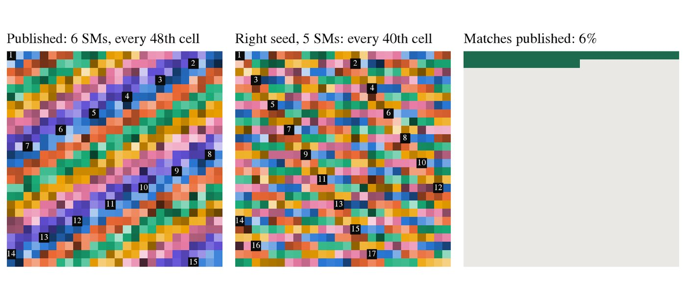
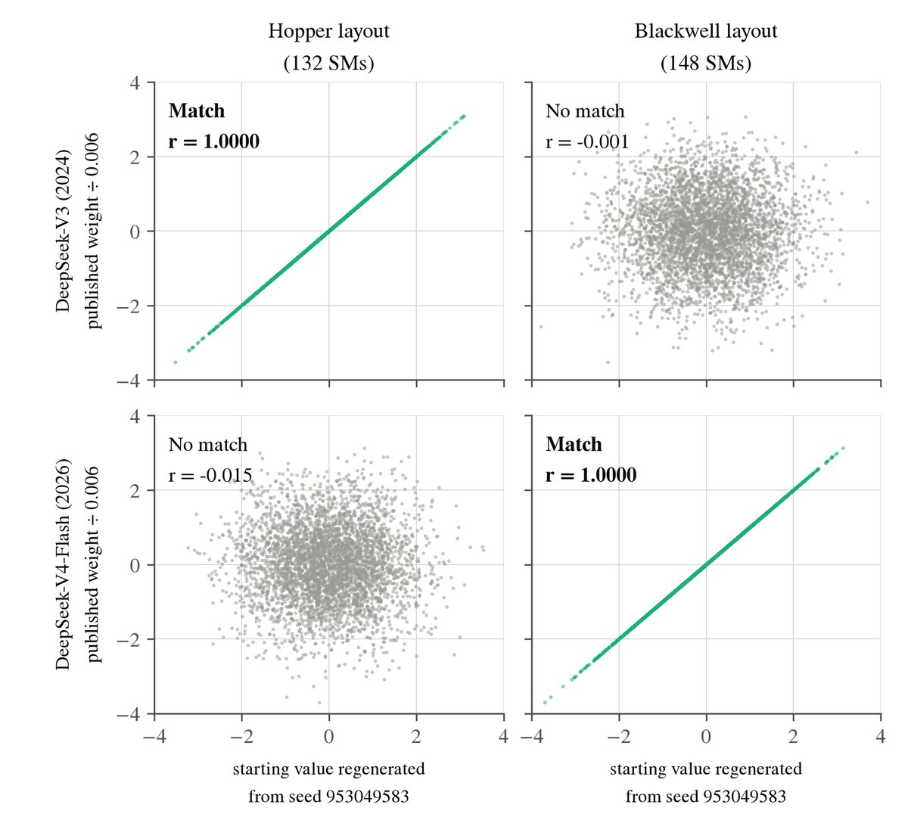
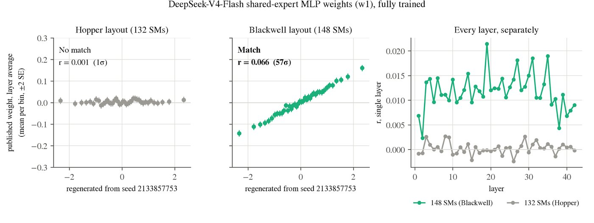
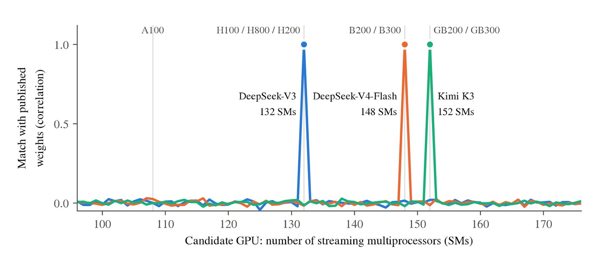

Did DeepSeek train its new models on NVIDIA Blackwell? Questions about DeepSeek NVIDIA Blackwell training have so far rested on unnamed sources and official statements. On November 12, 2026, Will DePue of Unemployment Labs published a report that uses the model weights themselves. The weights of [DeepSeek-V4-Flash](https://huggingface.co/deepseek-ai/DeepSeek-V4-Flash) carry a layout that matches Blackwell B200/B300 chips. DeepSeek-V3 matches the older Hopper generation.

The report says the evidence "supports, without proving" that Blackwell did the training. That distinction runs through everything below.

## Did DeepSeek use NVIDIA Blackwell to train DeepSeek-V4?

According to the report, the starting weights of both DeepSeek-V4 models were generated on Blackwell-class hardware:

| Model | Released | SM layout | Hardware class | Evidence strength |
|---|---|---|---|---|
| DeepSeek-V3 | Dec 2024 | 132 | Hopper (H800 / H100 / H200) | Exact copy, 239σ |
| DeepSeek-V4-Flash | Apr 2026 | 148 | Blackwell B200 / B300 | Exact copy, 1,385σ |
| DeepSeek-V4-Pro | Apr 2026 | 152 | Grace-Blackwell GB200 / GB300 | Partial survival, 49σ |

DeepSeek has disclosed H800s for V3. It has not disclosed the hardware for V4. All four Blackwell chips have needed a U.S. export license for China since before they shipped, and none has been reported. The V4-Pro reading is much weaker than V4-Flash because fewer of its starting values survived training.

DeepSeek is not alone. The report finds the same kind of match in Kimi K3 and Kimi K3.1-Pro from Moonshot AI (152 SMs, 305σ), MiniMax-M3 and M3.1-Flash (148 SMs, 323σ), and Ant Group's Ling-3.1-flash (152 SMs, 244σ). In each lab, earlier models read as Hopper.

## How do model weights reveal the GPU they were trained on?

Before training, every weight needs a starting value. PyTorch draws those values with a random-number generator called Philox, through NVIDIA's cuRAND library. The same seed always yields the same numbers, which makes experiments repeatable.

To fill billions of weights quickly, the work is split across GPU threads. On the chips examined, a large initialization uses 2,048 threads per streaming multiprocessor (SM). Each thread fills every Nth position, where N is the total thread count. A chip with a different number of SMs therefore puts the same numbers in different places.

*Same seed, different GPU size: in this toy example only 6% of positions still match. Figure: © Will DePue / [Unemployment Labs](https://unemploymentlabs.com/checkpoint-forensics).*

Real chips give three distinct totals:

| Hardware group | SMs | Threads used |
|---|---|---|
| Hopper H100 SXM / H200 / H800 | 132 | 270,336 |
| Blackwell B200 / B300 | 148 | 303,104 |
| Grace-Blackwell GB200 / GB300 | 152 | 311,296 |

So the layout can name a hardware group, but not a chip within it. A Hopper reading cannot tell an H800 from an H100.

Training changes most weights, but some never move. Rows reserved for tokens the model never sees keep their starting values almost exactly. The report found DeepSeek used the same seed, 953049583, for V3 and V4-Flash. Regenerating that seed under each layout gives a clean answer:

*Preserved rows: V3 lines up with Hopper, V4-Flash with Blackwell. Figure: © Will DePue / [Unemployment Labs](https://unemploymentlabs.com/checkpoint-forensics).*

Even trained weights keep a faint trace. Across 42 layers of V4-Flash, with 745,472 weights per layer, higher starting values still predict slightly higher final values under the Blackwell layout (r = 0.066, 57σ). Under Hopper the relationship disappears.

*A weak but measurable trace after training. Figure: © Will DePue / [Unemployment Labs](https://unemploymentlabs.com/checkpoint-forensics).*

## How strong is the evidence for the Blackwell fingerprint?

The author tested the claim several ways:

- **Held-out weights.** The seed and layout were chosen on one set of weights, then tested on another set that played no part in the search. Each model shows one clear peak, and other layouts score near zero.
- **Physical chips.** Using unmodified PyTorch, a B300 reproduced 461 of 469 selected V4-Flash rows with correlation above 0.99, 445 of them bit for bit. An H100 reproduced all 57,344 preserved V3 values bit for bit. Neither chip reproduced the other model. A GB200 reproduced 13 rows of Kimi K3.
- **Chance.** Searching about 6 trillion seed-and-layout combinations makes lucky matches likely, so the author uses about 8σ as the bar. The six Blackwell models score 49σ to 1,385σ, and the weakest single test reaches 20σ.
- **Known answers.** In all 24 cases where a developer named the hardware for a specific model, the reading agrees. Meta's Llama 3.1 reads as 132 (H100), and NVIDIA's Nemotron-3 Ultra, trained partly on GB200, reads as 152. The author calls this a consistency check, not a measured accuracy rate.

*One peak per model: V3 at 132 SMs, V4-Flash at 148, Kimi K3 at 152. Figure: © Will DePue / [Unemployment Labs](https://unemploymentlabs.com/checkpoint-forensics).*

There is one non-NVIDIA way to get these layouts. An AMD MI300X normally has 304 compute units but can be split into 152 or limited to 148. The author confirmed on a physical MI300X that this reproduces the "Blackwell" layouts. For V4-Flash, a small arithmetic difference between vendors settles it: in 377 values where AMD and NVIDIA differ, the weights match NVIDIA in 363 and AMD in none. For the other five models that test was inconclusive, and the author calls AMD "very unlikely" rather than excluded. The MI300X is also export-controlled.

## What are the limitations of checkpoint forensics?

The report is direct about what the method cannot do:

- **Initialization is not training.** The fingerprint shows which hardware generated the starting weights. A lab could create weights on one system and train elsewhere, or mix hardware. Huawei chips, for example, could have trained weights that NVIDIA chips initialized, and leave no trace.
- **Location and ownership are invisible.** Blackwell systems can be rented from data centers outside China. The report says its flags "are not a finding that any law was broken."
- **Open weights only.** Closed models cannot be checked.
- **Some stacks leave nothing.** Baidu's PaddlePaddle carries no chip layout; the seed for ERNIE-5.5 (2760) was recovered, but not its hardware. Models initialized on a CPU, such as several Qwen3 models, leave no GPU trace. No signature was found in DeepSeek-V4.1-Flash or Meituan's LongCat-2.0.
- **Hopper is a group.** Readings of 132 SMs fit H800, H100 SXM and H200 alike.
- **Not yet independently reproduced.** The scripts are available "to reviewers on request," not publicly.

That is why the conclusion is worded with care. The author calls the V4-Flash initialization evidence conclusive and says the other five are strong. Training on that same hardware is an inference.

## How does this fit earlier reports on DeepSeek and Blackwell chips?

The weights add technical evidence to claims that were previously unsourced:

- In December 2025, The Information reported that DeepSeek was using Blackwell chips. NVIDIA [rejected the claim](https://www.moneycontrol.com/technology/nvidia-rejects-claims-that-china-s-deepseek-is-using-smuggled-blackwell-chips-article-13722332.html) at the time.
- In February 2026, Reuters quoted a U.S. official saying DeepSeek trained a model on NVIDIA's best chip despite the ban.
- In June 2025, a DeepSeek engineer wrote that "we don't have SM100 GPUs" ([DeepGEMM PR 112](https://github.com/deepseek-ai/DeepGEMM/pull/112)). SM100 is Blackwell. V4 shipped ten months later.
- Ant Group's public [cuLA repository](https://github.com/inclusionAI/cuLA/blob/main/BENCHMARK_GB300.md) includes benchmark results run on a GB300 on March 31, 2026.

Not every lab has switched. The newest readable models from Alibaba (Qwen3.8), Zhipu (GLM-5.3), Tencent (Hy4-preview), Xiaomi (MiMo-V2.5-Pro) and StepFun (Step-5-Preview) all read as Hopper. If you run these models, as in our [Qwen 3.8 27B](/tutorials/qwen-3-8-27b/) or [GLM for coding](/tutorials/glm-for-coding/) guides, the finding does not change how they behave. It concerns how they were made.

## What would the training cost on Blackwell?

The report estimates each run from model size and training tokens, assuming 35% utilization over two to three months, and assuming the initializing hardware also did the training:

| Model | Blackwell GPUs, best estimate | Range |
|---|---|---|
| DeepSeek-V4-Flash | 1,000–1,500 | 250–4,500 |
| DeepSeek-V4-Pro | 2,000–2,500 | 750–6,000 |
| Kimi K3 | 2,000–3,000 | 1,000–8,000 |
| MiniMax-M3 | 500–600 | 200–2,000 |
| Ling-3.1-flash | 1,100–1,650 | 400–6,500 |

As a sanity check, the same arithmetic gives 2,000 to 2,500 chips for DeepSeek-V3, and DeepSeek disclosed 2,048. At about $70,000 per GPU, a price implied by a Wall Street Journal report on Blackwell chips in Malaysia, the largest cluster would cost $150 million to $200 million. These are rough bounds for the final runs only, not measured spending.

## What to watch next

Three things would move this from strong evidence to settled fact: an independent rerun of the seed search on public weights, a response from DeepSeek or NVIDIA to this specific report, and the forensic check applied to the next DeepSeek release. Until then, the safest reading is the report's own: Blackwell-class hardware created the starting weights of DeepSeek-V4, and probably trained it.

## References

- Will DePue, [Top Chinese Frontier AI Models Carry the Fingerprint of Export-Controlled NVIDIA Blackwell GPUs](https://unemploymentlabs.com/checkpoint-forensics), Unemployment Labs, Nov 12, 2026
- DeepSeek, [DeepSeek-V3 Technical Report](https://arxiv.org/abs/2412.19437), arXiv, 2024
- DeepSeek model weights: [DeepSeek-V3-Base](https://huggingface.co/deepseek-ai/DeepSeek-V3-Base), [DeepSeek-V4-Flash](https://huggingface.co/deepseek-ai/DeepSeek-V4-Flash), [DeepSeek-V4-Pro](https://huggingface.co/deepseek-ai/DeepSeek-V4-Pro)
- Other model weights: [Kimi K3](https://huggingface.co/moonshotai/Kimi-K3), [Kimi K3.1-Pro](https://huggingface.co/moonshotai/Kimi-K3.1-Pro), [MiniMax-M3](https://huggingface.co/MiniMaxAI/MiniMax-M3), [Ling-3.1-flash](https://huggingface.co/inclusionAI/Ling-3.1-flash)
- PyTorch, [DistributionTemplates.h](https://github.com/pytorch/pytorch/blob/main/aten/src/ATen/native/cuda/DistributionTemplates.h) (thread layout for random initialization)
- DeepSeek DeepGEMM, [pull request 112](https://github.com/deepseek-ai/DeepGEMM/pull/112), Jun 12, 2025
- Ant Group cuLA, [BENCHMARK_GB300.md](https://github.com/inclusionAI/cuLA/blob/main/BENCHMARK_GB300.md), Mar 31, 2026
- Moneycontrol, [Nvidia rejects claims that China's DeepSeek is using smuggled Blackwell chips](https://www.moneycontrol.com/technology/nvidia-rejects-claims-that-china-s-deepseek-is-using-smuggled-blackwell-chips-article-13722332.html), Dec 2025
- U.S. export licensing rule, [15 CFR 742.6](https://www.ecfr.gov/current/title-15/subtitle-B/chapter-VII/subchapter-C/part-742/section-742.6)
- Hacker News, [discussion of the report](https://news.ycombinator.com/item?id=50474883), Nov 2026
