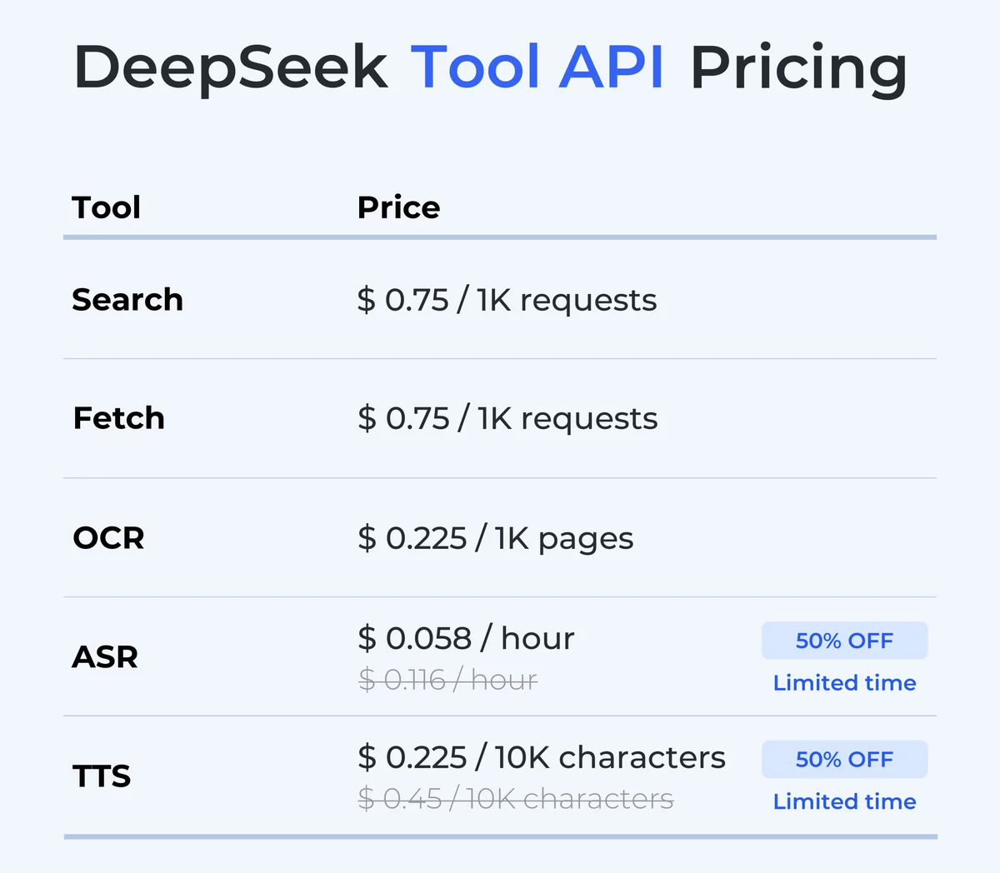

The DeepSeek web search API now comes in two forms. Since November 13, 2026, the `deepseek-flash` model can search the web inside an ordinary chat request: declare the `deepseek_web_search` tool and DeepSeek's servers run the searches, feed the results to the model and return an answer with citations. A second tool, `deepseek_read_url`, fetches the links a user pastes into a message. The standalone Search and Fetch endpoints, opened on October 17, still return raw results for code that wants to decide for itself what to search. Both paths bill $0.75 per 1,000 searches or page fetches on top of tokens.

The same release, which DeepSeek's change log calls "the full suite of application APIs," also put file parsing, a content safety switch, speech recognition and text-to-speech behind the API, with an open-source chat client as the reference build. This guide is for developers wiring search into a chatbot or agent on DeepSeek. It covers which path to pick, the request and response formats, how billing counts calls, and the 400 errors you are most likely to meet.

## DeepSeek web search API options: built-in tool, Search API or your own search {#deepseek-web-search-api-options}

Use the built-in `deepseek_web_search` tool when you want DeepSeek Chat's search behavior in your own chatbot with no search code of your own. Use the Search and Fetch API when your application decides the queries and only needs ranked results or page text. Keep your own search provider, called through ordinary function calling, when you need domain allow-lists or a model other than `deepseek-flash`.

| | Built-in web tools | Search and Fetch API | Your own search via function calling |
|---|---|---|---|
| Who decides to search | The model | Your code | The model asks, your code runs it |
| Who runs the search | DeepSeek's servers | DeepSeek's servers | Your provider (for example Brave, Tavily, Exa or SearXNG) |
| Model | `deepseek-flash` only | Any, or none | Any model that supports tool calls |
| What you get back | An answer with citations, plus display-only result blocks | JSON results with snippet, summary, optional page content, `rerank_score` and `authority` | Whatever your provider returns |
| Domain and date control | None: `allowed_domains`, `blocked_domains` and `user_location` return 400 | `site:`, `-site:`, `lang:`, `after:`, `before:` operators and a `localization` IP | Set by your provider |
| Price | $0.75 per 1,000 billed queries or page fetches, plus tokens | $0.75 per 1,000 successful requests | Your provider's price |

The split matters because the built-in tools hide the page text. A search result block carries the title, URL, snippet and publication date for display, while the content the model read travels in an encrypted field your client cannot decrypt. If you need to store, filter or re-rank what was found, call the Search API yourself.

The same per-call billing applies when an agent tool searches for you. DeepSeek's documentation says Search and Fetch calls triggered through [DeepSeek Harness](/tutorials/deepseek-harness-modes-explained/), Claude Code or Codex running on the DeepSeek API are billed per successful request, like direct calls.

## How to enable the deepseek_web_search tool {#enable-deepseek-web-search-tool}

To enable web search, add `deepseek_web_search` to `tools` in a request to `deepseek-flash`. Add `deepseek_read_url` as well if the model should open links the user pastes. The thinking setting picks the search mode: with thinking disabled the model runs ordinary web search, and with thinking enabled it runs deep thinking search, searching and opening pages over several reasoning steps.

The request below uses the Anthropic-compatible Messages endpoint and is taken from DeepSeek's quick example, with the safety check and automatic conversation title turned on:

```bash
curl https://api.deepseek.com/anthropic/v1/messages \
  -H "Content-Type: application/json" \
  -H "x-api-key: ${DEEPSEEK_API_KEY}" \
  -d '{
    "model": "deepseek-flash",
    "thinking": {"type": "enabled"},
    "tools": [
      {"type": "deepseek_web_search", "name": "deepseek_web_search"},
      {"type": "deepseek_read_url", "name": "deepseek_read_url"}
    ],
    "safety_check": {"level": "high"},
    "title": {"enabled": true},
    "messages": [{"role": "user", "content": "What is new in DeepSeek V4.1?"}],
    "stream": true
  }'
```

The same tools work on `POST https://api.deepseek.com/chat/completions` and `POST https://api.deepseek.com/responses`. In those two protocols the tool entries need only a `type`, and `safety_check` and `title` stay at the top level of the body. Chat Completions returns the tool calls in an extension field, `message.server_tool_calls`. A framework or gateway that strips unknown fields still gets an answer, but pages read in earlier rounds drop out of the context.

| Mode | Declare | Thinking | What the model does |
|---|---|---|---|
| Web search | `deepseek_web_search` | Disabled | Searches when the question needs it; one call can hold several queries |
| Deep thinking search | `deepseek_web_search` | Enabled | Searches, opens pages and finds text in pages, up to about 20 tool calls before answering |
| URL reading | `deepseek_read_url` | Either | Reads up to the first 10 distinct URLs in the last user message |

Image search is part of `deepseek_web_search`: when the user message contains an image, the model can search by image. The standalone Search API does not support image search yet.

A few rules shape how you build around the tools:

- The model always decides. Naming either tool in `tool_choice` returns 400, and `tool_choice: none` switches off every tool, link reading included.
- With thinking enabled and both tools declared, links in the message are opened as part of deep thinking search.
- When these tools, `safety_check: high` or `title` are on, DeepSeek sets sampling itself. It ignores `temperature`, `top_p` and similar parameters, and `max_tokens` limits each inference step rather than the whole answer.

DeepSeek's open-source [chat-demo](https://github.com/deepseek-ai/chat-demo) client shows one way to wire the switches. It always declares `deepseek_read_url`, adds `deepseek_web_search` only when the user turns on Search, and sends `safety_check: high` on every request.

## DeepSeek web search response blocks and citations {#deepseek-web-search-response-blocks}

A web search response interleaves four kinds of content: `thinking` blocks, a `server_tool_use` block for each search or page open, a result block for each call, and `text` blocks that carry `citations`. The screenshot at the top of this page, taken from DeepSeek's Build a Chatbot guide, maps each one to the matching element of the DeepSeek Chat interface, which is a fair template for your own UI.

| Block | What it holds | Show it as |
|---|---|---|
| `server_tool_use` | The action (`search`, `open_page`, `find_in_page` or `read_link`), its queries or URL, and a `kind` naming the capability | A search step |
| `web_search_tool_result` | Results with title, URL, snippet, site name, site icon and `page_age`; the page summary is encrypted | Source cards |
| `web_fetch_tool_result` | URL, title and publication date of a page that was opened or read; the text is empty and the page travels encrypted in `signature` | "Read N pages" |
| `text` with `citations` | The answer; each citation gives the URL, title and the answer text up to the citation mark | Answer with numbered links |

When streaming, tool blocks arrive whole in `content_block_start` rather than as deltas. With thinking enabled, the usage in `message_start` covers only the first inference step, so read the billed totals from the final `message_delta`.

Multi-turn conversations need two habits. Send the full history every time and pass each earlier assistant reply back unchanged, including `kind` and `signature`. A link the model read in round one is restored from that `signature` in later rounds; drop it and the request still succeeds, but the page is gone from the model's context. Search results, opened pages and thinking from earlier rounds are not carried forward at all, only the answer text, so a follow-up question that needs fresh facts triggers a fresh search.

## DeepSeek Search and Fetch API setup for your own pipeline {#deepseek-search-fetch-api}

The Search API is a plain JSON endpoint: send a query to `POST https://api.deepseek.com/v1/tools/search` with your DeepSeek API key as a bearer token, and it returns up to 50 ranked results. The Fetch API, `POST https://api.deepseek.com/v1/tools/fetch`, takes one URL and returns the page title and its content as Markdown.

```python
import os
import requests

resp = requests.post(
    "https://api.deepseek.com/v1/tools/search",
    headers={"Authorization": f"Bearer {os.environ['DEEPSEEK_API_KEY']}"},
    json={
        "query": "DeepSeek site:github.com OR site:huggingface.co lang:en after:2025",
        "count": 10,
        "need_content": False,
    },
    timeout=60,
)
resp.raise_for_status()
for r in resp.json()["results"]:
    print(round(r["rerank_score"], 2), r["authority"], r["url"])
```

The query accepts 1 to 128 characters and keeps search operators intact: `site:` and `-site:`, quoted phrases, `-term`, `lang:`, `after:` and `before:`. `ori_question` passes the user's original question to help query understanding, and `localization` takes an IP address to localize results. Each result carries a display `snippet`, a longer `summary` meant for a model, optional full `content`, a `date`, and two scores. DeepSeek describes `rerank_score` (0 to 3) as a blend of relevance, authority and freshness, with 1.5 or above counting as high quality, and `authority` (0 to 4) as an authority tier where 3 or above is highly authoritative. Rate limits are 100 queries per second for Search and 25 for Fetch, per account.

An independent test published on suganthan.com, run on October 17 from Dubai with 110 calls for about $0.08, is the most detailed outside look at these fields so far. Four findings matter if you build on them:

- **Authority behaved like a host score.** Every URL on a given host came back with the same tier, and spam uploads on a US government host and a university host received the top tier of 4.
- **Localization defaults to the caller.** Omitting `localization` gave the same results as passing a UAE IP from Dubai; switching to a UK or US IP changed the scores of 26 to 41 of 50 results and swapped 4 to 15 URLs.
- **Date filters drop undated pages.** `after:` and `before:` returned no out-of-range results, and also removed every result without a date; 11% of the sampled results had none.
- **Fetch returned robots-disallowed pages.** The fetcher identified itself as Firefox from Hong Kong cloud IPs and returned content from three URLs disallowed in robots.txt. It did not run JavaScript, so script-rendered content was missing.

That test covered one day and one calling region, so treat the numbers as directional. In practice, lean on `rerank_score` more than `authority`, set `localization` explicitly, and leave out date operators when recent but undated pages matter.

## DeepSeek web search pricing and cost per request {#deepseek-web-search-pricing}

DeepSeek web search costs $0.75 per 1,000 billed searches and $0.75 per 1,000 billed page fetches, whether the model triggers them through the web tools or your code calls the Search and Fetch API. Those fees come on top of the normal token charges for `deepseek-flash`. What differs between the two paths is what counts as one billed call.



*DeepSeek's tool price card from its November 13 announcement, cropped. The figures match the Models & Pricing page as of November 15, 2026. Source: DeepSeek.*

The counting rules from DeepSeek's Web Tools guide:

- **Search:** a search call that returns results is billed once per query it contains, so a call with three queries counts as three. A failed or empty search is free.
- **Image search:** each image counts as one search, and each region the model selects in an image counts as one more.
- **URL reading:** each page fetched successfully is billed, including pages that are fetched and then blocked by the safety review with a `url_not_allowed` error.
- **Deep thinking search:** an opened page is billed only when it is fetched from the web. Reopening a page, moving through it, opening a page whose content came with the search results, and `find_in_page` are free.
- **Search API:** one successful request is one billed call, however many results `count` asks for.

The tool fee per turn therefore depends on how much searching the model chooses to do:

| Turn | Billed calls | Tool fee per turn | Per 1,000 turns |
|---|---|---|---|
| Web search, one call with three queries | 3 searches | $0.00225 | $2.25 |
| URL reading, two links read | 2 fetches | $0.0015 | $1.50 |
| Deep thinking search, five calls of two queries plus six pages fetched (illustrative) | 10 searches, 6 fetches | $0.012 | $12.00 |
| Search API, one request with `count: 50` | 1 search | $0.00075 | $0.75 |

For scale, `deepseek-flash` charges $0.30 per million cache-miss input tokens and $1.20 per million output tokens at peak rates, and half that off-peak. Ten thousand fresh input tokens cost $0.003 at peak, about the same as the three-query search in the first row. On a model this cheap, a few searches can cost as much as the tokens in a turn, which is worth knowing before you enable deep thinking search for every user. DeepSeek's peak hours are 01:00–04:00 and 06:00–10:00 UTC on weekdays.

To reconcile a bill, read `usage.server_tool_use.tool_search`, `tool_fetch` and `tool_image_search` in the final usage block. Those are the billed counts. The `web_search_requests` and `web_fetch_requests` fields beside them count result blocks for display and include errors. Two more cases still cost money: tokens and searches that ran before a mid-generation failure, which arrives with HTTP 200, and input tokens of a request rejected by the safety review. For tracking spend per completed task rather than per call, see [cost per successful task for coding agents](/tutorials/coding-agents-finops-cost-per-successful-task/).

## DeepSeek safety_check: required for public apps {#deepseek-safety-check}

DeepSeek makes the safety switch mandatory for anything public: "Public-facing apps must enable safety checks," its announcement says. Set `"safety_check": {"level": "high"}` at the top level of the request in any of the three protocols. `low` gives the API's default checks, the same as leaving the field out. Turning it on does not cover the rest of a provider's duties; DeepSeek's [safety guide](https://api-docs.deepseek.com/guides/safety) says developers still handle their own content review, model registration and AI-generated content labeling.

With the check on, DeepSeek reviews both the input and the output. A blocked input returns `400 Content Exists Risk`. A blocked output ends the response with `stop_reason: "refusal"` in Messages, `content_filter` in Chat Completions, or an incomplete status in Responses, and no reason is given. Because the service reviews the complete output after the model finishes, the connection stays open until that review finishes, and text that has already streamed to the user cannot be withdrawn. Your client has to remove the displayed answer and show its own refusal message, which is exactly what chat-demo does: on a refusal it discards streamed thinking and text and keeps only the tool blocks.

The review is billed. Its tokens count as output tokens and are reported separately as `safety_tokens`, and an input rejected with a 400 is still billed for its input tokens at the cache-hit price. With the check on, a URL that fails review returns `url_not_allowed` but, as noted above, the fetch is still charged.

## DeepSeek file parsing, OCR, ASR and TTS limits {#deepseek-file-voice-apis}

The rest of the November 13 release fills in what a chat app needs around search. Files go through the Files API before chat: upload with `POST /files`, wait for parsing, then reference the returned `file_id` in a message to `deepseek-flash`. The `purpose` field, which must be sent before the `file` field, sets how the document is read. `text_recognition` keeps text only, `rich_layout_recognition` also crops out charts and figures and passes them to the model as images at their original positions, and `user_data` uploads plain text, code, spreadsheets and ebooks without parsing or charge.

| API | Endpoint | Main limits | Price (Nov 15, 2026) |
|---|---|---|---|
| File parsing | `POST /files`, then `file_id` in chat | 100 MiB, 1,000 pages, 120 s to upload and 120 s to parse, 15 uploads in progress, 20 documents and 8 MiB of text per request | $0.225 per 1,000 pages, once at upload |
| OCR | `POST /v1/tools/ocr` | 100 MiB, 1,000 pages, 180 s total; returns page text with box coordinates | $0.225 per 1,000 pages |
| Speech to text (ASR) | `POST /v1/tools/asr` | 16-bit WAV or Ogg Opus, up to 8 MiB and 120 s; no streaming; 21 languages detected automatically | $0.058 per hour (limited-time 50% off $0.116) |
| Text to speech (TTS) | `POST /v1/tools/tts` or WebSocket | Up to 10,000 billed characters; voices `stella` and `tide`; a Chinese character counts as two | $0.225 per 10,000 characters (limited-time 50% off $0.45) |

Two details catch people out. The upload request returns only after parsing finishes, so client and proxy timeouts must cover both steps. And the Messages API needs the header `anthropic-beta: files-api-2025-04-14` whenever a request references an uploaded file.

## DeepSeek web search API errors and fixes {#deepseek-web-search-api-errors}

Most DeepSeek web search errors come from combining the tools with something they do not support yet. The error messages below are quoted from DeepSeek's Web Tools guide.

| Symptom | Cause | Fix |
|---|---|---|
| `tools: other tools cannot be used together with deepseek_web_search, deepseek_read_url, safety_check or title yet` | Another server tool, such as `web_search`, is declared in the same request | Drop the other server tool from the request |
| `tools: allowed_domains is not supported by deepseek_web_search` | `allowed_domains`, `blocked_domains` or `user_location` set on the tool | Remove them, or move to the Search API and use `site:` and `localization` |
| `tool_choice: deepseek_web_search cannot be forced` | `tool_choice` names a web tool | Use `auto`; the model decides |
| `messages: the last assistant message used deepseek_web_search or deepseek_read_url and cannot be continued` | Trying to continue a cut-off reply that searched | Resend the previous request instead |
| 400 in Chat Completions or Responses | `web_search_options` (Chat Completions), or `previous_response_id` and `conversation` (Responses) | Declare the tools in `tools` and send full history |
| HTTP 200, but the body or last stream event is an error | Generation failed after it started; usage is still billed | Check every response for `error`; non-streaming SDK calls will not raise |
| Answer forgets a page read earlier | `signature` or `server_tool_calls` dropped from the history | Pass earlier assistant output back unchanged |
| Read link returns `url_not_allowed` | The page is blocked, or failed the safety review | Expect it with `safety_check: high`; the fetch is still billed |

If you route DeepSeek traffic through an internal [model gateway](/tutorials/model-gateway-enterprise-ai-control-plane/), the last two rows are the ones to test first, since a gateway that normalizes responses to a standard schema can drop these extension fields. For the model behind all of this, see the [DeepSeek V4.1 Flash 1017 benchmarks and pricing](/tutorials/deepseek-v4-1-flash-1017/), and the [DeepSeek topic page](/topics/deepseek/) for the rest of our coverage.

## References {#references}

- DeepSeek, [Change Log: Releasing the full suite of application APIs](https://api-docs.deepseek.com/updates), November 13, 2026.
- DeepSeek API Docs, [Web Tools](https://api-docs.deepseek.com/guides/web_tools) and [Build a Chatbot](https://api-docs.deepseek.com/guides/build_a_chatbot), read November 15, 2026.
- DeepSeek API Docs, [Search & Fetch](https://api-docs.deepseek.com/guides/search) and [Models & Pricing](https://api-docs.deepseek.com/quick_start/pricing), read November 15, 2026.
- deepseek-ai, [chat-demo](https://github.com/deepseek-ai/chat-demo), MIT license, commit 5d5dd75 (November 13, 2026).
- Suganthan, [I tested DeepSeek's new search API. Here's how it ranks and scores websites](https://suganthan.com/blog/deepseek-search-api/), October 19, 2026.
