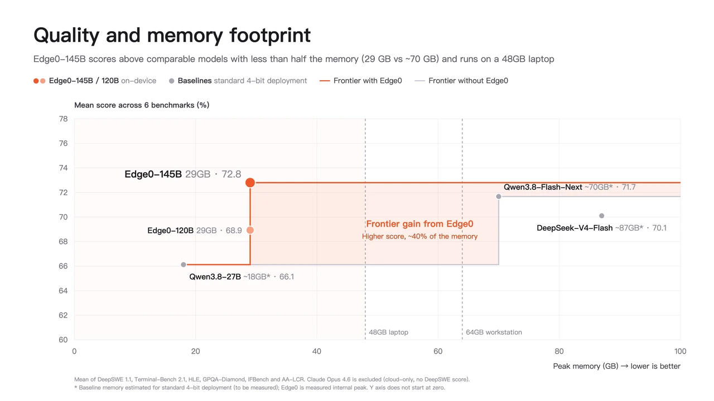

Edge0-145B, the 145-billion-parameter model Edge0 open-sourced on November 12, 2026, decodes agent text at 90 to 120 tokens per second on one 24 GB NVIDIA card, and its hardware requirements are larger than the "29GB peak memory" in the launch post suggests. Edge0's own repository puts the floor at a 16 GiB GPU plus 20 GiB of system RAM, measures the comfortable setup at about 23 GiB of VRAM plus 31 GiB of RAM, and keeps a 51.2-billion-parameter embedding table on SSD.

That gap is what most of the launch discussion was about. The blog promised a laptop "such as a MacBook Pro"; the release shipped CUDA-only, and Mac support arrived two days later, on November 14, for the Q3_K build. Below, the numbers come from Edge0's model page, its engine docs and its developers' answers on Hugging Face, so you can size a machine before you download 40-plus GiB of weights.

## Edge0-145B hardware requirements: GPU, RAM and SSD {#edge0-145b-hardware-requirements}

Edge0-145B needs one NVIDIA GPU with CUDA 13, at least 16 GiB of VRAM and 20 GiB of system RAM on Linux or Windows, or an Apple Silicon Mac running the Q3_K build on Metal. Edge0's engine docs list that floor; the speed tables were measured on an RTX 5090 D 24 GB, an RTX 4090 24 GB, an RTX Spark N1X with 60 GiB and an Apple M2 Ultra.

| Item | What Edge0 documents |
|---|---|
| GPU (Linux, Windows) | NVIDIA with CUDA 13; at least 16 GiB VRAM. One card only for now |
| System RAM | At least 20 GiB alongside a 16 GiB card |
| Mac | Apple Silicon with Metal since November 14; Q3_K folders only, Q4 projections, 32,768-token context; first start writes a draft-model file into the model folder, so it must be writable |
| Weights | Q3_K build 40.81 GiB, NVFP4 build 47.79 GiB (Edge0-120B: 27.98 and 32.96 GiB) |
| Embedding table | 51.2B-parameter FP8 n-gram table, read from disk on demand by default; the lead developer puts it at 51 GB |
| Whole model in VRAM | About 39 GB for the NVFP4 build (experts 34.9, dense layers 1.55, projections 2.67), per the same developer |
| Context | Up to 256K tokens on Linux and Windows (131,072 by default), int8 KV cache with 32K cells resident |

Two details change what you buy. The 16 GiB plus 20 GiB pairing is a measured test budget on a capped RTX 5090 D, and Edge0 states it is not a general minimum; no such result exists for the 145B NVFP4 build, so use Q3_K on a 16 GiB card. And the NVFP4 build is the checkpoint Edge0 trained and evaluated: the developers say "Edge0-145B" refers to the NVFP4 weights, trained natively in that format, and that Q3_K lands at about the same quality because only part of it is 3-bit. Edge0 publishes one quality table for both builds rather than separate evaluations.

For disk space, run `edge0-infer inspect --model <folder> --json` on the downloaded folder: it lists every required file with its size, including the embedding table and the speculative-decoding draft layer.

## Edge0-145B 29GB peak memory claim explained {#edge0-145b-memory}

The 29GB figure in Edge0's launch post is a peak measured on an unnamed "compatible laptop," reported next to 80+ tokens per second, 1,100+ tokens per second of prefill and about 120 W. The post gives no machine, build or flags for it, and a later paragraph of the same post says 28GB. It is one reading, and the repository's own measurements show where the rest of a 145B model sits.

The same launch post describes three storage tiers: frequently used "hot experts" stay in GPU memory, an expert library of about 40GB sits in system memory, and about 48GB of "vocabulary data" (the n-gram embedding table) is read from SSD. The GitHub benchmark notes then give hard numbers for the RTX 5090 D:

| Build | Weights | With expert residency on | Capped test budget |
|---|---|---|---|
| Edge0-145B Q3_K | 40.81 GiB | 23.14 GiB VRAM + 31.28 GiB host RAM | 16 GiB VRAM + 20 GiB RAM (cgroup, no swap) |
| Edge0-145B NVFP4 | 47.79 GiB | 23.25 GiB VRAM + 38.27 GiB host RAM | not published |
| Edge0-120B Q3_K | 27.98 GiB | 22.93 GiB VRAM + 18.40 GiB host RAM | 16 GiB VRAM + 20 GiB RAM |

*Source: Edge0 README benchmark notes. Host RAM is RssAnon plus RssShmem; the VRAM and RAM expert sets are disjoint, so nothing is counted twice. Single-run readings.*

So the setup behind Edge0's fastest numbers is a 24 GB card with 48 GB or more of system RAM for the Q3_K build, and 64 GB for NVFP4 once the operating system needs its share. Below that, the engine reads uncached experts from SSD and slows down, as the speed section shows. Edge0's comparison table also lists the 145B and 120B models at the same 29GB, although the 120B build is 13 GiB smaller on disk.



*Edge0's quality-versus-memory chart from the launch post. Edge0's points are measured internal peaks; the Qwen and DeepSeek points (marked with asterisks) are estimates for a standard 4-bit deployment that Edge0 says remain to be measured. Image: Edge0.*

The chart is where the claim got its pushback. It sets a measured Edge0 peak beside estimated competitor footprints and draws a "48GB laptop" line, and several technical replies in the [Hacker News launch thread](https://news.ycombinator.com/item?id=50475713) pointed out that the 40GB expert library and the 48GB SSD table from the same post add up to far more than 29GB. For sizing a machine, compare full working sets: the residency table above against your own VRAM, RAM and free SSD.

## Edge0-145B latent MoE architecture: how 145B fits one GPU {#edge0-145b-latent-moe}

Edge0-145B is a latent mixture-of-experts model: attention runs at the full 2,560-dimension width, but each token is projected down to 1,792 dimensions before it reaches the experts and projected back up afterwards. Every layer has 512 routed experts plus one shared expert, the router picks 10 per token, and 10.12B of the 145B parameters are active per token.


*Edge0-145B architecture from Edge0's model page. D and U are the shared down and up projections; ℓ is the latent width. Image: Edge0.*

The down and up projections (D and U) are shared: each layer has eight groups of them, and each expert carries a label that says which group it uses, which matches the launch post's "each group of 64 experts shares two large matrices." Because the experts only see the narrower latent vector, every expert in the 145B model is a fixed 1,630,720-byte record (1,164,800 bytes in the 120B model, whose latent width is 1,280). Edge0's model page draws the consequence: the engine keeps a few thousand experts on the card and streams the rest from host memory, so the cost tracks how many experts are resident rather than the total parameter count.

The rest of the 145B count sits outside the experts. A 51.2B-parameter per-layer n-gram embedding table in FP8 is memory-mapped from disk, a 1.26B multi-token-prediction head drafts tokens for speculative decoding, and the 48 layers mix 36 linear-attention layers with an indexed-attention layer every fourth layer.

Edge0 built the model from Qwen3.8-Flash-Next, which its GitHub and Hugging Face pages name as the base. Asked on Hugging Face whether this was a repack, Edge0's lead developer gave the numbers: Qwen3.8-Flash-Next carries 120.8B parameters of routed experts, Edge0-145B carries 84.6B (30% fewer) and Edge0-120B 60.4B (50% fewer). The expert parameters each token passes through drop from 2.36B to 1.65B and 1.18B, which is what sets decode speed. After the architecture change, Edge0 says it post-trained the model on its own data at 4-bit precision; the methodology is promised in a forthcoming technical report.

The runtime is edge0-strata, a fork of the MIT-licensed Strata engine with latent-MoE support added. Edge0's model page credits Strata's scheduling of CPU, GPU and PCIe work for the speed, and the launch post describes the split: the GPU computes the experts it has cached while the CPU handles the rest in parallel. Several Hacker News commenters noted that Qwen3.8-Flash-Next already runs on stock Strata, which makes the base model the obvious comparison point for both speed and quality.

## Edge0-145B benchmarks: decode and prefill speed by GPU {#edge0-145b-speed}

On a 24 GB RTX 5090 D, Edge0 measured the 145B Q3_K build at 121.2 tokens per second for agent decode and 3,554.9 tokens per second for 16K-token prefill. An RTX 4090 reaches 91.7 tokens per second, and the same 5090 D capped to 16 GiB of VRAM and 20 GiB of RAM drops to 44.9.


*Edge0-145B throughput in tokens per second, from Edge0's model page. The 4K and 16K columns are prefill input lengths. Image: Edge0.*

| Machine | Build | 16K prefill | Chat decode | Agent decode |
|---|---|---:|---:|---:|
| RTX 5090 D 24 GB | Q3_K | 3,554.9 | 99.7 | 121.2 |
| RTX 5090 D 24 GB | NVFP4 | 3,165.7 | 79.6 | 98.3 |
| RTX 4090 24 GB | Q3_K | 3,179.4 | 69.9 | 91.7 |
| RTX Spark N1X 60 GiB | Q3_K | 770.3 | 37.7 | 36.7 |
| RTX Spark N1X 60 GiB | NVFP4 | 922.4 | 40.1 | 46.0 |
| Apple M2 Ultra (Metal) | Q3_K | 800.3 | 60.9 | 57.0 |
| 5090 D capped at 16 GiB VRAM + 20 GiB RAM | Q3_K | 335 | 36.8 | 44.9 |

*Source: Edge0 model page, measured by Edge0. Edge0-120B on the same 5090 D: 144.6 tok/s agent decode with Q3_K, and 73.3 tok/s under the 16 + 20 GiB cap.*

Three patterns help pick a build. On discrete RTX cards Q3_K is faster than NVFP4, while on the RTX Spark, with its 60 GiB of unified memory, NVFP4 decodes faster. Prefill collapses under the memory cap, from 3,554.9 to 335 tokens per second at 16K, so long prompts hurt most on small machines. And the Mac number is a desktop M2 Ultra; Edge0 has published no laptop measurement for the Metal path, which leaves the launch post's MacBook claim without a matching benchmark.

Edge0 does not publish numbers for its base model on the same rigs. One Hacker News commenter reported 120 to 140 tokens per second of decode for Qwen3.8-Flash-Next NVFP4 on an RTX 5090 laptop with 64 GB of RAM under stock Strata, a single user report, but in the same range as Edge0-145B on a desktop 5090 D.

## Edge0-145B vs Qwen3.8-Flash-Next and DeepSeek-V4-Flash {#edge0-145b-vs-qwen}

On Edge0's own evaluations, Edge0-145B beats its base model, Qwen3.8-Flash-Next, on the two agent and coding benchmarks (64.6 vs 58.7 on DeepSWE 1.1, 86.5 vs 83.3 on Terminal-Bench 2.1) and trails it slightly on GPQA-Diamond, IFBench and HLE. Edge0 ran the Edge0, Qwen, DeepSeek and Claude scores internally.

| Model | DeepSWE 1.1 | Terminal-Bench 2.1 | AA-LCR | IFBench | GPQA-Diamond | HLE |
|---|---:|---:|---:|---:|---:|---:|
| Edge0-145B | **64.6** | **86.5** | 79.3 | 80.6 | 90.4 | 35.4 |
| Edge0-120B | 51.3 | 75.3 | 81.0 | 79.3 | 87.4 | 31.0 |
| Qwen3.8-Flash-Next | 58.7 | 83.3 | 79.1 | **81.3** | **91.7** | 35.9 |
| DeepSeek-V4-Flash-0731 | 54.4 | 82.7 | 79.7 | 79.2 | 90.8 | 33.8 |
| Qwen3.8-27B | 42.2 | 73.0 | **82.0** | 79.5 | 89.2 | 30.8 |
| Claude-Opus-4.6 (Max) | – | 78.2 | 78.0 | 62.5 | 91.3 | **40.0** |

*Source: Edge0 model page. Model-level scores, not separate evaluations of the Q3_K and NVFP4 builds. Claude has no public DeepSWE 1.1 score.*

Read the table with three caveats. The Qwen and DeepSeek baselines were run by Edge0, and the launch post compares memory against Qwen's "standard 4-bit deployment," so it is not clear which precision the Qwen scores used; one Hacker News reader suggested a quantized baseline could explain part of the gap. The 120B row differs between sources: the GitHub table and the launch post's chart give 51.3 on DeepSWE and 75.3 on Terminal-Bench, while the launch post's text table gives 53.6 and 81.3. And the Claude comparison is to Opus 4.6, an older model; the post's own wording limits the comparisons to "the named models and evaluations."

On these numbers, Edge0-145B scores about level with the model it was built from while carrying 30% fewer expert parameters, with a lift on agentic coding that its developers attribute to post-training. The [Qwen 3.8 27B](/tutorials/qwen-3-8-27b/) dense model, which Edge0 calls the mainstream on-device baseline, scores 42.2 on DeepSWE 1.1 and fits in a much smaller budget. Independent results will settle the agentic lift; as of November 15 we found setup reports and questions in the Hugging Face discussions, and no third-party benchmark.

## Edge0 SSD streaming and the prerouter: what the 35B report measured {#edge0-ssd-streaming-prerouter}

Edge0's SSD streaming and its routing predictor, the "prerouter," come from the September release of Edge0-35B, and its technical report is the only Edge0 paper so far. It shows a 35B mixture-of-experts model decoding at 20.4 tokens per second inside 2.9 GiB of active memory on a 24 GB Mac mini M4 Pro, where the same weights fully resident in mlx-lm decode at 3.9 tokens per second while holding 18.2 GiB.

The design keeps the 4-bit expert weights on SSD and memory-maps them, so the operating system's page cache holds the hot ones. The obstacle is timing: a layer's experts are chosen from the previous layer's output, so a naive engine waits for disk once per layer per token. The prerouter is a small trained head per layer that predicts the next layer's experts one token ahead, and Edge0 uses that prediction as the routing itself, so every expert it loads gets used and nothing is dropped. A LoRA adapter, served unmerged beside the 4-bit weights, recovers quality lost to quantization and the substituted routing.

The report's own A/B tests show where the predictor matters:

| Machine and routing width | On-demand streaming | With prerouter |
|---|---:|---:|
| 24 GB Mac mini M4 Pro, released 35B profile | 19.9 tok/s | 20.4 tok/s |
| 16 GB MacBook M2, 2 experts per token | 4.8 tok/s | 8.6 tok/s |
| 16 GB MacBook M2, 4 experts per token | 3.5 tok/s | 6.4 tok/s |
| 16 GB MacBook M2, 8 experts per token | 1.8 tok/s | 3.3 tok/s |

*Source: Lin et al., arXiv 2609.18063, Table 1 and Table 3. The 16 GB tests hold an 18.4 GiB checkpoint that does not fit in memory.*

When the weights fit in the page cache, the predictor adds almost nothing; the fivefold gain over mlx-lm comes from streaming and caching. When the model does not fit, prediction roughly doubles decode speed, because it moves disk waits off the critical path. The quality cost is real but bounded: the 35B model averaged 79.2 against 83.2 for its FP16 base on five OpenCompass benchmarks, with the biggest loss on AIME (86.6 vs 92.7).

The report covers the 35B and 8B models on Apple's MLX framework. Edge0-145B runs on a different engine, and its docs describe a static expert profile and residency caches; they do not say whether the trained prerouter carries over. Treat the 35B results as evidence for the approach, and the 145B speed table as the only measurement of the new model.

## How to run Edge0-145B locally with edge0-infer {#run-edge0-145b-locally}

To run Edge0-145B, build two programs from the Edge0 repository, edge0-strata (the engine) and edge0-infer (the launcher), then point `edge0-infer serve` at one downloaded model folder. On Windows and macOS, the Edge0 Chat desktop app from the GitHub releases page opens a model folder without a build.

1. Download one folder from Hugging Face: `Edge0-145B-q3k` or `Edge0-145B-NVFP4` (on a Mac, Q3_K only). Keep it as shipped; edge0-infer identifies the model from `model_name` in its `model.json`.
2. Build edge0-strata following the "Build (Linux, NVIDIA)", "Build (Windows, NVIDIA)" or "Build (macOS, Apple Silicon)" section of `edge0-strata/EDGE0.md`, then build edge0-infer as in its getting-started guide.
3. Check the folder, then start the server from `edge0-infer/`:

```bash
build/cpu/bin/edge0-infer inspect --model /path/to/Edge0-145B-q3k --json
build/cpu/bin/edge0-infer serve --model /path/to/Edge0-145B-q3k
curl localhost:8000/v1/chat/completions -H 'content-type: application/json' \
  -d '{"model":"edge0_145b","messages":[{"role":"user","content":"hi"}],"max_tokens":64}'
```

The server listens on `127.0.0.1:8000` and exposes OpenAI- and Anthropic-compatible endpoints, so coding agents that accept a custom base URL can use it; `edge0-infer chat --model <folder>` opens an interactive session instead. On Windows the binary is `build\windows\bin\edge0-infer.exe`.

On a 16 GiB card, the memory flags decide whether it starts. They live in the folder's `model.json` (`args`), or can be appended per launch with `--strata-arg`:

| Flag | Effect | Default |
|---|---|---|
| `--resident-budget-gib 20 --expert-profile <file>` | Caps the host-RAM expert cache at 20 GiB; uncached experts come from SSD | off |
| `--mmap-experts` | Reads experts from the pack file on demand, keeping none pinned in RAM | off |
| `--vram-reserve-mib N` | VRAM left free for the desktop and driver; the rest becomes expert cache | 700 |
| `--kv-resident N` | KV cells kept in VRAM per attention layer; the rest streams from pinned host RAM | 0 |
| `--spec N` | Tokens the MTP draft proposes per verify window (about 180 MiB of buffers at 4) | 4 |

A user who reported out-of-memory crashes on two 16 GB RTX 5070 Ti cards got a single card running at the full 262,144-token context with `--kv-resident 32768 --vram-reserve-mib 1024`. Both of the engine's two-GPU modes crashed in edge0-strata 0.1.55, and the maintainers confirmed the bug and said a single GPU is the supported path until a fix ships. The engine docs list other limits: concurrent requests wait in a queue, identical requests at temperature 0 can return different answers, and the server's status endpoint reports no memory breakdown for this model. Whether the NVFP4 build runs on Ampere cards was still unanswered on Hugging Face on November 15.

Licensing matters before you build on it. The framework code is Apache 2.0, but the weights use the Edge0 Community Model License 1.0, which allows personal, research and internal use and commercial use of outputs, and requires written permission for paid model distribution, commercial inference or fine-tuning services, and stand-alone commercial coding or office assistants. Qwen's upstream license terms also still apply.

## Should you run Edge0-145B? {#should-you-run-edge0-145b}

Edge0-145B makes sense if you have one 24 GB NVIDIA card, 48 GB or more of system RAM and a fast NVMe drive, and you want a local model for agentic coding behind an OpenAI- or Anthropic-compatible endpoint. On that hardware Edge0's own numbers put it at 90 to 120 tokens per second with Q3_K, fast enough to drive a coding agent through long tool loops without per-token bills, the cost question we looked at in [cost per successful task for coding agents](/tutorials/coding-agents-finops-cost-per-successful-task/).

A few situations call for waiting. On a 16 GiB card it runs at 36 to 45 tokens per second and prefill falls tenfold, so long repository prompts become slow. On two smaller GPUs it does not run yet. On a Mac, the only published measurement is an M2 Ultra desktop, and the support is two days old. If you already serve Qwen3.8-Flash-Next on Strata, the reasons to switch are Edge0's reported agentic gains and a 30% smaller expert pool, both from Edge0's own tests; the reasons to stay are a better-understood base model, multi-GPU support and a license without Edge0's commercial-service restriction.

For teams weighing self-hosting at a larger scale, our look at [how Revolut moved 2,000 engineers to self-hosted GLM](/tutorials/glm-for-coding/) covers the serving side, and [Ripple-65B Preview](/tutorials/ripple-65b-preview/) is another open agentic coding model sized for a single desktop machine. The memory-wall problem Edge0 attacks on the client is the same one Google targets in the datacenter with [TPU 8i Max](/tutorials/tpu-8i-max/). If you are sizing a GPU for several local models, our [MiniMax H3 Image VRAM comparison](/tutorials/minimax-h3-image-vs-p-h3-image/) runs the same exercise for image generation.

## References {#references}

1. Edge0, [Introducing Edge0-145B: Frontier AI Capabilities on Your Own Computer](https://edge0.ai/blog/introducing-edge0-145b-frontier-ai-capabilities-on-your-own-computer), November 12, 2026.
2. Edge0, [Edge0 145B and Edge0 120B model page](https://github.com/Edge0-AI/Edge0/blob/main/docs/models/edge0-145b.md), GitHub, accessed November 15, 2026.
3. Edge0, [edge0-infer reference: Edge0 145B](https://github.com/Edge0-AI/Edge0/blob/main/edge0-infer/docs/edge0-145b.md), GitHub, accessed November 15, 2026.
4. Yu Lin, Yiming Wang, Runyuan Cai, Hanze Liu and Xiaodong Zeng, [The Other Half of the Memory Wall: Serving 35B MoEs from SSD with Trained Routing Prediction](https://arxiv.org/abs/2609.18063), arXiv 2609.18063, September 2026.
5. Hugging Face, [Edge0-145B-NVFP4 discussion: How is this different from Qwen3.8-Flash-Next?](https://huggingface.co/Edge0/Edge0-145B-NVFP4/discussions/3), November 13–14, 2026.
