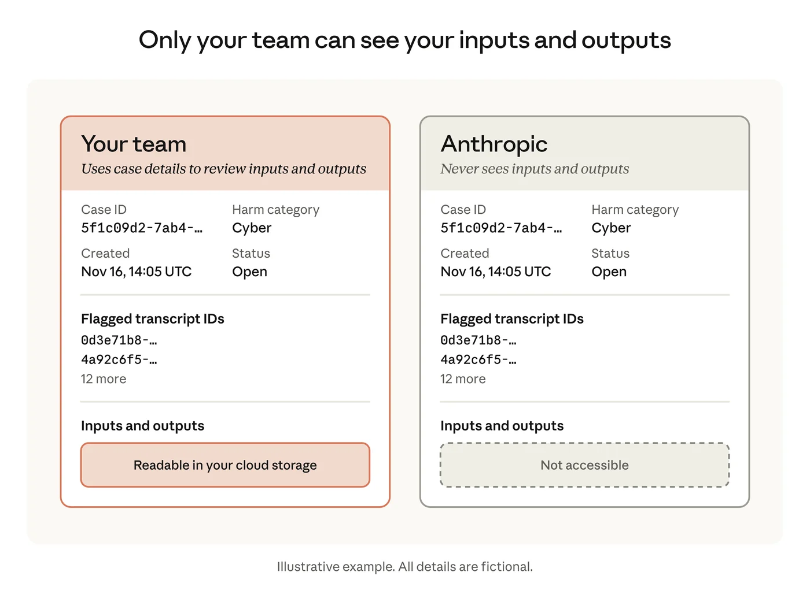

Anthropic opened Enterprise Frontier Safeguards (EFS) to a public beta on November 23, 2026, and it solves a specific conflict: Claude's most capable models require 30 days of data retention so Anthropic can spot misuse, while banks, hospitals and law firms often cannot let a model vendor keep their prompts. EFS keeps zero data retention (ZDR) and still runs Anthropic's cross-request misuse detection, by writing the data to a bucket in the customer's own cloud account and letting only automated systems read it.

The detection layer is the part a per-request filter misses. Anthropic's September threat intelligence report described an operation against roughly fifty organizations in which one AI agent split an attack across many parallel agents and saved harvested credentials between sessions; one request at a time, each piece looked like a benign task. Anthropic says it built EFS with more than 100 customers, including a quarter of the Fortune 100, and that Bridgewater, Salesforce and Stripe evaluated it in private beta. The sections below cover how the data moves, how EFS compares with the other retention options, and what an organization commits to when it turns EFS on.

## How Enterprise Frontier Safeguards works: architecture and data flow {#efs-architecture}

Enterprise Frontier Safeguards moves the stored copy of your traffic out of Anthropic's infrastructure and into a bucket you own, then lets Anthropic's automated safety monitoring read that bucket to look for misuse patterns across many requests. Requests still go to Claude as usual; what changes is where the safety copy lives and who can open it.

Three kinds of data can land in that bucket, and each has a different reader:

| Data | What it contains | Who can read it |
|---|---|---|
| Sealed Safety Data | Prompts, responses and model reasoning, encrypted in Anthropic's format | Only automated safety monitoring. Your own team cannot read it, even in your bucket |
| Transcripts | A readable copy of a prompt and response | Your team |
| Safety Correspondence | Safety Cases, Safety Notices and your responses; never prompts or responses | Your team and Anthropic |

On Claude Platform, Anthropic deletes prompts and responses promptly after the response is generated and written to your bucket, and Sealed Safety Data stays there for up to 28 days before Anthropic removes it. You set the access policies and audit logging on the bucket and can encrypt it with your own key. Anthropic's human reviewers are switched off for every EFS workspace, and per the EFS FAQ you cannot plug in your own classifiers: the monitoring is Anthropic's.

*EFS data flow. Safety data is written to and read from your own storage; Anthropic receives correspondence and monitoring metadata only. On Amazon Bedrock and Claude on Google Cloud (Google Managed), the whole loop stays inside that cloud. Diagram: Anthropic, "Zero data retention with Enterprise Frontier Safeguards is now in beta," November 23, 2026.*

When the monitoring finds a pattern that may break Anthropic's Usage Policy, it opens a Safety Case. Anthropic's examples are deliberate misuse such as offensive cyber operations and attempts to build biological capabilities, and also agents that act beyond what their user intended, in the extreme case by using a software exploit to reach an internal database. Anthropic expects most organizations to see Safety Cases rarely.

## EFS vs Legacy ZDR vs Enterprise Data Controls {#efs-vs-legacy-zdr}

EFS is the only option that combines zero data retention with cross-request monitoring. Legacy ZDR keeps no data but only screens requests one at a time; Anthropic-managed retention and Enterprise Data Controls (EDC) run the same monitoring but keep the safety copy in storage Anthropic runs, so neither counts as ZDR. Claude Platform's documentation lays out the options like this:

| | Legacy ZDR | Anthropic managed (30-day retention) | Enterprise Data Controls | Enterprise Frontier Safeguards |
|---|---|---|---|---|
| Where the safety copy is stored | Not stored after the response, except where law or misuse requires | Anthropic-managed storage | Anthropic-managed storage | A bucket in your cloud account |
| Real-time classifiers on each request | Yes | Yes | Yes | Yes |
| Automated monitoring across requests | No | Yes | Yes | Yes |
| Who reviews flagged activity | Not applicable | A small Anthropic team (Human Review on) | Your team, if you turn Anthropic Human Review off | Your team; Anthropic Human Review is always off |
| Customer-managed key | Not applicable | Through EDC | Optional | Optional |
| Counts as zero data retention | Yes | No | No | Yes |
| Claude Fable and Mythos models | Only with Anthropic's explicit authorization | Yes, the default for these models | Yes | Yes |

Anthropic does not charge for EFS, and turning it on does not change model behavior, API pricing or rate limits. The cost moves to your cloud bill: storage, reads, writes, key operations and network transfer, and Anthropic notes that it reads and writes your bucket from its own regions, which can affect network transfer charges.

The choice between EDC and EFS comes down to whether your policy allows a retained copy to sit with the vendor. EDC already gives you your own key and your own reviewers without a bucket to run. EFS is for organizations whose rules require that nobody outside their account holds the data at all.

## Claude zero data retention on Fable and Mythos models: why EFS is required {#covered-models}

Claude Fable 5, 5.1 and 5.2 and Claude Mythos 5, 5.1 and 5.2 are what Anthropic calls Covered Models: they require 30-day data retention wherever they are offered, so ordinary ZDR does not apply to them. A workspace on Legacy ZDR that calls one of them gets a `400 invalid_request_error` with the message "In order to access this model, your organization or workspace must have data retention enabled," unless Anthropic has explicitly authorized that organization.

Anthropic's September announcement gives the reasoning. The most sophisticated misuse it has seen spans many tasks, sessions and accounts, and checking each interaction once before discarding it cannot connect those pieces; detection needs data kept long enough to correlate. The same post says the 30-day policy, introduced with Claude Fable 5, was not about training, and the Claude Platform FAQ repeats that Anthropic does not train on enterprise data without explicit permission.

That leaves a ZDR organization three routes to these models: turn on 30-day retention for one specific workspace, use EFS, or rely on a time-limited exception where one exists. On Amazon Bedrock, eligible customers keep ZDR on current Fable models and existing Cyber Verification Program models for internal use through at least June 30, 2027; Google Cloud gives the same June 30, 2027 date for its Legacy ZDR on Covered Models. Both describe EFS as the way to keep zero data retention after that. For what those models can do, see our [Claude Fable 5.2 pricing and benchmark breakdown](/tutorials/claude-fable-5-2/).

## Enterprise Frontier Safeguards on Claude Platform, AWS Bedrock and Google Cloud {#efs-platforms}

EFS is available on Claude Platform, Claude Platform on AWS, Amazon Bedrock and Claude on Google Cloud, with Microsoft Foundry listed as coming soon. The model is the same everywhere, but who runs the monitoring, where Safety Cases arrive and what the preview restricts differ by platform:

| Platform | Who operates EFS | Your bucket | How Safety Cases reach you | Platform-specific limits |
|---|---|---|---|---|
| Claude Platform (Claude API) | Anthropic | Amazon S3 or Google Cloud Storage | Files in your bucket and the Safety Cases API (beta, Claude Platform only) | Turned on per workspace; the Default Workspace cannot use EFS |
| Claude Platform on AWS | Anthropic | Amazon S3 | Only through a Case bucket | A Case bucket is required |
| Claude Models on Google Cloud (Anthropic managed) | Anthropic | Google Cloud Storage | Only through a Case bucket | A Case bucket is required; ask your account team first if you want a bucket per workspace |
| Amazon Bedrock | AWS; data stays in your AWS account | Amazon S3 with your AWS KMS key, one configuration per Region | Case files under `review-cases/` in your bucket | Public preview; enroll through Bedrock's trusted access program API |
| Claude on Google Cloud (Google managed, Model Garden) | Google Cloud; data stays in your project | Cloud Storage with Cloud KMS keys, set up with a Terraform module from your account teams | Files in your Cloud Storage bucket | Preview; online prediction only (`rawPredict`, `streamRawPredict`), no batch prediction |

Amazon Bedrock has the most operational detail in its documentation. You check eligibility with `aws bedrock list-trusted-access-programs`, then create a KMS key and an S3 bucket in the same Region and save a storage configuration in every Region where you call covered models; a Region without one falls back to Amazon-managed storage. Bedrock writes records to the bucket within minutes and retries failed writes for up to 72 hours. If you remove its access to your key or bucket, Bedrock stops serving covered models 24 hours later.

The Bedrock preview also carries two warnings worth reading before enrolling. AWS asks preview users to send only test traffic from a test account, with no regulated data such as PII or PHI. And joining the preview turns ZDR off for the accounts or projects you list: their content is retained in your own bucket under EFS, or in Amazon-managed storage under EDC, while your other accounts keep ZDR. Accounts enrolled only in EFS cannot call covered models until the storage configuration is saved.

On Google-managed Claude, enrolled projects get Legacy ZDR by default, and EFS ZDR is an opt-in preview set up through the onboarding guide. Enrollment removes the need to accept the Advanced AI Safety Addendum or set `dataSharingEnabledProvider`. If you use VPC Service Controls, the perimeter has to allow the EFS service accounts.

## How to set up Enterprise Frontier Safeguards: decisions you can't undo {#efs-setup}

Setting up EFS on Claude Platform takes five steps in the Claude Console: get access, add your bucket and optional key, turn EFS on for a workspace, optionally set a policy for new workspaces, and check the setup. The order matters less than the planning, because several of those steps are permanent or change things beyond the workspace you meant to touch.

Access is limited to eligible organizations, for internal use only during the beta. You request it through your Anthropic account team or the EFS request form. An organization with HIPAA readiness turned on cannot get EFS, and some Anthropic access programs cannot be combined with it, so Anthropic asks you to tell your account team which ones you use.

| Step | Can you undo it? | What else changes |
|---|---|---|
| Accept the EFS terms for an organization | Not by yourself; removing access goes through your account team | Turns on the Compliance API, including for other eligible organizations linked to your Verification Portal profile. Where people sign in to Claude Code or Cowork with a subscription plan, the Compliance API also stores session transcripts |
| Access Transparency turns on | No, once it is on it stays on for every workspace in the organization | Records Anthropic personnel access to covered data through the Compliance API |
| Attach a customer-managed key | No, it is permanent | Turns off some Claude Platform features; a revoked key keeps requests working for up to an hour, then they fail |
| Use customer-owned storage | Partly; you can change or stop using the bucket | Stopping takes the workspace off EFS. It also requires Anthropic Human Review off, so your own team must review Safety Cases |

Workspace planning comes next. On Claude Platform, EFS applies to every request to every model in a workspace, including models that do not need retention, so traffic you want outside EFS needs a separate workspace selected by API key or workspace ID. An organization on Legacy ZDR cannot convert an existing workspace: the Console marks EFS "Ineligible" there, and you create a new workspace with EFS selected, keeping production traffic on the old one until the setup check passes.

Three people are involved: a cloud admin who runs the setup file that creates the bucket, key and access roles; an Organization Admin who connects the bucket and turns EFS on in the Console; and the reviewers who will handle Safety Cases. For S3, Anthropic recommends `us-east-2`, and an AWS organization that blocks outside accounts with resource control policies needs an exception for Anthropic's account. A new workspace usually starts writing to your bucket within 10 minutes; Anthropic advises waiting another 10 minutes after the first object arrives before moving on. Changes to Anthropic Human Review take up to 2 hours, and a customer-managed key can take up to a day to apply to a workspace that already serves traffic.

## How to handle an EFS Safety Case within 7 days {#safety-case}

An EFS Safety Case gives your team 7 calendar days from its `created_at` time to investigate and answer `violation` or `no_violation`. Each case lists its ID, a policy category such as `cyber` or `bio`, the IDs of the flagged messages with the location of each Transcript, the workspace, and sometimes the user profile that sent them. Anthropic sees the same case record but cannot read the Transcripts.

*The same Safety Case as your team and Anthropic see it. Illustrative example with fictional details. Diagram: Anthropic, November 23, 2026.*

Anthropic does not notify you when a case opens and sends no webhooks, so the first job is an alert path: watch the bucket for new case files and forward them to your SIEM or ticketing queue, or poll the Safety Cases API on Claude Platform. Anthropic says 24/7 coverage is not needed; a queue someone checks every working day is enough. On Claude Platform on AWS and Anthropic-managed Google Cloud, a Case bucket is the only delivery route, so a missing bucket means missed deadlines.

The Claude Platform documentation sorts most cases into four outcomes:

| What the investigation finds | What to do | Response |
|---|---|---|
| Authorized work, such as a red team running a penetration test under the Cyber Verification Program | Confirm with the team that owns the work | `no_violation` |
| An employee or user breaking your policy or Anthropic's Usage Policy on their own | Remove their access and follow your own process | `violation` |
| An external user or a stolen credential | Block the user or rotate the key | `violation` |
| A false positive | Nothing to fix | `no_violation` |

You answer once, either by writing a response file to the bucket (`review-responses/<case_id>.json` on S3) or through the API, and the first valid response closes the case for good. You do not have to share names, evidence or Transcripts with Anthropic, though anything you include becomes part of the case. If 7 days pass without a valid response, Anthropic closes the case, and repeated silence can lead to suspended access. For clear, intentional harm Anthropic can suspend access while you investigate, as narrowly as one user profile.

A few habits make investigations possible. Log the `id` (`msg_...`) of every Messages API response next to your own user ID, starting before you need it, and set `metadata.user_id` to an opaque ID so it comes back in the Transcript. Save the Transcripts you need, because they expire. Be careful pasting Transcripts into Claude or another model during the investigation: Anthropic warns that this can open another Safety Case. Teams already running offensive-security work with agents, like the setups in our [Claude Code bug bounty skills review](/tutorials/claude-code-bug-bounty/), should expect the first category and agree in advance who confirms it. The pattern is close to [Claude Approvals](/tutorials/claude-approvals/), where Anthropic also hands the final human review to the customer's own team.

## Enterprise Frontier Safeguards limitations: Batch API, Files API and Managed Agents {#efs-limitations}

On Claude Platform, EFS covers requests to the Messages API in an EFS workspace and nothing that Claude Platform features store for their own use, even inside a Messages API request. That leaves several common building blocks outside it:

- **Batch API.** Not supported, because batches keep no Transcript for your team to review. Anthropic suggests sending requests individually, or running batches from a non-EFS workspace with Anthropic Human Review on.
- **Files API uploads and code execution containers.** Their stored data is not covered by EFS.
- **Claude Managed Agents.** Sessions and [dreams](/tutorials/claude-dreaming/) do not run in a workspace with Anthropic Human Review off, which every EFS workspace is; an existing session there stops accepting new messages.
- **Earlier traffic.** EFS applies from the moment the configuration takes effect. Data written before that stays where it was until it expires.
- **Google-managed Claude.** Online prediction only during the preview; batch prediction is not supported.

These gaps shape architecture more than the setup steps do. An agent platform that relies on batches for offline evaluation or on Managed Agents for long-running work will end up with two kinds of workspace: EFS for interactive traffic that must stay in your account, and a retained workspace for the rest. Deciding which data may live in the second kind is a policy question to settle before the first bucket is created. For how other vendors gate their most capable security models, compare OpenAI's approach in our [GPT-6 Cyber access and benchmark review](/tutorials/gpt-6-cyber/).

## References {#references}

1. Anthropic, ["Zero data retention with Enterprise Frontier Safeguards is now in beta"](https://claude.com/resources/articles/zero-data-retention-with-enterprise-frontier-safeguards), claude.com, November 23, 2026.
2. Anthropic, ["Developing Enterprise Frontier Safeguards with our customers"](https://www.anthropic.com/news/enterprise-frontier-safeguards), September 1, 2026.
3. Anthropic, [Enterprise Frontier Safeguards documentation](https://platform.claude.com/docs/en/manage-claude/enterprise-frontier-safeguards/overview): overview, [FAQ](https://platform.claude.com/docs/en/manage-claude/enterprise-frontier-safeguards/faq), [setup guide](https://platform.claude.com/docs/en/manage-claude/enterprise-frontier-safeguards/setup-console) and [Review Safety Cases](https://platform.claude.com/docs/en/manage-claude/enterprise-frontier-safeguards/flagged-cases), Claude Platform docs, accessed November 24, 2026.
4. AWS, ["Introducing the Amazon Bedrock Trusted Access API, with Enterprise Frontier Safeguards and Enterprise Data Controls for Claude models"](https://aws.amazon.com/blogs/machine-learning/introducing-the-amazon-bedrock-trusted-access-api-with-anthropics-enterprise-frontier-safeguards-and-enterprise-data-controls/), AWS Machine Learning Blog, and the [Amazon Bedrock user guide for EFS and EDC](https://docs.aws.amazon.com/bedrock/latest/userguide/anthropic-efs-enterprise-data-controls.html), accessed November 24, 2026.
5. Google Cloud, ["Enterprise Frontier Safeguards for Claude"](https://docs.cloud.google.com/gemini-enterprise-agent-platform/models/partner-models/claude/enterprise-frontier-safeguards), Google Cloud documentation, accessed November 24, 2026.
