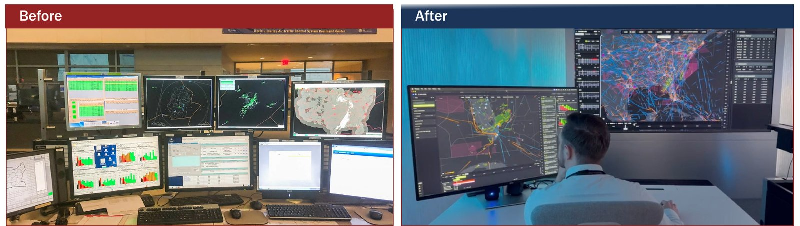

FAA SMART AI, the Federal Aviation Administration's new traffic planning tool, has been advising all 22 US en route air traffic control centers since November 10, 2026. It reads about 200 data streams, forecasts where traffic will outrun airspace capacity, and suggests reroutes and departure times. People still decide: FAA specialists check each suggestion, and the facility it is meant for can accept or decline it. When a telecom failure grounded every US departure three days later, the timing made SMART the first suspect. Officials and the company that built it say the outage started elsewhere.

## FAA SMART AI rollout: what changed on November 10 {#faa-smart-ai-rollout}

On November 10 the FAA moved SMART from Washington-area airspace to the airspace of all 22 air route traffic control centers. The agency told FLYING that after a "successful initial rollout" in the National Capital Region it would use SMART across the country "to reduce delays, reduce fuel consumption and improve the travel experience for the flying public."

The tool had gone live on September 21 in what the Department of Transportation called "a limited mode," covering flights at Reagan National, Washington Dulles and Baltimore/Washington International. The national step came 50 days later. Those en route centers handle aircraft flying on instrument flight plans between airports, in sectors that each have a set capacity, which is the constraint SMART is built to forecast.

The rollout is still partial in scope. FLYING reports that the Washington phase was set up to handle same-day delays only, while the system is being built to look days, weeks or months ahead. Transportation Secretary Sean Duffy said in August that SMART would be fully deployed by spring 2027.

## How FAA SMART AI works: from 200 data streams to a controller's decision {#how-faa-smart-ai-works}

FAA SMART AI is a forecasting and planning layer. It pulls together about 200 data streams, including weather, flight plans and paths, traffic flow, airport capacity and controller staffing, and uses what DOT calls an "AI-supported engine" to predict where demand will exceed capacity. FAA specialists turn those forecasts into scheduling recommendations, and the recommendations travel down the existing chain of command to the facilities that own the airspace.

*The path of a SMART suggestion. Based on the FAA and DOT SMART fact sheets (September 2026), FAA statements to FLYING (Nov. 10) and officials' account of the ground stop (Nov. 14). The dashed box is a separate system.*

The chain has four human-run steps after the software:

1. **SMART center, Washington.** DOT says a team of FAA specialists staffs the center around the clock, analyzing SMART's output and validating its findings.
2. **Air Traffic Control System Command Center, Warrenton, Virginia.** The specialists send scheduling recommendations here. The Command Center already manages national traffic flow through traffic management initiatives (TMIs).
3. **The facility responsible for the airspace.** The Command Center passes recommendations on, and local leadership decides whether to use them.
4. **Controllers.** They issue any resulting clearances to pilots and remain responsible for keeping aircraft apart, as the FAA's one-page fact sheet puts it.

That is why FLYING's summary says pilots "may now receive routing and schedule recommendations" from controllers "that were informed by an AI-powered system." The pilot hears a normal clearance; SMART's influence sits several steps upstream.

### FAA SMART and FMDS: how the pieces fit

SMART is one part of a larger replacement. The FAA's June contract announcement describes Flow Management Data and Services (FMDS) as "the new technological backbone" of the Command Center, the system that balances demand against capacity, and SMART as "an enhancement within FMDS" that coordinates schedules and trajectories before aircraft depart. The FAA's stated problem is fragmentation: the data controllers rely on sits in different systems, and they "often have to use numerous screens and spreadsheets" to see it.

*"Before" and "After" as DOT presents them: a Command Center position with separate screens, and the new SMART center. Image from the DOT SMART fact sheet, September 2026.*

## AI air traffic control: what SMART does and does not do {#ai-air-traffic-control-limits}

SMART recommends; it does not control aircraft. DOT's launch release says SMART "cannot be used to replace the critical role air traffic controllers play or take over control of an aircraft," and that "all of SMART's recommendations are reviewed by FAA staff." Pilots still get their instructions from controllers, and nothing in the FAA's description gives SMART a role in separating aircraft.

DOT's fact sheet lists four jobs the FAA wants it to do:

| Problem today | What SMART is meant to do |
|---|---|
| Too many flights scheduled into one sector at once | Predict where traffic will pile up and move flights to open airspace before it builds |
| Weather airspace blocked off as "large, rectangular boxes" | Show how storms will move over time so controllers can use gaps instead of closing whole areas |
| Airspace stays closed after weather ground stops | Spot sooner when restricted airspace can safely reopen |
| Controllers sequence stacked arrivals in real time | Sort out landing order "hours ahead of time" |

These are goals; the only public outcome so far covers reroutes in the Washington phase, discussed below. Arrival sequencing reaches furthest into controllers' own work: DOT says SMART would sort out landing times hours ahead, "allowing the system to determine the order of arrivals rather than leaving controllers to make those decisions in real time."

The design is familiar from other operational AI: a narrow model that ranks options inside a fixed workflow, with people holding the final call. Our look at [decision models in production](/tutorials/decision-model-vs-llm/) covers the same pattern in a very different setting, and [our piece on AI agents with internal access](/tutorials/ai-agent-internal-access-security-boundary/) explains why the approval boundary matters as much as the model.

## Did FAA SMART AI cause the November 13 ground stop? {#faa-smart-ai-ground-stop}

No official finding links SMART to the outage, and every account so far places the failure in the FAA's telecom network. On November 13 the FAA ordered a nationwide ground stop "following communication issues impacting multiple Air Route Traffic Control Centers." Departures stayed halted for more than four hours, and by Wikipedia's count it was only the third nationwide ground stop in US history.

The timeline of what officials said:

| When | Who | What they said |
|---|---|---|
| Nov. 13, afternoon | FAA | Ground stop issued over communication problems at multiple en route centers; technicians investigating |
| Nov. 13, evening | Homeland Security Secretary Markwayne Mullin | Officials were looking at whether the new AI tool played a role and could not rule anything out |
| Nov. 13–14 | Air Space Intelligence, on X | "The current ground stop is not based on or a result of the SMART system, any product of ASI or our integration with FAA and ATC" |
| Nov. 13–14 | Transportation Secretary Sean Duffy | The problem involved legacy equipment; SMART is disconnected from the affected systems and the new equipment did not go down |
| Nov. 14 | Duffy and FAA Administrator Bryan Bedford | The outage began while L3Harris, which runs the network, was moving lines from copper to fiber at a remote FAA site; a router "flooded" the rest of the system and disrupted communications with aircraft and radar |

CBS News, citing multiple sources, reported that an update to that private network made it reboot and crash. Bedford said the review will establish whether the router was installed or configured wrongly or was simply defective. Officials have said they see no sign of a cyberattack.

The architecture above explains why the claim is plausible. SMART sends planning suggestions through people to facilities; the network that failed carries communications between those facilities, aircraft and radar. A planning tool losing its feed would slow advice, but would not by itself cut controllers off from pilots. That is still the officials' and ASI's account, not an investigation result, and the full review has not been published.

## FAA SMART results: 180 rerouted flights and what the number covers {#faa-smart-results}

The FAA says SMART helped reroute 180 flights in the Washington area between September 21 and November 10, saving an average of 10 minutes and almost 80 gallons of fuel per rerouted flight. By the FAA's own figures that is roughly 14,000 gallons across those flights.

The numbers come from the FAA, through statements to FLYING and others, and the agency has not said how it measured them: what baseline route each flight was compared against, how many SMART suggestions were declined, or whether any flight did worse. The sample covers one region in a limited mode focused on same-day delays. It says nothing yet about the nationwide system or the longer-range planning SMART is meant to add.

Air Space Intelligence has a longer record with airlines. Alaska Airlines said in 2024 that ASI's Flyways platform found optimization opportunities on 55% of its flights and saved 3% to 5% of fuel on flights longer than four hours. Those figures describe an airline's dispatch planning, not FAA traffic management, and they are the airline's own.

## FAA SMART contract: Air Space Intelligence, $875 million and FMDS {#faa-smart-contract}

The FAA awarded the SMART work to Air Space Intelligence (ASI), a Boston company, on June 22, 2026. ASI describes it as a 12-year, $875 million software and AI contract covering both FMDS and SMART. ASI says it had already spent nearly $100 million of its own money building the platform and that its software runs live operations for major US airlines and the US Air Force; Alaska Airlines has used its Flyways tools since 2021.

The contract is one piece of a larger spending story. DOT is separately spending $12.5 billion on radios, radars, telecom lines and electronic flight strips through 2028, and FLYING reports that Duffy put the SMART project's cost at around $10 billion in August, that DOT asked Congress for $600 million to finish rolling out SMART and FMDS, and that Politico reported in October that the FAA was seeking an ownership stake in ASI. After the ground stop, Duffy and Mullin asked Congress for $50 billion to overhaul air traffic control.

## FAA SMART AI safety concerns: the questions lawmakers and controllers raised {#faa-smart-ai-safety-concerns}

The open questions are about testing and accountability, and the FAA has not answered them in public. On October 9 more than two dozen Democratic lawmakers, led by Representative April McClain Delaney of Maryland, asked Duffy and Bedford to pause SMART at the three Washington airports until the FAA explained:

- how SMART was tested, including in severe weather and during equipment outages;
- how controllers and other safety staff were trained to use it;
- how airports, airlines and aviation safety workers were consulted;
- how the initial 90-day evaluation would be judged, and what had to be true before a nationwide expansion;
- who is accountable if a SMART recommendation contributes to a safety incident.

Representative Alexandria Ocasio-Cortez said the FAA launched the tool "without publishing a safety evaluation or sufficiently consulting air traffic controllers." The lawmakers set an October 19 deadline. The nationwide expansion came 50 days after launch, before the 90-day window the letter describes, and AeroTime noted that the FAA's November 10 update did not address their questions. House Democrats have also asked the Government Accountability Office to review SMART's implementation, metrics and safety risk management.

Controllers have been outside the project. The National Air Traffic Controllers Association, which represents more than 15,000 members, said in September that it was not "involved in the design, testing, or implementation of SMART and therefore cannot speak to its effect on the air traffic control workforce." Airlines publicly backed the launch: United's CEO Scott Kirby said that "if it works as we think it can," SMART would cut delays more than anything in decades, and American's Robert Isom said programs like SMART would benefit travelers "when done thoughtfully and methodically."

Aviation is not the only place where AI rules are being written on the fly this month. United also changed its contract of carriage to stop [personal AI agents from booking tickets](/tutorials/personal-ai-agents-united-booking-ban/), and the Bloomington, Indiana, city council passed a [local ban on superintelligent AI](/tutorials/bloomington-superintelligence-ban/). Each case turns on who signs off on what an AI system may do. For SMART that line is drawn on paper, with people at every step; the FAA has yet to publish evidence of how well those steps work. More AI explainers are in our [frontier research section](/tutorials/category/frontier-research/).

## FAA SMART AI FAQ {#faa-smart-ai-faq}

### Why isn't air traffic control automated?

In the US, keeping aircraft apart is still a controller's job, and the FAA has kept SMART out of that role. The agency says SMART cannot replace controllers or take control of an aircraft; its suggestions are reviewed by FAA staff and local leaders can decline them. FAA Administrator Bryan Bedford put it this way in August: "The primary mission of the air traffic organization is to keep things separated. None of that's changing."

## References {#references}

1. Federal Aviation Administration, [Strategic Management of Airspace, Routes, and Trajectories (SMART) fact sheet](https://www.faa.gov/newsroom/SMART_One-Pager.pdf), 2026.
2. U.S. Department of Transportation, [Duffy delivers state-of-the-art air traffic control management tool](https://www.transportation.gov/briefing-room/trumps-transportation-secretary-sean-p-duffy-delivers-state-art-air-traffic-control) and [What is SMART? fact sheet](https://www.transportation.gov/briefing-room/smart-fact-sheet), September 21, 2026.
3. Federal Aviation Administration, [Duffy selects Air Space Intelligence to deploy air traffic control software](https://www.faa.gov/newsroom/modern-skies-trumps-transportation-secretary-sean-p-duffy-selects-air-space-intelligence), June 22, 2026.
4. Jack Daleo, [FAA's SMART AI System Now Active at All 22 ARTCCs](https://www.flyingmag.com/faa-smart-ai-now-active-at-22-artccs-nationwide/), FLYING, November 10, 2026.
5. Federal Aviation Administration, [FAA Statement on Nationwide Ground Stop](https://www.faa.gov/newsroom/faa-statement-nationwide-ground-stop), November 13, 2026; officials' account via [Yahoo News live coverage](https://www.yahoo.com/news/us/live/faa-ground-stop-latest-updates-duffy-blames-contractor-l3harris-thousands-more-flights-canceled-saturday-no-sign-of-cyberattack-161329174.html), November 14, 2026.
