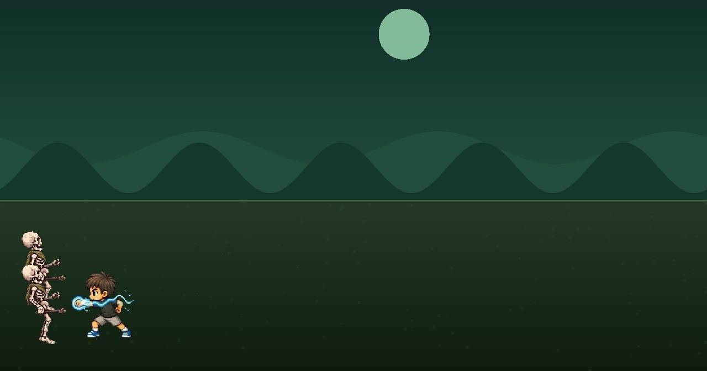
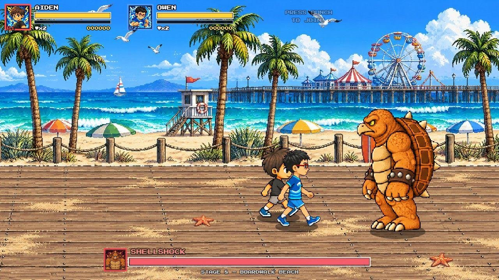
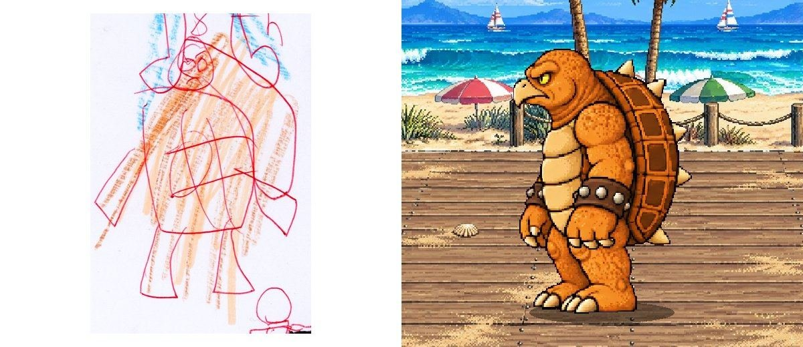

This **Fable 5.2 review** follows one real job instead of a benchmark table. Developer Lex Toumbourou had an early look at Claude Fable 5.2 and pointed it at the game his nephew Aiden had been asking for all year: a beat 'em up starring the family, drawn by Aiden himself. He gave Claude Code one prompt before bed. By morning it had produced a 12-stage, four-player game that the kids played the next afternoon, and which you can [play in a browser](https://aidens-revenge.pages.dev/).

The run shows what Fable 5.2 does well on a long creative task, how many tokens it burns doing it, and where the result still falls short.

| Question | Short answer |
|---|---|
| What was built? | A 12-stage, up-to-four-player beat 'em up from a child's drawings, later grown to 18 playable characters. |
| How? | Claude Code with Fable 5.2, calling ChatGPT Images 2.5 for art and ElevenLabs for audio. |
| Human input | One overnight prompt for the first build, then follow-up requests after playtesting. |
| Claude usage | About 600 requests and 340M tokens over two days, mostly cache reads. |
| Cost | About $300 at Fable 5.2 API prices, per the developer; tokens were free during his test. |
| Main weaknesses | Exploitable combat, unclear keyboard controls, generic art and sprites that drift from the drawings. |

## Fable 5.2 Review: Hands-On Test of an Overnight Build {#fable-5-2-review-the-overnight-build}

Fable 5.2 took a prototype that held attention for about two minutes and returned a complete game with cutscenes, smashable crates and an ending, none of which the prompt asked for. It threw away most of the existing code and rewrote the game, generating roughly 175 images and 140 audio clips along the way.

The starting point came from June. Toumbourou had built a first version for Aiden's birthday, mostly in Claude Code with Opus 4.8 and Fable 5 on a side-scrolling template from AIOriented.dev. In his words, it "wasn't worth playing for more than a couple of minutes."

*The June build, made with Opus 4.8 and Fable 5 on a template: one flat field and generic enemies. Image: Lex Toumbourou.*

Aiden's design notes were specific. He drew five heroes from the family, including the dog, numbered twelve villains from first to twelfth, and set a loose plot: rescue the puppy Pudding and unlock Mum and Dad along the way. The Fable 5.2 build kept that order, so each boss appears where Aiden ranked it.

*The Fable 5.2 build: two-player HUD, boss health bar and a full stage background for Stage 8. Image: Lex Toumbourou.*

The art itself came from ChatGPT Images 2.5, which Fable 5.2 called with an API key from the prompt. Each villain sprite started from one of Aiden's drawings.

*Aiden's drawing of his eighth villain and the Shellshock sprite generated from it. Image: Lex Toumbourou.*

## The Prompt Fable 5.2 Received {#the-prompt-fable-5-2-received}

The prompt was a single paragraph of goals, tools and permissions, with no task list. Toumbourou asked for a game that feels "like a modern-day Ninja Turtles arcade game," named the image and sound services and where their keys lived, pointed to a folder of scanned drawings, and asked for up to four controllers.

Several lines handed judgment to the model:

- "Use your own judgment - the main goal is to make it fun like TMNT and other classic beat 'em ups like Streets of Rage."
- "Commit as you go. Don't worry about destroying what exists. Start fresh where it makes sense."
- "You are a truly world-class game developer. Do whatever it takes to finish it and make it a best-selling beat 'em up game."

The last line borrows a trick from the [Latent Space Engineering](https://blog.fsck.com/2026/01/30/Latent-Space-Engineering/) post about putting an agent in a confident frame of mind. Toumbourou says he is unsure it still matters with Fable 5.2. On Hacker News, simonw reported that simply asking "make this more fun" also works with Opus 5.5.

## Fable 5.2 Self-Testing: A Bot That Played Every Stage {#fable-5-2-self-testing}

Fable 5.2 checked its own work without being told to. The reasoning traces show it wrote a bot to play the game, ran that bot through all twelve stages in a headless browser and inspected screenshots for problems before stopping.

That loop explains why the build was playable on first launch. The next morning Toumbourou paired four PS4 controllers with his MacBook and the game handled all four players.

Self-testing has limits that showed up later. A bot checking screenshots confirms that stages load and can be finished. It does not judge whether combat can be exploited or whether keyboard players know which key pauses, and those were the first things human players reported.

## Claude Fable 5.2 Usage in Tokens {#claude-fable-5-2-usage-in-tokens}

Toumbourou published the tally for the full two days, covering the overnight build and the follow-up sessions:

| Service | Usage |
|---|---|
| Claude (Fable 5.2) | About 600 requests: ~320M tokens read from cache, 19M written to cache, 1M output |
| OpenAI images | About 500 images: sprite sheets, character designs, portraits, backgrounds, key art |
| ElevenLabs | 11 music tracks, about 100 sound effects, 90 announcer lines |

He sums it up as "340M tokens for a 12-level, 18-character, four-player beat 'em up." Output was under 1% of that. Most tokens were the agent rereading the project's code and context from cache on every turn, which is the normal shape of a long Claude Code session.

## Fable 5.2 Cost for a Full Game {#fable-5-2-cost-for-a-full-game}

Tokens were free during Toumbourou's early-access test. Asked on Hacker News what the build would cost at list prices, he answered about $300 for the Claude tokens.

Anthropic's price list gives the same order of magnitude. Fable 5.2 charges $8 per million input tokens, $40 per million output tokens, $0.20 per million cache reads and $10 or $16 per million cache writes for 5-minute or 1-hour caching. Applied to the tally:

| Line item | Tokens | Price per 1M | Cost |
|---|---|---|---|
| Cache reads | 320M | $0.20 | $64 |
| Cache writes | 19M | $10 (5-min) to $16 (1-hour) | $190 to $304 |
| Output | 1M | $40 | $40 |
| **Total** | **340M** | | **≈ $294 to $408** |

Uncached input is not broken out in the tally, and the image and audio bills from OpenAI and ElevenLabs come on top. One commenter estimated $2,560 to $13,000 by pricing the tokens at the full input or output rate. Another did the cache math and got $294, matching the low end of the table. Caching is what keeps the real figure near $300. For the price table and how it compares with Opus 5.5, see our [Claude Fable 5.2 overview](/tutorials/claude-fable-5-2/).

For a family project, $300 buys a game a studio would not make for one child. For teams, the useful number is cost per finished result, which the [cost per successful task](/tutorials/coding-agents-finops-cost-per-successful-task/) framework measures better than per-token price.

## Fable 5.2 Limitations Players Found {#fable-5-2-limitations-players-found}

The build log drew 503 points on Hacker News, and players who tried the game posted bugs in the thread:

- **Exploitable combat.** Several players found they could juggle an enemy against the left edge of the screen and kick it indefinitely.
- **Controls.** Keyboard play was barely tested because the family used controllers. One player could not find the controls and found that only Enter paused the game. Toumbourou said he would add fixes.
- **Collision and difficulty.** Reports of odd hit detection and a very hard Stage 3.
- **Animation.** One commenter counted an eight-frame walk cycle that changes from frame to frame; another noticed Pudding shrinking during jumps.
- **Fidelity to the drawings.** Some sprites differ from Aiden's designs, such as a villain drawn with two knives that holds one in the game. Others found the art style generic.
- **Mobile.** The game is not really playable in a phone browser.

Most of these sit in the gap between the self-test bot and real players: game feel, input methods the bot did not use, and judgment about whether art matches a brief.

## Fable 5.2: One-Shot or Iteration? {#fable-5-2-one-shot-or-iteration}

The first playable build came from one prompt. Everything after that came from conversation.

After playtesting, Owen, Aiden's older brother, wanted a Hulk smash, so Claude made him turn into the Hulk on his first power-up. Aiden wanted the most powerful special move, and Claude made it a screen-wide blast of lightning and blue fire. The family then added uncles, aunties, grandparents, a great-grandmother as an angel and two pet turtles. For each new character Toumbourou gave Claude a few photos and the special move Aiden picked, and Claude redrew the cutscenes and updated the story. Five heroes became eighteen.

Hacker News commenters pushed back on the "one-shot" label for this reason: the shipped game reflects many human requests. The harness also did a lot of work the label hides, since the overnight run spent tokens on its own testing to make the first attempt land.

Toumbourou did not try Opus 5.5 on the same job, so this run alone does not show how much of the result is new in Fable 5.2. One commenter who did compare them on a DX-Ball clone found Fable 5.2 stronger in places but Opus 5.5 more fun, and noted that Fable changed game mechanics the prompt had specified.

## Verdict {#verdict}

As a review data point, this build shows Fable 5.2 handling a long, open-ended creative job end to end: planning, coding, orchestrating image and audio services, testing itself and adding polish unprompted. It needs a person for game feel, input coverage and taste, and it needs cache pricing to stay affordable. Developers with a clear brief and a few hundred dollars of tokens can expect a playable first build overnight and should budget human playtesting for the rest.

## FAQ {#faq}

**Did Fable 5.2 really build the game in one shot?** The first complete, playable build came from one prompt in one overnight run. The extra characters, special moves and story changes came from follow-up prompts after playtesting.

**How much did it cost?** The developer estimates about $300 in Claude tokens at Fable 5.2 API prices. Our arithmetic on Anthropic's price list gives $294 to $408, before uncached input and the separate image and audio services.

**Which tools did it use besides Claude?** ChatGPT Images 2.5 for sprites, portraits and backgrounds, and ElevenLabs for music, sound effects and announcer lines.

**Is Fable 5.2 better than Opus 5.5 for this?** This build does not answer that, because Opus 5.5 was not tested. Anthropic's benchmarks and the price gap are covered in our [Fable 5.2 overview](/tutorials/claude-fable-5-2/).

## References {#references}

1. Lex Toumbourou, [Fable 5.2 One-Shotted My Nephew's Dream Game](https://notesbylex.com/fable-5-2-one-shotted-my-nephews-dream-game), NotesByLex, November 10, 2026.
2. Aiden's Revenge, [playable game](https://aidens-revenge.pages.dev/), accessed November 12, 2026.
3. Hacker News, [discussion thread](https://news.ycombinator.com/item?id=50433659), accessed November 12, 2026.
4. Anthropic, [Pricing](https://platform.claude.com/docs/en/about-claude/pricing), accessed November 9, 2026.
5. blog.fsck.com, [Latent Space Engineering](https://blog.fsck.com/2026/01/30/Latent-Space-Engineering/), January 30, 2026.
