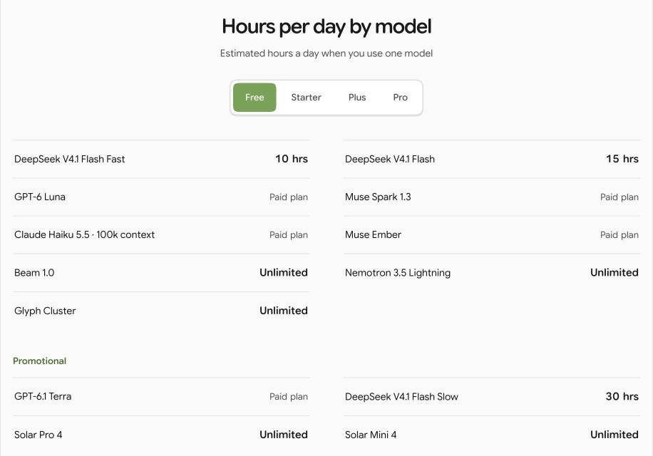

A free Freebuff account in a supported region currently buys about 15 hours a day of DeepSeek V4.1 Flash, paid for by the text ads that run inside the app. This Freebuff AI coding review checks the rest of that deal as of November 24, 2026: how the 30-hour daily allowance converts into time on each model, which models sit behind the $8 paid plan, and what the privacy policy lets Freebuff do with your prompts, project files and keystrokes in exchange.

Freebuff comes from the team behind Codebuff and ships as a terminal CLI, a desktop app, a browser builder, a cloud agent for GitHub repositories and a chat app. Its homepage still promises "$0 forever, unlimited usage". In practice, the free allowance is metered in hours, it has been changed several times since October, and the stronger models need a subscription. The ads also pay for themselves partly through data: Notebookcheck, which tested the app in November, concluded it is still a good free option but warned readers to be "extremely careful" about what they share with it.

| Question | Short answer (Nov 24, 2026) |
|---|---|
| Is Freebuff free? | Yes, with no card. Full access gets 30 hours refilled daily; limited-access regions and VPN users get 5 (4 on a VPN). |
| Which models are free? | DeepSeek V4.1 Flash (Slow, standard, Fast), Solar Mini 4, Solar Pro 4, Beam 1.0, Glyph Cluster, Nemotron 3.5 Lightning. |
| What needs a paid plan? | GPT-6 Luna, Muse Spark 1.3, Muse Ember, Claude Haiku 5.5, GPT-6.1 Terra. Plans start at $8 a month. |
| What do the ads cost you? | Prompts, a profile of your projects, and typing, pointer and focus activity can be used to choose and measure ads. |
| Who should use it? | Hobby, learning and open-source work. Not client or employer code, and nothing with secrets in reach. |

## Freebuff Limits: Free Hours per Day by Model {#freebuff-limits}

Freebuff's free plan refills 30 hours of usage every day, and each model spends those hours at its own rate. On November 24, 2026, the plans page converted that into 30 hours of DeepSeek V4.1 Flash Slow, 15 hours of DeepSeek V4.1 Flash or 10 hours of DeepSeek V4.1 Flash Fast, with five smaller models unlimited.



*Free-tier hours per day when you use a single model. Screenshot of freebuff.com/plans, November 24, 2026; Freebuff labels these figures as estimates for full-access accounts.*

The meter works like this, according to the plans page FAQ. An hour on DeepSeek V4.1 Flash Slow uses one hour of balance, and other models carry a multiplier, so the standard Flash model effectively costs two hours and Flash Fast three. Each session lasts an hour with unlimited messages inside it. Daily hours reset at midnight in your local timezone and do not roll over. Referrals and bounties add extra hours on top.

Two conditions shrink that allowance:

- **Region and VPN.** The README says supported regions get full access. Everyone else, and anyone on a VPN, gets limited access: 5 hours a day, or 4 on a VPN or proxy, restricted to the DeepSeek V4.1 Flash variants, the two Solar models and the free experimental models.
- **Fair use.** The plans page says "a session may pause or stop even with allowance remaining", and that model costs and allowances may change during the beta.

That second clause has been active. In mid-October, according to the README quoted by Developers Digest, the default model was MiMo 2.6 Flash, GLM 5.3 Flash and DeepSeek V4.1 Flash were unmetered for full-access users, and balances were counted in Freebucks. Freebuff switched balances to hours on October 15 (1 hour equals 5 Freebucks), and GLM 5.3 Flash and MiMo 2.6 Pro have since been retired. Notebookcheck's screenshot of the free tier on November 20 showed 7 hours of Flash Fast, 10 of Flash and 21 of Flash Slow; four days later the plans page showed 10, 15 and 30. These figures move in both directions, so anyone planning around Freebuff should read the plans page on the day rather than rely on a review, this one included.

## Freebuff Models: Free vs Paid Plan {#freebuff-models}

The free tier runs on DeepSeek V4.1 Flash in three speeds plus a set of smaller models; for a new account, every model from OpenAI, Meta and Anthropic in the catalog needs a paid plan. The README lists what each one is for:

| Model | Free tier | Notes from the README |
|---|---|---|
| DeepSeek V4.1 Flash / Slow / Fast | Yes (metered) | Same model at three speeds; 1M context. Fast is the default for full access, Slow for limited access without a plan |
| Solar Mini 4, Solar Pro 4 | Yes (unlimited) | Upstage models; 500K context, text only |
| Beam 1.0, Glyph Cluster, Nemotron 3.5 Lightning | Yes (unlimited) | "Free experimental models that use none of your hours"; 256K context |
| GPT-6 Luna | Paid plan | Full access on older accounts; paid plans on newer ones |
| Muse Spark 1.3, Muse Ember | Paid plan | Meta's agentic and fast coding models |
| Claude Haiku 5.5 (100K context) | Paid plan | Anthropic's fast model with a reduced context window |
| GPT-6.1 Terra | Paid plan | Two sessions a day |

The README adds that models "may still serve from a quantized (Q8_0) build", so the DeepSeek you get through Freebuff may not match the full-precision model behind DeepSeek's own API. Accounts created before November 3 keep access to models that have since moved to paid plans, until those models are retired. Separately, Gemini 3.1 Flash Lite runs Freebuff's internal file-finding and research steps rather than appearing in the picker.

<p><strong>Paying per token instead of per hour.</strong> Freebuff's hour meter suits steady daily use, but a developer who mostly needs one stronger model for a few hard tasks may prefer to call it directly from an open harness and pay only for the tokens used, for example through a shared gateway such as
<a href="https://www.packyapi.ai/register?aff=5W73&amp;utm_source=agentspulse&amp;utm_medium=affiliate&amp;utm_campaign=freebuff-ai-coding-review"
rel="sponsored nofollow noopener" target="_blank">PackyAPI</a>. That route has no ads, and the data terms are those of the gateway and model provider you choose.</p>

Freebuff Desktop can also run a locally installed Claude Code or Codex agent with your own provider account. Those sessions use your existing subscription, sit outside Freebuff's catalog and do not draw on its free hours.

## Freebuff Pricing: Paid Plans and Cancellation {#freebuff-pricing}

Freebuff's paid plans cost $8, $25 or $60 a month and add more daily hours, a monthly bonus and access to the paid models. Yearly billing saves 22%, and the yearly "pay once" option is how Freebuff offers crypto and local payment methods.

| Plan | Price | Daily hours | Monthly bonus | DeepSeek V4.1 Flash per day | Paid models |
|---|---|---|---|---|---|
| Free | $0 | 30 | none | 15 h (or 10 h Fast) | No |
| Starter | $8/month | 50 | 30 h | 25 h (or 16 h Fast) | Yes |
| Plus | $25/month | 80 | 50 h | 40 h (or 26 h Fast) | Yes |
| Pro | $60/month | 130 | 100 h | 65 h (or 43 h Fast) | Yes |

*Freebuff plans page, November 24, 2026. Figures are Freebuff's estimates for full-access accounts.*

On Starter, the per-model table gives 12 hours a day of GPT-6 Luna, 17 of Muse Spark 1.3, 8 each of Claude Haiku 5.5 and Muse Ember, and 1 hour of GPT-6.1 Terra if you spend the whole allowance on one model.

Read the cancellation terms before paying. A monthly cancellation "ends your plan and perks immediately, with no proration or refund"; a yearly plan keeps working until the paid year ends. Plans bought before November 8 keep their original hours while they stay subscribed, but a lapsed plan restarts on whatever allowance is on sale at the time. Two of the six Trustpilot reviews complain about exactly this area: one says paid allocations were cut by about 40% partway through a subscription, and another says cancelling removed paid perks at once, although that reviewer adds that support refunded them on request.

## Freebuff Privacy and Ads: What the Free Tier Collects {#freebuff-privacy}

Freebuff pays for free usage with text ads, and its privacy policy lets it use your prompts, a profile of your projects and your in-app activity to pick and measure those ads. The current policy was updated on November 8 and took effect on November 12, 2026. The points that matter for code:

- **Prompts feed ad targeting.** Freebuff "may use Prompt and Project Data to personalize advertising", including a general profile of the languages, frameworks, tools and services your projects use. Its apps "may automatically review project files, such as configuration and documentation files, without a separate prompt from you" to build that profile.
- **Typing and pointer signals.** Advertising signals include "typing, pointer, and focus activity and text you type before sending it", which ads appear and for how long, and whether you later install an advertised product. Freebuff says these are used only for advertising, including training the models that select ads.
- **What ad providers do not get.** Freebuff says it does not hand separately uploaded files, project files or connected repository contents to advertising providers. Text you paste into a prompt, attached files and command output count as part of the prompt, though, and prompts can be processed by ad and measurement providers acting for Freebuff.
- **Training opt-in by label.** Apart from the ad models, Freebuff says it does not train on your prompts unless a model or feature carries a notice such as "May use data for AI training". Data sent through a labelled model can be retained, and shared, licensed or sold to third parties, agent traces included.
- **Cloud repository evaluation.** Connecting a GitHub repository to Freebuff Cloud authorizes a "Codebase Evaluation" of that repository's "potential technical or commercial value", which can involve human review and evaluation partners. Disconnecting GitHub or deleting the project does not by itself delete data already collected.
- **Agents can reach beyond the project.** Desktop and CLI agents run with your device account's permissions, so they "can read files, run commands, and access environment variables" outside the project. Anything an agent reads becomes Prompt and Project Data. The policy itself recommends a container or separate account, and keeping passwords, keys and tokens out of prompts.

Account checks add to the data footprint. Freebuff fingerprints devices to stop duplicate free accounts, may ask for phone verification and shares a hashed form of a verified number with ad and measurement providers unless you opt out, and asks for a government ID and selfie only when a user on a flagged VPN or proxy chooses to prove they are in a full-access country. Where privacy law does not require an opt-out, the policy says some advertising processing "may be necessary to use the free Service".

Notebookcheck also tracked the ads themselves: in late October they were a muted text strip, and by November 19 they had become a coloured banner with advertiser logos.

## How Freebuff Works: CLI, Desktop and Specialist Agents {#how-freebuff-works}

Freebuff splits a coding task across specialist agents instead of sending everything through one model and one prompt. According to the README, file-finding agents first map the relevant parts of the project, then agents plan, edit, run commands and review the result; research and browser agents can read documentation and test an app in a real browser. Freebuff Desktop runs several agents in parallel, each in its own workspace, and Web and Cloud add hosted sandboxes, previews and deployment.

The CLI installs from npm and runs inside a project directory, with no API key or config file:

```bash
npm install -g freebuff
cd ~/my-project
freebuff
```

*Quick start from the Freebuff README. We did not run it for this review.*

The orchestration layer is Codebuff, the same team's open multi-agent framework, published under Apache-2.0 together with its SDK. Notebookcheck points out where the openness stops: the CLI, agents and SDK are on GitHub, while the desktop app, the server infrastructure and the platform that meters hours and serves ads are proprietary.

## Freebuff User Reviews: What Testers Report {#freebuff-user-reviews}

Hands-on reports so far describe a capable agent whose free terms keep changing. Notebookcheck's Christian Hintze had Freebuff's agents code an RPG and analyze an app, and concluded on November 22 that it "remains a good alternative", while noting that free allowances had been cut, larger models had moved to paid plans and the ads had grown more prominent over a few weeks.

User reviews split along the same line. On Trustpilot, where Freebuff has six reviews averaging 3.4, the positive ones call it "a very strong CLI agent" and say the free allowance was never close to running out; the negative ones cover a website build that failed out of the box and the subscription changes described above. Developers Digest, summarizing Reddit threads it could only read as search excerpts, found the same pattern: one commenter called Freebuff "a free harness like OpenCode with some text ads", and another thread complained that a model which had been free and unmetered now costs Freebucks.

## Freebuff vs Claude Code and OpenCode: The Trade-offs {#freebuff-vs-claude-code-opencode}

Freebuff, Claude Code and OpenCode all run an agent loop over your repository; the difference is who pays for the model and what you give up for it. Notebookcheck frames the choice the same way: paid agents from Anthropic, Google and OpenAI start at around €20 a month, OpenCode with a local model avoids the bill but needs expensive hardware, and Freebuff fills the gap with ads.

| | Freebuff (free plan) | Claude Code | OpenCode |
|---|---|---|---|
| Who pays for the model | Ads, plus your usage data | Your Anthropic subscription or API spend | You: your own API keys or local hardware |
| Models | DeepSeek V4.1 Flash, Solar and experimental models; stronger ones on paid plans | Anthropic's models | Any provider or local model you configure |
| Usage limit | 30 hours a day (5 in limited-access regions), metered per model | Set by your Anthropic plan | Set by your provider or hardware |
| Data terms | Prompts and project profile used for ad targeting; opt-in training by label | Anthropic's terms for your plan | The terms of whichever provider you connect, or none if fully local |
| Ads | Yes, inside the app | No | No |

*Based on the Freebuff plans page, README and privacy policy (Nov 2026) and Notebookcheck's comparison; Claude Code and OpenCode rows describe their general model, not current prices.*

If you already pay for Claude Code or Codex, Freebuff Desktop can run those agents with your existing account, which gives you its multi-agent desktop without moving your code onto the ad-funded models. For more on how teams compare agent spend beyond the sticker price, see our guide to [measuring coding agents by cost per successful task](/tutorials/coding-agents-finops-cost-per-successful-task/), and for the harness side of the comparison, [how DeepSeek Harness and the minimal Pi agent differ](/tutorials/deepseek-harness-vs-pi-agent/).

## Freebuff Verdict: Which Code to Use It On {#freebuff-verdict}

Freebuff is worth installing for side projects, learning, prototypes and open-source work, where 15 free hours a day of DeepSeek V4.1 Flash is a real resource and the code is not sensitive. It is a poor fit for employer or client repositories, regulated work, or any machine where secrets sit within an agent's reach.

A sensible way to try it:

1. Start the CLI in a scratch repository and watch how fast your chosen model spends the daily hours.
2. Run it in a container or a separate OS account, as the privacy policy itself recommends, and keep `.env` files and credentials outside that environment.
3. Check each model for a "May use data for AI training" label before selecting it.
4. Leave Freebuff Cloud disconnected from private GitHub repositories unless you accept the Codebase Evaluation terms.
5. Recheck the plans page before relying on a number; the free hours changed at least once between November 20 and 24.

For background on why agent access to a workstation deserves this care, see [how internal access changes the security boundary for AI agents](/tutorials/ai-agent-internal-access-security-boundary/), and for another place coding-agent activity is being logged, [what Windows 11 telemetry now records about coding agents](/tutorials/windows-11-telemetry-coding-agents/). If the paid models are the draw, our pages on [Muse Ember's pricing and benchmarks](/tutorials/muse-ember/) and [MAI Code 2 Flash versus GPT-6 Luna and Claude Haiku 5.5](/tutorials/mai-code-2-flash/) cover two of the models Freebuff reserves for subscribers, measured outside Freebuff.

## References {#references}

- Freebuff, [Plans: Free and paid plans](https://freebuff.com/plans), including "Hours per day by model" and FAQ, checked November 24, 2026.
- Freebuff, [Privacy Policy](https://freebuff.com/privacy-policy), last updated November 8, 2026, effective November 12, 2026.
- Freebuff (CodebuffAI), [freebuff GitHub repository README](https://github.com/CodebuffAI/freebuff), Apache-2.0, read November 24, 2026.
- Christian Hintze, Notebookcheck, [Use Claude Code for free? I test Freebuff, which promises virtually unlimited AI coding](https://www.notebookcheck.net/Use-Claude-Code-for-free-I-test-Freebuff-which-promises-virtually-unlimited-AI-coding.1455441.0.html), November 22, 2026.
- Developers Digest, [Freebuff Review: The Free Coding Agent Paid for by Ads, and What It Costs You](https://www.developersdigest.tech/blog/freebuff-free-coding-agent-ads-privacy-what-it-costs-2026), October 12, 2026.
