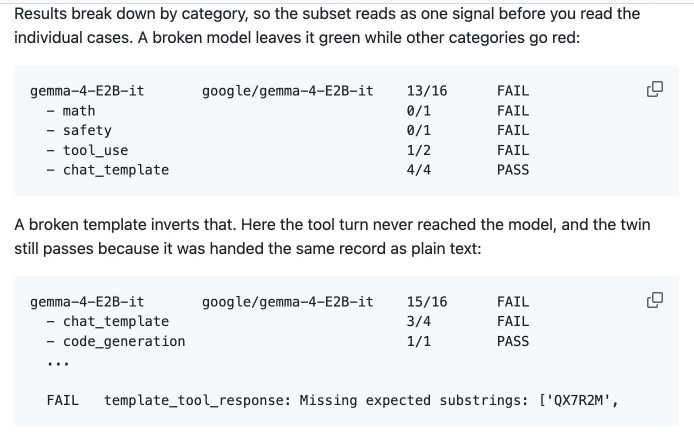

gBench is Google DeepMind's open-source benchmark framework for open models, released on November 23, 2026, and the shortest useful way to use it is to point it at an endpoint you already serve. Any OpenAI-compatible `/v1` server works through `--remote-endpoint`; the project has validated vLLM and Ollama. What decides whether your first afternoon ends with scores is the run order, because 86 eval suites, a 16-case deployment check, an agentic suite and a load test each need different things from your machine.

The gBench team's own logs show the cost of skipping that order. A serial sweep of its 84 suites at five samples each took 783 minutes in October, and five of its seven hard failures were missing keys, credentials or images that a check before generation names in seconds. The steps below go from cheapest to most expensive, with the flags, the prerequisites and the timings Google recorded. (Searching "gbench" also turns up Gert Labs' GBENCH Intelligence Benchmark, a game-based model leaderboard; it is unrelated.)

## gBench Setup: What to Install Before the First Run {#gbench-requirements}

For a remote endpoint, gBench needs Python 3.11 or newer, the `gbench` package from PyPI and, for most real runs, the eval extras and `transformers`. It skips local GPU detection in remote mode, so a laptop or CPU-only VM can drive a GPU server elsewhere. vLLM itself is only needed when gBench should start the server for you.

```bash
python3 -m venv venv && source venv/bin/activate
pip install gbench               # base package: remote endpoints such as Ollama
pip install transformers         # needed for --tokenizer, chat-template cases, mmlu and others
pip install "gbench[evals]"      # clients, scorers and harnesses for the eval suites
```

Serve the model with the parsers its serving recipe specifies. For Gemma 4 on vLLM, the docs use `--reasoning-parser gemma4 --enable-auto-tool-choice --tool-call-parser gemma4`. gBench asks the server for the generated token IDs on each eval request and decodes them through vLLM's `/detokenize` (or your `--tokenizer`), which lets it recover text a reasoning or tool-call parser stripped out of a reply. Servers without that route fall back to the tokenizer you pass.

The remaining prerequisites only matter for some suites, and they are the ones that broke Google's serial sweep:

| Needed for | Requirement |
|---|---|
| Every eval run | `--max-output-tokens` set explicitly |
| Containerized and agent suites | Docker, plus a server listening on an address Docker's bridge can reach, such as `0.0.0.0` |
| Graded, search and user-simulation suites, and the agentic suite's helper models | `GEMINI_API_KEY` or `GEMINI_API_KEYS` |
| The preflight check | 100 GB free under `--results-dir` by default (`GBENCH_PREFLIGHT_MIN_DISK_GB`) |
| Local vLLM mode | GPUs by model size: 1 up to 20B parameters, 2 up to 80B, 8 above |

Two endpoint types are not covered yet. Cloud Run services only work when they allow unauthenticated calls, because the endpoint check that opens every remote run sends no identity token. SGLang, TGI and TensorRT-LLM serve the same API, but gBench lists them as not validated.

<p><strong>Comparing outside the harness.</strong> The Gemini key above is for gBench's own graders and helper models. If you also want to put the same prompts to hosted models next to your open-weight endpoint while you read results, a shared gateway such as
<a href="https://www.packyapi.ai/register?aff=5W73&amp;utm_source=agentspulse&amp;utm_medium=affiliate&amp;utm_campaign=gbench"
rel="sponsored nofollow noopener" target="_blank">PackyAPI</a> is one option for reaching several of them through one OpenAI-style API.</p>
<p><small>Disclosure: this page contains an affiliate link. If you sign up through it, we may earn a commission at no extra cost to you.</small></p>

## gBench Preflight Check: Find Missing Keys in 30 Seconds {#gbench-preflight}

`gbench --preflight` runs every selected suite's own prerequisite check at once without sending a single model request, then prints a PASS/FAIL table with the reason for each failure. Across 84 suites it took 31 seconds in the gBench team's October 11 run. It exits with code 2 if anything fails, so it also works as a gate in a script.

```bash
gbench --preflight --evals all \
  --remote-endpoint http://127.0.0.1:8000/v1 \
  --tokenizer google/gemma-4-26B-A4B-it \
  --thinking --max-output-tokens 65536
```

Per suite, it checks the Docker images, repository checkouts, datasets and keys that suite's runner would check first. Globally, it checks free disk, the Docker daemon, whether `/v1/models` answers from your host, whether it also answers from inside a bridge container, and whether a Gemini key is present for the suites that need one. A failed disk, Docker or host-endpoint check stops a later smoke run outright; a missing key only fails the suites that use it.

Run it with the same `--thinking` and output-token flags you plan to use later. In the October sweep that prompted these checks, two MCP suites failed in 0.0 minutes, but only when the end of their lane finally reached them.

## gBench Golden Set: Catch a Broken Chat Template Before You Benchmark {#gbench-golden-set}

The Golden Set (`--golden-only`) is a 16-case deployment check: a healthy model passes every case that applies to it, and cases for a modality the model lacks, such as audio, drop out of the denominator. It covers code (the generated Python is run against unit-test assertions), math, tool calls, structured JSON, factual recall, translation, a safety refusal, vision, audio and four chat-template cases.

```bash
gbench --golden-only \
  --remote-endpoint http://127.0.0.1:8000/v1 \
  --tokenizer google/gemma-4-12B-it
```

Run it before any long benchmark because of the chat-template cases. A chat template is the Jinja that flattens structured messages into the string the model was trained on. gBench's documentation puts the failure plainly: get it wrong and nothing errors; the model receives prompts in a shape it never saw and gets quietly worse, which looks like a weak checkpoint. Every academic score you collect afterwards would carry that damage.

Two of the template cases put a tool call and its result on the wire, or a five-turn history; each has a twin that asks for the same answer in one plain user turn. Read each pair together:

| Template case | Plain-turn twin | What it means |
|---|---|---|
| pass | pass | Serialization is healthy |
| fail | pass | The model can answer, so the structure broke: check the chat template |
| fail | fail | The model cannot answer the question; the template is not implicated |

The docs show both patterns on `gemma-4-E2B-it`. A model with real gaps scored 13 of 16, failing math, safety and one tool-use case while the chat-template category stayed at 4 of 4. A broken template scored 15 of 16, but the category dropped to 3 of 4 because the replayed tool result never reached the model. Both halves of each pair also fail if the model's own special tokens leak into the visible answer.



*The two failure patterns in the Golden Set's category breakdown: a weak model (top) and a broken chat template (bottom). Screenshot of docs/golden-set.md in the google-deepmind/gbench repository, November 24, 2026.*

The gBench authors note two limits. The isolation is a structural argument: nobody has yet run the pairs against a deliberately corrupted template on real weights. And the pairs tell you a template is broken, not which line. For Gemma 4 templates, the repository's `tools/template_checks` diff a template against Google's training-time serialization without needing a GPU or an endpoint.

## gBench Smoke Test: Run Every Suite Once Without Scores {#gbench-smoke-test}

`gbench --smoke` runs the preflight and then exactly one sample of every selected suite end to end, returning PASS or FAIL per suite and no scores. It is the check that the whole pipeline works: the request reached your server, a reply came back, the sample was scored, and an agent's follow-up request arrived after its first action.

```bash
gbench --smoke --evals all \
  --remote-endpoint http://127.0.0.1:8000/v1 \
  --tokenizer google/gemma-4-26B-A4B-it \
  --thinking --max-output-tokens 65536
```

Google's October 11 smoke run of 84 suites, 8 at a time, took 42.4 minutes: 37 seconds of preflight and 41.8 minutes of pool, against 269 minutes of summed suite time. Two suites set that wall time. The default pool is now 12, the point where Google's replay of that run stopped getting faster, and the whole run stops at 3,900 seconds unless you raise `GBENCH_SMOKE_DEADLINE_S`.

The smoke test also checks request shape, which catches mistakes a score would hide. A suite fails if a request carried the wrong temperature (1.0 with `--thinking`, 0.0 without, unless you override it), a thinking switch that never reached the server, or more tokens than `--max-output-tokens`. That rule exists because in the October sweep one suite recorded `thinking_applied: false` under `--thinking`, which only showed up when someone read its result file. A request silent for 300 seconds while the server's token counters stand still counts as a hang.

## How to Run gBench Evals and the Agentic Suite on a Remote Endpoint {#gbench-evals-remote-endpoint}

Scored runs come in two kinds. `--evals` runs academic and domain suites, 86 of them under `--evals all`, grouped in six pillars: general knowledge and scientific reasoning, mathematics and proofs, coding and algorithmic design, long context and retrieval, tool use and agentic workflows, and multimodal vision. `--quality-only` runs the agentic quality suite. Start with a few named suites rather than all 86:

```bash
gbench --evals-only \
  --remote-endpoint http://127.0.0.1:8000/v1 \
  --tokenizer google/gemma-4-E4B-it \
  --evals gpqa mmlu --eval-thinking --max-output-tokens 65536
```

For a full sweep, `--parallel-suites N` runs up to N suites as separate processes, longest first, and keeps suites that share images, files or ports apart; the hand-made lanes in Google's earlier attempt collided on ports when gaia, gaia2 and wildclawbench ran together. Parallel runs change one thing: suites share your server. Agent loops with wall-clock budgets can score differently in a pool than alone, so each result records the concurrency it ran under. A validation pass at `--eval-limit 5` before the full run is the pattern the docs use. You can also add your own data as JSONL with `--eval-custom-jsonl`.

The agentic suite runs the QA scenarios of a pinned GemmaClaw/OpenClaw commit, 60 at `d8bc6989`, testing multi-turn tool calling, session memory and plugin routing. It builds a local Docker image on first use, which takes several minutes, and needs a Gemini API key for its helper models, such as the alternate model and memory embeddings. Scenarios that need a provider other than the model under test and Gemini are listed but not scored. The container has no network access; its only way out is a relay in gBench that holds the keys and forwards the Gemini calls the suite makes, so no key reaches the model under test.

```bash
gbench --quality-only --models google/gemma-4-12B-it \
  --remote-endpoint http://127.0.0.1:8000/v1 \
  --tokenizer google/gemma-4-12B-it
```

gBench holds the scaffold fixed and varies the model; to measure the agent harness itself, a purpose-built test such as [the HarnessDev benchmark](/tutorials/harnessdev-agent-harness-benchmark/) asks the opposite question. The suites inherit their upstream protocols, so a thinking-mode change can move scores the way it did in [our Qwen3.8 27B thinking-level comparison](/tutorials/qwen3-8-27b-pi-adapted/).

## gBench Stress Test: Find the Max QPS Your Server Holds {#gbench-stress-test}

`--stress-test` measures serving capacity on your hardware rather than model quality. It fires one Poisson-scheduled load per rate point, doubling the rate each step until a point fails, then certifies the limit with probes sized for the P99 target, at least 1,099 requests per cohort, to within ±9% when that resolution is reachable. Otherwise it reports a certified lower bound or marks the result uncertified.

A rate point passes only if the queue is not growing, at least 90% of requests finish within the end-to-end time the SLOs imply, P99 time to first token (TTFT) and P99 inter-token latency (ITL) meet their targets, and failures stay under 2%. Without a workload campaign, the targets are 5,000 ms TTFT and 200 ms ITL; `--stress-threshold` and `--itl-slo-ms` change them, and campaigns such as `--campaign agentic` set their own.

This is the part of gBench that works as an LLM inference framework benchmark: the same model behind vLLM, Ollama or another server gets a QPS limit under the same SLOs. Throughput and latency runs repeat each configuration and report mean, median, standard deviation, P50, P95, P99 and the coefficient of variation, checked against `--max-cv-percent` (5% by default). If you are sizing hardware for the test, [our cloud GPU price comparison](/tutorials/cloud-gpu-prices/) lists what the GPUs behind gBench's 1, 2 and 8-GPU tiers cost per hour, and [the GLM-5.3 NVFP4 serving guide](/tutorials/glm-5-3-nvfp4/) shows a vLLM setup with measured throughput.

## Reading gBench Results: Exit Codes, scaffold_id and Dataset Licenses {#gbench-results}

Each run writes a timestamped directory under `--results-dir` with `metadata.json`, a `summary.json` of every result and failure, an `eval_summary.csv`, one `eval_<suite>_<model>.json` per suite with sample-level traces, and `performance/`, `quality/` and `logs/` folders. The exit code tells you what kind of problem you have:

| Exit code | Meaning |
|---|---|
| 0 | Every planned pillar produced its result |
| 1 | A model verdict failed: the Golden Set has failing cases |
| 2 | A harness error: unreachable endpoint, a suite without a score, a server that did not start, a refused configuration |

A harness error outranks a Golden Set failure, and a failed pillar does not stop the next one from running.

For comparisons, two fields matter. `subject_id` hashes the model's observable identity and `scaffold_id` hashes how it was asked: suites, decoding, dataset and serving settings. Two runs with the same `scaffold_id` and different `subject_id` values are a like-for-like model comparison; if the `scaffold_id` changed, so did the test. Each result also records the served model ID, temperature, token cap, thinking switch and gBench commit.

Before you publish numbers, read `docs/THIRD_PARTY_DATASETS.md`. Each dataset's license, including gated and non-commercial terms, governs how you can use the scores computed on it. If you serve locally with Ollama, our [Inkling 2 Mini Ollama setup guide](/tutorials/inkling-2-mini-ollama/) covers getting a model to the point where `/v1/models` answers, which is the first thing gBench checks.

## References {#references}

1. Google DeepMind, [gBench README](https://github.com/google-deepmind/gbench), Apache 2.0, accessed November 24, 2026.
2. Google DeepMind, [Preflight, smoke test and parallel suites (docs/smoke.md)](https://github.com/google-deepmind/gbench/blob/main/docs/smoke.md), accessed November 24, 2026.
3. Google DeepMind, [Golden Set capability smoke test (docs/golden-set.md)](https://github.com/google-deepmind/gbench/blob/main/docs/golden-set.md), accessed November 24, 2026.
4. Google DeepMind, [Remote endpoint mode (docs/remote-endpoints.md)](https://github.com/google-deepmind/gbench/blob/main/docs/remote-endpoints.md) and [Results (docs/results.md)](https://github.com/google-deepmind/gbench/blob/main/docs/results.md), accessed November 24, 2026.
5. Google Gemma, ["Meet gBench, our newly open-sourced benchmarking framework"](https://x.com/googlegemma/status/2124935724999073902), X, November 23, 2026.
