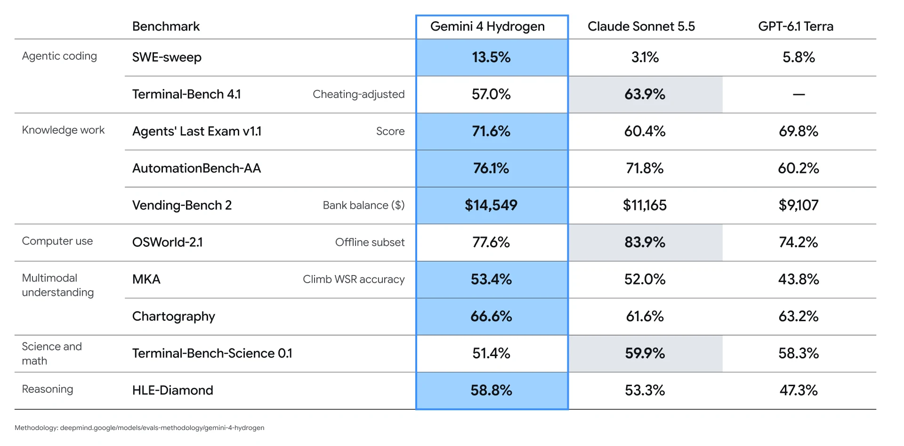
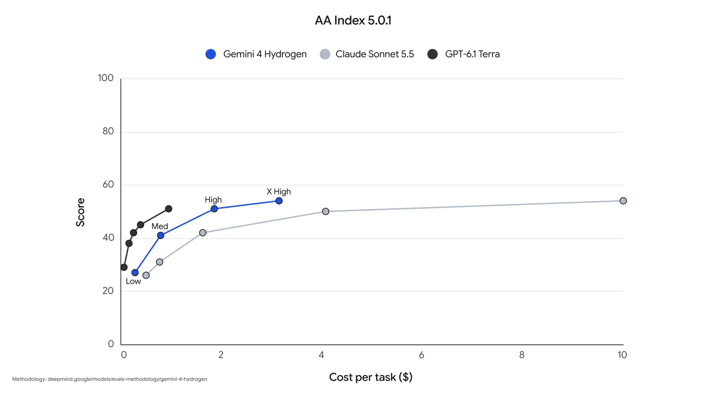
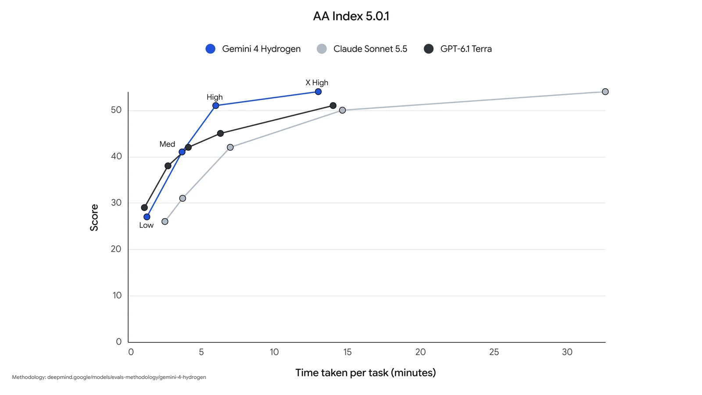

Gemini 4 Hydrogen benchmarks put Google's new fast model at 51 on the Artificial Analysis Intelligence Index at its default setting, level with GPT-6.1 Terra and Gemini 4 Argon, for $1.87 per task, about a third of Gemini 4 Carbon's $5.48. Google released Hydrogen on November 12, 2026 as the quick, cheaper member of the Gemini 4 family, alongside the frontier models Carbon and Argon. The useful number for most teams is cost per task at each of its four thinking levels, because the gap between them is large.

## Gemini 4 Hydrogen Benchmarks at a Glance {#gemini-4-hydrogen-benchmarks-at-a-glance}

Gemini 4 Hydrogen scores 51 on the Artificial Analysis Intelligence Index v5.0.1 at its default high thinking level and 54 at the new xhigh level. The index combines nine evaluations, including Terminal-Bench 4.0, AutomationBench-AA, HLE-Diamond and GDP.pdf; the median for comparable models is 41.

| Question | Short answer |
|---|---|
| What is it? | Google's fast Gemini 4 model, adapted from Gemini 4 Carbon. |
| Price | $1.50 input / $7.50 output per million tokens, flat across the 1M-token context. |
| Context | 1M tokens in; 64K output by default, up to 1M with background long decode. |
| Headline score | 51 at high ($1.87 per task), 54 at xhigh ($3.16 per task), Artificial Analysis. |
| Main catch | xhigh is very verbose; Sonnet 5.5 still leads on terminal and computer-use tests. |

*Index scores, costs and times from Artificial Analysis model pages, accessed November 13, 2026.*

## Gemini 4 Hydrogen Benchmark Results: Google's Table {#gemini-4-hydrogen-benchmark-results}

In Google's launch table, Gemini 4 Hydrogen beats Claude Sonnet 5.5 and GPT-6.1 Terra on seven of ten benchmarks and trails Sonnet 5.5 on three. The same table appears in the model card, and Google links its evaluation methodology from the image.

*Gemini 4 Hydrogen vs Claude Sonnet 5.5 vs GPT-6.1 Terra. Image by Google DeepMind.*

### Where Hydrogen leads

| Benchmark | Gemini 4 Hydrogen | Claude Sonnet 5.5 | GPT-6.1 Terra |
|---|---|---|---|
| SWE-sweep | 13.5% | 3.1% | 5.8% |
| Agents' Last Exam v1.1 | 71.6% | 60.4% | 69.8% |
| AutomationBench-AA | 76.1% | 71.8% | 60.2% |
| Vending-Bench 2 (bank balance) | $14,549 | $11,165 | $9,107 |
| MKA (Climb WSR accuracy) | 53.4% | 52.0% | 43.8% |
| Chartography | 66.6% | 61.6% | 63.2% |
| HLE-Diamond | 58.8% | 53.3% | 47.3% |

The widest margins are on SWE-sweep, where all three models score low but Hydrogen's 13.5% is more than four times Sonnet 5.5's 3.1%, and on Agents' Last Exam, where it leads Sonnet 5.5 by 11 points. Google also cites outside rankings: fifth on Agent Arena, first on the Vals Tax Agent Bench at 52.3%, and tied first on the Vals Legal Research Bench at 55.8%.

### Where Sonnet 5.5 leads

| Benchmark | Gemini 4 Hydrogen | Claude Sonnet 5.5 | GPT-6.1 Terra |
|---|---|---|---|
| Terminal-Bench 4.1 (cheating-adjusted) | 57.0% | 63.9% | — |
| OSWorld-2.1 (offline subset) | 77.6% | 83.9% | 74.2% |
| Terminal-Bench-Science 0.1 | 51.4% | 59.9% | 58.3% |

Terminal work and computer use are where Sonnet 5.5 stays ahead, by about 6 to 9 points. On Terminal-Bench-Science, GPT-6.1 Terra also beats Hydrogen. Google's table does not state the thinking level for each row, so compare these with the Artificial Analysis numbers below, which are measured per level.

## Gemini 4 Hydrogen Thinking Levels: Score, Cost and Time per Task {#gemini-4-hydrogen-thinking-levels}

Gemini 4 Hydrogen has four thinking levels: low, medium, high (the default) and a new xhigh. Artificial Analysis measures each as a separate model on its Intelligence Index, the same chart we used for [Muse Ember](/tutorials/muse-ember/) and [Inkling 2 Small](/tutorials/inkling-2-small/), and the spread is wide: from 27 points at $0.29 per task to 54 points at $3.16.

| Thinking level | Intelligence Index | Rank (of 78) | Cost per task | Time per task | Time to first answer token | Output tokens on the index |
|---|---|---|---|---|---|---|
| low | 27 | #60 | $0.29 | 1.3 min | 5.7 s | 20.3M |
| medium | 41 | #39 | $0.80 | 3.7 min | 11.8 s | 54.4M |
| high (default) | 51 | #21 | $1.87 | 8.3 min | 18.9 s | 110M |
| xhigh | 54 | #16 | $3.16 | 13.5 min | 37.8 s | 304M |

*Source: Artificial Analysis model pages, Intelligence Index v5.0.1, accessed November 13, 2026.*

The step sizes are what matter when choosing a level:

| Step | Index gain | Extra cost per task | Extra time per task |
|---|---|---|---|
| low → medium | +14 | +$0.51 | +2.4 min |
| medium → high | +10 | +$1.07 | +4.6 min |
| high → xhigh | +3 | +$1.29 (+69%) | +5.2 min (+63%) |

*Differences calculated by AgentsPulse from the table above.*

Xhigh nearly triples output tokens compared with high (304M vs 110M). Artificial Analysis ranks it 76th of 77 models for verbosity, against a median of 72.8M tokens, and the model card lists higher token use at higher thinking levels as a known limitation.

Google's launch charts plot the same Artificial Analysis data against Claude Sonnet 5.5 and GPT-6.1 Terra.

*Score vs cost per task. Image by Google, data from Artificial Analysis.*

*Score vs time per task. Image by Google, data from Artificial Analysis.*

The two charts show different winners. On cost, GPT-6.1 Terra's curve sits to the left of Hydrogen's and reaches about 51 for under $1 per task. On time, Google's chart puts Hydrogen high at 51 in about 6 minutes, where Terra needs roughly 14; the Artificial Analysis page now lists 8.3 minutes for Hydrogen high, so the chart likely reflects an earlier speed measurement. Sonnet 5.5 matches Hydrogen xhigh's score only at about $10 and 33 minutes per task; our [Claude Fable 5.2 review](/tutorials/claude-fable-5-2/) covers where Anthropic's line sits on the same index.

### Which thinking level to use

- **Medium** fits high-volume calls and interactive tools. It scores 41, the median for comparable models, in under 4 minutes per index task, and its first answer token arrives in about 12 seconds.
- **High** is the best value for agent work. The step from medium buys 10 points for about a dollar per task, roughly four times the points per dollar of the step to xhigh.
- **Xhigh** is worth testing only when a task fails at high. Three more points cost 69% more money and 63% more time, and token use nearly triples.
- **Low** suits routing, extraction and short replies; 27 on the index is below Gemini 3.8 Flash's 31.

## Gemini 4 Hydrogen vs Gemini 3.8 Flash {#gemini-4-hydrogen-vs-3-8-flash}

Gemini 4 Hydrogen at high scores 51 on the Intelligence Index against 31 for Gemini 3.8 Flash at high (the model [Inkling 2 Small](/tutorials/inkling-2-small/) was measured against), and it costs $1.87 per task against $7.77. Hydrogen's per-token price is twice Flash's ($1.50/$7.50 vs $0.75/$3.75 per million tokens), but Flash used 126M output tokens on the index and took 14.8 minutes per task, against 8.3 minutes for Hydrogen high.

| | Gemini 4 Hydrogen (high) | Gemini 3.8 Flash (high) |
|---|---|---|
| Intelligence Index | 51 | 31 |
| Cost per task | $1.87 | $7.77 |
| Time per task | 8.3 min | 14.8 min |
| Price per 1M input / output tokens | $1.50 / $7.50 | $0.75 / $3.75 |
| Terminal-Bench 4.1 (Google) | 57% | 18.2% |

*Index, cost, time and price from Artificial Analysis; Terminal-Bench 4.1 from Google.*

Google adds that Hydrogen is 2.5 times faster than 3.8 Flash at high and cuts fabricated claims by more than five times; early partners reported 2x to 2.8x faster runs with 12% to 23% fewer tokens. These are Google's and its partners' figures, not independent measurements.

The model card's safety comparison with 3.8 Flash moves in both directions: image-to-text safety improved by 7.00 percentage points, while unjustified refusals rose 5.57 points, particularly on multimodal prompts.

On Hacker News, users noted that the Gemini app swapped 3.8 Flash for Hydrogen right away, and that Hydrogen's list price matches 3.8 Flash's undiscounted price, which is above what many developers pay after discounts.

## Gemini 4 Hydrogen vs Carbon and Argon {#gemini-4-hydrogen-vs-carbon}

Gemini 4 Carbon at high scores 60 on the Intelligence Index, nine points above Hydrogen high, but it costs $5.48 and 27.4 minutes per task, about three times Hydrogen's cost and time. Gemini 4 Argon scores 50.4, so Hydrogen at its default level matches Google's other frontier model.

| | Hydrogen (high) | Hydrogen (xhigh) | Carbon (high) | Argon |
|---|---|---|---|---|
| Intelligence Index | 51 | 54 | 60 | 50.4 |
| Cost per task | $1.87 | $3.16 | $5.48 | — |
| Time per task | 8.3 min | 13.5 min | 27.4 min | — |
| Price per 1M input / output | $1.50 / $7.50 | $1.50 / $7.50 | $2 / $10 | — |

*Artificial Analysis, accessed November 13, 2026. Argon's cost and time were not checked for this article.*

Google's intended pairing is Carbon as coordinator and Hydrogen as worker or verifier agents. In its Antigravity coding environment, an Orchestrator mode switches between the two inside one session. Google reports that on Terminal-Bench 4.0 this setup came close to Carbon's success rate while using 24% less quota and running 19% faster.

For a single-model choice, Carbon is worth the cost only for long, hard tasks where nine extra points change the outcome. For agents that run many short steps, Hydrogen high delivers most of the score at about a third of the cost.

## Gemini 4 Hydrogen Pricing, Context and Limits {#gemini-4-hydrogen-pricing}

Gemini 4 Hydrogen costs $1.50 per million input tokens and $7.50 per million output tokens, with no surcharge for long prompts across the full 1M-token context. Artificial Analysis lists a 95% discount on cached input.

- **Context and output:** 1M tokens of text, image, audio or video in; 64K tokens out by default, up to 1M with background long decode.
- **Knowledge cutoff:** March 2026.
- **Where it runs:** the Gemini API in Google AI Studio and Android Studio, Gemini for business, Antigravity on AI Pro and Ultra plans, the Gemini app, Google Search and Sheets.
- **Known limits from the model card:** hallucinations, occasional slowness or timeouts, and more tokens at higher thinking levels.
- **Frontier Safety:** Hydrogen did not reach the critical capability levels for CBRN or cyber, but it did reach the alert thresholds for both, which triggers additional testing under Google's framework.

For most agent and coding workloads, start with Hydrogen at high and measure [cost per successful task](/tutorials/coding-agents-finops-cost-per-successful-task/) on your own jobs; drop to medium for latency-sensitive calls and keep Carbon for the steps that fail at high. A [model gateway](/tutorials/model-gateway-enterprise-ai-control-plane/) can make that per-step routing a policy instead of a code change.

## References {#references}

1. Google, [Introducing Gemini 4 Hydrogen](https://blog.google/innovation-and-ai/models-and-research/gemini-models/introducing-gemini-4-hydrogen/), November 12, 2026.
2. Google DeepMind, [Gemini 4 Hydrogen Model Card (PDF)](https://storage.googleapis.com/deepmind-media/Model-Cards/Gemini-4-Hydrogen-Model-Card.pdf), November 2026.
3. Artificial Analysis, [Gemini 4 Hydrogen model page](https://artificialanalysis.ai/models/gemini-4-hydrogen), with the [high](https://artificialanalysis.ai/models/gemini-4-hydrogen-high), [medium](https://artificialanalysis.ai/models/gemini-4-hydrogen-medium) and [low](https://artificialanalysis.ai/models/gemini-4-hydrogen-low) variants, accessed November 13, 2026.
4. Artificial Analysis, [Gemini 3.8 Flash](https://artificialanalysis.ai/models/gemini-3-8-flash), [Gemini 4 Carbon](https://artificialanalysis.ai/models/gemini-4-carbon) and [Claude Sonnet 5.5](https://artificialanalysis.ai/models/claude-sonnet-5-5) model pages, accessed November 13, 2026.
5. Hacker News, [Gemini 4 Hydrogen discussion](https://news.ycombinator.com/item?id=50471431), November 12, 2026.
