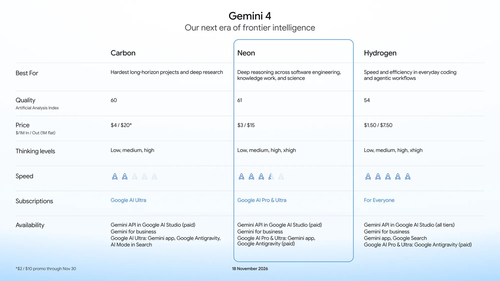

There are four Gemini 4 models, and one independent leaderboard already separates them: Artificial Analysis scores Gemini 4 Neon 61, Carbon 60, Hydrogen 54 and Argon 50 on its Intelligence Index. Google DeepMind announced them between September 30 and November 18, 2026, and the lineup has already shifted under early adopters. Argon and Carbon carry the same API price even though Carbon scores ten points higher, both prices double on December 1, and the Gemini app no longer offers Argon at all. This guide puts the scores, cost per task, prices and plan access for all four Gemini 4 models side by side, then turns them into a choice.

## Gemini 4 Models at a Glance: Argon, Carbon, Neon and Hydrogen {#gemini-4-models-at-a-glance}

The Gemini API lists four Gemini 4 models: Carbon (`gemini-4-carbon`), Neon (`gemini-4-neon`), Hydrogen (`gemini-4-hydrogen`) and Argon (`gemini-4-argon`). All four share a 1M-token context window, default to 64K output tokens with long decode up to 1M, and accept text, images, audio, video and PDFs through the API. They differ in how long they think, how fast they finish and what they cost.

| | Argon | Carbon | Neon | Hydrogen |
|---|---|---|---|---|
| Generally available | Oct 13 | Nov 10 | Nov 18 | Nov 12 |
| Google's positioning | Efficient frontier reasoning | Strongest; hardest long-horizon work | Between Carbon and Hydrogen | Fast everyday coding and agents |
| API price per 1M tokens, in / out | $2 / $10, then $4 / $20 from Dec 1 | $2 / $10, then $4 / $20 from Dec 1 | $3 / $15 | $1.50 / $7.50 |
| API free tier | No | No | No | Yes |
| Thinking levels | Up to high; medium default | low, medium (default), high | low, medium, high (default), xhigh | low, medium, high (default), xhigh |
| AA Intelligence Index | 50 (high) | 60 (high) | 61 (xhigh) | 54 (xhigh) |
| Gemini app | Not listed | AI Ultra | AI Pro and Ultra | Everyone |

*Prices and model codes from the Gemini API pricing and models pages; app access from Gemini Apps Help; scores from Artificial Analysis. All read November 20, 2026.*

Google's own comparison chart from the Neon launch covers only three of these models. Argon is missing from it, and from the "Choosing a model" page in Google AI Studio, even though the API still sells it.



*Gemini 4 Carbon, Neon and Hydrogen as Google presented them on November 18, 2026. Carbon's $4/$20 price carries a $2/$10 promotion through November 30. Image by Google.*

## Gemini 4 Benchmarks: Score, Cost and Time per Task {#gemini-4-benchmarks}

On the Artificial Analysis Intelligence Index v5.0.1, which combines nine evaluations including Terminal-Bench 4.0, GDP.pdf, HLE-Diamond and AA-Omniscience, Neon leads the Gemini 4 family at 61 and Argon trails at 50. The median for comparable models is 44. Cost and time per task separate the models more than the scores do.

| Model (thinking level) | Index score | Cost per task | Price basis | Time per task | Output tokens to run the index |
|---|---|---|---|---|---|
| Neon (xhigh) | 61 | $6.44 | $3 / $15 | 21.5 min | 283M |
| Carbon (high) | 60 | $7.76 | $4 / $20 (standard) | 39.9 min | 205M |
| Hydrogen (xhigh) | 54 | $3.16 | $1.50 / $7.50 | 15.7 min | 304M |
| Argon (high) | 50 | $4.97 | $2 / $10 (introductory) | 28.4 min | 113M |

*Source: Artificial Analysis model pages, accessed November 20, 2026. Comparable-model medians: 12.8 minutes and 65.4M tokens.*

Artificial Analysis prices Carbon at its standard rate and Argon at its introductory rate, so the two cost figures are not on the same footing. Every component of both prices (input, output and cached input) doubles on December 1. With the same token use, that puts Carbon at about $3.88 per task today and Argon at about $9.94 from December 1. Those two figures are our arithmetic from the published numbers.

Three patterns stand out. Carbon is the slowest model by a wide margin, at almost 40 minutes per index task. Neon beats it on score, time and standard-price cost, and at its default high level Artificial Analysis found that Neon matches Carbon's score for less than half the cost per task. Argon writes the fewest tokens, but Google's Hydrogen post already put Hydrogen at its default high level one point above Argon (51 vs 50) at a quarter lower token price.

Single-model deep dives are in our [Gemini 4 Neon benchmark breakdown](/tutorials/gemini-4-neon-benchmarks/) and the [per-thinking-level Hydrogen results](/tutorials/gemini-4-hydrogen-benchmarks/). For context outside Google, Artificial Analysis ranks Neon third overall behind Claude Fable 5.2 and GPT-6.2 Astra; see the [GPT-6.2 Astra and Sol results](/tutorials/gpt-6-2-benchmarks/) and our [Claude Fable 5.2 comparison with Opus 5.5](/tutorials/claude-fable-5-2/).

<p><strong>Testing more than one model?</strong> The four Gemini 4 models share a request schema, so moving a prompt between them is a model-string change, and cost per task is easiest to judge on your own workload. If you also benchmark models from other vendors, a shared gateway such as
<a href="https://www.packyapi.ai/register?aff=5W73&amp;utm_source=agentspulse&amp;utm_medium=affiliate&amp;utm_campaign=gemini-4-models"
rel="sponsored nofollow noopener" target="_blank">PackyAPI</a> is one option for running them behind a single key.</p>
<p><small>Disclosure: this page contains an affiliate link. If you sign up through it, we
may earn a commission at no extra cost to you.</small></p>

## Gemini 4 Pricing After December 1 {#gemini-4-pricing-december-1}

From December 1, 2026, Gemini 4 Carbon and Argon cost $4 per million input tokens and $20 per million output tokens, double their current $2 and $10. Neon has no introductory price and stays at $3 and $15, so it becomes the cheaper of the three frontier models per token. Hydrogen stays at $1.50 and $7.50 and is the only Gemini 4 model on the free tier.

| Per 1M tokens | Through Nov 30 | From Dec 1 |
|---|---|---|
| Argon, input / output / cached | $2 / $10 / $0.10 | $4 / $20 / $0.20 |
| Carbon, input / output / cached | $2 / $10 / $0.10 | $4 / $20 / $0.20 |
| Neon, input / output / cached | $3 / $15 / $0.15 | $3 / $15 / $0.15 |
| Hydrogen, input / output / cached | $1.50 / $7.50 / $0.075 | $1.50 / $7.50 / $0.075 |

*Source: Gemini API pricing page, standard tier, read November 20, 2026. All four models support implicit caching only; thinking tokens are billed as output.*

The price change reorders the value ranking. Until November 30, Carbon at its promotional price works out to roughly $3.88 per Artificial Analysis task, cheaper than Neon's $6.44 for a one-point lower score, as long as you can wait about twice as long for each task. After December 1, Neon is cheaper per task, faster and slightly higher scoring than Carbon on that index. Any team running Argon or Carbon in production should rerun its cost estimate before the switch. Tracking [cost per successful task](/tutorials/coding-agents-finops-cost-per-successful-task/) rather than token price is the fairer test, because Neon and Hydrogen spend many more output tokens at xhigh.

## Gemini 4 Carbon vs Argon: Same Price, Ten Points Apart {#gemini-4-carbon-vs-argon}

Gemini 4 Carbon and Argon cost the same per token, take the same `thinking_level` controls and share the same 1M context and tools, so Google calls switching between them a single model-string change. The difference is how much each thinks. Carbon scores 60 to Argon's 50 on the Artificial Analysis index and spends more tokens doing it: 205M against 113M to run the full index.

Google's guidance has moved since Carbon arrived. The Carbon developer guide, published November 10, still recommends Argon "for the majority of software engineering and knowledge work" because of its tighter token use and faster turnaround, and keeps Carbon for the hardest multi-step coding, auditing, formal math and research. Eight days later the lineup had a different middle model. Google's current "Choosing a model" page recommends Hydrogen by default, Neon for complex high-volume work and Carbon for the hardest problems, and it does not mention Argon.

Argon remains callable as `gemini-4-argon` on the paid API tier, and the Gemini API models page does not list it as deprecated. Google Cloud's Neon developer guide, however, names Neon as the upgrade path for Argon. On the numbers, Hydrogen at its default level already scores a point above Argon at a lower price, and from December 1 Neon offers a much higher score for less per token. If Argon is your production model today, test Hydrogen for routine turns and Neon for hard ones before the price change.

## Which Gemini 4 Models You Get in the Gemini App {#gemini-4-models-gemini-app}

The Gemini app offers three Gemini 4 models, and your Google AI plan decides which ones you can pick: Hydrogen for everyone, Neon from AI Pro up, and Carbon only on AI Ultra. Google's help page lists no Argon in the app.

| Google AI plan | Chats | Tasks |
|---|---|---|
| No plan | Auto | Hydrogen |
| Google AI Plus | Auto, Hydrogen | Hydrogen |
| Google AI Pro | Auto, Hydrogen, Neon | Hydrogen, Neon |
| Google AI Ultra | Auto, Hydrogen, Neon, Carbon | Hydrogen, Neon, Carbon |

*Source: Gemini Apps Help, "About Gemini models", personal Google Accounts, read November 20, 2026. Work and school accounts depend on the Workspace license.*

Auto routes each prompt between Hydrogen and a faster lightweight model, and picks the thinking level for you. When you choose a model manually, the app offers Low, Medium and High thinking and defaults to Low if you skip that step, so set High yourself for hard prompts. Heavier models and higher levels use more of your plan's allowance, and once you hit the limit chats continue on the lightweight model.

Users on Google's community forum have reported Argon disappearing from the model picker since Hydrogen and Neon arrived. The help page matches those reports: it lists Hydrogen and Neon for AI Pro and adds Carbon only on Ultra. In Google Antigravity, Google lists Carbon for Ultra and Neon and Hydrogen for paid Pro and Ultra plans; our [Antigravity /teamwork guide](/tutorials/antigravity-teamwork/) covers how those agents split work.

## Is There a Gemini 4 Pro? {#gemini-4-pro}

There is no Gemini 4 Pro model. The four Gemini 4 models are named Argon, Carbon, Neon and Hydrogen, and "Pro" now refers to the Google AI Pro subscription, which unlocks Hydrogen and Neon in the Gemini app. The most recent model with Pro in its name is Gemini 3.1 Pro, still listed in the Gemini API catalog as `gemini-3.1-pro-preview`.

If you are replacing Gemini 3.1 Pro in an API project, Google Cloud's Neon developer guide names Neon as the upgrade target for both `gemini-3.1-pro-preview` and `gemini-4-argon`. Neon's default thinking level is high, and it adds xhigh, which 3.1 Pro and Argon do not support.

## How to Choose a Gemini 4 Model for API Work {#how-to-choose-a-gemini-4-model}

Choose a Gemini 4 model by the cost of a wrong answer and how long you can wait. Google's model-selection page gives a simple default, and the independent numbers above mostly agree with it.

1. **Start with Hydrogen** for everyday coding, interactive apps, tool-calling agents and document pipelines. It is the fastest Gemini 4 model, the cheapest at $1.50/$7.50, and the only one on the free tier.
2. **Move to Neon** when Hydrogen fails on multi-file changes, dense analysis or science work. It scores 61 at xhigh, needs a paid tier, and from December 1 costs less per token than Carbon or Argon.
3. **Keep Carbon** for the hardest problems: architecture, root-cause debugging across a repository, formal proofs and security audits, or tasks where a faster model gets stuck. Expect long runs; it averaged almost 40 minutes per index task.
4. **Plan your Argon exit.** Argon still works on the paid API, but it scores below Hydrogen and costs as much as Carbon from December 1.

You do not have to pick one. Carbon, Neon and Hydrogen share one request schema, context window and tool set, and Google's own pattern runs Carbon on the first turn to design a fix, then passes `previous_interaction_id` to Hydrogen to write the edits and run tests:

```python
from google import genai

client = genai.Client()

plan = client.interactions.create(
    model="gemini-4-carbon",
    input="Identify the race conditions in this Redis lock and outline a safe fix.",
)
edits = client.interactions.create(
    model="gemini-4-hydrogen",
    previous_interaction_id=plan.id,
    input="Implement the fix and add tests.",
)
```

Swap Carbon for Neon on the planning turn if speed matters more than the last bit of verification. A [model gateway](/tutorials/model-gateway-enterprise-ai-control-plane/) can make that routing a configuration change rather than a code change, and for yes/no routing decisions Google also offers the zero-output-token [Gemini Decision 1 model](/tutorials/gemini-decisions-api/).

## References {#references}

1. Google, [Gemini API pricing](https://ai.google.dev/gemini-api/docs/pricing) and [Gemini models](https://ai.google.dev/gemini-api/docs/models), accessed November 20, 2026.
2. Google AI Studio, [Choosing a model](https://aistudio.google.com/docs/choosing-a-model) and [Gemini 4 Carbon developer guide](https://aistudio.google.com/learn/gemini-4-carbon-developer-guide), accessed November 20, 2026.
3. Google, [About Gemini models](https://support.google.com/gemini/answer/18648722), Gemini Apps Help, accessed November 20, 2026.
4. Google, [Gemini 4 Carbon is now available](https://blog.google/innovation-and-ai/models-and-research/gemini-models/gemini-4-carbon-now-available/), November 10, 2026, and [Introducing Gemini 4 Neon](https://blog.google/innovation-and-ai/models-and-research/gemini-models/introducing-gemini-4-neon/), November 18, 2026.
5. Artificial Analysis, model pages for [Gemini 4 Argon](https://artificialanalysis.ai/models/gemini-4-argon), [Carbon](https://artificialanalysis.ai/models/gemini-4-carbon), [Neon](https://artificialanalysis.ai/models/gemini-4-neon) and [Hydrogen](https://artificialanalysis.ai/models/gemini-4-hydrogen), accessed November 20, 2026.
