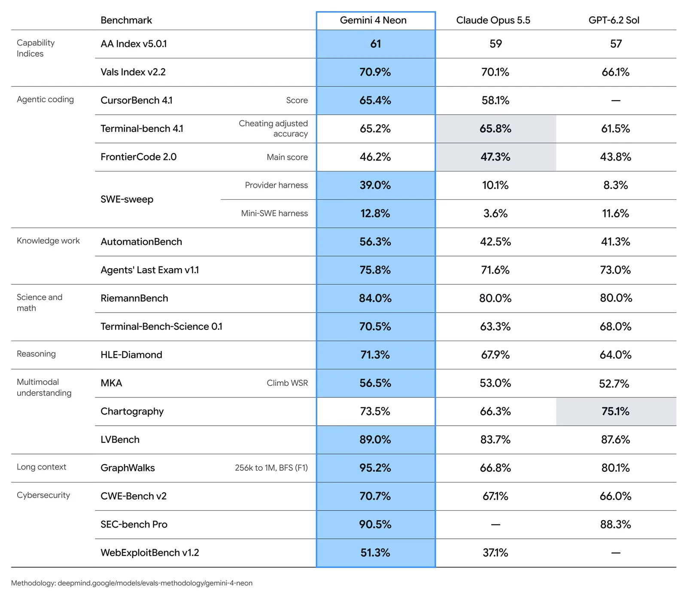
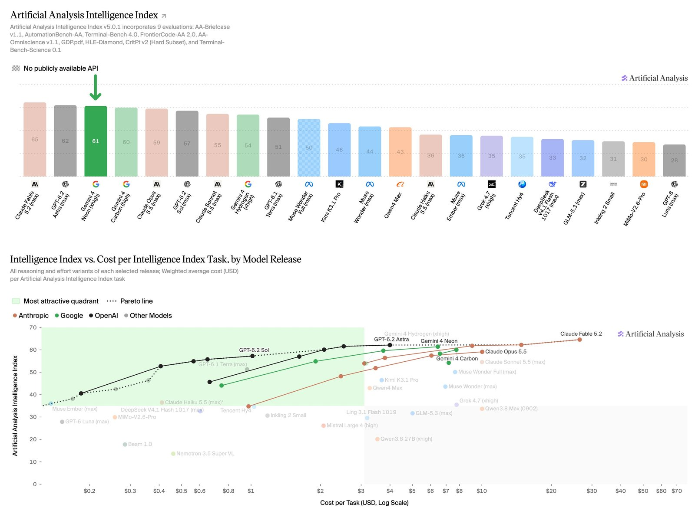
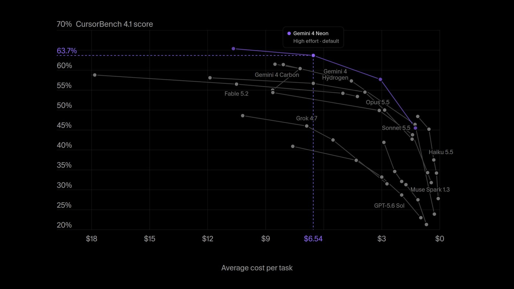
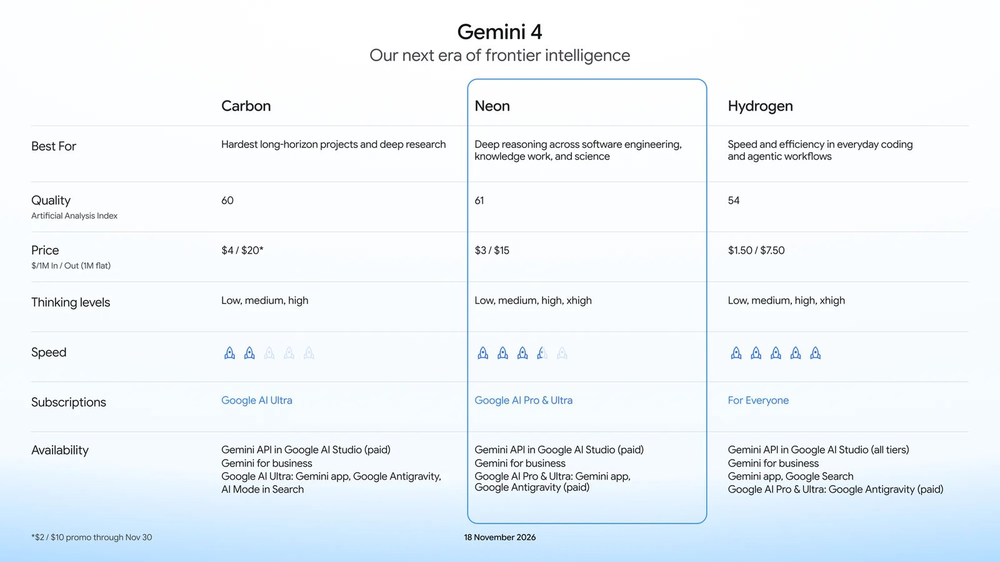

Gemini 4 Neon benchmarks put Google's new middle model at 61 on the Artificial Analysis Intelligence Index, one point above Gemini 4 Carbon and third overall, while costing about 17% less per task and finishing about 40% faster than Carbon at standard prices. Google DeepMind released Neon on November 18, 2026, six days after [Gemini 4 Hydrogen](/tutorials/gemini-4-hydrogen-benchmarks/), and positions it between Hydrogen's fast everyday work and Carbon's long-horizon projects. For most teams the deciding numbers are cost and time per task at each thinking level, and how Neon stacks up against Claude Opus 5.5 and GPT-6.2 Sol on coding agents.

## Gemini 4 Neon Benchmarks at a Glance {#gemini-4-neon-benchmarks-at-a-glance}

Gemini 4 Neon scores 61 on the Artificial Analysis Intelligence Index v5.0.1 at xhigh and 60 at its default high level. The index combines nine evaluations, including AA-Briefcase, AutomationBench-AA, Terminal-Bench 4.0, GDP.pdf, HLE-Diamond and CritPt; the median for models in its price tier is 43.

| Question | Short answer |
|---|---|
| Position | Middle Gemini 4 model, adapted from Carbon, for complex coding, analysis and enterprise workflows. |
| Price | $3 input / $15 output per million tokens; cached input $0.15. |
| Context | 1,048,576 tokens shared by input and output. |
| Headline score | 61 at xhigh ($6.44 and 21.5 minutes per task), 60 at high. |
| Coding agents | 59 on the AA Coding Agent Index in Antigravity CLI, $6.86 per task. |
| Main catch | Slow and verbose at xhigh: 56.5 s to first answer token and 283M output tokens to run the index. |

*Index scores, costs and times from Artificial Analysis, accessed November 19, 2026.*

## Gemini 4 Neon Benchmark Results: Google's Table {#gemini-4-neon-benchmark-results}

In Google's launch table, Gemini 4 Neon leads Claude Opus 5.5 and GPT-6.2 Sol on 16 of 19 rows. Opus 5.5 is ahead on Terminal-Bench 4.1 and FrontierCode 2.0, and GPT-6.2 Sol is ahead on Chartography. These are Google's numbers; its methodology page sits at deepmind.google/models/evals-methodology/gemini-4-neon.



*Gemini 4 Neon vs Claude Opus 5.5 vs GPT-6.2 Sol. Image by Google DeepMind.*

### Where Neon leads

| Benchmark | Gemini 4 Neon | Claude Opus 5.5 | GPT-6.2 Sol |
|---|---|---|---|
| CursorBench 4.1 | 65.4% | 58.1% | — |
| SWE-sweep (provider harness) | 39.0% | 10.1% | 8.3% |
| SWE-sweep (mini-SWE harness) | 12.8% | 3.6% | 11.6% |
| AutomationBench | 56.3% | 42.5% | 41.3% |
| Agents' Last Exam v1.1 | 75.8% | 71.6% | 73.0% |
| Terminal-Bench-Science 0.1 | 70.5% | 63.3% | 68.0% |
| HLE-Diamond | 71.3% | 67.9% | 64.0% |
| GraphWalks (256K to 1M, BFS F1) | 95.2% | 66.8% | 80.1% |

The SWE-sweep rows show how much the harness matters. Neon scores 12.8% in the neutral mini-SWE harness and 39.0% in Google's own Antigravity harness, so the 39.0% figure measures Neon plus Google's agent tooling. The largest model-only gap is long context: on GraphWalks, which tests graph search across 256K to 1M tokens, Neon scores 95.2% against 66.8% for Opus 5.5.

### Where Opus 5.5 and GPT-6.2 Sol lead

| Benchmark | Gemini 4 Neon | Claude Opus 5.5 | GPT-6.2 Sol |
|---|---|---|---|
| Terminal-Bench 4.1 (cheating-adjusted) | 65.2% | 65.8% | 61.5% |
| FrontierCode 2.0 | 46.2% | 47.3% | 43.8% |
| Chartography | 73.5% | 66.3% | 75.1% |

The margins here are small, under 1.5 points, but they fall on the two terminal and repository coding tests most teams care about. Google's table also does not say which thinking level each row uses. Its CursorBench 4.1 figure of 65.4% is higher than the 63.7% Cursor published for Neon at its default high level, which suggests the table row used a higher setting.

## Gemini 4 Neon Independent Benchmarks: Artificial Analysis, Vals and Cursor {#gemini-4-neon-independent-benchmarks}

Three outside evaluators published Gemini 4 Neon results on launch day, and all three place it near the top at a lower cost than the models around it. Artificial Analysis ranks it third on intelligence, Vals AI ranks it second on the Vals Index, and Cursor reports a new cost-performance frontier on its own coding benchmark.



*Artificial Analysis Intelligence Index v5.0.1 and index score vs cost per task. Image by Artificial Analysis.*

- **Artificial Analysis Intelligence Index:** Neon at xhigh scores 61, behind Claude Fable 5.2 (65) and GPT-6.2 Astra (62), and ahead of Gemini 4 Carbon at high (60), Claude Opus 5.5 (59) and GPT-6.2 Sol (57). The biggest gains over Carbon are in visual reasoning: on GDP.pdf, Neon at high scores 33.4% against Carbon's 28.4%, while Neon at xhigh drops to 28.0%.
- **Artificial Analysis Coding Agent Index:** run through Antigravity CLI, Neon at xhigh scores 59, against 55 for Carbon at high, 58 for Claude Code with Fable 5.2 at xhigh and 58 for Opus 5.5 at max.
- **Vals Index v2.2:** 70.9%, second and 0.4 points behind Claude Fable 5.2 at less than half the cost per task. Vals also ranks Neon first on its Finance and Legal indexes and on Tax Agent and Legal Research.
- **CursorBench 4.1:** 63.7% at the default high effort and $6.54 average cost per task, up from 57.3% for Gemini 4 Hydrogen. Neon is available in Cursor at launch.



*CursorBench 4.1 score vs average cost per task. Image by Cursor.*

Early hands-on reports are mixed. On Hacker News, one tester running a 43-question data analytics exam found every Gemini 4 model earned an A, with Neon the most expensive at $17 against $11 for Carbon and $6 for Hydrogen. Another commenter measured Neon at 127 tokens per second on OpenRouter against 46 for Carbon. Both are single snapshots from individual users.

## Gemini 4 Neon Thinking Levels: Score, Time and Tokens {#gemini-4-neon-thinking-levels}

Gemini 4 Neon has four thinking levels, low, medium, high (the default) and xhigh, and Artificial Analysis measures each as a separate model. The step from high to xhigh adds one index point but 45% more time per task and more than twice the output tokens.

| Thinking level | Intelligence Index | Time per task | Time to first answer token | Output tokens on the index |
|---|---|---|---|---|
| low | 44 | 3.7 min | 13.9 s | 28.3M |
| medium | 55 | 8.3 min | 20.1 s | 62.9M |
| high (default) | 60 | 14.8 min | 40.6 s | 123M |
| xhigh | 61 | 21.5 min | 56.5 s | 283M |

*Source: Artificial Analysis Gemini 4 Neon model page, measured on Google's API, accessed November 19, 2026.*

At xhigh, Neon costs $6.44 per index task, and Artificial Analysis rates it "notably slow" and "very verbose": 21.5 minutes per task against a median of 12.1 for comparable models, and 283M output tokens against a median of 65.1M. Because output tokens make up most of the bill, the token counts above are a fair guide to relative cost between levels.

### Which thinking level to use

High is the sensible starting point. It sits one point below xhigh, takes about two-thirds of the time, and uses less than half the output tokens. Medium gives up five points for roughly half the time of high, which suits interactive turns. Keep xhigh for the hard steps that fail at high, the same pattern we found with [Hydrogen's thinking levels](/tutorials/gemini-4-hydrogen-benchmarks/#gemini-4-hydrogen-thinking-levels).

## Gemini 4 Neon vs Carbon {#gemini-4-neon-vs-carbon}

Gemini 4 Neon matches or slightly beats Gemini 4 Carbon on the Artificial Analysis index for less money and time. Neon at xhigh scores 61 against Carbon's 60 at high, costs $6.44 per task against $7.76 for Carbon at standard prices, and finishes in about 21 minutes against about 36.

| | Gemini 4 Neon (xhigh) | Gemini 4 Carbon (high) |
|---|---|---|
| Intelligence Index | 61 | 60 |
| Cost per task | $6.44 | $7.76 at standard prices |
| Time per task | ~21 min | ~36 min |
| Output speed | ~110 tokens/s | ~57 tokens/s |
| Coding Agent Index | 59 | 55 |
| Price per 1M tokens | $3 / $15 | $4 / $20 standard, $2 / $10 promo to Nov 30 |
| Thinking levels | low, medium, high, xhigh | low, medium, high |

The cost gap comes from price. Neon uses about 15% more output tokens per task than Carbon, and its 25% lower token price more than covers that. At high, Artificial Analysis finds Neon matches Carbon's score at less than half Carbon's cost per task. Until November 30, Carbon's promotional $2 / $10 price makes Carbon cheaper per token than Neon.

Carbon still has a role. Google keeps it for the "hardest, long-horizon projects and deep research," and its model card describes Neon as adapted from Carbon. A Hacker News reader of the index breakdown noted that Neon scores lower than Carbon on CritPt, the research-scale reasoning test in the index. If your workload is long research runs, test both before switching.

## Gemini 4 Neon vs Hydrogen {#gemini-4-neon-vs-hydrogen}

Gemini 4 Neon is the step up from Gemini 4 Hydrogen when tasks need more reasoning. Neon at xhigh scores 61 against Hydrogen's 54 at xhigh, and on CursorBench 4.1 Neon reaches 63.7% at default effort against 57.3% for Hydrogen. Hydrogen costs half as much per token.



*Gemini 4 Carbon, Neon and Hydrogen side by side. Image by Google.*

| | Gemini 4 Hydrogen | Gemini 4 Neon |
|---|---|---|
| Google's positioning | Fast everyday coding and agent work | Deep reasoning across code, knowledge work and science |
| Intelligence Index (xhigh) | 54 | 61 |
| Price per 1M tokens | $1.50 / $7.50 | $3 / $15 |
| Gemini app access | Everyone | Google AI Pro and Ultra |

Google's own docs suggest using the two together. On the Interactions API, Neon plans and verifies a multi-step workflow and hands work to Hydrogen subagents through `previous_interaction_id`; in Antigravity, Neon can act as the orchestrator for parallel Hydrogen agents, a setup similar to the [swarm and teamwork modes](/tutorials/antigravity-teamwork/) we covered earlier. Google's migration guide keeps high-volume agent loops on Hydrogen.

## Gemini 4 Neon vs Claude Opus 5.5 and GPT-6.2 Sol {#gemini-4-neon-vs-opus-5-5}

Gemini 4 Neon scores level with or slightly above Claude Opus 5.5 in independent tests and costs less per coding task; GPT-6.2 Sol is cheaper per token and scores lower. Its price per token sits between the two.

| | Gemini 4 Neon | Claude Opus 5.5 | GPT-6.2 Sol |
|---|---|---|---|
| Intelligence Index | 61 (xhigh) | 59 (max) | 57 (max) |
| Coding Agent Index | 59, Antigravity CLI | 58 (max) | — |
| Coding agent cost per task | $6.86 | $12.61 | — |
| Vals Index v2.2 | 70.9% | 70.1% | 66.1% |
| Price per 1M tokens (in / cached / out) | $3 / $0.15 / $15 | $4 / $0.20 / $20 | $2 / $0.10 / $10 |

*Index and cost figures from Artificial Analysis; Vals scores from Google's table; Opus 5.5 and Sol prices as reported by SiliconANGLE.*

The coding comparison mixes harnesses: Neon ran in Antigravity CLI, Opus 5.5 and Fable 5.2 in Claude Code. Opus 5.5 also keeps a small lead on Terminal-Bench 4.1 and FrontierCode 2.0 in Google's own table. Hacker News reaction split along familiar lines, with some commenters calling Neon the closest any model has come to Opus 5.5 and others reporting that Opus still feels stronger in daily use. One tester found Neon much more expensive than Sol at maximum reasoning, with a similar score at medium. For the OpenAI side in more detail, see our [GPT-6.2 benchmarks](/tutorials/gpt-6-2-benchmarks/) and [Claude Fable 5.2](/tutorials/claude-fable-5-2/) breakdowns.

## Gemini 4 Neon Price and Cost per Task {#gemini-4-neon-price}

Gemini 4 Neon costs $3 per million input tokens, $0.15 per million cached input tokens and $15 per million output tokens, with one price across the 1M-token context. Artificial Analysis puts the blended rate at $2.21 per million tokens for a 7:2:1 mix of cache hits, input and output.

- **Context and output:** a single 1,048,576-token limit covers input, thinking, function calls and the final response. One request returns up to 65,536 output tokens; long decodes continue to the full limit through continuation tokens or background generation.
- **Input types:** text, image, video and speech in, text out, plus Office and OpenDocument files inline or from Cloud Storage.
- **Knowledge cutoff:** March 2026.
- **Where it runs:** the paid Gemini API in Google AI Studio and Android Studio, Gemini for business, Google Antigravity for paid AI Pro and Ultra subscribers, the Gemini app for Pro and Ultra subscribers, and Cursor. On Google Cloud it is limited to verified enterprise customers in the global, us and eu locations.
- **Cyber variant:** Gemini 4 Neon for cyber is rolling out to members of Google's Fairwind Program.

Token price is only half of the bill. Neon's output-heavy reasoning at xhigh means cost per task, the number Artificial Analysis and Cursor report, is the better guide. Measure [cost per successful task](/tutorials/coding-agents-finops-cost-per-successful-task/) on your own jobs before you move traffic.

## Gemini 4 Neon API Migration from Gemini 3.1 Pro and Argon {#gemini-4-neon-api-migration}

Google names `gemini-4-neon` as the upgrade path for Gemini 3.1 Pro (`gemini-3.1-pro-preview`), for general coding and reasoning on Gemini 4 Argon, and for complex coding or science work on Gemini 3.8 Flash. A few request settings that worked on those models fail on Neon:

- **Thinking settings:** `thinking_budget` and `thinking_level="MINIMAL"` return HTTP 400. Use `LOW`, `MEDIUM`, `HIGH` or `XHIGH`. The default is now `HIGH`, up from `MEDIUM` on Argon and 3.8 Flash.
- **Caching:** explicit context caching (`cached_content`) is not supported. Implicit caching applies automatically to shared prefixes of 4,096 tokens or more.
- **Output length:** a single foreground request now returns up to 65,536 tokens, up from 32,768 non-streaming on Argon.
- **Region:** if you ran Argon in `europe-west2` or `asia-southeast1`, switch to `global`, `us` or `eu`.

```python
response = client.models.generate_content(
    model="gemini-4-neon",  # was "gemini-3.1-pro-preview" or "gemini-4-argon"
    contents=prompt,
    config=types.GenerateContentConfig(
        thinking_config=types.ThinkingConfig(
            thinking_level="HIGH",  # LOW, MEDIUM, HIGH (default) or XHIGH
        ),
    ),
)
```

Leave headroom in long coding sessions: Google's guide warns that high and xhigh reasoning traces need room for context compaction, and suggests medium on latency-sensitive turns. A [model gateway](/tutorials/model-gateway-enterprise-ai-control-plane/) can route those turns to different levels or to Hydrogen without code changes.

## References {#references}

1. Google, [Introducing Gemini 4 Neon](https://blog.google/innovation-and-ai/models-and-research/gemini-models/introducing-gemini-4-neon/), November 18, 2026.
2. Google DeepMind, [Gemini 4 Neon model card](https://deepmind.google/models/model-cards/gemini-4-neon/), November 2026.
3. Google Cloud, [Developer's guide to Gemini 4 Neon](https://docs.cloud.google.com/gemini-enterprise-agent-platform/models/guides/gemini-4-neon), accessed November 19, 2026.
4. Artificial Analysis, [Google continues to accelerate its release cadence with Gemini 4 Neon](https://artificialanalysis.ai/articles/gemini-4-neon-intelligence-gain) and the [Gemini 4 Neon model page](https://artificialanalysis.ai/models/gemini-4-neon), November 18–19, 2026.
5. Cursor, [Gemini 4 Neon in Cursor and CursorBench 4.1 results](https://x.com/cursor_ai/status/2123198346802450926), November 18, 2026.
