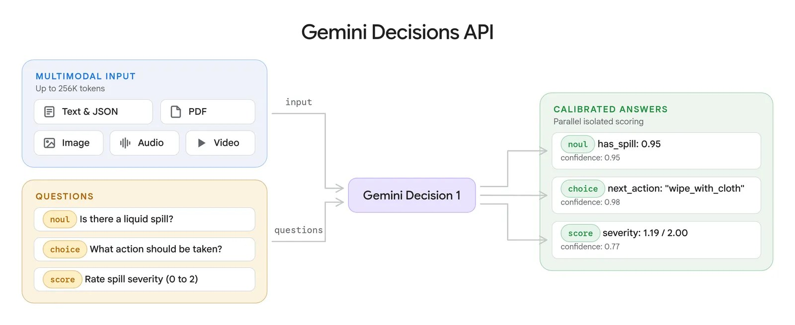
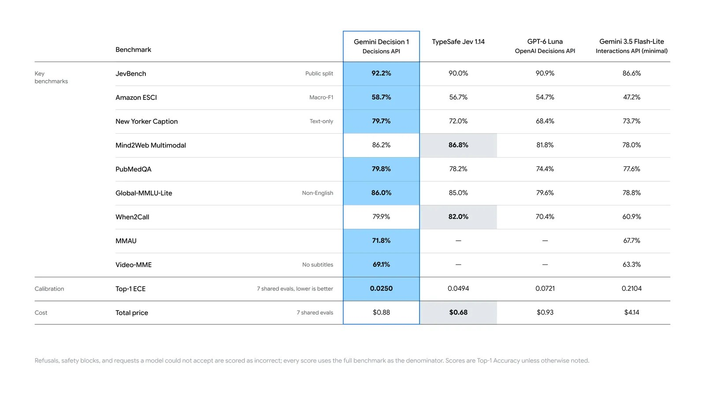

The **Gemini Decisions API** gives your code a fast way to ask closed questions about any input: is this a defect, which queue should take it, how severe is it. Google launched it on November 11, 2026 with a dedicated model, `gemini-decision-1`. You send one input of text, images, audio, video or PDFs and up to 1,000 typed questions. The model scores every candidate answer in a single forward pass and returns calibrated probabilities with a confidence value, so nothing is generated and output tokens are always zero. Google reports a median of 150 to 250 ms end to end and charges $0.10 per million input tokens.

This tutorial covers the parts you need to ship it: the request shape, the three question types, confidence thresholds, batching questions, multimodal input, limits and cost.



*One shared input and a set of typed questions go in; each question gets an isolated, calibrated answer. Image: Google.*

## How to Call the Gemini Decisions API

You need a Gemini API key from Google AI Studio and the Google GenAI SDK. The endpoint lives on `v1beta`, so set the API version on the client. This request asks whether a return is a product defect:

```python
from google import genai

client = genai.Client(http_options={"api_version": "v1beta"})

result = client.decisions.create(
    model="gemini-decision-1",
    input="Customer returned the sweater because they preferred green over blue.",
    questions={
        "is_defect": {
            "type": "noul",
            "instructions": "Is the customer reporting a product defect?",
            "criteria": {
                "true_description": "The product itself is broken or faulty.",
                "false_description": "Preference, sizing, shipping, or pricing complaint.",
            },
        },
    },
)
print(result.answers["is_defect"].noul)
```

Google's documented answer is `{"type": "noul", "noul": 0.03, "confidence": 0.97}`. The JavaScript SDK has the same shape:

```javascript
import { GoogleGenAI } from "@google/genai";

const ai = new GoogleGenAI({ apiVersion: "v1beta" });
const result = await ai.decisions.create({
  model: "gemini-decision-1",
  input: "Customer returned the sweater because they preferred green over blue.",
  questions: {
    is_defect: { type: "noul", instructions: "Is the customer reporting a product defect?" },
  },
});
```

Over REST, post the same JSON body to `https://generativelanguage.googleapis.com/v1beta/decisions` with an `x-goog-api-key` header:

```bash
curl -X POST "https://generativelanguage.googleapis.com/v1beta/decisions" \
  -H "x-goog-api-key: $GEMINI_API_KEY" \
  -H "Content-Type: application/json" \
  -d '{"model": "gemini-decision-1",
       "input": "I was charged twice for my order.",
       "questions": {"is_billing": {"type": "noul",
         "instructions": "Is this a billing problem?"}}}'
```

Every request has three required fields: `model`, `input` and `questions`. Question keys are yours to choose (`[A-Za-z0-9_-]+`, up to 64 characters), and answers come back under the same keys. The response also carries `usage`, which counts input tokens by modality and always reports 0 output tokens.

## How to Choose noul, choice or score

Each question has a `type`, an `instructions` string and, for choice and score, `criteria`. Pick the type by the shape of the decision.

| Type | Use it for | Criteria | Answer fields |
|---|---|---|---|
| `noul` | Yes/no checks | Optional `true_description` and `false_description` | `noul` (yes probability, 0.01 to 0.99), `confidence` |
| `choice` | Picking one of a fixed set | Map of option key to description, 2 to 255 options | `choice`, `probabilities`, `confidence` |
| `score` | Rating on an ordered rubric | Array of level descriptions, lowest first, 2 to 255 levels | `score`, `probabilities`, `legend`, `confidence` |

A **choice** question for ticket routing looks like this:

```python
"department": {
    "type": "choice",
    "instructions": "Which department should handle this request?",
    "criteria": {
        "billing": "Payments, invoices, and refunds.",
        "technical": "Problems using the product.",
        "shipping": "Delivery and tracking.",
        "other": "Anything outside these categories.",
    },
}
```

For "I was charged twice for my order," Google's docs show `billing` at 0.99, with the other three options sharing the rest. The API sorts option keys alphabetically before scoring, and exact ties go to the first key. That is why Google recommends a catch-all named `other` instead of `none_of_the_above`.

A **score** question indexes its levels from 0. The returned `score` is the probability-weighted average of those indices, so it can land between levels:

```python
"severity": {
    "type": "score",
    "instructions": "How severe is this issue for the user?",
    "criteria": [
        "Cosmetic: appearance only, no lost functionality.",
        "Workaround available: a task fails, but another way works.",
        "Fully blocked: a task fails with no workaround.",
    ],
}
```

Keep rubric steps evenly spaced. Because the score averages indices 0, 1, 2 and up, a scale such as 1, 10, 100, 1000 would distort the expected value. Google suggests 2 to 10 levels for most rubrics.

## How to Set Confidence Thresholds

Confidence is the estimated probability that the top answer is right. For choice and score it equals the top outcome's probability; for yes/no it is `max(noul, 1 - noul)`. Use the answer to pick an action and confidence to decide whether to run it automatically:

```python
answer = result.answers["department"]
if answer.confidence >= 0.7:
    route_to(answer.choice)
else:
    route_to("human_review")
```

The 0.7 is an example. Google tells you to set thresholds from labeled samples of your own traffic and to weigh what a false positive costs against a false negative. Two details catch people out:

- **noul never reaches 1.** Yes probabilities are clamped to 0.01 to 0.99, so a check like `noul > 0.99` never fires.
- **choice always returns something.** If an input fits no option, the top option can still win. Check confidence first, or add a yes/no scope question such as "Is this message about an order?" and act only when both agree.

Write instructions as complete questions. The model never sees your keys or variable names, so `is_defect` alone tells it nothing. Ask positive questions ("Is the tier Gold?") and compute the negation in code.

## How to Ask Many Questions in One Request

Questions in a request are evaluated independently against the same input. They cannot see each other, and adding or removing one does not change the others. Google says latency stays nearly flat from 1 to 100 questions, and the shared input is billed once. That makes a single call the natural place to run a whole policy checklist or a routing decision plus its guards.

Google's support-ticket example mixes all three types and combines them in code:

```python
import json

order = {"order": {"id": "8821", "item": "headphones", "price_usd": 240}, "tier": "Gold"}
message = {"message": "Audio cuts out on the left earcup. Fix it today or I cancel my membership."}

result = client.decisions.create(
    model="gemini-decision-1",
    input=[
        {"type": "text", "text": json.dumps(order) + "\n"},
        {"type": "text", "text": json.dumps(message)},
    ],
    questions={
        "is_defect": {"type": "noul",
                      "instructions": "Does `message` describe a hardware defect?"},
        "next_action": {"type": "choice",
                        "instructions": "What is the right resolution given `tier` and `order`?",
                        "criteria": {
                            "instant_refund": "Refund without return. Low value or clear fault.",
                            "replacement_shipment": "Ship a replacement. Customer returns the original.",
                            "troubleshooting_flow": "The issue may be fixable by the customer.",
                            "human_escalation": "",
                        }},
        "churn_risk": {"type": "score",
                       "instructions": "How likely is the customer to churn if the issue is not resolved now?",
                       "criteria": ["No churn signal", "Mild frustration",
                                    "Mentions alternatives", "Threatens to cancel"]},
    },
)

a = result.answers
if a["is_defect"].noul > 0.9 and a["next_action"].confidence > 0.6:
    action = a["next_action"].choice
else:
    action = "human_escalation"
```

Structured data goes in as serialized JSON text, and instructions refer to fields by key path. Adjacent text blocks are joined with no separator, which is why the example appends `"\n"`. Do arithmetic yourself: Google's guidance is to compare numbers, dates and durations in code and pass the result or a named bucket. Send only the fields the questions need, since unrelated content lowers accuracy.

## How to Send Images, Audio, Video and PDFs

`input` accepts a string or content blocks in the same schema as the Interactions API: `text`, `image`, `audio`, `video` and `document` (PDF). Media blocks take inline base64 `data` or a `uri`, plus the real `mime_type`. Google's launch post checks a photo and a note together:

```python
input=[
    {"type": "image",
     "uri": "https://storage.googleapis.com/generativeai-downloads/images/spill.jpg",
     "mime_type": "image/jpeg"},
    {"type": "text", "text": "Breakroom counter check before the 9 AM client meeting."},
]
```

The rules that matter in practice:

- Inline data is capped at 100 MB per request (50 MB for PDFs). External HTTPS URLs are capped at 15 MB each; Files API URIs also work.
- YouTube URLs and `gs://` URIs are not supported.
- Generic `application/octet-stream` MIME types are rejected.
- Image and video blocks take an optional `resolution` (low, medium, high, or ultra_high for images) to trade detail against token cost.
- Question instructions are text only; media goes in `input`.
- Conversation history, thought and tool-call blocks are not accepted. Serialize multi-turn context as text.

## Gemini Decisions API Limits and Rate Limits

| Limit | Value |
|---|---|
| Questions per request | 1 to 1,000, within the context window |
| Context window | 262,144 tokens across input and all questions |
| Options per choice question | 2 to 255 |
| Levels per score question | 2 to 255 (2 to 10 recommended) |
| Question key | 1 to 64 characters, `[A-Za-z0-9_-]+` |
| Option key | 1 to 128 characters, up to 512 UTF-8 bytes |

A request that breaks a limit returns HTTP 400 with a message naming the rule. Requests blocked by input safety filters also return 400, with an error `code` such as `safety` or `prohibited_content`, so handle that branch separately from your low-confidence path.

Standard rate limits on the Decisions API, as published on November 12, 2026:

| Tier | Requests/min | Tokens/min | Requests/day |
|---|---|---|---|
| Free | 200 | 50,000 | 10,000 |
| Tier 1 | 1,500 | 1,000,000 | 50,000 |
| Tier 2 | 5,000 | 4,000,000 | Unlimited |
| Tier 3 | 15,000 | 10,000,000 | Unlimited |

## Gemini Decisions API Pricing and Cost

The paid tier charges **$0.10 per million input tokens** for every modality. Output is zero tokens, and there are no thinking-token, transcription or OCR charges. The free tier costs nothing; Google's terms say free-tier data may be used to improve its products, and paid-tier data is not.

Cost scales with input, so the estimate is simple: shared input tokens once, plus each question's instructions and criteria. A 2,000-token ticket with twenty short questions is a few thousand tokens per call, or well under a tenth of a cent. Two things raise the bill:

- **No context caching.** If you send the same long document in many requests, you pay for it every time. Put all questions about one input into one request.
- **No Batch API, Flex or Priority inference.** Offline jobs pay the standard interactive rate.

Google says that across its shared benchmark suite, Gemini Decision 1 through the Decisions API is nearly five times cheaper than Gemini 3.5 Flash-Lite through the Interactions API.

## Gemini Decision 1 vs Jev and OpenAI Benchmarks

Google published a benchmark table against TypeSafe's Jev 1.14, OpenAI's GPT-6 Luna on the OpenAI Decisions API, and Gemini 3.5 Flash-Lite in minimal mode.



*Google's comparison. Refusals and blocked requests count as wrong; scores are Top-1 accuracy unless noted. Image: Google.*

| Benchmark | Gemini Decision 1 | Jev 1.14 | GPT-6 Luna | Gemini 3.5 Flash-Lite |
|---|---|---|---|---|
| JevBench (public split) | **92.2%** | 90.0% | 90.9% | 86.6% |
| Mind2Web Multimodal | 86.2% | **86.8%** | 81.8% | 78.0% |
| When2Call | 79.9% | **82.0%** | 70.4% | 60.9% |
| Top-1 ECE (lower is better) | **0.0250** | 0.0494 | 0.0721 | 0.2104 |
| Total price, 7 shared evals | $0.88 | **$0.68** | $0.93 | $4.14 |

Gemini Decision 1 leads seven of the nine accuracy rows and has the lowest calibration error, which is what makes its confidence values usable as thresholds. Jev 1.14 wins the two agent-action benchmarks and costs less on the shared suite. Google's table has no MMAU audio or Video-MME entries for Jev or GPT-6 Luna. These are Google's own numbers, so test on your own labeled traffic before switching.

## Decisions API or Structured Output

Use the Decisions API when the answer is a bounded outcome you want to threshold:

- Route a request to a model, queue, agent or tool.
- Check inputs or outputs against many policy rules at once.
- Decide which tools an agent needs, or whether to compact, escalate or stop.
- Filter, score or rank candidates against a rubric.
- React to UI state, audio or video frames in real time.

Inside Google, Gemini Notebook uses it to route queries to the right model tier and thinking level, which Google says cut latency by up to 40% on everyday queries. CC from Google Labs uses it to pick an emoji reaction from more than 200 options.

Stay with the Interactions API and structured output when you need generated text, values extracted into your own JSON schema, tool calls with arguments, or multi-step reasoning. The two fit together: a Decisions call can decide whether a generative call is needed at all.

Treat input as untrusted. A user message can argue for its own classification, so write explicit criteria, test with adversarial examples, and keep a human or second check on high-stakes actions such as payouts.

## Gemini Decisions API FAQ

**Which model does it use?** Only `gemini-decision-1`, on the Gemini Developer API `v1beta`.

**Does it return text explanations?** No. It returns probabilities, a top answer and confidence per question. Use a generative model if you need a rationale.

**Can a choice question return "none"?** Only if you add that option. Name the catch-all `other` and check confidence or a scope question before acting.

**Where can I try it without code?** Google's Decisions Playground in AI Studio runs yes/no, choice and score questions on custom text and media and exports runnable code.

## References

- Min Choi and Felix Yu, [Gemini Decisions API: Fast, calibrated multimodal decisions](https://blog.google/innovation-and-ai/technology/developers-tools/gemini-decisions-api/), Google blog, Nov 11, 2026
- Google AI Studio, [Decisions API documentation](https://aistudio.google.com/docs/decisions-api), checked Nov 12, 2026
- Google AI Studio, [Gemini Decision 1 model page](https://aistudio.google.com/docs/models/gemini-decision-1), checked Nov 12, 2026
- Google AI Studio, [Rate limits](https://aistudio.google.com/docs/rate-limits), checked Nov 12, 2026
- Google AI Studio, [Pricing](https://aistudio.google.com/docs/pricing), checked Nov 12, 2026
