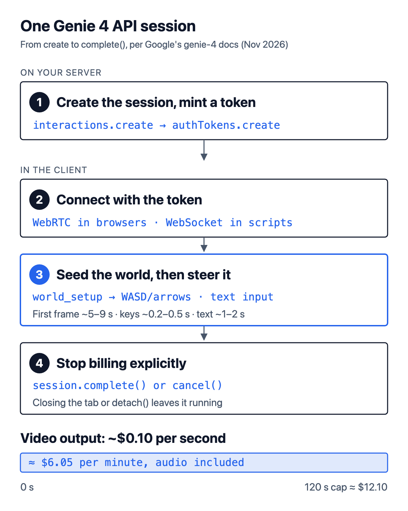

Google's Genie 4 world model is now something you can call from code. Since November 19, 2026, it has been available in the Gemini API as `genie-4`, streaming a 720p world at 24 frames per second with synchronized stereo audio that you steer with WASD keys and typed prompts. It runs on the paid tier only, at about $0.10 per second of streamed output, so a full two-minute session costs roughly $12. The day before, Google rolled Genie 4 out to eligible Google AI Ultra subscribers in Project Genie, its browser app for building and exploring worlds.

This guide is for developers deciding whether to build on the API. It covers which access route fits, what a session and a day of testing cost, the four calls that make up a session, the transport choice, prompt patterns Google has tested, and the limits in Google's own documentation.

| Route | Who can use it | How you pay | Session length |
|---|---|---|---|
| Gemini API (`genie-4`) | Paid-tier Gemini API keys | ~$0.10 per second of video output | Up to 120 seconds |
| Google AI Studio Live playground | Paid-tier Gemini API keys | Bills the same paid-tier key | Up to 120 seconds |
| Project Genie | Eligible Google AI Ultra subscribers; AI Pro has a waitlist | Subscription | Genie 4, or Genie 3 for up to 3 minutes |

## Genie 4 API vs Project Genie: Which Access Route Fits {#genie-4-api-vs-project-genie}

Use the Genie 4 API if you want Genie 4 inside your own app, script or test harness; use Project Genie if you want to make and explore worlds in a browser without writing code. Both run Genie 4, but they package it differently.

Project Genie is the consumer product. Google's November 18 post describes a Project Genie agent that turns a conversation into a world, picking the visuals and a background score with Google's other multimodal models. Gemini can watch the session, suggest where to go next and trigger events. There is also a community gallery where you can publish and remix worlds. Project Genie also keeps Genie 3 in its model picker, with runs of up to three minutes, world chaining and 360-degree panorama seeds. Access requires an eligible Google AI Ultra subscription, and AI Pro members can only join a waitlist. On the Hacker News launch thread, which reached 293 points, a recurring complaint was this gate: commenters with Google Workspace accounts or pay-as-you-go cloud billing said they could not get access.


*"Villa Giallo," a room-by-room mystery built in Project Genie with Genie 4. The clue tracker and controls are Project Genie's interface, not part of the API. Source: Google, "Genie 4 is now available" (November 18, 2026).*

The API gives you the raw stream and nothing else. There is no agent, gallery or music score: you send a world prompt or a 16:9 image, then key presses and text, and you get back video frames and audio. Pay-as-you-go access is what some Hacker News commenters were asking for, and the API now offers it. The trade-off is a per-second meter, which the next section turns into real numbers.

<p><strong>Planning to pair it with a text model?</strong> DeepMind's own demos run Genie 4 with a Gemini model alongside it, planning the next steps and checking incoming frames. If your prototype adds a planner or chat model next to Genie 4 and you want one key for those text-model calls across vendors, a shared gateway such as
<a href="https://www.packyapi.ai/register?aff=5W73&amp;utm_source=agentspulse&amp;utm_medium=affiliate&amp;utm_campaign=genie-4-api"
rel="sponsored nofollow noopener" target="_blank">PackyAPI</a> is one option. Genie 4 itself is only served through Google's Gemini API.</p>
<p><small>Disclosure: this page contains an affiliate link. If you sign up through it, we
may earn a commission at no extra cost to you.</small></p>

## Genie 4 API Pricing: Cost per Second, per Session and per Day {#genie-4-api-pricing}

The Genie 4 API costs about $0.10 per second of streamed world, according to Google's pricing page. Google bills the video output at $17.50 per million tokens, counts 240 tokens per frame, and streams 24 frames a second, which works out to 5,760 tokens a second, or roughly $6.05 a minute. Audio is bundled into that rate. There is no free tier, and Batch, Flex and Priority inference are not available for this model.

| Genie 4 pricing (paid tier) | Price |
|---|---|
| Input: text and reference image | $1.50 per 1M tokens |
| Output: text | $9.00 per 1M tokens |
| Output: video, audio included | $17.50 per 1M tokens |
| Effective streaming rate | ~$0.10 per second, ~$6.05 per minute |

Because a session is capped at 120 seconds, one full run costs about $12.10 in video output (5,760 tokens × 120 seconds × $17.50 per million). Google's model card adds that coherence is strongest in the first 45 to 90 seconds, so many apps will end sessions sooner. A one-minute session costs about $6.

Rate limits cap how many sessions you can run, not how fast you can steer them. Key presses and text events inside a session do not count against request quotas.

| Usage tier | Concurrent sessions | Sessions per day |
|---|---|---|
| Free | Not supported | Not supported |
| Tier 1 | 2 | 50 |
| Tier 2 | 5 | 250 |
| Tier 3 | 10 | 1,000 |

The daily cap doubles as a budget ceiling. On Tier 1, 50 full-length sessions would cost about $605 in a day. The more likely surprise is a session that keeps running after the user leaves, which is the last step of the setup below.

## How to Set Up a Genie 4 API Session in Four Steps {#how-to-set-up-genie-4-api}

Every Genie 4 API session follows the same four steps on the `v1beta` Interactions API: create the interaction on your server, connect a live stream, seed and steer the world, then end it with `complete()`. You need a paid-tier Gemini API key and the current `google-genai` (Python) or `@google/genai` (JavaScript) SDK.



*The four steps of a Genie 4 session and its billing window. Based on Google's Gemini API documentation for genie-4; the $12.10 cap is our calculation from Google's published rate.*

1. **Create the interaction on your server.** Call `interactions.create` with `model: "genie-4"`. For a browser app, mint a single-session token with `interactions.authTokens.create(interaction.id)` and send only the interaction ID and token to the browser. Google's docs say a raw API key passed to a browser WebSocket throws an error by design, so the token step is required there, not optional.
2. **Connect a live session.** Call `interactions.connect` with `transport: "webrtc"` in a browser or `"websocket"` in Python, Node.js or a browser.
3. **Seed the world, then steer it.** Send exactly one `world_setup` event with a `world_prompt`, a 16:9 `reference_image`, or both. Then send `user_action` events for movement and camera (`key_w`, `key_a`, `key_s`, `key_d` and the four arrow keys, each with `key_down` and `key_up`) and text `input` events for changes such as weather, new objects or dialogue.
4. **End the session.** Call `session.complete()` when the user is done, or `cancel()` to abort. Google's docs warn that closing a tab, leaving a Python `async with` block or calling `detach()` drops the connection without stopping server-side generation or billing, and Genie 4 cannot resume a session.

A trimmed version of Google's Python quickstart shows steps 1 to 4 over WebSocket. It walks forward for about six seconds, then ends the session; audio arrives in the same stream as `audio` deltas of 48 kHz stereo PCM:

```python
from google import genai

WORLD_PROMPT = ("First-person POV on a cobblestone canal bridge inside a post-impressionist "
                "oil painting at twilight. Audio: water lapping against the stone steps, "
                "footsteps on cobblestone.")

# run inside an async function
client = genai.Client(http_options={"api_version": "v1beta"})  # reads GEMINI_API_KEY
interaction = await client.aio.interactions.create(model="genie-4", api_version="v1beta")

async with client.aio.interactions.connect(interaction.id, api_version="v1beta") as session:
    await session.send({"event_type": "world_setup",
                        "world_prompt": {"text": WORLD_PROMPT}})
    frames = 0
    async for event in session.receive():
        if event.event_type == "step.delta" and getattr(event.delta, "type", None) == "video":
            frames += 1                      # each delta is one base64 JPEG frame
            if frames == 1:
                await session.send({"event_type": "user_action",
                                    "action": "key_down", "input": "key_w"})
            elif frames == 144:              # about 6 seconds at 24 fps
                await session.complete()     # stops generation and billing
        elif event.event_type == "interaction.completed":
            break
```

Expect the first frame 5 to 9 seconds after `world_setup`. Google's docs put movement keys at about 0.2 to 0.5 seconds to show on screen, and text changes at 1 to 2 seconds, because Genie 4 plans environmental changes between generation steps. For text events, the docs recommend repeating a short prompt about 10 times at 150-millisecond intervals so the next four-frame planning step picks it up, then waiting about two seconds before sending a conflicting one.

## Genie 4 WebRTC vs WebSocket: Which Transport to Use {#genie-4-webrtc-vs-websocket}

Use WebRTC for interactive browser apps and WebSocket for scripts, backends and frame capture. Google recommends WebRTC in the browser because the video and Opus audio arrive as native media tracks that a `<video>` element plays with its own jitter buffer, which gives the lowest latency. WebSocket delivers each frame as a base64 JPEG and audio as raw 48 kHz stereo PCM inside JSON events, which is easier to save or process but adds about a third more data and suffers more when packets are lost.

| | WebRTC | WebSocket |
|---|---|---|
| Best for | Browser apps and games | Python or Node.js scripts, recording, custom pipelines |
| Media | Native video and Opus audio tracks | Base64 JPEG frames and 48 kHz PCM in `step.delta` events |
| Latency | Lowest; UDP with browser jitter buffer | Higher; ~33% base64 overhead, TCP head-of-line blocking |
| Seed image limit | JPEG under 48 KB (64 KB data-channel cap) | Larger images, including PNG |

The seed image limit is the detail most likely to break a first WebRTC build. Control events travel over a data channel capped at 64 KB per message, and base64 adds about 33%, so Google says to resize reference images to 1280×720 or 640×360 and compress them as JPEG under 48 KB, or switch to WebSocket for larger seeds. Over WebSocket, only one `receive()` loop is allowed per connection, and Google suggests dropping any decoded frame older than the last one drawn so a slow decode never overwrites a newer frame. The same latency trade-offs show up in voice agents, which we covered in [why real-time voice agents behave like distributed systems](/tutorials/real-time-voice-agents-distributed-systems/).

## How to Write Genie 4 Prompts and Key Bindings {#genie-4-prompts}

Genie 4 prompts work best when they describe a physical scene and its sounds, not a movie trailer. Google's prompt guide says its world planner rewrites prompts before rendering, so requests for a soundtrack, camera cuts or room-wide triggers misfire. Test prompts first in the Google AI Studio Live playground, which needs the same paid-tier key and bills the same way, then move them into code. Four patterns from the guide carry most of the weight:

- **Causal rules.** Add `Rule:` clauses to the setup prompt, such as "Pulling the red lever makes the stars outside the window stretch into hyperspace streaks." Tie each rule to an object or character, not a location; place it "far away from me" so it does not fire at frame one; and tell characters to wait "until a rule is triggered." Google calls these probabilistic, so use key bindings when an event must fire on demand.
- **Custom keys.** Only WASD and the arrow keys have trained controls. The wire format also accepts `key_e` and `space`, but Genie 4 attaches no action to them, so catch keys like E, Q and R in your client and send a text `input` instead, for example "Make heavy snow fall across the painted village," with a two-second cooldown.
- **Image seeds.** A 16:9 landscape image fixes the first frame's composition and style. Portrait or square images produce padding or invented side walls, and street photos with bystanders, public figures or logos often trip the safety filters.
- **Sound and motion.** Ask for broadband Foley, such as footsteps on gravel, rustling leaves or rain on canvas. Genie 4 strips or rewrites music and low drones. If the camera moves forward, say how in the first sentence ("sitting in the driver's seat," "holding a canoe paddle"); otherwise the model may invent a boat or vehicle mid-session to explain the motion.

For dialogue, put the line in quotation marks while facing a character. For driving games, Google's guide asks for a round-trip time under 100 ms to a serving region and notes that above 150 ms tight turns start clipping through walls.

## Genie 4 Limitations: Memory, Latency, Regions and Filters {#genie-4-limitations}

Genie 4's main limitation is short memory. Google's docs say it simulates frames over a rolling window instead of keeping a 3D scene, so looking away from an object for eight seconds or more, or turning 360 degrees, can move or reset landmarks, doors and buttons. Visual stability may degrade after 60 to 90 seconds, and every session stops at 120. Design around short visits: keep important objects in view and end sessions before the drift shows.

The other limits in Google's documentation:

- **Two response speeds.** Movement and camera keys respond in about 0.2 to 0.5 seconds; text changes take 1 to 2 seconds because they go through world planning.
- **Fixed output and serving regions.** Output is 1280×720 at 24 fps in 16:9 only, with no portrait mode or adjustable frame rate. Genie 4 serves from the United States, Western Europe and Japan; Google expects under 150 ms round trips in North America, Western and Central Europe and East Asia, and higher steering latency and possibly lower frame rates elsewhere.
- **Narrow inputs.** Genie 4 accepts text, one 16:9 start image and key events. It does not take live microphone or webcam input, and it does not support function calling, Google Search grounding, structured outputs or session resumption.
- **Safety filters.** Prompts or images with identifiable real people, public figures or brand IP can be blocked at startup or end a stream mid-session. Every output carries a SynthID watermark.
- **Text and counts.** Signs, gauges and clocks deform over time, and object counts drift as the camera pans.

DeepMind listed the same research gaps when it announced Genie 4 on October 27: object permanence, complex physics, audio accuracy, legible text and long-term consistency. Those limits matter most for the use case Google pitches to researchers, training robots and agents inside generated worlds, a direction we looked at in [world action models for physical agents](/tutorials/physical-agents-world-action-models/).

## Genie 4 vs Genie 3 and Gemini Omni: Which Model to Use {#genie-4-vs-genie-3}

Pick Genie 4 for live, steerable worlds with sound; pick Genie 3 in Project Genie for longer runs; and pick Gemini Omni 1.2 Flash when you need a finished clip rather than a live stream.

| Need | Model | Where |
|---|---|---|
| Live world you steer with keys and text, with native audio | Genie 4 | Gemini API, AI Studio, Project Genie |
| Longer exploration (up to 3 minutes), world chaining, 360° panorama seeds | Genie 3 | Project Genie |
| Offline 3 to 15 second clips, editing, extension to 30 seconds, 1080p or 4K upsampling | Gemini Omni 1.2 Flash | Gemini API |
| Real-time voice agent with tools and Search grounding | Gemini 3.8 Live | Gemini API (Live API) |

Google describes Genie 4 as its highest-fidelity world model for visuals, physics and audio, and the first in the Genie line to generate sound natively. DeepMind says it builds on the Gemini family: Gemini Omni anchors how things look and behave, and in DeepMind's demos Gemini 3.8 Flash runs alongside as a guiding agent that breaks goals into steps and checks incoming frames. The Gemini models involved are covered in our [Gemini 4 model comparison](/tutorials/gemini-4-models/). If what you need is a finished video rather than a world to walk through, a clip model such as Omni, or a hosted tool like the one in our [Arcade AI video generator guide](/tutorials/arcade-ai-video-generator/), fits better and does not bill by the second of exploration.

For most teams, the sensible first step is a fixed budget in the AI Studio Live playground: a dozen one-minute sessions cost about $73 and show whether the rolling memory and 1 to 2 second text lag suit your idea. Genie 4 runs on the `v1beta` Interactions API, so pin your SDK version and recheck field names before you depend on them, as with other recent Gemini API additions such as the [Gemini Decisions API](/tutorials/gemini-decisions-api/).

## References {#references}

1. Google, ["Interactive world generation with Genie 4"](https://aistudio.google.com/docs/genie), Gemini API documentation, with the [Genie 4 model card](https://aistudio.google.com/docs/models/genie-4), accessed November 22, 2026.
2. Google, [Gemini API pricing: Genie 4](https://aistudio.google.com/docs/pricing#genie-4) and [rate limits](https://aistudio.google.com/docs/rate-limits#genie-4), accessed November 22, 2026.
3. Google, ["Genie 4 prompt and controls guide"](https://aistudio.google.com/docs/genie-prompting), Gemini API documentation, accessed November 22, 2026.
4. Diego Rivas and Pavan Kumar, ["Genie 4 is now available"](https://blog.google/innovation-and-ai/models-and-research/google-deepmind/genie-4-now-available-project-genie/), Google, November 18, 2026; and ["Genie 4 now available through the Gemini API"](https://blog.google/innovation-and-ai/technology/developers-tools/genie-4-in-gemini-api/), November 19, 2026.
5. Raia Hadsell, Diego Rivas and Hang Qi, ["Genie 4: A new generation of world simulation"](https://deepmind.google/blog/genie-4-a-new-generation-of-world-simulation/), Google DeepMind, October 27, 2026.
