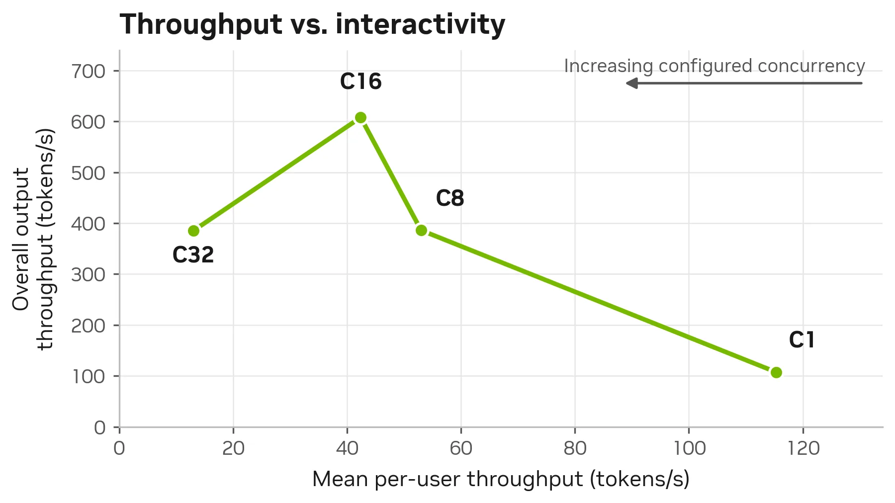

GLM-5.3 NVFP4, NVIDIA's 4-bit build of Z.ai's 753-billion-parameter mixture-of-experts model, is about 464 GB on disk, and NVIDIA's latest tutorial shows how to serve it from two DGX Station desktops joined by a single 400 Gb/s cable. The checkpoint does not fit in the 252 GB of HBM3e on one GB300 GPU, so vLLM splits every layer across both machines with tensor parallelism and exposes one OpenAI-compatible endpoint.

NVIDIA published the walkthrough on November 13, 2026, with a measured peak of 607.8 output tokens per second, and it reached the front page of Hacker News. That peak is shared by 16 concurrent requests; a single request runs at 107.4 tok/s. The memory figures, flags and benchmarks below come from NVIDIA's tutorial and the [nvidia/GLM-5.3-NVFP4 model card](https://huggingface.co/nvidia/GLM-5.3-NVFP4).

## GLM-5.3 NVFP4 size and memory: why one GB300 is not enough {#glm-5-3-nvfp4-size}

The GLM-5.3 NVFP4 checkpoint is about 464 GB, split into 50 safetensors shards, and it has to sit entirely in GPU memory. NVIDIA's tutorial keeps CPU weight offload disabled, and a single GB300 GPU in a DGX Station has 252 GB of HBM3e, so the weights alone need roughly two GPUs' worth of fast memory.

Mixture-of-experts sparsity does not help with that. GLM-5.3 activates 40 billion of its 753 billion parameters per token, which cuts compute, but each token can be routed to any expert, so every expert must stay loaded. Sparse activation lowers the arithmetic per token; it leaves the memory footprint at the size of the full model.

| Item | GLM-5.3 NVFP4 figure | Source |
|---|---|---|
| Parameters | 753B total, 40B active per token | Model card |
| Checkpoint on disk | About 464 GB, 50 shards | NVIDIA tutorial |
| Memory on one GB300 | 252 GB HBM3e | NVIDIA tutorial |
| Weights per GPU after TP=2 load | About 218 GiB | vLLM startup log, per NVIDIA |
| GPU memory in use after load, idle | 231.35 GiB (A), 231.34 GiB (B), including KV cache and buffers | NVIDIA tutorial, Table 1 |
| Context ceiling in NVIDIA's config | 98,304 tokens (input plus output) | `--max-model-len` |
| Model maximum context | Up to 1M tokens | Model card |

Disk is the other line item. Each Station keeps its own full copy of the checkpoint, so both need at least 464 GB free, plus space for the vLLM container. NVIDIA estimates the download at about an hour over 1 Gb/s or about six minutes over 10 Gb/s, after which you copy it from Station A to Station B.

## GLM-5.3 NVFP4 vs FP8: what 4-bit costs in accuracy {#glm-5-3-nvfp4-vs-fp8}

On NVIDIA's own evaluation, GLM-5.3 NVFP4 lands within 1.2 points of the FP8 baseline on all eight benchmarks it reports, and scores higher on six of them. NVIDIA quantized the weights and activations of the linear layers inside the MoE blocks to NVFP4 with Model Optimizer v0.47.0 and left other tensors at higher precision. The model card says this takes those parameters from 8 bits to 4 and makes the checkpoint and its GPU memory about 1.66x smaller than FP8.

| Benchmark | FP8 | NVFP4 |
|---|---|---|
| MMLU Pro | 87.81 | 87.88 |
| GPQA Diamond | 91.79 | 92.68 |
| LiveCodeBench V6 | 52.95 | 53.55 |
| SciCode | 58.65 | 58.03 |
| AIME 2025 | 99.38 | 99.53 |
| AA-LCR | 69.75 | 69.63 |
| IFBench | 65.33 | 66.00 |
| Terminal Bench 2.1 | 85.67 | 86.80 |

*Source: nvidia/GLM-5.3-NVFP4 model card. NVIDIA ran both precisions in SGLang with tensor parallelism 8 across two 4-GPU nodes, a 400,000-token context, `reasoning_effort=max`, temperature 1.0 and top-p 0.95.*

NVIDIA reports one score per precision, sampled at temperature 1.0, with no spread across runs, so the fair reading is parity on these tests rather than a gain from quantization. The model card lists SGLang on Blackwell B300 as its supported path; the two-Station tutorial below uses vLLM instead, and NVIDIA did not publish a separate accuracy run for that configuration. For teams that serve GLM-5.3 from a datacenter GPU pool, like the 56 B200s in our [GLM for coding case study at Revolut](/tutorials/glm-for-coding/), NVFP4 is mainly a way to fit the same model into fewer GPUs.

## How two DGX Stations serve GLM-5.3 NVFP4: the TP=2 architecture {#two-dgx-stations-architecture}

Two DGX Stations act as one inference server: Station A runs the vLLM API server and tensor-parallel rank 0, Station B runs rank 1 as a headless worker, and the two GB300 GPUs exchange partial results over one ConnectX-8 RoCE rail at 400 Gb/s using GPUDirect RDMA through NCCL. Neither GPU holds a complete copy of the model, so neither can answer a request alone.

*Figure 1 from NVIDIA's tutorial: two Stations serve one model through a single endpoint. Image: NVIDIA.*

Tensor parallelism with a size of 2 cuts each weight matrix in half, so every layer of every token runs on both GPUs and ends with a collective exchange over the cable. That is why NVIDIA's setup spends so many steps on the network: it checks for a 400,000 Mb/s link, an MTU of 9000, successful jumbo-frame pings and synchronized clocks before launching anything, and it verifies afterwards that NCCL is using GPUDirect RDMA rather than falling back to TCP sockets. A slow or misconfigured link shows up as NCCL timeouts or as a drop in tokens per second.

The alternative split, pipeline parallelism, would give each Station a contiguous block of layers and pass activations between them once per stage. NVIDIA's tutorial uses only tensor parallelism, which keeps both GPUs busy on every token at the cost of more frequent communication. The community 8-GPU build covered further down mixes the two (TP4×PP2) on a PCIe-only machine.

## How to deploy GLM-5.3 NVFP4 on two DGX Station GB300s with vLLM {#deploy-glm-5-3-nvfp4-vllm}

To deploy GLM-5.3 NVFP4 on two DGX Station GB300 machines, NVIDIA's tutorial pins one vLLM container (`vllm/vllm-openai:v0.30.0-aarch64` at a fixed digest) and one model revision on both Stations, copies the checkpoint to each local disk, and starts the same launch script on Station B first and Station A second. The prerequisites matter more than the commands:

| Requirement | Detail from NVIDIA's tutorial |
|---|---|
| Hardware | Two GB300 DGX Stations running Linux |
| Interconnect | Cabled and validated with NVIDIA's "Connect Two DGX Stations" playbook, including its GPU-memory RDMA test on both rails |
| Access | SSH and sudo on both, same Linux username; passwordless SSH from A to B |
| Software | Docker and the NVIDIA Container Toolkit (preinstalled on the DGX Station stack) |
| Disk | At least 464 GB free on each Station, plus room for the container image |
| Licenses | NVIDIA Open Model Agreement and the original GLM-5.3 license |
| Benchmark only | A Hugging Face token with access to the gated `cais/hle` dataset, which SPEED-Bench pulls from |

The workflow runs in five steps:

1. **Prepare both Stations.** Pick one of the two direct rails (for example `cx8r1`), note its RDMA device and IPv4 address on each machine, and write them into a `~/glm53.env` file on both, with `RANK="0"` on A and `RANK="1"` on B.
2. **Download and copy the model.** Pull the pinned image on both Stations, download `nvidia/GLM-5.3-NVFP4` at the pinned revision on A, `rsync` it to B, and verify that both copies match and that `config.json` reports `GlmMoeDsaForCausalLM` with `MIXED_PRECISION` quantization.
3. **Launch the distributed service.** Run `~/launch-glm53.sh` on B, then on A, and follow A's log until it prints `Application startup complete`. Loading, kernel preparation and CUDA graph capture take several minutes.
4. **Verify and send a request.** Check `/health` on A, confirm the NCCL logs show GPUDirect RDMA with no socket fallback, and send a chat request to `/v1/chat/completions`.
5. **Benchmark and shut down.** Install AIPerf 0.12.0 in its own virtual environment, run the SPEED-Bench Coding sweep, then stop the container on A before B.

These are the `vllm serve` settings in NVIDIA's launch script that decide memory use and speed:

| Flag | Value | What it does |
|---|---|---|
| `--tensor-parallel-size` / `--nnodes` | 2 / 2 | One rank per Station |
| `--max-model-len` | 98304 | Context ceiling per request, input plus output |
| `--gpu-memory-utilization` | 0.93 | vLLM may use 93% of GPU memory; what is left after weights becomes KV cache |
| `--kv-cache-dtype` | fp8 | Halves KV cache memory compared with 16-bit |
| `--enable-prefix-caching` | on | Skips recomputing prompt prefixes the server has seen |
| `--speculative-config` | MTP, 4 draft tokens | The model's multi-token-prediction layer drafts four tokens per step and the full model verifies them |
| `--max-num-seqs` | 16 | Concurrent sequences; NVIDIA relaunches with 32 for its C32 test |
| `--tool-call-parser` / `--reasoning-parser` | glm47 / glm47 | OpenAI-style tool calls and reasoning output |

The script also forces the NCCL 2.30.7 library bundled in the image, because NVIDIA notes that older versions can deadlock cross-node CUDA graph replays over RoCE (vLLM issue #52504). It binds the API to `0.0.0.0` with no authentication, which exposes the endpoint on every interface of Station A, so NVIDIA tells readers to firewall the port and add authentication and TLS before anyone else uses it.

Requests can set `reasoning_effort` to `low`, `high` or `max` through `chat_template_kwargs`. The default is `max`, and every benchmark number below was measured at that default; NVIDIA did not publish figures for the lower settings. Because tool calling is enabled, agent frameworks that speak the OpenAI tools API can point at the same endpoint.

## GLM-5.3 NVFP4 benchmark: throughput and latency by concurrency {#glm-5-3-nvfp4-benchmark}

In NVIDIA's benchmark, two DGX Stations serving GLM-5.3 NVFP4 reach a peak of 607.8 output tokens per second with 16 concurrent requests, deliver 107.4 tok/s to a single request, and fall back to 385.0 tok/s at 32. NVIDIA measured this with AIPerf on the 80 Coding conversations of SPEED-Bench, a prompt set built to evaluate speculative decoding, with prefix caching on, an FP8 KV cache, four MTP draft tokens, an 8,192-token output cap and reasoning at `max`. Token counts include reasoning tokens.

| Concurrency | Total throughput (tok/s) | Per-user throughput (tok/s) | Mean request latency (s) | Mean time to first token (ms) | Mean inter-token latency (ms) |
|---|---|---|---|---|---|
| 1 | 107.4 | 115.3 | 49.84 | 479.75 | 8.78 |
| 8 | 386.0 | 53.0 | 114.17 | 433.79 | 19.01 |
| 16 | 607.8 | 42.4 | 136.46 | 482.90 | 23.77 |
| 32 | 385.0 | 13.0 | 453.54 | 899.36 | 77.90 |

*Source: NVIDIA Technical Blog, Table 2 and Figure 2. Each level sends 3× its concurrency in warmup requests and measures 10×. The C32 row was run after relaunching with `--max-num-seqs 32`.*

*Figure 2 from NVIDIA's tutorial: total throughput against per-user throughput on SPEED-Bench Coding, prefix caching enabled. Image: NVIDIA.*

The headline number is a total. At 16 concurrent requests, each user gets about 42 tok/s and waits a mean of 136 seconds for a complete answer, with reasoning set to `max`. At 32, the server is past its limit: total output falls by more than a third, per-user speed drops to 13 tok/s, and a mean request takes over seven minutes. So the useful operating range for this pair of machines is somewhere between 8 and 16 concurrent long-reasoning requests, and NVIDIA suggests rerunning AIPerf with your own prompts to find the point that fits your workload.

Two caveats from the Hacker News discussion are worth carrying into any comparison. One commenter noted that the post does not separate prefill from decode speed, so the figures mix both. And the single-request 107.4 tok/s includes MTP speculative decoding, whose gain depends on how often the drafted tokens are accepted, which NVIDIA says varies with the prompt.

## GLM-5.3 NVFP4 troubleshooting: RDMA, NCCL and out-of-memory errors {#glm-5-3-nvfp4-troubleshooting}

The GLM-5.3 NVFP4 failures NVIDIA's tutorial anticipates come from the link between the two Stations, the shared environment file or GPU memory. These fixes come from its troubleshooting list and launch-script notes:

- **NCCL timeouts or RDMA check failure.** Inspect `docker logs` on both nodes, confirm the RoCE GID index and checkpoint, and rerun validation script 07 from the Connect Two DGX Stations playbook. NVIDIA runs the pre-launch checks (400,000 Mb/s, MTU 9000, jumbo pings, NTP sync) to catch cabling and addressing mistakes before they surface as NCCL timeouts.
- **Hangs during CUDA graph replay across nodes.** Use the NCCL 2.30.7 library inside the pinned image; older versions can deadlock over RoCE.
- **CUDA out of memory.** Lower `--max-model-len` or send fewer concurrent requests. All in-flight requests share the KV cache left after the roughly 218 GiB of weights per GPU.
- **Missing variables or SSH errors.** Run `source ~/glm53.env` after every reconnect and check A-to-B key login.
- **SPEED-Bench preparation fails on a gated dataset.** Accept the `cais/hle` terms on Hugging Face with the same account you logged in with.

Stop the containers on A before B. NVIDIA's restart path is `docker start` on B, then A, followed by the health and RDMA checks again.

## Two DGX Stations vs 8× RTX PRO 6000 vs the Z.ai API for GLM-5.3 {#glm-5-3-nvfp4-hardware-alternatives}

Hacker News readers compared NVIDIA's two-Station setup with two other ways to get GLM-5.3 output: one 8-GPU workstation server and Z.ai's hosted API. The comparison below keeps each source's own numbers; they come from different checkpoints and workloads and are not a head-to-head test.

| Option | What it runs | Reported speed | Notes |
|---|---|---|---|
| Two DGX Station GB300 (NVIDIA tutorial) | `nvidia/GLM-5.3-NVFP4`, stock vLLM v0.30.0, TP=2 over RoCE | 107.4 tok/s at 1 request; 607.8 tok/s total at 16 (SPEED-Bench Coding, reasoning max) | All weights in HBM; one desktop-class box per rank |
| One PCIe server with 8× RTX PRO 6000 Blackwell (community, kacper-daftcode/GLM5.3-8xPRO6K) | `incoai/GLM-5.3-NVFP4` (routed experts NVFP4, attention and shared layers BF16), patched vLLM nightly, TP4×PP2, MTP3 | Author reports 118–150 tok/s single-stream on a coding task; 660 tok/s at 16 streams and 1,050 at 32 | 96 GB cards, no NVLink, 300 W cap; needs a pruned nightly base image and custom patches |
| Z.ai API | GLM-5.3, hosted | Not applicable | $1.4 per million input tokens, $0.26 cached, $4.4 output (Z.ai pricing, read November 15, 2026) |

The community build is the strongest counterpoint. Its author publishes raw benchmark outputs and a GSM8K check (97.19% against 97.50% for the unpatched stack), but the stack depends on a Docker image that has been pruned from Docker Hub and on patches that are not upstream. NVIDIA's route uses a public, pinned vLLM release and an official checkpoint, which is easier to reproduce and to keep running.

Commenters were split on cost. One back-of-envelope estimate put the hardware payback at about seven years against API prices; a reply using Z.ai's list prices got under a year. Others said cost is beside the point for data that cannot leave the building, such as banking or medical work where approving an outside API can take years. Another thread recommended GLM-5.3-Flash on smaller hardware for well-defined tasks, while users who had run both said the full model handles open-ended, longer-horizon work noticeably better. Z.ai lists Flash at $0.15 per million input tokens and $0.50 output. For a way to compare those options on real work rather than per-token price, see [cost per successful task for coding agents](/tutorials/coding-agents-finops-cost-per-successful-task/).

## Should you serve GLM-5.3 NVFP4 on DGX Stations? {#should-you-serve-glm-5-3-nvfp4}

It fits a team that already has, or is buying, two GB300 DGX Stations and needs a frontier-scale open model on premises for sensitive data, prototyping agents or prompt iteration without per-token bills. NVIDIA's numbers support up to about 16 concurrent long-reasoning requests at 40-plus tok/s each, which suits a small team or an agent pipeline more than a company-wide service. Plan for the network work first: NVIDIA puts the cabling playbook and RDMA validation ahead of every model step, and its troubleshooting list starts there.

If you only need GLM-5.3 occasionally, the API is cheaper to start with. If you want local inference on one workstation, smaller models built for a single machine, such as [Edge0-145B on a single 24 GB GPU](/tutorials/edge0-145b-hardware-requirements/), [Ripple-65B Preview](/tutorials/ripple-65b-preview/) or [Qwen 3.8 27B](/tutorials/qwen-3-8-27b/), cover more of the hardware people already own. The memory wall that pushes GLM-5.3 onto two machines is the same constraint Google is designing around in the datacenter with [TPU 8i Max](/tutorials/tpu-8i-max/), and for routing between a self-hosted model and hosted ones, see [the model gateway as an enterprise control plane](/tutorials/model-gateway-enterprise-ai-control-plane/).

## References {#references}

1. Fatima Fall et al., NVIDIA, [When One GPU Isn't Enough: Serving GLM-5.3 Across Two NVIDIA DGX Stations with vLLM](https://developer.nvidia.com/blog/when-one-gpu-isnt-enough-serving-glm-5-3-across-two-nvidia-dgx-stations-with-vllm/), NVIDIA Technical Blog, November 13, 2026.
2. NVIDIA, [nvidia/GLM-5.3-NVFP4 model card](https://huggingface.co/nvidia/GLM-5.3-NVFP4), Hugging Face, accessed November 15, 2026.
3. kacper-daftcode, [GLM5.3-8xPRO6K: GLM-5.3 NVFP4 on 8× RTX PRO 6000 Blackwell with vLLM](https://github.com/kacper-daftcode/GLM5.3-8xPRO6K), GitHub, accessed November 15, 2026.
4. Z.ai, [Pricing](https://docs.z.ai/guides/overview/pricing), accessed November 15, 2026.
5. Hacker News, [Serving GLM-5.3 at 607.8 tok/s across two Nvidia DGX stations with vLLM](https://news.ycombinator.com/item?id=50497155), November 14–15, 2026.
