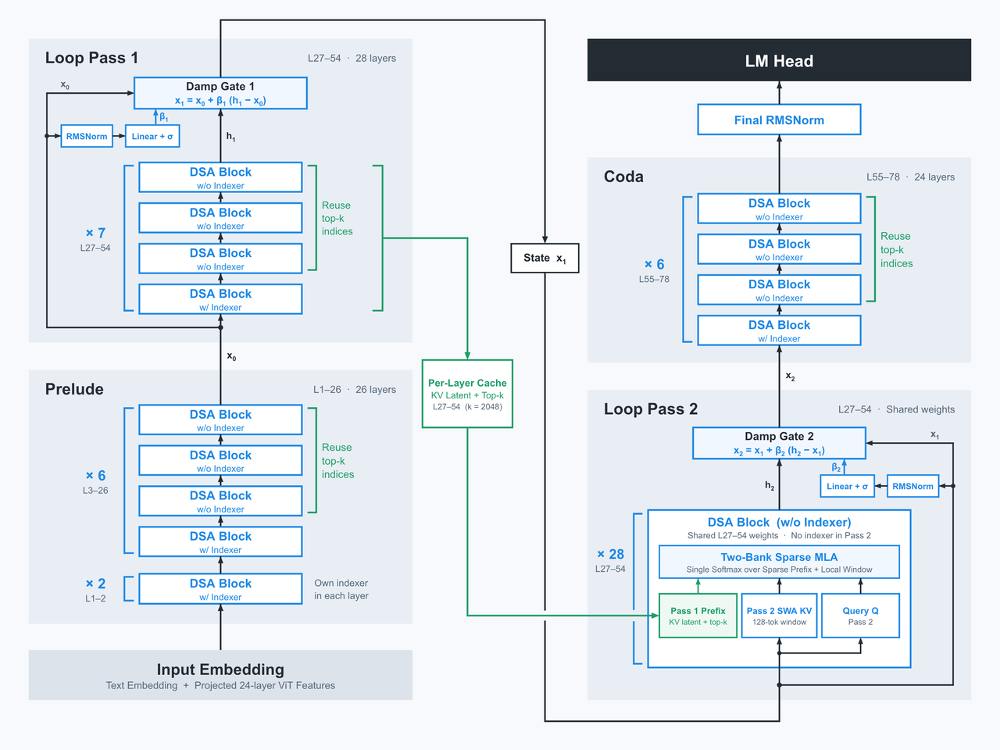
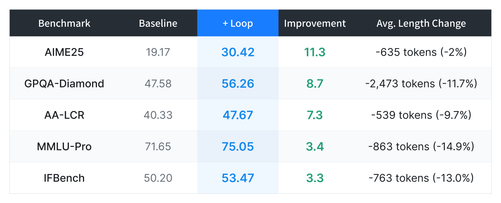
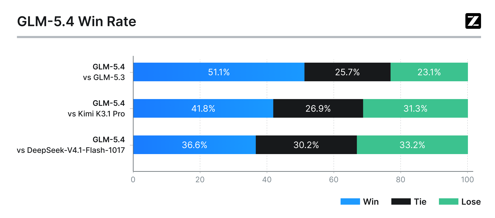

GLM-5.4 sends every token through the same 28 layers twice. Z.ai released the model on November 23, 2026, as its first flagship built on a loop transformer: it takes the 750B-scale GLM-5 base, keeps its parameters, and runs layers 27 through 54 a second time so each token gets more computation. Z.ai says this lifts the model to the level of 2T–3T parameter models. The controlled evidence it published comes from a 30B test model, the flagship itself has no coding benchmark table yet, and the weights will follow later.

The loop is the main technical change in this release, and most of the published numbers describe the loop rather than the finished model. Early testers found GLM-5.4 slow but useful for code review and security work, and both the public API and the open weights are still pending. Inkling 2 Mini, released three days earlier by Thinking Machines Lab, loops its layers too, which makes it a useful point of comparison for how the two designs differ.

## GLM-5.4 Loop Transformer Architecture: 78 Layers, 106 Passes per Token {#architecture}

GLM-5.4 stores 78 layers and runs 106 of them per token. Z.ai's diagram splits the stack into three parts: a 26-layer prelude (layers 1–26) that runs once, a 28-layer loop block (layers 27–54) that runs twice with the same weights, and a 24-layer coda (layers 55–78) that runs once before the output head.

*GLM-5.4's loop layout. The prelude and coda run once; layers 27–54 run in Loop Pass 1 and again, with shared weights, in Loop Pass 2. Source: Z.ai, "GLM-5.4: Toward Generalized Coding with Our First Loop Transformer."*

The 106 figure is our count from the diagram: 26 + 28 × 2 + 24. That is about 36% more layer applications per token than the same 78 layers would get in a single pass, with no new parameters. Z.ai describes the trade it is making in its blog: memory-heavy tasks benefit from more parameters, while reasoning-heavy tasks such as large software projects, security work, 3D modeling and physical control benefit from more computation per token.

Two other details in the diagram matter for readers comparing it with GLM-5.3. The input embedding combines text embeddings with projected features from a 24-layer vision encoder, which is where GLM-5.4's new image and video input enters the model. And the attention blocks are DSA blocks with a sparse-attention indexer, which GLM-5.4 inherits from its base.

The loop was added after pre-training. Z.ai writes that looped models trained from scratch "still lag behind unshared models under the same pre-training compute budget," so it took the pre-trained GLM-5 base and converted it through continued training. Before committing the flagship, the team tested the same conversion on 1B, 4B and 30B base models.

## How GLM-5.4 Makes the Second Pass Affordable: Gates, KV Cache and Index Reuse {#second-pass}

GLM-5.4 keeps the second pass cheap with three changes: gates that control how much each pass writes back, a KV cache that the second pass mostly borrows from the first, and attention indices computed once and reused. Without them, a second pass would destabilize activations and double the cache.

### Gated progressive updates

When Z.ai turned the middle layers of a finished model into a loop, letting each pass overwrite the hidden state made activation norms grow from one iteration to the next. The coda layers then received inputs outside the range they had been trained on.

GLM-5.4 adds a separate gate per token for each pass. The diagram writes it as x₁ = x₀ + β₁(h₁ − x₀): the pass computes a candidate h, and the gate β decides what fraction of the change goes back into the residual stream. Z.ai reports that after training the two gates split the work. The first pass builds global context with small gate values, and the second pass opens its gate and writes full updates. On harder tokens the first pass writes more aggressively, so difficult predictions get more of the refinement.

### Hybrid KV cache with a 128-token sliding window

A straightforward loop would keep a full KV cache for every pass, so memory would grow with the loop count. In GLM-5.4 the second pass reads the sparse KV entries the first pass already selected (the diagram labels this a per-layer cache with top-k of 2,048) and keeps only its own newly generated KV inside a 128-token sliding window.

The diagram calls the result a two-bank sparse MLA: a single softmax over both the first pass's sparse prefix and the second pass's local window. An extra loop therefore costs one sliding window of cache, not a second full-context cache. Z.ai says this keeps GLM-5.4's deployment cost increase over GLM-5.3 "well under control" at 1M-token context, without giving a figure.

### Sparse attention index reuse

The base model's sparse attention uses an indexer to choose which tokens each query attends to. In GLM-5.4 the second pass skips its own indexer and reuses the indices from the first pass, so the loop adds no indexing work. Z.ai says its experiments show this performs "nearly identically" to recomputing indices on every pass; it does not publish those numbers.

On top of these, Z.ai fused core kernels to cut intermediate memory reads and writes, and reports serving speeds of up to 200 tokens per second off-peak and 70–80 tokens per second at peak load on its own service.

## GLM-5.4 Benchmarks: What the 30B Loop Ablation Shows {#benchmarks}

The cleanest GLM-5.4 benchmark evidence Z.ai has published measures the loop on a 30B model, not on GLM-5.4. The 30B model has the same architecture as the 750B base. Z.ai compared a looped and an unlooped version with identical parameter counts, the looped one using about 10% more total training compute, and evaluated both after 200K long-context supervised fine-tuning with thinking mode on.

*Z.ai's 30B iso-parameter ablation, looped versus baseline. Source: Z.ai GLM-5.4 blog.*

| Benchmark (30B test model) | Baseline | + Loop | Change | Average output length |
|---|---|---|---|---|
| AIME25 | 19.17 | 30.42 | +11.3 | −635 tokens (−2%) |
| GPQA-Diamond | 47.58 | 56.26 | +8.7 | −2,473 tokens (−11.7%) |
| AA-LCR | 40.33 | 47.67 | +7.3 | −539 tokens (−9.7%) |
| MMLU-Pro | 71.65 | 75.05 | +3.4 | −863 tokens (−14.9%) |
| IFBench | 50.20 | 53.47 | +3.3 | −763 tokens (−13.0%) |

The gains are largest on math (AIME25), scientific reasoning (GPQA-Diamond) and long-context reasoning (AA-LCR), and smallest on instruction following (IFBench). The outputs also got shorter: on four of the five tests the looped model wrote 9.7–14.9% fewer tokens, and on AIME25 the drop was 2%. Z.ai reads this as part of the reasoning moving out of the visible chain of thought and into the extra depth of the loop.

The flagship-level claims rest on thinner ground. The "comparable to 2T–3T parameter models" line comes with no explanation of how it was derived, a point VentureBeat also raised. Z.ai's documentation adds a win-rate chart for GLM-5.4 against three models, also without a described method, test set or judge.

*GLM-5.4 win rates as published in Z.ai's developer documentation. Z.ai does not describe the tasks or how wins were judged. Source: Z.ai docs.*

### GLM-5.4 vs GLM-5.3 and other models in the win-rate chart

Against GLM-5.3, GLM-5.4 wins 51.1% of comparisons, ties 25.7% and loses 23.1%. The margin narrows against outside models: 41.8% wins to 31.3% losses against Moonshot AI's Kimi K3.1 Pro and 36.6% to 33.2% against DeepSeek-V4.1-Flash-1017. Without the task list, these read as Z.ai's internal preference results. There is no SWE-bench, Terminal-Bench or other coding score for GLM-5.4 in either the blog or the docs.

## GLM-5.4 vs Inkling 2 Mini: Two Ways to Loop a Transformer {#vs-inkling-2-mini}

GLM-5.4 and Inkling 2 Mini both loop their middle layers, but at opposite ends of the size range and with different goals. Thinking Machines Lab released [Inkling 2 Mini](/tutorials/inkling-2-mini-ollama/) on November 20, 2026, three days before GLM-5.4, as an open-weights model small enough to run on a laptop.

| | GLM-5.4 | Inkling 2 Mini |
|---|---|---|
| Size | 750B-scale (active parameters not disclosed) | 26.4B MoE, 3.4B active |
| Stored layers | 78 | 24 |
| Looped region | Layers 27–54, run 2 times | Layers 7–18 (two six-layer blocks), run 3 times |
| Layer applications per token | 106 (our count from the diagram) | 48 |
| How the loop was added | Continued training of the pre-trained GLM-5 base | Built into training; a learned gate starts closed and opens over time |
| Cost-control trick | Shared KV cache plus 128-token window; reused sparse-attention indices | Each pass starts from the prelude output; the previous pass's message is gated in |
| Published compute evidence | 30B test: about 10% more training compute for the gains above | Unpruned test: the non-looped model trained on 7.5% less compute but needed 140% more inference compute to match the looped model's loss on 512K-token agentic traces |
| Weights | Not yet; promised after safety hardening | Open weights, about 20GB |

The two labs reach similar conclusions from different sides. Both place the loop in the middle of the stack and leave the first and last layers to translate in and out of the model's internal representation. Both use a learned gate to control how much a repeated pass changes the hidden state. And both report that looping buys reasoning rather than knowledge: Thinking Machines says plainly that looping "doesn't enable its weights to store more facts," which fits GLM-5.4's biggest gains landing on math and reasoning tests rather than on MMLU-Pro.

The difference is where the loop pays off. Inkling 2 Mini uses three passes to make a small model reason like a larger one on local hardware. GLM-5.4 uses two passes on a frontier-scale model and spends most of its engineering on keeping a 1M-token context affordable on Z.ai's servers.

## GLM-5.4 for Coding: Early Tests, Speed and Marathon Thinking {#coding}

Early coding tests put GLM-5.4 behind the fastest frontier models but find it useful for slow, careful work such as review and bug hunting. Z.ai pitches the model for what it calls Generalized Coding, using code to produce videos, games, 3D scenes and CAD models, and its launch demos include a six-axis robotic arm modeled in FreeCAD. The first outside numbers come from developers who ran it on their own tasks in the first hours after release.

The most detailed is from AICodeKing, who placed GLM-5.4 seventh on his KingBench 4 coding benchmark, as reported by VentureBeat. At maximum reasoning effort GLM-5.4 took 431 minutes and 1,128 steps to finish the suite. Google's Gemini 4 Neon took 109 minutes and 244 steps on the same run. His advice was to keep GLM-5.4 "as a reviewer," for complex architecture work and for "searching for bugs, security vulnerabilities," rather than as the only model. Migel Tissera, also cited by VentureBeat, said GLM-5.4 completed a multistep remote code execution chain when he used it as a black-box attacker against a private lab environment.

The complaints point the same way. A widely discussed r/LocalLLaMA post described GLM-5.4 as strong at coding but poor at writing and most other tasks, and said about half of its chain of thought went to deliberating whether something was acceptable. Z.ai's own blog names the model's main limitation as a tendency to get caught in overly long "marathon thinking" loops, while saying the extra self-correction still raises accuracy.

That profile suggests a practical split for coding agents:

- Use GLM-5.4 where a second, slower look is worth the wait: code review, security audits, tracing a bug through a large codebase.
- Route routine edits and quick iterations to faster models, and judge the mix by [cost per successful task](/tutorials/coding-agents-finops-cost-per-successful-task/) rather than per-token price.
- Cap reasoning effort, output tokens and agent turns so a marathon-thinking loop ends on its own. Inkling 2 Mini's model card warns of the same kind of long reasoning loop, and our [Inkling 2 Mini agent setup notes](/tutorials/inkling-2-mini-ollama/#inkling-2-mini-coding-agents) list the limits that help.

Speed on Z.ai's hosted service is the other variable: up to 200 tokens per second off-peak and 70–80 at peak, by Z.ai's figures. For comparison with an outside benchmark that tracks time and tokens per task, see [Gemini 4 Neon's numbers](/tutorials/gemini-4-neon-benchmarks/).

## GLM-5.4 API, Pricing and Open Weights Status {#availability}

GLM-5.4 is available now only through Z.ai's own products: the GLM Coding Plan, the ZCode desktop app and Z.ai Chat. Z.ai lists the Model API as coming after a security assessment and says it will open-source the weights "after completing necessary safety hardening," with no date or license named.

Z.ai's documentation gives the model's limits as a 1M-token context window and up to 128K output tokens, with video, image, text and file input and text output; GLM-5.3 accepted text only. Coding Plan subscribers on weekly quotas get 1.5 times the GLM-5.3 quota for GLM-5.4.

Simon Willison found a path to the model from code today. The Coding Plan and the regular API share the same OpenAI-compatible endpoint at `https://api.z.ai/api/v1`, and a Coding Plan API key gave him access to GLM-5.4 through it, while regular API accounts could not yet reach the model. He also noted that his test drawings from GLM-5.4 looked similar in quality to GLM-5.3's.

There is no per-token price yet. For reference, VentureBeat cites Z.ai's docs pricing GLM-5.3 at $1.40 per million input tokens, $0.26 per million cached input tokens and $4.40 per million output tokens.

Teams that self-host GLM today should plan around GLM-5.3 for now. Its open weights already run in production, as in [Revolut's move of 2,000 engineers to self-hosted GLM](/tutorials/glm-for-coding/), and NVIDIA has shown how to [serve GLM-5.3 NVFP4 on two DGX Stations](/tutorials/glm-5-3-nvfp4/). When GLM-5.4's weights arrive, the loop changes the serving math: the stored weights stay roughly the size of the GLM-5 base, while each token runs 106 layer applications instead of 78, plus the extra sliding-window cache.

## References {#references}

1. Z.ai, ["GLM-5.4: Toward Generalized Coding with Our First Loop Transformer"](https://z.ai/blog/glm-5.4), November 23, 2026. Architecture diagram, 30B ablation table, serving speeds and availability.
2. Z.ai Developer Documentation, ["GLM-5.4 Overview"](https://docs.z.ai/guides/llm/glm-5.4), accessed November 24, 2026. Context length, output limit, input modalities, quota and win-rate chart.
3. Sean Michael Kerner, VentureBeat, ["Z.ai's GLM-5.4 aims to match models up to four times its size by running 28 layers twice"](https://venturebeat.com/technology/z-ais-glm-5-4-aims-to-match-models-up-to-four-times-its-size-by-running-28-layers-twice), November 23, 2026. Early tester results and GLM-5.3 API pricing.
4. Thinking Machines Lab, ["Introducing Inkling 2 Mini"](https://thinkingmachines.ai/news/inkling-2-mini/), November 20, 2026. Looping design and compute comparison.
5. Simon Willison, ["GLM-5.4: Toward Generalized Coding with Our First Loop Transformer"](https://simonwillison.net/2026/Nov/23/glm-54/), November 23, 2026. API access through the Coding Plan key.
