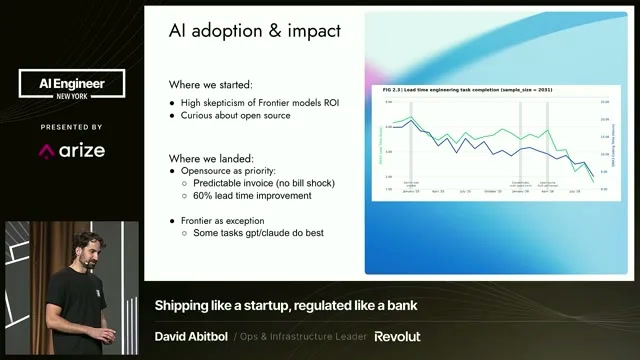
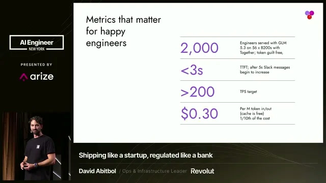
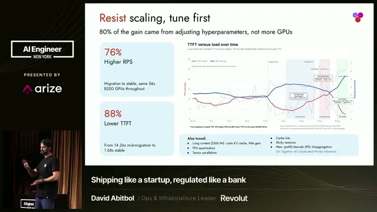

**GLM for coding** is now the default at Revolut. The fintech serves Z.ai's open-weight GLM-5.3 to about 2,000 engineers from a dedicated pool of 56 Nvidia B200 GPUs, and keeps Claude Code, Codex and Gemini for exceptions. David Abitbol, who leads AI operations at Revolut, described the move at AI Engineer New York (video posted October 29, 2026). He says the coding-token bill dropped to about a tenth of what Revolut had paid Anthropic and OpenAI, and that engineers no longer have to save tokens for the hardest tasks.

The talk spread widely this week after a post on X and a story in The Register on November 3. This guide covers how Revolut runs GLM coding at scale, what its numbers show, and where they stop.

## GLM for Coding at Revolut

Revolut uses GLM as its standard coding model, served from its own dedicated fleet rather than Z.ai's API. Revolut has about 80 million customers in 45 markets, according to Abitbol, and the deployment covers a sample of roughly 2,000 engineers.

The path ran through three stages:

- **January 2025:** Revolut rolled out Gemini, the first time staff could use private company data with AI.
- **Early 2026:** Claude Code launched at scale with strict budget limits. "We were seeing engineers spend a thousand a month, ten thousand a month with not so much ROI," Abitbol said.
- **April 2026:** Revolut began self-hosting open models, starting with GLM-5.1. "We're a big fan of GLM for coding," he said. It now runs GLM-5.3, which Z.ai released on August 14, 2026 with a 1M-token context window.

The aim, in his words, was to give engineers "unlimited tokens" so they could "use AI guilt-free for a fraction of the cost."

## GLM Coding Results: Coding Time and Lead Time

Revolut reports a 60% improvement in coding time and a 70% improvement in lead time after the GLM rollout. Lead time runs from picking up a feature to merging it, ready to deploy; coding time is the hours spent writing code. For comparison, the earlier Gemini rollout brought 20% on coding time and 10% on lead time, and the budget-capped Claude Code launch showed "not so much impact," Abitbol said.

*Lead time (days) and coding time (hours) across Revolut's engineers, January 2025 to July 2026. Image: Revolut slide via AI Engineer.*

Two caveats sit next to these numbers. The slide labels the lead-time gain as 60% while the spoken figure is 70%, and neither gives the comparison windows. The trends are observational: they do not separate GLM from other changes at Revolut over the same months.

Abitbol's explanation for the larger lead-time gain is that coding was not the bottleneck. Engineers with cheap tokens also used the model to dig through email and work in Jira and Confluence. "You no longer have to save your tokens for the end of the quarter or the most difficult task," he said.

## GLM vs Claude Code and Codex at Revolut

Revolut kept the frontier models for exceptions. "Open source is now a priority at Revolut," Abitbol said, "and the frontier is the exception. So obviously, we keep using Codex, Claude Code." Gemini stays in use too.

The split is economic. Frontier tools are billed by usage, which led to budget caps; the GLM fleet has a flat bill with "no bill shock" at the end of the month. Abitbol did not present a head-to-head quality benchmark between GLM and Claude or GPT models. Public leaderboards place GLM-5.3 below the frontier: BenchLM scores it 61 out of 100, 50th of 216 ranked models as of November 4. Revolut's case rests on cost and access to tokens.

## Self-Hosted GLM Hardware and Latency Targets

Serving GLM-5.3 to 2,000 engineers takes roughly 56 B200 GPUs, Abitbol said, for a model he puts at about 800 billion parameters. The Register notes that 56 GPUs equals seven eight-GPU DGX B200 systems, and that the earlier GLM-5.1 has about 754 billion total parameters with 40 billion active per token.

*Revolut's service targets and cost for its GLM fleet. Image: Revolut slide via AI Engineer.*

The slide says the fleet runs "with Together," and the tuning slide refers to Together AI's dedicated model inference. "Self-hosted" here means dedicated GPUs running weights Revolut controls. The talk does not say whether Revolut owns or rents the GPUs, or where they sit.

The service targets come from user complaints:

- **Time to first token under 3 seconds.** "As soon as you exceed five second, my Slack inbox starts to blow up."
- **About 200 tokens per second** is enough. Engineers run tasks in parallel and check back later instead of watching the stream.
- **Off-peak speed** reaches about 800 tokens per second after 5 p.m., when the GPUs are idle.

## Self-Hosted GLM Cost per Million Tokens

Revolut's blended cost is $0.30 per million tokens, with input and output at the same rate and cached tokens free, according to the slide. Abitbol said the resulting invoice is one-tenth of what Revolut had spent with Anthropic and OpenAI. That 90% figure compares bills; the talk gives no matched usage periods and does not count the engineering time to run the service.

For a reference point, Together lists GLM-5.3 on its shared API at $1.40 per million input tokens and $4.40 per million output tokens. SemiAnalysis measured GLM-5 on B200 GPUs with NVFP4 weights at $0.29 per million tokens at 80 tokens per second per user, a different model version under benchmark conditions. Revolut's $0.30 is in that range for a well-utilized dedicated fleet. Our guide to [cost per successful task](/tutorials/coding-agents-finops-cost-per-successful-task/) explains why token price is only one input to coding-agent economics.

## How to Tune a Self-Hosted LLM for Coding

Tuning delivered most of Revolut's performance gain. Between April and August, on the same 56 B200 GPUs, time to first token fell from 14.26 seconds mid-migration to 1.68 seconds, while demand rose 76% in requests per second. Abitbol credits 80% of that gain to adjusting serving parameters and tells teams to "resist scaling."

*Time to first token against load over the migration, same 56 B200 GPUs throughout. Image: Revolut slide via AI Engineer.*

The settings he named:

- **Context length.** "Long context is a scam," Abitbol said. GLM-5.3 can serve 1M tokens, but 256K is what Revolut's coding work needs, and longer windows eat KV-cache memory.
- **Precision.** On Blackwell GPUs he recommends FP4 and cites roughly 40% less GPU footprint with no precision loss in Revolut's use. The spoken comparison mixes up FP4 and FP8, so treat 40% as his estimate.
- **Tensor parallelism.** GLM fits on TP4, but that leaves too little KV cache; TP8 may work better at Revolut's load.
- **Cache hit rate.** Coding workloads should stay above 90% prefix-cache hits.
- **Other levers:** speculative decoding and prefill/decode disaggregation, which The Register also lists alongside NVFP4.

Public recipes exist for smaller setups. One developer publishes an SGLang configuration for GLM-5.3-Flash in NVFP4 on four B200 GPUs, built from about 100,000 requests a day. In the public discussion, one commenter testing GLM reported correctness bugs at large contexts in vLLM, so the serving engine choice deserves its own test.

## GLM Image Input and Coding Harness

GLM runs text-only in Revolut's setup, so image work goes elsewhere. Abitbol would rather "get the smarter model and figure out how to do image recognition another way." A local router sends image recognition to Gemini or another vision model and keeps GLM on the main task. Where vision matters, a vision-capable GLM Flash model serves Revolut's UI designers.

The harness stays the same. Revolut's endpoints are OpenAI-compatible and support the Responses API, so engineers use them inside OpenCode, Claude Code, Codex and the Codex app. Engineers kept their coding interface when inference moved to open weights. Tools such as [T3 Code](/tutorials/t3-code/) take the same approach from the other side, running several harnesses from one UI. For the layer between apps and models, see [how model gateways handle routing, budgets and audit](/tutorials/model-gateway-enterprise-ai-control-plane/).

## Self-Hosted Open Model Compliance for Banks

Revolut is an EU-regulated bank, and Abitbol addressed the concern about Chinese open models directly. Revolut downloads the weights and runs them on a US-based service; no inference traffic goes to an endpoint in China. The Register reports the same point.

His compliance setup has four parts:

- **Human in the loop by design.** A sandbox sets which operations an agent may run, for example allowing `grep` but not Gradle. That shows a regulator the coding agent is supervised, not autonomous, and limits rogue internal use and prompt injection.
- **Data location.** GPUs sit in countries covered by data-equivalence arrangements; he named the US, EU, UK and Israel.
- **Retention.** Inference and GPU providers offer zero data retention by default, in his account.
- **Telemetry.** Strong OpenTelemetry logging lets the team reconstruct any incident and track usage.

These points describe Revolut's own framing; other providers and regulators may set different terms. Our piece on [the security boundary for AI agents with internal access](/tutorials/ai-agent-internal-access-security-boundary/) covers the sandbox and identity side in more depth.

## Is a Self-Hosted LLM for Coding Worth It

Revolut's numbers favor a self-hosted LLM for coding at its scale: a flat bill, about a tenth of the old invoice, and 18 months of internal data showing faster delivery. Smaller teams face a different calculation.

The public discussion put rough numbers on it. One commenter estimated 56 B200 GPUs at $2.5–3 million in hardware plus operating costs, paying back in about a year if a company had been spending $500,000 to $1 million a month on tokens. That assumes bought hardware; Revolut's slide points to a provider-run dedicated fleet, which changes the math. Others noted that the B200 launched in 2024 and will depreciate, and that small frontier models such as Claude Haiku are also cheap per token. Another asked what "blended" means; it is an average across input and output, so the real cost depends on each team's input-to-output ratio.

For a smaller team, open-weight models on a shared API or a smaller local model are the nearer options. Our review of [Ripple-65B Preview](/tutorials/ripple-65b-preview/) covers an open-weight coding model that runs on a single DGX Spark.

## References

- David Abitbol (Revolut), [How Revolut Cut AI Coding Costs 90% With Self-Hosted Open Models](https://ai.engineer/talks/Ok6QdZHCcI8-revolut-cut-ai-coding-costs-90-self), AI Engineer New York, video posted Oct 29, 2026
- Tobias Mann, [Revolut slashes AI coding costs 10x by cutting out Claude and going self-hosted](https://www.theregister.com/ai-and-ml/2026/11/03/british-fintech-revolut-slashes-ai-coding-costs-10x-by-cutting-out-claude-and-going-self-hosted/5307345), The Register, Nov 3, 2026
- Together AI, [GLM-5.3 model page and pricing](https://www.together.ai/models/glm-5-3), checked Nov 5, 2026
- SemiAnalysis InferenceX, [B200 NVFP4 vs H200 FP8 on GLM-5](https://inferencex.semianalysis.com/blog/b200-glm5-nvfp4-vs-h200-fp8-3-6x-perf-per-dollar), May 26, 2026
- Hacker News, [Revolut moves to self-hosted GLM](https://news.ycombinator.com/item?id=50350004), discussion, Nov 2026
